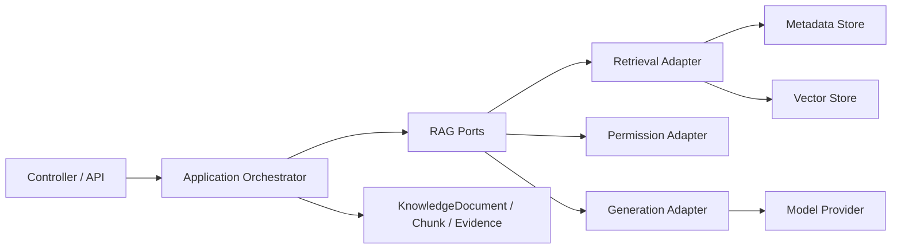

# D25 RAG 模块边界与依赖方向

## 1. 当前实现与目标边界

当前项目只有：

```text
classpath 预切分 JSON
 -> bigram keyword retrieval
 -> CitationRegistry
 -> existing chat generation
```

它不是完整 RAG：没有解析、通用切分、Embedding、向量库和知识 ACL。

## 2. 职责表

| 职责 | 输入 | 输出 | 依赖 | 本轮状态 |
|---|---|---|---|---|
| Knowledge Ingestion | 来源文件/系统、业务身份 | DocumentVersion、内容哈希 | 文件/对象存储、来源系统 | 当前仅静态教学 JSON；后续规划 |
| Parsing | DocumentVersion、解析器配置 | 结构化文本/页码/章节 | 文档解析器 | 当前语料预解析；后续规划 |
| Chunking | 解析结果、切分版本 | Chunk generation | Parser、确定性 ID | 当前语料预切分；后续规划 |
| Metadata | Document/Chunk 属性、版本、ACL 引用 | 可过滤元数据 | 权限/设备字典 | 现有仅 7 个 Chunk 字段；本轮定义完整契约 |
| Embedding | Active Chunk、Embedding 模型 | 向量和模型版本 | Embedding Provider | 未实现；后续规划 |
| Vector Store | 向量、metadata、索引版本 | 检索候选、删除/重建 | 向量数据库 | 未实现 |
| Permission Filter | 用户上下文、permissionPolicyId | 允许/拒绝 | 身份/权限服务 | 未实现；必须早于证据暴露 |
| Retrieval | Query、filter、topK | Scored Evidence | keyword 或 vector adapter、ACL | 已有 keyword；后续替换/扩展 |
| Context Assembly | Authorized Evidence | 编号证据上下文 | CitationRegistry | 已有 |
| RAG Generation | Context、用户问题 | Answer + citations | AiChatService | 已有通用生成；无完整 RAG 向量 |
| Evaluation | 固定问题/资料版本 | 决策、Recall/MRR、证据正确性 | 评测运行器 | 本轮定义 JSON 基线 |

## 3. 依赖方向



- Controller/业务服务依赖内部 Port 和领域模型。
- Provider SDK、向量数据库客户端、文件存储 SDK只存在于 Adapter。
- `KnowledgeDocument/Chunk/Evidence` 不依赖 Spring AI、向量库或数据库类型。
- 不要求拆成多个 Maven 模块；先保持包/接口边界。

## 4. 建议的逻辑包边界

```text
knowledge.domain
knowledge.application
knowledge.port
knowledge.adapter.retrieval
knowledge.adapter.vector
knowledge.adapter.persistence
knowledge.adapter.parser
knowledge.evaluation
```

当前阶段只设计，不创建生产代码或新依赖。

## 5. 权限处理顺序

```text
用户身份/租户/工厂
 -> 权限服务解析 permissionPolicyId
 -> 元数据与 ACL 过滤
 -> 向量/关键词召回
 -> 应用层二次 ACL 校验
 -> Context Assembly
 -> Generation
```

禁止：

- 先返回证据再由模型判断权限。
- 将 ACL 仅当作普通标签。
- 在回答/错误中暴露受限文档标题、数量或存在性。

## 6. 版本/索引一致性

- Active DocumentVersion 决定可检索 Chunk generation。
- Chunk generation 决定索引版本。
- Embedding version与 chunker/parser 分开。
- 发布切换使用 active version 指针，新索引验证后才能替换。
- 旧版本/向量/缓存进入 STALE，不原地覆盖。
- 查询结果必须带 documentVersion/chunkGeneration，评测可复现。

## 7. 本轮不实施

- 不新增数据库表。
- 不新增向量库/Embedding/文档解析器依赖。
- 不把设计 schema 自动变成生产实体。
- 不运行未实现的 RAG 端到端评测。
