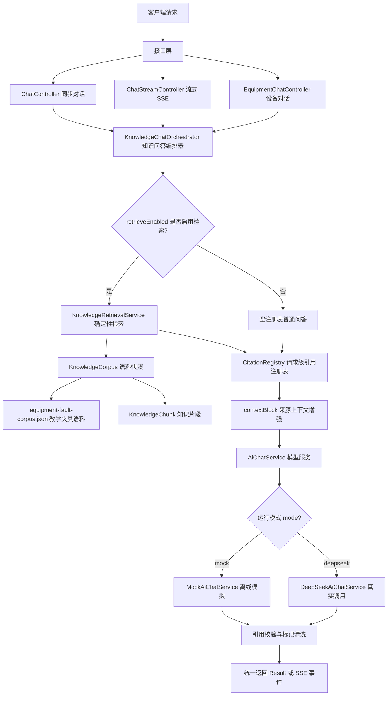
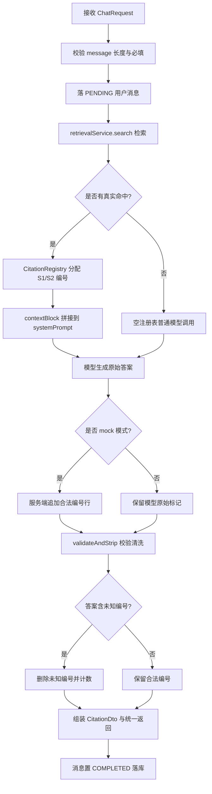
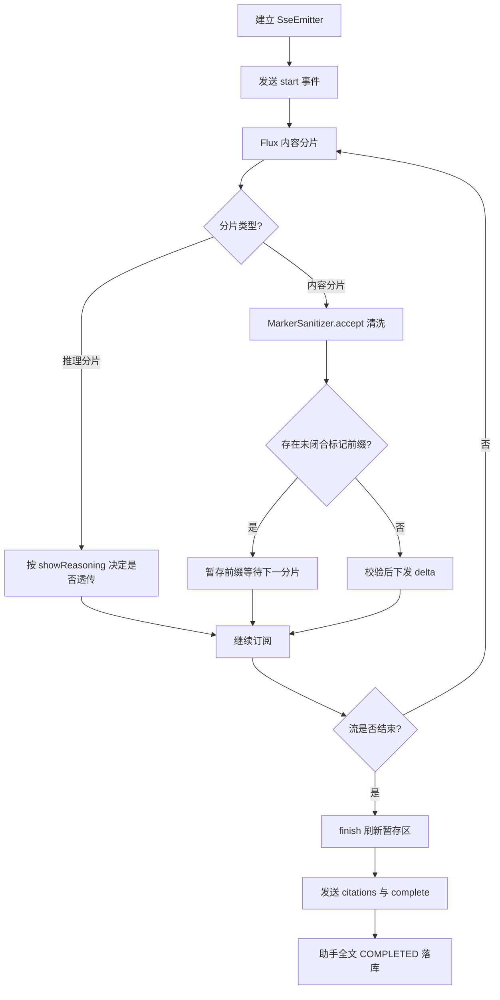

# D25 RAG 架构图（初稿 v1）

> 模块：`D25_DKDCM_RAC`（artifactId），主题：RAG 架构与评测设计
> 技术基线：JDK 21 ｜ Spring Boot 3.5.16 ｜ Spring AI 1.1.8 ｜ MyBatis-Plus 3.5.17
> 说明：本架构图基于本地真实代码绘制，当前检索为「classpath 语料 + 确定性关键词评分」的最小可替换端口，**不是向量库、不依赖 Embedding**。

---

## 一、架构定位

当前实现是一个**可替换的最小检索端口**：

- 真实数据来源唯一：classpath 下 `equipment-fault-corpus.json`，启动时扁平化为不可变 `KnowledgeChunk` 列表；
- 检索不依赖向量数据库：对问题做字符二元组（bigram）切分，在标题/章节/摘录上做可复现的关键词命中评分；
- 引用可信：编号由请求级 `CitationRegistry` 按真实命中分配，模型无法凭空创建可映射来源；
- 演进点：后续接入真实 RAG（Embedding + 向量库）时，只需替换检索实现，请求级引用映射与校验契约保持不变。

---

## 二、组件职责一览

| 层次 | 组件 | 职责 |
|------|------|------|
| 接口层 | `ChatController` / `ChatStreamController` / `EquipmentChatController` | 同步对话、SSE 流式对话、设备领域对话入口 |
| 编排层 | `KnowledgeChatOrchestrator` | 串联「检索 → 提示词增强 → 模型调用 → 引用校验」 |
| 检索层 | `KnowledgeRetrievalService` | bigram 切词 + 确定性评分，返回真实命中片段 |
| 语料层 | `KnowledgeCorpus` / `KnowledgeChunk` | 加载并扁平化语料，提供不可变片段快照 |
| 引用层 | `CitationRegistry` | 请求级编号分配、上下文拼装、同步/流式标记清洗 |
| 模型层 | `AiChatService`（`MockAiChatService` / `DeepSeekAiChatService`） | 离线模拟与真实模型调用两种实现 |
| 持久化 | MySQL `chat_session`/`chat_message`/`prompt_template` | 会话、消息、模板权威存储 |
| 缓存 | Redis | 模板读缓存、会话短期存储（学习资产） |
| 横切 | `TraceIdFilter` / 访问日志 / 重试策略 / `ModelCallRecorder` | 链路追踪、脱敏日志、失败重试、Token 用量观测 |

---

## 三、RAG 总体分层架构图

---

## 四、同步知识问答链路流程图

---

## 五、流式 SSE 链路与引用边界图

---

## 六、引用可信边界（关键设计）

1. **请求级隔离**：`CitationRegistry` 是方法栈内局部对象，不放入 Spring 容器、不跨请求共享；
2. **编号只来自真实命中**：后端按检索顺序分配 `S1`、`S2`……模型只能使用这些编号；
3. **未知编号必被清洗**：同步走 `validateAndStrip`，流式走 `MarkerSanitizer`，未知 `[Sn]` 在下发前删除并计数；
4. **资料即数据**：`contextBlock` 明确告知模型资料中的指令性文字一律按普通数据处理，防御提示注入。

---

## 七、向真实 RAG 演进的替换点

| 当前实现 | 未来真实 RAG | 不变的契约 |
|----------|--------------|------------|
| `KnowledgeCorpus` 读 classpath JSON | 文档加载器对接文件/对象存储/数据库 | `KnowledgeChunk` 片段模型 |
| bigram 关键词评分 | Embedding 向量化 + 向量库相似度检索 | 检索返回真实片段、无命中返回空 |
| 内存语料快照 | 向量库 + 元数据过滤 | `CitationRegistry` 编号与校验 |
| 单机教学夹具 | 多文档、增量更新、权限隔离 | 请求级引用映射与清洗 |

> 结论：检索实现可整体替换，但 `KnowledgeChunk` 模型、请求级 `CitationRegistry`、引用编号清洗规则应保持稳定，避免上层接口与前端契约返工。
