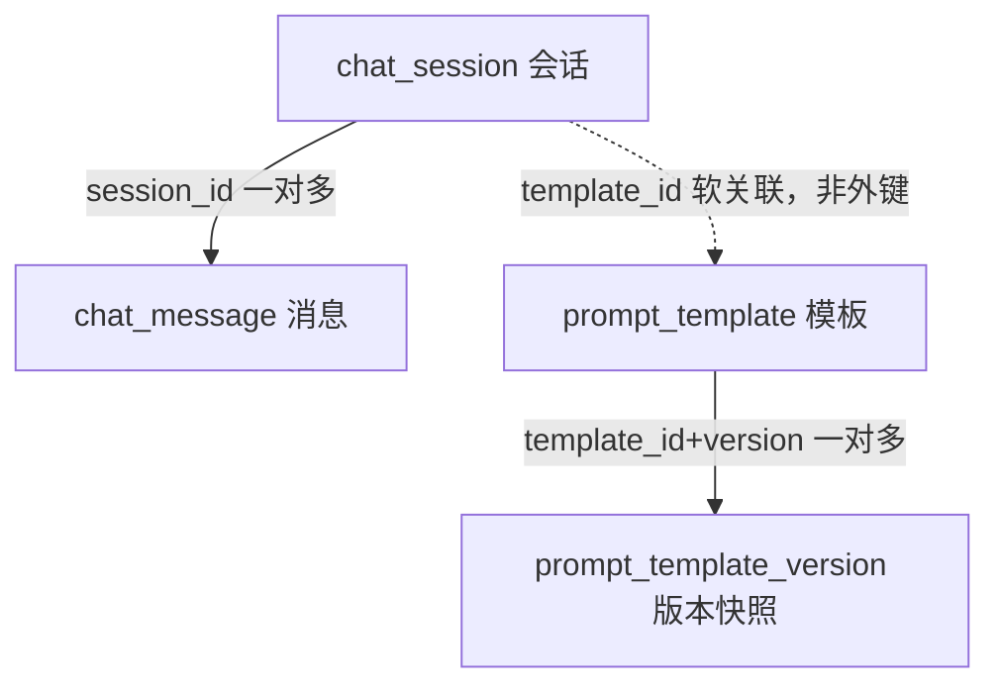

# D25 RAG 数据模型初稿（v1）

> 模块：`D25_DKDCM_RAC` ｜ 数据库：MySQL 8.x，库名 `ai_db`，引擎 InnoDB，字符集 utf8mb4
> 说明：本文分三部分——已落库物理表（真实 DDL）、领域/内存模型（record）、面向真实 RAG 的建议新增模型（**当前未实现**）。

---

## 一、存储分工总览

| 存储 | 角色 | 内容 |
|------|------|------|
| MySQL | 权威持久化 | 会话、消息、Prompt 模板及版本快照 |
| Redis | 缓存/短期存储 | 模板读缓存、会话短期存储（学习资产，非主链路） |
| classpath | 只读语料 | `knowledge/equipment-fault-corpus.json`，启动加载为 `KnowledgeChunk` |

---

## 二、物理表模型（已实现，共 4 张）

### 2.1 `chat_session` 对话会话表

| 字段 | 类型 | 约束/默认 | 说明 |
|------|------|-----------|------|
| `id` | BIGINT | PK，自增 | 代理主键 |
| `session_id` | VARCHAR(64) | NOT NULL，唯一 | 业务会话标识，UUID 去横线 |
| `owner_id` | VARCHAR(64) | 默认 `dev-user` | 开发归属标识，非生产鉴权 |
| `scene` | VARCHAR(64) | 默认空串 | 角色场景，普通链路为空 |
| `title` | VARCHAR(200) | 默认空串 | 首条用户消息安全截断 |
| `template_id` | VARCHAR(64) | 默认空串 | 角色链路绑定模板 |
| `template_version` | INT | 默认 0 | 绑定时刻模板版本 |
| `status` | VARCHAR(16) | 默认 `ACTIVE` | ACTIVE/CLOSED |
| `created_at` | DATETIME | NOT NULL | 创建时间 |
| `updated_at` | DATETIME | NOT NULL | 更新时间 |
| `last_message_at` | DATETIME | NOT NULL | 最近消息时间 |

索引：`uk_session_id`（唯一）、`idx_owner_status(owner_id,status,last_message_at)`。

### 2.2 `chat_message` 对话消息表

| 字段 | 类型 | 约束/默认 | 说明 |
|------|------|-----------|------|
| `id` | BIGINT | PK，自增 | 代理主键 |
| `session_id` | VARCHAR(64) | NOT NULL | 所属会话业务标识 |
| `owner_id` | VARCHAR(64) | NOT NULL | 冗余归属，便于隔离校验 |
| `sequence_no` | INT | NOT NULL | 会话内单调递增，从 1 开始 |
| `role` | VARCHAR(16) | NOT NULL | user/assistant |
| `content` | TEXT | NOT NULL | 消息正文 |
| `status` | VARCHAR(16) | NOT NULL | PENDING/COMPLETED/FAILED/INTERRUPTED |
| `model_name` | VARCHAR(64) | 默认空串 | 产出消息的模型名 |
| `error_code` | VARCHAR(32) | 默认空串 | 失败/中断错误码 |
| `error_message` | VARCHAR(500) | 默认空串 | 安全错误摘要，不含堆栈密钥 |
| `created_at` | DATETIME | NOT NULL | 落库时间 |
| `updated_at` | DATETIME | NOT NULL | 状态变更时间 |

索引：`uk_session_sequence(session_id,sequence_no)`（唯一）、`idx_session_status(session_id,status,sequence_no)`。

### 2.3 `prompt_template` Prompt 模板表

| 字段 | 类型 | 约束/默认 | 说明 |
|------|------|-----------|------|
| `id` | BIGINT | PK，自增 | 代理主键 |
| `template_id` | VARCHAR(64) | NOT NULL，唯一 | 业务稳定标识，创建后不可改 |
| `name` | VARCHAR(100) | NOT NULL | 展示名称 |
| `scene` | VARCHAR(64) | NOT NULL | 场景/角色标识 |
| `description` | VARCHAR(500) | 默认空串 | 用途说明 |
| `content` | TEXT | NOT NULL | 模板正文，ST4 单大括号占位符 |
| `variables` | JSON | NOT NULL | 变量声明 JSON 数组 |
| `version` | INT | 默认 1 | 更新自增 |
| `status` | VARCHAR(16) | 默认 `ENABLED` | ENABLED/DISABLED |
| `deleted` | TINYINT(1) | 默认 0 | 逻辑删除：0 未删 1 已删 |
| `created_at` | DATETIME | NOT NULL | 创建时间 |
| `updated_at` | DATETIME | NOT NULL | 最近更新时间 |

索引：`uk_template_id`（唯一）、`idx_scene_status_deleted(scene,status,deleted)`。

### 2.4 `prompt_template_version` 模板不可变版本快照

| 字段 | 类型 | 约束 | 说明 |
|------|------|------|------|
| `id` | BIGINT | PK，自增 | 代理主键 |
| `template_id` | VARCHAR(64) | NOT NULL | 稳定模板标识 |
| `version` | INT | NOT NULL | 内容版本 |
| `name` | VARCHAR(100) | NOT NULL | 快照时名称 |
| `scene` | VARCHAR(64) | NOT NULL | 快照时场景 |
| `description` | VARCHAR(500) | 默认空串 | 快照时用途 |
| `content` | TEXT | NOT NULL | 快照时正文 |
| `variables` | JSON | NOT NULL | 快照时变量声明 |
| `status` | VARCHAR(16) | NOT NULL | 快照时启停状态 |
| `captured_at` | DATETIME | NOT NULL | 快照落库时间 |

索引：`uk_template_version(template_id,version)`（唯一）、`idx_template_captured(template_id,captured_at)`。

---

## 三、表关系图（ER）

> 说明：表间均为应用层软关联，**未建物理外键**，会话通过 `template_id` 引用模板，便于独立运维与逻辑删除。

---

## 四、领域/内存模型（不落关系表）

### 4.1 `KnowledgeChunk` 知识片段（record，8 字段）

| 字段 | 类型 | 说明 |
|------|------|------|
| `documentId` | String | 文档稳定标识 |
| `chunkId` | String | 片段稳定标识 |
| `title` | String | 文档标题/文件名 |
| `sourceType` | String | 来源类型 |
| `section` | String | 章节，可 null |
| `page` | Integer | 页码，可 null |
| `excerpt` | String | 片段摘录原文（不可信数据） |
| `url` | String | 数据源链接，可 null，禁止本机绝对路径 |

### 4.2 `CitationDto` 引用项（record，9 字段）

字段：`id`、`documentId`、`chunkId`、`title`、`sourceType`、`section`、`page`、`excerpt`、`url`；`NON_NULL` 隐藏空字段。

### 4.3 `EquipmentTicketCandidate` 工单候选（只读，record）

字段：`symptomSummary`、`ticketCategory`、`deviceModel`、`faultCode`、`deviceIdentifier`、`observedSymptoms`、`missingInformation`、`uncertaintyNote`、`candidateStatus`、`sourceType`、`candidateOnly`（固定 true）。

受控字典枚举：

| 枚举 | 取值 |
|------|------|
| `TicketCategory` | MECHANICAL、THERMAL_COOLING、ELECTRICAL、CONTROL_SENSOR、SAFETY_RISK、UNCLASSIFIED |
| `CandidateStatus` | CANDIDATE、NEEDS_CLARIFICATION |
| `CandidateSourceType` | USER_DESCRIPTION、CONVERSATION_SUMMARY |

---

## 五、面向真实 RAG 的建议新增模型（当前未实现）

> 以下为设计建议，**数据库中尚不存在对应表**，供接入 Embedding + 向量库时评审。

### 5.1 建议 `knowledge_document` 文档表

| 建议字段 | 类型 | 说明 |
|----------|------|------|
| `id` | BIGINT | 主键 |
| `document_id` | VARCHAR(64) 唯一 | 稳定文档标识，对齐现有 `KnowledgeChunk.documentId` |
| `title` | VARCHAR(200) | 文档标题 |
| `source_type` | VARCHAR(32) | MANUAL/GUIDE/SPEC 等 |
| `url` | VARCHAR(500) | 数据源链接，可空 |
| `status` | VARCHAR(16) | ACTIVE/ARCHIVED |
| `version` | INT | 文档版本 |
| `created_at` / `updated_at` | DATETIME | 时间戳 |

### 5.2 建议 `knowledge_chunk` 片段表（元数据 + 向量映射）

| 建议字段 | 类型 | 说明 |
|----------|------|------|
| `id` | BIGINT | 主键 |
| `document_id` | VARCHAR(64) | 所属文档 |
| `chunk_id` | VARCHAR(64) 唯一 | 稳定片段标识 |
| `section` | VARCHAR(200) | 章节 |
| `page` | INT | 页码 |
| `excerpt` | TEXT | 片段原文 |
| `token_count` | INT | 切分 Token 数，用于上下文预算 |
| `embedding_id` | VARCHAR(128) | 向量库中的向量主键 |
| `metadata` | JSON | 扩展元数据 |
| `created_at` | DATETIME | 落库时间 |

### 5.3 向量存储分工建议

- 关系库（MySQL）：保存文档/片段元数据与 `embedding_id` 映射；
- 向量库：保存 `embedding_id → embedding 向量`，执行相似度检索；
- 检索结果仍回灌现有 `KnowledgeChunk` 与 `CitationRegistry`，保持引用契约不变。

---

## 六、待确认事项

1. 是否启用物理外键（当前为软关联），建议保持软关联以适配微服务与逻辑删除；
2. 向量库选型（独立向量库/关系库向量插件）决定 `embedding_id` 与元数据拆分方式；
3. 多租户/权限隔离字段（如 `tenant_id`）当前未建模，生产化需补充。
