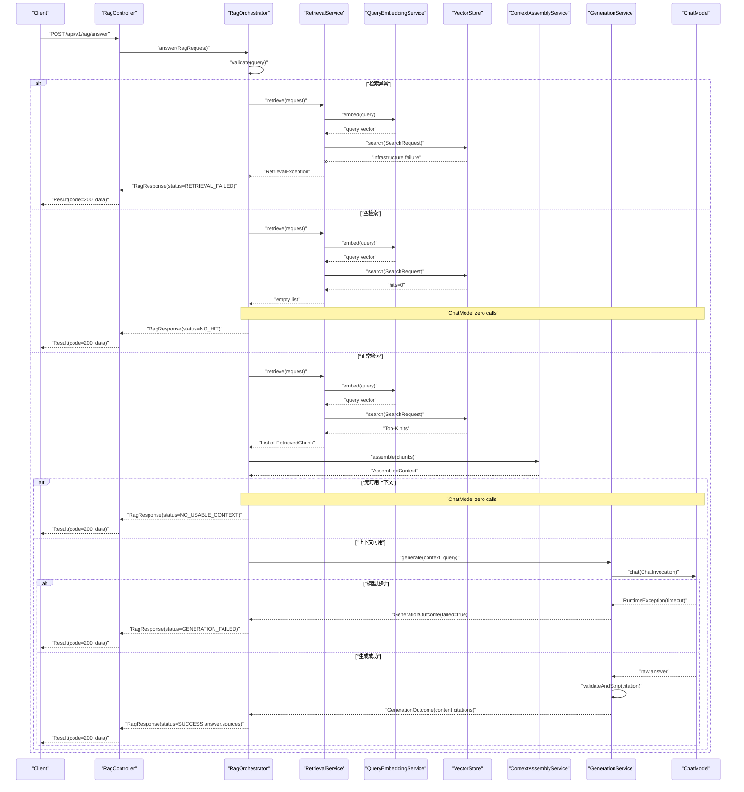

# D33 RAG 最小闭环调用链时序图（Mermaid sequenceDiagram）

Typora 0.11.18 兼容；参与方：Client / RagController / RagOrchestrator / RetrievalService /
QueryEmbeddingService / VectorStore / ContextAssemblyService / GenerationService / ChatModel。
分支覆盖：正常流 / 空检索跳过 ChatModel / 无可用上下文跳过 ChatModel / 检索异常 / 模型超时。

## 关键不变量（与图中分支一一对应）

1. 只有 `else "上下文可用"` 分支会触达 `ChatModel`；其余拒绝路径（NO_HIT /
   NO_USABLE_CONTEXT / RETRIEVAL_FAILED）均可由测试以 `verifyNoInteractions` 核验零调用。
2. `RETRIEVAL_FAILED` 与 `NO_HIT` 严格区分：前者是 `VS--xRS` 异常路径，绝不伪装成空检索。
3. `GENERATION_FAILED` 仅在组装成功之后出现，此时来源列表（sources）仍完整返回。
4. 引用编号只在本轮请求内有效（S1..Sn 由 CitationRegistry 按进入顺序分配）。
