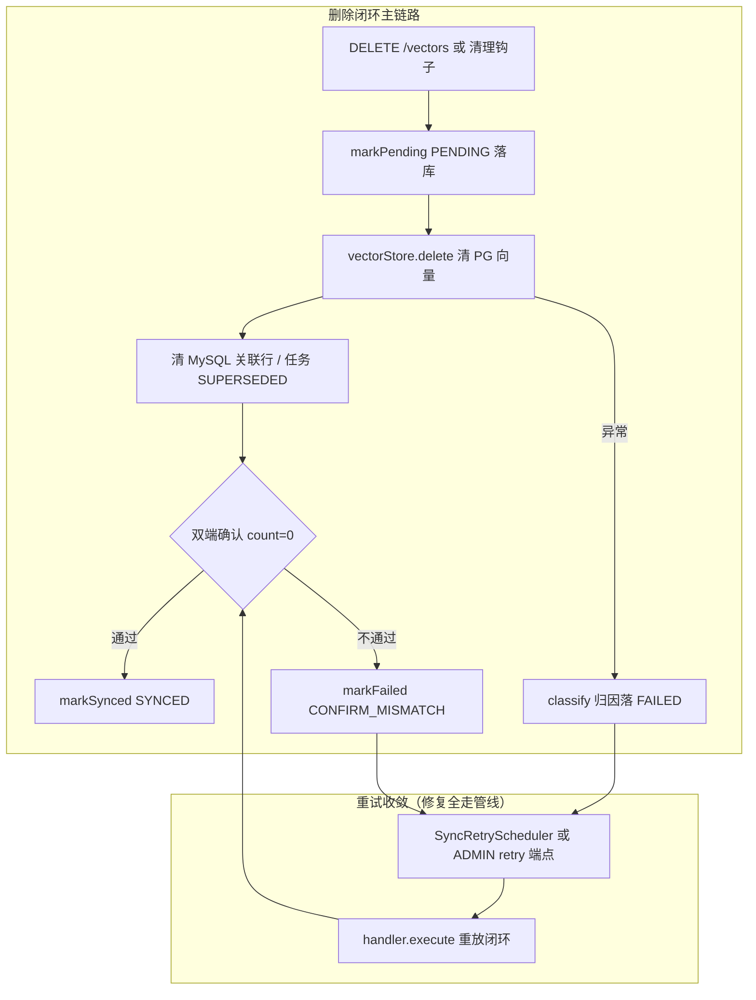

# D40 项目迭代技术文档 R01｜文档更新删除与一致性修复（D40_DUDACR）

> 仓库：`E:\AI\project\AI-Learning-two-lp\M3-Java-ds\D40\D40_DUDACR`（com.zl.d40，端口 9090，two 线）
> 基线：HEAD `ec86b75`（用户提交 D40 骨架）→ 本文档对应迭代提交
> 技术基线：JDK 21 / Spring Boot 3.5.16 / Spring AI 1.1.8 / MySQL 8.0.33(ai_db) / PostgreSQL 18.7 + pgvector 0.8.7 / 默认 AI_MODE=mock
> 状态：**代码/测试/回归完成；执行层（DDL、E1–E5 真实演练）待 MySQL 通道解阻后运行脚本**

---

## 一、是什么（本轮交付的能力）

1. **操作级同步状态机**：新表 `d40_document_sync`，三态 `PENDING/SYNCED/FAILED` + 六枚冻结原因码，自然键 `(document_id, operation, version)`，指数退避与 RETRY_EXHAUSTED 待人工编码（不新增第四状态）。
2. **删除闭环**：标记 PENDING → 清 PG 向量 → 清 MySQL 关联/任务 SUPERSEDED → 双端确认（两端 count=0）→ SYNCED；任一步失败原因码落库，重试全走管线。
3. **版本指针权威化**：SWITCH 成功路径同事务更新 `knowledge_document.version`，使文档行版本成为可核查的权威 active 指针。
4. **清理失败落库钩子**：旧版本清理（UPDATE_CLEANUP）失败经 `DocumentCleanupFailureHandler` 落 `d40_document_sync`，不再静默。
5. **审计留痕**：新表 `d40_admin_audit`，特权写面（register/import/index/delete/recover/retry/reconcile/corpus-index/sync-retry）鉴权通过后写 ALLOWED 行；`AuditService` 经 `ObjectProvider` 随 `app.access.enabled` 装配，**关闭态 Bean 缺席 = 零差异**。
6. **一致性核查扩展**：在既有孤儿/缺失/数量/卡住四类之上追加 `DRIFT_VERSION_MISMATCH`（指针脱节 / 多 COMPLETED 并存 / PG 行与关联行版本脱节）与 `DRIFT_SYNC_STUCK`；所有修复通道收敛到重试管线与重新导入/SWITCH 管线，**核查服务禁止直改 SQL**。
7. **受控故障注入装饰器**：`FaultInjectingVectorStore` 包装 `pgVectorStore`（@Primary，非 JdbcTemplate，避免自动配置退让），计数式触发第 N 次 add/delete 抛受控异常（消息含 "simulated connection loss" → 归因 PG_UNREACHABLE）；`fault-injection.enabled` 默认 false，主 profile 永不装配。
8. **夹具与异常矩阵**：全部演练数据 `d40t-` 前缀（H6 防撞：ai_db 实证存在 one 仓 `d40-doc-*` 残留 9 行，零触碰）；E1–E5 异常矩阵执行层脚本已落盘（未执行，OPEN）。

## 二、为什么（问题根因）

- 删除/版本切换是跨 MySQL（关联/任务）与 PG（向量）两库的**分布式写**，此前无操作级留痕：半途失败只能靠人工比对，且 reconcile 补偿可能掩盖数据漂移。
- `knowledge_document.version` 此前只在导入链被动更新，SWITCH 与任务状态可能脱节，检索侧"active 版本"缺乏单一权威。
- 特权写面无审计行，安全矩阵（D39）只能证明"拒绝可观测"，无法证明"放行有留痕"。

## 三、底层原理与关键决策

| 决策 | 理由 |
|---|---|
| 三态 + 原因码表达 RETRY_EXHAUSTED | 列值 ENUM 冻结；第四状态会破坏 KP4 冻结口径并放大状态迁移测试面 |
| handler 注册方向 管线→sync（@PostConstruct） | 构造依赖图无环：`DocumentSyncService` 不反向依赖 `DocumentVectorIndexService` |
| 故障注入装饰 VectorStore 而非 JdbcTemplate | PgVectorAccess 非通用 Bean，包装 JdbcTemplate 会触发 Spring Boot 自动配置 `@ConditionalOnMissingBean` 退让（D38 教训） |
| DENIED 不落审计行 | 拒绝路径已由 4001 异常链 + 过滤器日志可观测（D39 矩阵已证）；写面 ALLOWED 行补足"放行留痕"，避免双写不一致 |
| `classify` 弃用裸子串 "io" | 组件测试暴露真实缺陷："v**io**lated" 等普通词被误判为连接类；改精确 token（connect/timeout/socket/ioexception 等）并检查 cause 类型名 |
| markSyncedIfRowExists（清理钩子专用） | UPDATE_CLEANUP 正常成功不产噪音行，只抹平历史 FAILED 遗留 |

## 四、执行流程

### 4.1 删除闭环与同步状态机



### 4.2 层级树

```text
com.zl.d40.knowledge.sync（新包，P1）
├── SyncStatus / SyncOperation / SyncReasonCode（KP4 冻结枚举与六码）
├── DocumentSyncRow / DocumentSyncRepository（自然键 upsert/updateState/findDueForRetry/findStuck）
├── SyncRetryHandler（管线解耦接口：operation() + execute(row)）
├── DocumentSyncService（状态机 + classify 归因 + retryOne/retryDue）
├── SyncRetryScheduler（app.vector-index.sync-retry.enabled 门禁，默认关）
├── AuditService / AdminAuditRow / AdminAuditRepository（ALLOWED 留痕）
├── SyncAuditConfiguration（@ConditionalOnProperty app.access.enabled=true）
├── DocumentCleanupFailureHandler（清理失败落库钩子）
├── D40SyncController（/api/v1/d40/sync/retry + status，ADMIN 门禁）
└── SyncStatusView
com.zl.d40.knowledge.vectorstore（P1/P2）
├── FaultInjectingVectorStore（装饰器，计数注入）
└── FaultInjectionConfiguration（fault-injection.enabled 门禁，@Primary）
```

## 五、核心代码要点

```java
// 归因分类（修正后口径，冻结于 SyncReasonCode 六码）
if (message.contains("connect") || message.contains("timeout")
        || message.contains("socket") || message.contains("ioexception")
        || causeName.contains("ioexception") /* ... */) {
    return SyncReasonCode.PG_UNREACHABLE;
}
return SyncReasonCode.PG_DELETE_FAILED;

// 双端确认后才收敛 SYNCED（删除闭环尾部）
long pgCount = pgVectorAccess.countByDocument(documentId);
int relationCount = repository.countChunksByDocument(documentId);
if (pgCount == 0 && relationCount == 0) { syncService.markSynced(...); }
else { syncService.markFailed(..., SyncReasonCode.CONFIRM_MISMATCH, ...); }
```

## 六、验证结果（区分口径）

**已执行并通过：**
- `mvn -o compile`：BUILD SUCCESS（exit 0，仅 1 条存量 deprecation WARNING）。
- `mvn -o test`：**Tests run: 18, Failures: 0, Errors: 0** —— `DocumentSyncServiceTest`(12，内存假仓储，状态机全迁移 + E1/E3/E4 状态机面 + RETRY_EXHAUSTED 重置 + classify 修正回归)、`FaultInjectingVectorStoreTest`(3，注入计数语义)、`VectorReconciliationServiceDriftTest`(3，E4/E5 漂移检测 + dryRun 零补偿)。
- P6 回归三重纪律：冻结基线 SHA 前验 `CD875F…9C3F` → 重跑 D37 评测（先全量重编修复 `out` 缺内部类 `Main$Args`）→ 质量列 diff **= 0**（61 行×19 列逐字节一致；全文件仅 `inMemorySearchMs` 耗时列 2 行差异，非质量列）。数据集 SHA 复核 `896BCE…4BEC` 一致。证据：`docs/evidence/D40/P6-regression-qualitycols-diff.txt`。
- 期间发现并根因修复 1 个真实缺陷（classify 裸 "io" 误判），以 T-SM-10/12 回归锁定。

**已执行但失败（后修复）：**
- 首轮 `mvn test` 2 败（classify 缺陷实证）→ 修主代码后全绿。
- `run-evaluation.ps1` 增量判定跳过编译致 `NoClassDefFoundError` → 全量 javac 修复。

**尚未执行，建议后续验证（OPEN）：**
- MySQL 直连命令仍被风险确认弹窗阻塞（本轮模式未解阻）：`d40_document_sync`/`d40_admin_audit` DDL 未应用、表存在性未核验、E1–E5 执行层演练未运行（脚本已落盘 `docs/evidence/D40/scripts/run-e1-e5-execution.ps1`）、`vector_chunk_index/vector_index_task` 中 d40-/d40t- 前缀分布未核验。
- 真实 Spring 上下文启动验证（access=true 装配审计链）待执行层窗口一并做。
- 诚实标注：组件测试桩仅替代存储/网络边界，**不替代真实端到端**。

## 七、常见问题与工程实践

1. **为什么不用分布式事务**：两库无 XA；以"操作留痕 + 幂等重放 + 双端确认"达成最终一致，与 Spring 声明式事务边界（单库单事务）兼容。
2. **重试放大防线**：Spring AI 内置重试保持 `maxAttempts=1`（韧性约定），本轮所有收敛重试唯一收归 `DocumentSyncService` 单一责任层。
3. **零差异纪律**：所有新开关默认 false（sync-retry / fault-injection / access），主 profile 行为与迭代前逐字节等价，P6 即为门禁证明。
4. **失败必落库（H8）**：markPending 自身失败上抛由调用方归因 MARK_FAILED；handler 异常逃逸由状态机兜底分类落库，杜绝无痕失败。
5. **密钥边界**：本轮无任何 Key 进入代码/yml/git；执行层脚本仅引用环境变量名。

## 八、文档溯源（英文原标题 + 中文翻译 + 链接，均 2026-11-23 实测可达）

- 《Using @Transactional :: Spring Framework》（Spring Framework 参考文档 · 使用 @Transactional）：https://docs.spring.io/spring/reference/6.2/data-access/transaction/declarative/annotations.html
- 《Retry Properties :: Spring AI Reference (1.0)》（Spring AI 参考文档 · 重试属性，spring.ai.retry.max-attempts 默认 10 的内置重试口径）：https://docs.spring.io/spring-ai/reference/1.0/api/chat/openai-chat.html
- 勘误记录：旧引用路径 `docs.spring.io/spring-ai/reference/api/retry.html` 实测 link dead，本轮起以版本化路径引用。
