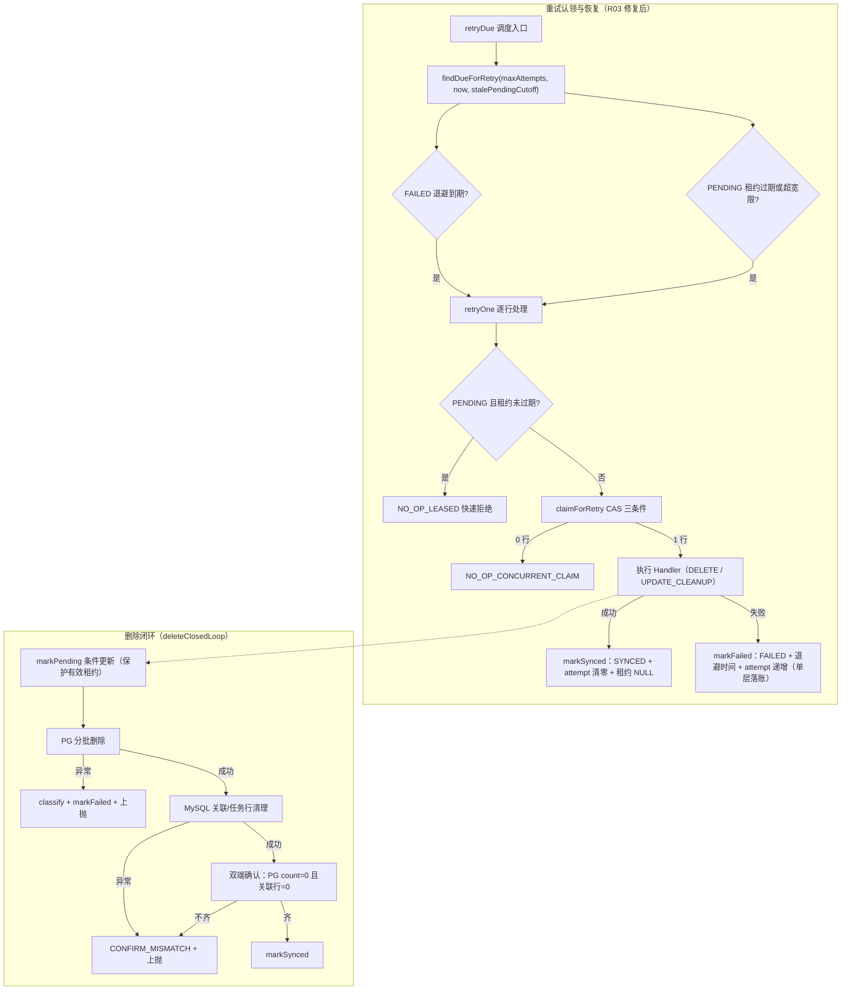

# D40 迭代技术文档 R03：重试租约、并发安全与跨库一致性验证

> 仓库：`E:\AI\project\AI-Learning-two-lp\M3-Java-ds`（two 线）｜模块：`D40/D40_DUDACR`（端口 9090）
> 基础 HEAD：`09aaad2`（R02）｜本轮主题：R03 整改（租约保护 / PENDING 超时恢复 / 真实链路验证）
> 证据根：`docs/evidence/D40/R03/`｜验收：`final-acceptance.md`（PASS）

## 一、是什么

R03 不新增功能，而是把 D40 同步状态机（`d40_document_sync`）的**重试认领**从
"可被覆盖的标记"升级为**带租约（lease）的 CAS 认领**，并用真实 MySQL/PG/HTTP 演练
证明跨库删除闭环可恢复、可核验、可重复执行。

核心语义冻结（`next_retry_at` 一列三义）：

| sync_status | next_retry_at 含义 | 恢复条件 |
|---|---|---|
| FAILED | 退避到期时间 | now ≥ 退避时间 且 attempt < maxAttempts |
| PENDING | 执行租约到期时间 | 租约过期，或无租约且 updated_at ≤ 宽限截止 |
| SYNCED / EXHAUSTED | NULL | 不恢复（SYNCED 可被新事件重新标记并清零 attempt） |

## 二、为什么

R02 遗留三个可复现缺陷（R03 扫描报告逐项判定属实）：

1. **租约被清除**：`markPending` 的 UPDATE 无条件置 `next_retry_at=NULL`，
   并发执行者 B 的重复事件标记会把执行者 A 正在持有的租约抹掉 → A 崩溃后无人能
   判定"认领已失效"，恢复窗口丢失。
2. **PENDING 不可恢复**：`findDueForRetry` 只查 FAILED，认领后崩溃的 PENDING 行
   永久滞留（进程崩溃≠失败落账，没有 FAILED 行可重试）。
3. **测试仓储不兼容**：内存替身缺 `claimForRetry`，12 例既有测试 3 例 NPE
   （PRE 证据：`test/pre-existing-test-run.log`）。

## 三、底层原理

**CAS（Compare-And-Swap，比较并交换）认领**：把"读取-判断-写入"压缩为一条条件
UPDATE，由 MySQL 行锁保证原子性，无需 JVM 本地锁（任务书禁止以本地锁冒充分布式安全）：

```sql
UPDATE d40_document_sync
   SET sync_status='PENDING', attempt_count=?, next_retry_at=?  -- leaseUntil
 WHERE document_id=? AND operation=? AND version=?
   AND sync_status=?            -- 期望状态
   AND attempt_count=?          -- 期望计数
   AND next_retry_at <=> ?      -- null 安全比较（<=> 而非 =）
```

三条件任一不符 → 影响行数 0 → 认领失败（`NO_OP_CONCURRENT_CLAIM`）。
`<=>` 是 MySQL null 安全等值运算符：`NULL <=> NULL` 为真，避免 `= NULL` 永假。

**租约宽限共用**：`leaseDurationNanos = max(backoffMs×8, 5s)`。认领时写入
`leaseUntil = now + lease`；调度恢复时以 `stalePendingCutoff = now − lease` 判定
"无租约 PENDING"的崩溃宽限——同一常数保证"持约者尚未超时"与"恢复者不过早抢占"
两个窗口互斥。

**markPending 条件化**（保护租约的关键）：

```sql
UPDATE d40_document_sync
   SET sync_status='PENDING', attempt_count=?,
       next_retry_at = CASE WHEN sync_status='PENDING'
                            THEN next_retry_at ELSE NULL END
 WHERE document_id=? AND operation=? AND version=?
   AND (sync_status <> 'PENDING'
        OR next_retry_at IS NULL
        OR next_retry_at <= NOW(6))
```

有效租约中的 PENDING 行不命中 WHERE → 0 行 → no-op，租约保留。

## 四、执行流程



## 五、核心代码（本轮修改点）

- `DocumentSyncRepository.markPendingConditional(...)`：条件 UPDATE + CASE 保留租约。
- `DocumentSyncRepository.findDueForRetry(maxAttempts, now, stalePendingCutoff)`：
  FAILED 分支保留，新增 PENDING 分支（`next_retry_at <= now` OR
  `next_retry_at IS NULL AND updated_at <= stalePendingCutoff`）。
- `DocumentSyncService.markPending`：既有行改走条件更新；`retryOne` 增 `NO_OP_LEASED`；
  `retryDue` 计算宽限截止；私有 `leaseDurationNanos()` 共用常数。
- `application.yml`：追加 `app.access.enforce-admin: ${APP_ACCESS_ENFORCE_ADMIN:false}`
  （生产门禁；AccessGuard 缺席启动失败，见 `SyncAdminBoundaryConfiguration`）。

## 六、常见问题（本轮实测踩坑）

1. **Mockito 重桩副作用**：对已有 answer 的 mock 用 `when()` 重桩会触发旧 answer
   副作用（清状态/抛异常）→ 一律 `doReturn/doAnswer/doThrow` 风格。
2. **索引依赖页面级文本**：`indexFromPages` 走 `KnowledgeDocumentChunkingService`，
   txt 导入无 extracted pages → 4091；演练夹具必须用 PDF（`GenPdf.java` 生成）。
3. **PG metadata 键口径**：`metadata->>'documentId'`（驼峰），非物理列 document_id；
   清理 SQL 必须按 documentId 清单（服务端 UUID 无批次前缀）。
4. **Document 构造 null 守卫**：Spring AI `Document` 禁止 metadata null 值；
   mock descriptor 必须 stub `modelName()` 等非空组件。
5. **legacy 分支条件**：`syncService==null && !syncStateRequired` 才走 deleteLegacy；
   注入了 syncService 即使 required=false 仍走闭环（two_ 装配不注入 syncService）。
6. **D37 基线目录甄别**：冻结基线为 `20261120-195125`（SHA CD875F…）；
   `20261123-205412` 是 R01 P6 重跑目录，不可误作冻结源。

## 七、工程实践

- **验证分层**：单元（内存 CAS 替身，语义对齐生产 SQL）→ 组件组合（真实服务+存储替身）
  → 真实演练（独立 9090 实例 + 静态故障注入预设 + PRE/POST 指纹）→ 冻结回归（D37 质量列）。
- **故障注入纪律**：`app.vector-index.fault-injection.fail-add-call/fail-delete-call=N`
  第 N 次调用抛受控异常，启动静态预设；后续调用自然恢复，无需重启即可验证重试收敛。
- **数据安全**：批次 source 标识 + documentId 清单精确清理；空表 ALTER 前后 COUNT 复核；
  临时凭据随机 token、SHA-256 入库、演练后删除；密钥仅 env 注入。
- **回归三重纪律**：冻结 SHA 门禁 → 全量 javac（不依赖增量判定）→ 剔除耗时列后质量列逐行比对。

## 八、官方溯源

- 《MySQL 8.0 Reference Manual | MySQL 8.0 参考手册》：https://dev.mysql.com/doc/refman/8.0/en/（UPDATE、NULL-safe `<=>`、CASE 表达式）
- 《Spring Boot Reference | Spring Boot 参考文档》：https://docs.spring.io/spring-boot/3.5/index.html（@ConditionalOnProperty、SmartInitializingSingleton）
- 《Spring AI Reference | Spring AI 参考文档》：https://docs.spring.io/spring-ai/reference/（VectorStore.add/delete、PgVectorStore）
- 《PostgreSQL pgvector | pgvector 项目》：https://github.com/pgvector/pgvector（metadata JSON 过滤、COSINE）

## 九、验收结论

R03 九项整改全 PASS；Maven 54/54 绿；E1–E5 真实演练 5/5 PASS 且指纹一致；
D37 60×20 质量列 diff=0。详见 `R03/final-acceptance.md`。
