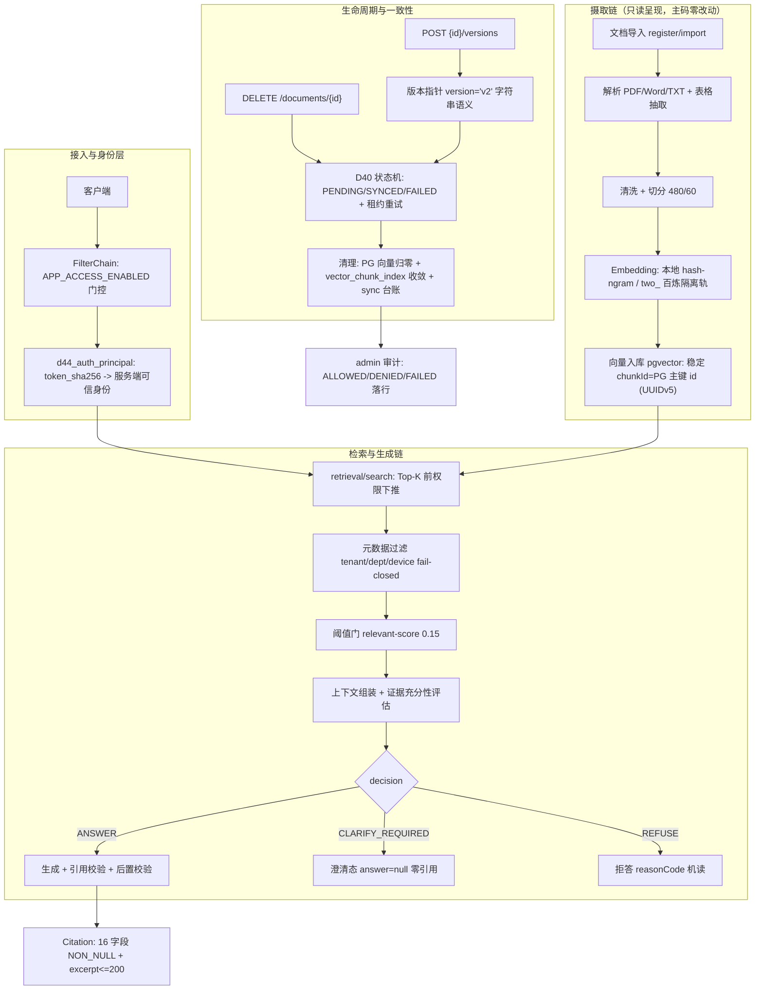

# RAG 架构 v3（D44 冻结视图）

版本：v3（成立性判定见 `../milestone/rag-v3-milestone.md`）｜基线：提交 5016c39 + 主码 352 类/测试 26 类
指纹：AGG_MAIN=`b2bd7798…066c`、AGG_TEST=`7e086fb9…d755`（终测复扫逐字一致）
依据：本地实码 `D44/D44_RAG_PDAM/src/main/java/com/zl/d44/`，非设计愿景。

## 1. 主链全景（graph TD，Typora 兼容）



## 2. 分层与包结构（实码目录）

```text
com.zl.d44
├── access/          D39 服务端可信身份（token→principal 解析，无请求侧 tenant 入参）
├── rag/             RagController(answer) + 证据评估 + 生成编排 + CitationDto
├── knowledge/
│   ├── document/    导入/解析/生命周期（lifecycle_status: ACTIVE→DELETED）
│   ├── chunk/       切分 480/60 + compare
│   ├── embedding/   EmbeddingModelCatalog（BAILIAN qwen3.7-text-embedding 1024，baseUrl/key 全 env）
│   ├── sync/        D40 状态机 + AdminAuditRepository + 一致性核查（四类漂移+SYNC_STUCK）
│   └── table/       D41 表格抽取（d44_table_extract）
├── retrieval/       Top-K + 权限下推 + 混合检索/查询改写（D38 轨）
├── rerank/          D42 实验框架（R1/R2/R3 + BailianTextReranker，实验门 P_EXP_RUN*）
├── vectorstore/     pgvector 适配（d44_vector_store 索引表 + PG vector_store 主表）
├── config/          DeepSeekChatModel/Switch 装配（H2 八键快照冻结）
└── controller/…     共 19 控制器 / 47 端点（api-endpoints.json 注解实扫）
```

## 3. 存储拓扑（v3 事实面）

| 存储 | 关键对象 | 冻结基线（P0，DV-01 裁决） |
|------|----------|---------------------------|
| MySQL ai_db | knowledge_document(+page/content)、vector_chunk_index/task | doc=18、vci=30、task=23、page=43、content=16 |
| MySQL d44_* | d44_auth_principal / d44_document_sync / d44_admin_audit / d44_vector_store / d44_table_extract | principal=5、sync=3、audit=233→78（DEV-03 登记）、vs=8、extract=0 |
| PG 192.168.200.153 spring_ai | vector_store（d43 表结构克隆，chunkId=主键 id，metadata 17 键无 chunkId 键） | 30 行 |
| Redis db0 | 无 RAG 键（演示域 stock:sku:1001） | DBSIZE=1 |

## 4. 质量属性与已知边界（v3 口径的诚实面）

1. **mock 语义上限**：hash-ngram+relevant-score 0.15 组合下，可答题终态 CLARIFY_REQUIRED
   零引用（非编造安全态，BC-19e 同款双标注）；真实模型语义质量=C16 NOT RUN（O-10 待授权）。
2. **装配组合缺陷**：默认主配置（pgvector=on+rerank=off）应用无法启动（BC-22/O-07，
   IT 面 TestConfiguration 规避、活体面绕行参数实证），修复排 D45 首位。
3. **审计完整性**：文档删除链连坐物理清审计（DEV-03/O-13）；测试库隔离（O-02）D45 首位。
4. **历史数据 tenant=NULL**：30 行 fail-closed 使 fixed-eval hitRate@5=0.0 恒零（O-09 授权项，
   与 D43 基准恒等复现）。
5. 生产化提示：本地测试口令/弱凭据仅限本机学习场景，**不得描述为生产适用**（项目规范 §二.6）。

## 5. API 与数据契约

端点全集与 DTO 字段级契约见同目录 `api-data-spec.md`（C16：注解实扫+DTO 实码一致）。

官方溯源（稳定入口）：
《Spring Boot Reference | Spring Boot 参考文档》：https://docs.spring.io/spring-boot/3.5/reference/
《Spring AI Reference | Spring AI 参考文档》：https://docs.spring.io/spring-ai/reference/1.1/index.html
《pgvector: Vector Type and Usage | pgvector 官方说明》：https://github.com/pgvector/pgvector
