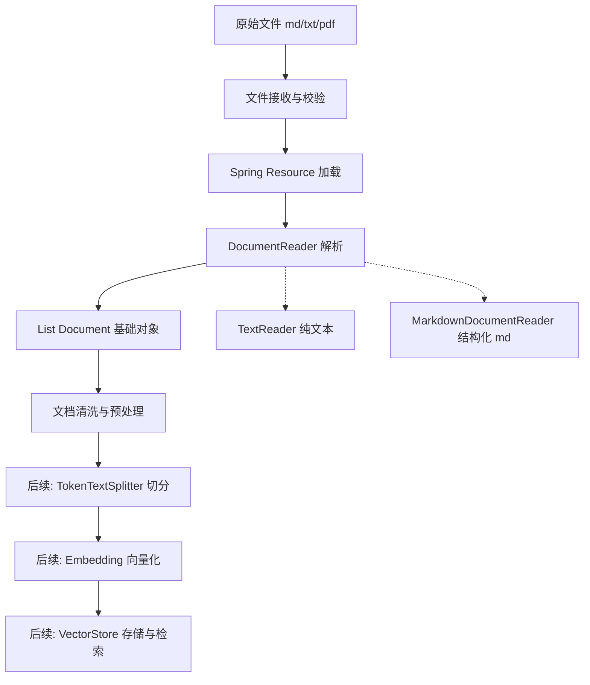
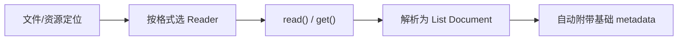
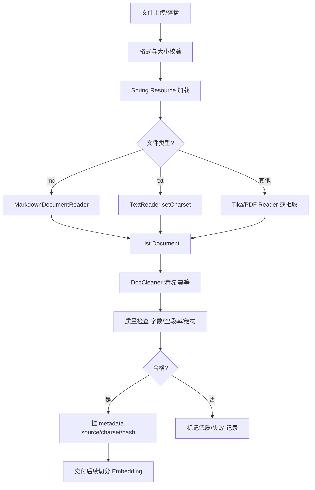

# D26 知识笔记：Spring AI 文档导入与基础解析

（Document / DocumentReader / TextReader / MarkdownDocumentReader 与 Markdown/TXT 清洗）

> 学习阶段：M3（RAG 数据接入层）
> 技术基线：JDK 21（21.0.7）、Spring Boot 3.5.x、Spring AI **1.1.8**、Maven 3.9.16
> 口径说明：本笔记所有 Spring AI 类名、方法签名、构造器、配置项均以任务书指定的 **1.1.8 官方 Javadoc** 逐字核验；凡未实跑或项目未实现处均显式标注。

---

## 0. 技术基线、版本核验与项目扫描范围

### 0.1 版本核验结果

| 项 | 核验依据（1.1.8 Javadoc） | 结论 |
|---|---|---|
| `org.springframework.ai.document.Document` | `Document.html` | 构造器、`getText/isText/getMedia/getMetadata/getScore/getFormattedContent` 签名已逐字核对 |
| `org.springframework.ai.document.DocumentReader` | `DocumentReader.html` | 继承 `Supplier<List<Document>>`，`read()` 为默认方法 |
| `org.springframework.ai.reader.TextReader` | `TextReader.html` | 两个构造器、`CHARSET_METADATA/SOURCE_METADATA` 常量、`setCharset/getCustomMetadata` 已核对 |
| `org.springframework.ai.reader.markdown.MarkdownDocumentReader` | `MarkdownDocumentReader.html` | 四个构造器、`get()` 已核对；Config 走参考文档 builder |

> 说明：`MarkdownDocumentReaderConfig` 的独立 Javadoc 页面在 1.1.8 链接下不可达（link dead），其 builder 配置项以 Spring AI 1.1 **参考文档（Reference）** 的 ETL 章节为准，下文均标注来源，不臆造。

### 0.2 项目读取边界（务必先看）

经全盘检索，当前学习仓库（`AI-Learning-one` / `AI-Learning-two-lp` / `AI-Learning-three-GPT`）中：

- **【项目尚未实现】** 没有任何模块真正接入 Spring AI 的 `DocumentReader` / `TextReader` / `MarkdownDocumentReader`。
- **【项目已实现】** 的语料加载方式是：手工维护 classpath 下的 JSON 语料，经 `KnowledgeCorpus` 扁平化为关键词/二元组检索结构（见 D24/D25 笔记）。这是**自研加载**，不是 Spring AI Reader。
- 因此本笔记中：Reader 的用法为**基于 1.1.8 Javadoc 的独立示例（官方框架能力）**；真正被本机 JDK21 编译运行过的是**第 5 节的清洗工具 `DocCleanDemo`（建议练习，已实跑）**。

四类标记贯穿全文：**【官方框架能力】/【项目已实现】/【项目尚未实现】/【建议练习】**。

---

## 1. 文档导入与解析在 RAG 中的位置

### 1.1 概念

RAG 的第一步不是“切分”，而是把**外部原始文件**（Markdown、TXT、PDF、HTML……）读取成框架内部统一的数据对象——`Document`。这一步在 Spring AI 里叫 **ETL（Extract-Transform-Load）** 的 Extract 阶段，由 `DocumentReader` 承担。

### 1.2 它在整条链路中的位置



> 本笔记只覆盖 **B → F**（导入与基础解析/清洗）。切分、Embedding、向量库、检索生成属于 D25 及后续内容，按任务书要求不展开。

### 1.3 关键边界（容易踩错）

- **解析粒度 ≠ 切分粒度**：`MarkdownDocumentReader` 会按标题/段落/水平线切成多个 `Document`，但这是“结构切分”；真正按 Token 预算的切分由后续 `TokenTextSplitter` 完成。`TextReader` 则把**整个文件读成一个** `Document`。
- **能提取文本 ≠ 完整保留原文信息**：Reader 只产出文本，版式、图片、坐标、页眉页脚通常丢失；所以要保留原始文件。
- **解析成功 ≠ 内容质量合格**：读出非空 `Document` 不代表没有乱码、空段、重复内容或语义截断，必须做质量检查（见第 5、8 节）。

---

## 2. Spring AI Document 核心原理

> 包路径：`org.springframework.ai.document.Document`　**【官方框架能力】**

### 2.1 概念与设计目的

官方定义：`Document` 是“**content 与 metadata 的容器，并携带文档唯一 ID**”，作为 Spring AI ETL 流水线从外部来源取数时的统一数据载体。

两个硬性设计约束（来自 Javadoc 原文）：

1. **一个 Document 只能装文本，或装媒体（Media），二者不可兼得**——用 `isText()` 判定。
2. **metadata 的值只允许简单类型**（string / int / float / boolean），目的是兼容下游向量数据库的元数据过滤。

### 2.2 核心属性

| 属性 | 方法 | 说明 |
|---|---|---|
| 唯一 ID | `String getId()` | 创建时显式传入，或由 `IdGenerator` 生成（默认 `RandomIdGenerator`） |
| 文本内容 | `String getText()`（@Nullable） | 仅当 `isText()==true` 时有值 |
| 内容类型 | `boolean isText()` | true=文本，false=媒体 |
| 媒体内容 | `Media getMedia()`（@Nullable） | 仅当非文本时有值 |
| 元数据 | `Map<String,Object> getMetadata()` | 值限简单类型，供向量库过滤/溯源 |
| 相似度分数 | `Double getScore()`（@Nullable） | 检索回填，导入阶段为空 |
| 格式化内容 | `getFormattedContent()` 等 | 把 content + metadata 按 `MetadataMode` 拼成送给模型的文本 |

### 2.3 构造方式与方法（1.1.8 实测签名）

```java
// 1.1.8 Javadoc 列出的全部公开构造器
new Document(String content);
new Document(String text, Map<String,Object> metadata);
new Document(String id, String text, Map<String,Object> metadata);
new Document(Media media, Map<String,Object> metadata);
new Document(String id, Media media, Map<String,Object> metadata);

// 推荐：builder
Document doc = Document.builder()
        .text("样本文本")
        .metadata("source", "user-input")
        .build();

// 基于已有 Document 派生修改（不改原对象）
Document mutated = doc.mutate()
        .metadata("chunk", "1")
        .build();
```

`getFormattedContent` 三个重载（决定送给大模型时 metadata 是否拼进去、拼多少）：

```java
doc.getFormattedContent();                                  // 默认格式
doc.getFormattedContent(MetadataMode.EMBED);                // 按 Embedding 场景模式
doc.getFormattedContent(ContentFormatter, MetadataMode);     // 自定义格式化器
```

### 2.4 为什么它是 RAG 的基础对象

- 它是 Reader、清洗、切分、Embedding、向量库之间**唯一传递的数据结构**——下游所有组件都认 `Document`，而不认 `.md`/`.txt` 文件。
- `metadata` 承担**溯源**：来源文件、编码、标题层级、章节、哈希等都挂在这里，检索后能回答“这段话出自哪份文件哪一节”。
- `id` 让重复导入可去重、向量库可覆盖更新（幂等导入的基础）。

### 2.5 工程问题

- 直接往 `metadata` 塞复杂对象（List、嵌套 Map）→ 写入向量库时被拒或丢字段，**只放简单类型**。
- 文本与媒体混用（既 `setText` 又 `setMedia`）→ 语义混乱，应二选一。
- 长文本整篇塞进一个 Document 又不切分 → Embedding 截断、检索不准（这是切分阶段的问题，但根源在导入时没规划）。

---

## 3. DocumentReader 接口与工作机制

> 包路径：`org.springframework.ai.document.DocumentReader`　**【官方框架能力】**

### 3.1 接口定义（1.1.8）

```java
public interface DocumentReader extends Supplier<List<Document>> {
    default List<Document> read() {
        return get();
    }
}
```

- 它本质就是 `Supplier<List<Document>>`：调用方不问“怎么读文件”，只问“给我一批 Document”。
- `read()` 是 `get()` 的默认别名，二者等价——保留 `read()` 是为了语义更直白。

### 3.2 已知实现类（1.1.8 Javadoc 列出）

| 实现 | 用途 |
|---|---|
| `TextReader` | 纯文本文件（TXT/ properties 等） |
| `MarkdownDocumentReader` | Markdown 结构化读取 |
| `JsonReader` | JSON 数据 |
| `TikaDocumentReader` | Apache Tika 通用多格式（PDF/Word/HTML 等） |
| `PagePdfDocumentReader` / `ParagraphPdfDocumentReader` | PDF 按页/按段落 |
| `JsoupDocumentReader` | HTML 解析 |

> PDF/Word/OCR 本笔记只点到“存在对应 Reader、适用边界是把非结构化格式转成纯文本”，不深入实现（任务书第 6 节约束）。

### 3.3 Reader 的统一工作流



### 3.4 工程问题

- **选错 Reader**：把 Markdown 当 TXT 读（用 `TextReader`）→ 标题层级、代码块结构全丢，变成一大坨纯文本。
- **Reader 不做清洗**：Reader 只负责“提取”，脏数据（BOM、乱码、多余空行）原样进 Document；清洗必须在后续单独做。
- **大文件内存压力**：`TextReader` 一次性读全文件，超大文件会 OOM，需要流式或按分片处理。

---

## 4. TextReader 与 MarkdownDocumentReader

### 4.1 TextReader（纯文本）

> 包路径：`org.springframework.ai.reader.TextReader`　**【官方框架能力】**

#### 4.1.1 构造器与方法（1.1.8 实测）

```java
// 两个公开构造器
new TextReader(String resourceUrl);          // 传资源地址串
new TextReader(Resource resource);          // 传 Spring Resource

// 关键方法
reader.setCharset(StandardCharsets.UTF_8);   // 设置字符集（getCharset() 读取）
Map<String,Object> m = reader.getCustomMetadata(); // 附加到所有产出 Document 的自定义 metadata
List<Document> docs = reader.get();          // 真正执行读取
```

#### 4.1.2 自动写入的 metadata 常量

```java
TextReader.CHARSET_METADATA   // 键名：charset（读取所用字符集）
TextReader.SOURCE_METADATA    // 键名：source（资源标识）
```

即每个产出的 Document 会自动带上 `source`（来源）和 `charset`（编码）两个元数据键。

#### 4.1.3 行为特征

- 默认按 **UTF-8** 读取；遇到 GBK 等编码必须 `setCharset(...)`，否则乱码。
- **整个文件读成一个 Document**（不按结构切分）。
- 不适合超大文件；读完后通常接 `TokenTextSplitter` 再切。

#### 4.1.4 典型用法（独立示例，未实跑容器）

```java
Resource res = new ClassPathResource("docs/notes.txt");
TextReader reader = new TextReader(res);
reader.setCharset(StandardCharsets.UTF_8);
reader.getCustomMetadata().put("biz", "knowledge-base");
List<Document> docs = reader.read();   // 等价 get()
Document d = docs.get(0);
// d.getText()      -> 全文
// d.getMetadata()  -> {source=..., charset=UTF-8, biz=knowledge-base}
```

### 4.2 MarkdownDocumentReader（结构化 Markdown）

> 包路径：`org.springframework.ai.reader.markdown.MarkdownDocumentReader`　**【官方框架能力】**

#### 4.2.1 构造器（1.1.8 实测，共 4 个）

```java
new MarkdownDocumentReader(String markdownResources);                       // 资源模式串，按模式解析
new MarkdownDocumentReader(String markdownResources, MarkdownDocumentReaderConfig config);
new MarkdownDocumentReader(Resource markdownResource, MarkdownDocumentReaderConfig config);
new MarkdownDocumentReader(List<Resource> markdownResources, MarkdownDocumentReaderConfig config);
```

官方说明：它把 Markdown 中的**标题、段落，或被水平分隔线（`---`）划分的文本**，按配置聚合成多个 `Document`。

#### 4.2.2 配置项（MarkdownDocumentReaderConfig.builder()）

> 来源：Spring AI 1.1 参考文档 ETL 章节（Config 独立 Javadoc 页面 1.1.8 不可达，故以参考文档为准）。

```java
MarkdownDocumentReaderConfig config = MarkdownDocumentReaderConfig.builder()
        .withHorizontalRuleCreateDocument(true)  // 遇到水平分隔线 --- 时切出独立 Document
        .withIncludeCodeBlock(false)             // 代码块是否作为独立 Document 输出
        .withIncludeBlockquote(false)            // 引用块是否作为独立 Document 输出
        .withAdditionalMetadata("source", "guide.md")  // 附加 metadata
        .build();
```

| 配置 | 作用 | 常见取舍 |
|---|---|---|
| `withHorizontalRuleCreateDocument` | 以 `---` 为分段边界 | 教程类文档按章节分隔时打开 |
| `withIncludeCodeBlock` | 代码块是否独立成 Document | 要单独检索代码片段时打开；否则并入上下文 |
| `withIncludeBlockquote` | 引用块是否独立成 Document | 引用多为提示语，一般并入正文即可 |
| `withAdditionalMetadata` | 给所有产出 Document 挂 metadata | 打来源、业务线标签 |

#### 4.2.3 解析行为要点

- **标题层级保留**：标题会作为 metadata（标题文本/层级）关联到其下属段落。
- **段落进 content**：正文段落进入 `Document.getText()`。
- **代码块/引用块**：默认并入所在 Document，配置后可独立成 Document。
- **水平分隔线**：可作为分段开关。

#### 4.2.4 典型用法（独立示例，未实跑容器）

```java
Resource res = new ClassPathResource("docs/guide.md");
var config = MarkdownDocumentReaderConfig.builder()
        .withHorizontalRuleCreateDocument(true)
        .withAdditionalMetadata("biz", "user-guide")
        .build();
MarkdownDocumentReader reader = new MarkdownDocumentReader(res, config);
List<Document> docs = reader.read();   // 多段 -> 多个 Document
```

Maven 构件（参考文档）：Markdown 读取器位于独立模块 `org.springframework.ai:spring-ai-markdown-document-reader`；`TextReader` 等核心 Reader 在 `spring-ai-core`。具体 starter 装配以参考文档 BOM 为准。

### 4.3 TextReader vs MarkdownDocumentReader 对照

| 维度 | TextReader | MarkdownDocumentReader |
|---|---|---|
| 适用文件 | 纯 TXT | Markdown |
| 产出 Document 数 | **1 个（全文）** | **多个（按标题/段落/水平线）** |
| 结构感知 | 无 | 保留标题层级、代码块、引用、表格位置 |
| 编码配置 | `setCharset` | 走 Resource，编码按资源默认 |
| 自动 metadata | source + charset | 源 + 配置附加项 + 标题信息 |
| 后续 | 必接切分 | 结构切分已做粗切分，仍可能需 Token 切分 |

---

## 5. Markdown / TXT 文档清洗与预处理

> 定位：**【建议练习】**，由项目侧实现；Spring AI Reader 不负责清洗。下面 `DocCleanDemo` 已在本机 JDK21（21.0.7）真实编译运行。

### 5.1 清洗原则（不是粗暴删字符）

清洗目标是“规范化”，**不能破坏技术文档的代码、参数、表格、标题、业务语义**：

- 去 BOM（``）、换行符统一（`\r\n`/`\r` → `\n`）。
- 行尾空白清理、连续空行收敛为一个。
- 不可见控制字符清理。
- **代码块（``` 围栏）内原样保留**，不裁剪其中空格。
- 标题、表格（`|`）、引用（`>`）结构原样保留。
- **幂等性**：清洗两次结果 = 清洗一次结果。

### 5.2 已实跑的清洗工具（核心逻辑）

工作目录：`doc-clean-demo\DocCleanDemo.java`（无外部依赖，纯 JDK）。关键逻辑：

```java
// 1) 去 BOM
if (s.startsWith("")) s = s.substring(1);
// 2) 换行统一
s = s.replace("\r\n", "\n").replace('\r', '\n');
// 3) 逐行处理；跟踪 ``` 围栏，围栏内原样保留
boolean inCodeFence = false;
for (String line : lines) {
    if (line.stripLeading().startsWith("```")) { inCodeFence = !inCodeFence; out.append(line); continue; }
    if (inCodeFence) { out.append(line); continue; }     // 代码块内不动
    if (line.isBlank()) { blankRun++; continue; }          // 空行先计数后收敛
    // 普通行：去控制字符 + 去行尾空白
}
// 连续空行 flush 为至多一个
```

### 5.3 清洗前后对比（真实运行输出，节选自 `clean-output-utf8.txt`）

**用例 1：脏 Markdown**（含 BOM、CRLF、标题后 3 个空格、3 个连续空行、代码块、表格、引用）

清洗后：

```text
# 标题后面带了空格
第一段。

```java
public class Keep {
  int keepLeading = 1;   // 代码块内保留前后空格
}
```
| 列A | 列B |
| --- | --- |
| 1   | 2   |
> 这是一段引用，后面有空白
```

统计：`removedBom=true, normalizedNewlines=1, trailingSpacesTrimmed=2, blankLinesCollapsed=2, idempotent=true`。

**用例 2：脏 TXT**（BOM + CRLF + 行尾多余空格 + 4 个空行）

清洗后：

```text
第一行
第二行带了多余空格

第三行
```

统计：`removedBom=true, normalizedNewlines=1, trailingSpacesTrimmed=1, blankLinesCollapsed=2, idempotent=true`。

**用例 3：空输入** → 清洗后仍为空（`true`）。
**用例 4：幂等性** → Markdown/TXT 二次清洗结果均与一次一致（`true`）。

### 5.4 对比表（清洗行为验证）

| 输入特征 | 清洗动作 | 结果 | 是否破坏语义 |
|---|---|---|---|
| UTF-8 BOM `` | 移除 | `removedBom=true` | 否 |
| CRLF / CR 换行 | 统一为 `\n` | `normalizedNewlines=1` | 否 |
| 标题/引用行尾空格 | 裁剪 | `trailingSpacesTrimmed` 计数 | 否 |
| 3+ 连续空行 | 收敛为 1 个 | `blankLinesCollapsed=2` | 否 |
| 代码块内前导/尾随空格 | **原样保留** | 第 9 行空格保留 | 否（关键） |
| 表格 `\|...\|` | 原样保留 | 三行表格完整 | 否 |
| 空文件 | 安全返回空 | 不报错 | 否 |
| 重复执行 | 结果不再变化 | 幂等 true | 否 |

### 5.5 工程问题

- **一刀切删空白** → 代码缩进被删，`public class` 变成 `publicclass` 风险或代码块排版崩坏。必须按围栏区分。
- **GBK 文件当 UTF-8 读** → 不是清洗能解决的，是读取编码错误（见第 6 节）。
- **清洗不幂等** → 重复导入时文本被越洗越短，须用 `clean(clean(x))==clean(x)` 守住。

---

## 6. 解析失败与工程处理

### 6.1 异常分类与处理策略

| 现象 | 根因 | 是否可重试 | 处理 |
|---|---|---|---|
| 文件不存在 | 路径/资源错误 | 否 | 直接标记失败，记录日志 |
| 文件损坏 / 格式不支持 | 非预期格式或损坏 | 否 | 标记失败，人工介入 |
| 乱码（中文变 ¿/锟斤拷） | 字符集与实际不符 | 否（换编码重试） | 显式 `setCharset(GBK)` 后重读 |
| 空文件 / 解析出空 Document | 空内容或 Reader 不支持该格式 | 否 | 记录“空结果”，不入库 |
| Reader 执行中抛异常 / 部分失败 | IO、解析中断 | 视异常类型 | 瞬时 IO 可有限重试；解析错误不可重试 |
| 文件过大 OOM | Reader 一次性读全量 | 否 | 流式/分片，或限制大小 |
| 重复导入 | 同一文件被反复处理 | —— | 用文件哈希 + Document id 幂等去重 |

### 6.2 工程要点

- **格式校验 ≠ 内容解析**：先按扩展名/魔数校验格式，再交给对应 Reader；不要靠 Reader 抛异常来判断格式。
- **保留原始文件**：解析只产文本，原始文件是溯源与重跑的依据。
- **元数据应记录**：文件名、文件类型、来源、文档 ID、文件哈希（用于去重与增量更新）。
- **解析任务状态机**：待处理 → 解析中 → 成功 / 失败；失败带错误码，支持人工重跑。
- **重试边界**：网络/IO 瞬时错误可指数退避重试；编码错误、格式错误、空内容不应重试。

---

## 7. Java 工程中的文档处理流程



### 核心组件职责对照表

| 组件 | 类型 | 职责 | 不负责 |
|---|---|---|---|
| `Document` | 数据对象 | 承载 content + metadata + id | 不负责读取/切分 |
| `DocumentReader` | 接口 | 把资源解析成 `List<Document>` | 不做清洗、不做切分 |
| `TextReader` | 实现 | 整文件读为一个 Document，带 source/charset | 不识别 Markdown 结构 |
| `MarkdownDocumentReader` | 实现 | 按标题/段落/水平线结构化切分 | 不做 Token 切分 |
| `MarkdownDocumentReaderConfig` | 配置 | 控制代码块/引用块/水平线/附加 metadata | 不控制编码 |
| `DocCleaner`（项目侧） | 工具 | BOM/换行/空行/控制字符规范化，保代码块 | 不做语义纠错 |
| 质量检查（项目侧） | 校验 | 字数、空段率、结构完整性 | 不替代人工 |

---

## 8. 实践练习及验收标准

### 8.1 练习一：TXT 解析（TextReader）

- 目标：用 `TextReader` 读 TXT，验证 UTF-8 正常、不同编码、空文件，检查 content 与 metadata。
- **状态：示例代码已按 1.1.8 Javadoc 给出（4.1.4）；本机未启动 Spring/Maven 工程实跑 Reader。**
- 验收点：`get(0).getMetadata()` 含 `source`、`charset`；GBK 文件 `setCharset(GBK)` 后不乱码；空文件返回空列表或空 Document。

### 8.2 练习二：Markdown 解析（MarkdownDocumentReader）

- 目标：覆盖标题、段落、列表、表格、代码块、引用块；对比不同 Config 的输出。
- **状态：示例代码已给出（4.2.4）；未实跑容器。**
- 验收点：标题进 metadata、段落进 content；`withHorizontalRuleCreateDocument(true)` 时 `---` 分段生效；代码块按配置并入或独立。

### 8.3 练习三：文本清洗（DocCleaner）——**已真实完成**

- 编译：`javac -encoding UTF-8 DocCleanDemo.java` → `compile_exit=0`
- 运行：`java DocCleanDemo` → `run_exit=0`，结果写入 `clean-output-utf8.txt`（UTF-8）
- 验收结果（真实）：
  - ✅ BOM 移除（removedBom=true）
  - ✅ CRLF/CR 统一为 LF
  - ✅ 行尾空白裁剪（MD 2 处、TXT 1 处）
  - ✅ 连续空行收敛（2 处被合并）
  - ✅ 代码块内空格原样保留
  - ✅ 空输入安全处理
  - ✅ 二次清洗结果一致（幂等 true）

### 8.4 面试/自测清单

1. `Document` 为什么文本和媒体不能同时存在？`isText()` 的意义？
2. `DocumentReader.read()` 和 `get()` 是什么关系？
3. `TextReader` 为什么把整文件读成一个 Document？适合什么、不适合什么？
4. `MarkdownDocumentReader` 与 `TextReader` 在产出 Document 数量上的核心差异？
5. `SOURCE_METADATA` / `CHARSET_METADATA` 有什么用？
6. 清洗为什么不能无差别删除空格？代码块如何保护？
7. 为什么要记录文件哈希？它解决什么工程问题？
8. 乱码应该靠“清洗”还是靠“设置编码”解决？

---

## 9. 官方参考资料

- Class Document | Document 类：[https://docs.spring.io/spring-ai/docs/1.1.8/api/org/springframework/ai/document/Document.html](https://docs.spring.io/spring-ai/docs/1.1.8/api/org/springframework/ai/document/Document.html)
- Interface DocumentReader | DocumentReader 接口：[https://docs.spring.io/spring-ai/docs/1.1.8/api/org/springframework/ai/document/DocumentReader.html](https://docs.spring.io/spring-ai/docs/1.1.8/api/org/springframework/ai/document/DocumentReader.html)
- Class TextReader | TextReader 类：[https://docs.spring.io/spring-ai/docs/1.1.8/api/org/springframework/ai/reader/TextReader.html](https://docs.spring.io/spring-ai/docs/1.1.8/api/org/springframework/ai/reader/TextReader.html)
- Class MarkdownDocumentReader | MarkdownDocumentReader 类：[https://docs.spring.io/spring-ai/docs/1.1.8/api/org/springframework/ai/reader/markdown/MarkdownDocumentReader.html](https://docs.spring.io/spring-ai/docs/1.1.8/api/org/springframework/ai/reader/markdown/MarkdownDocumentReader.html)
- Spring AI Reference | Spring AI 官方参考文档：[https://docs.spring.io/spring-ai/reference/](https://docs.spring.io/spring-ai/reference/)

---

## 10. 未完成与边界声明

- 练习一、练习二的 Spring AI Reader 代码为**依据 1.1.8 Javadoc 的独立示例**，未在本机 Maven 工程内实跑；后续接入时应以真实 `spring-ai-markdown-document-reader` 依赖验证 Config 行为。
- `MarkdownDocumentReaderConfig` 的字段值以官方参考文档为准（其独立 Javadoc 在 1.1.8 链接不可达）。
- 切分（Chunking）、Embedding、向量库、检索重排等属于 D25 及后续，本笔记按任务书要求不展开。
- 项目当前**未接入**任何 Spring AI Reader；现有 `KnowledgeCorpus` 为自研 JSON 语料加载，不代表 Spring AI 能力。
