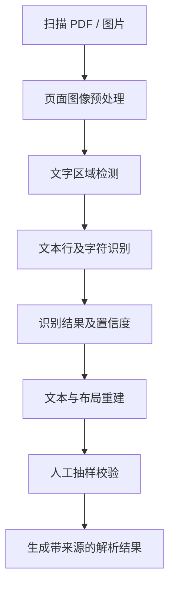
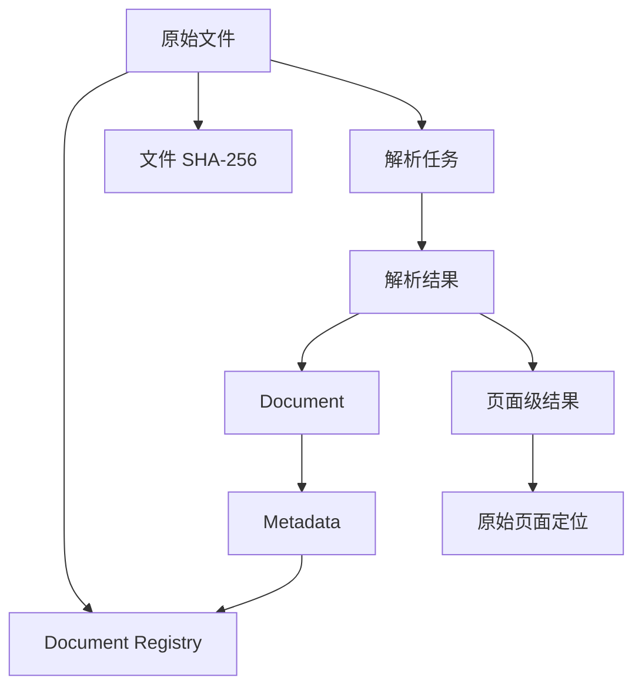
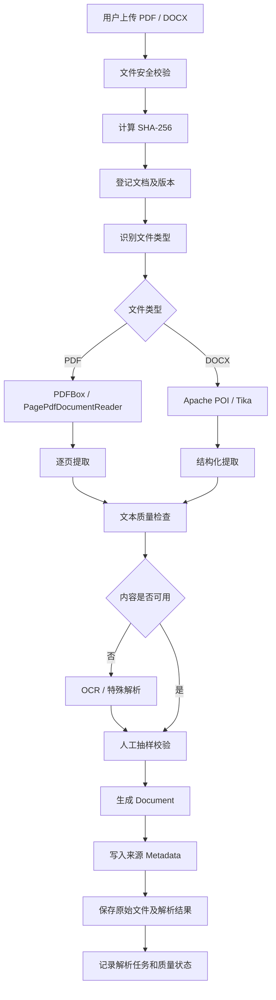

# M3 知识笔记：PDF/Word 解析与来源元数据

> **学习阶段：** M3 - RAG 知识与技能  
> **学习主题：** PDF/Word 解析与来源元数据  
> **技术环境：** JDK 21、Spring Boot 3.5.x、Spring AI 1.1.8  
> **学习目标：** 掌握 PDF、Word 文档解析原理、Java 解析方案、来源元数据设计、页码溯源和解析质量评估。

---

# 一、PDF/Word 在 RAG 中的作用

## 1.1 核心概念

PDF 和 Word 是知识的原始载体，不是天然适合机器处理的结构化知识。

设备手册通常包含：

- 设备型号及技术参数。
- 安装和接线说明。
- 故障代码和排查步骤。
- 安全注意事项。
- 参数表和设备结构图。

例如，用户提出问题：

> S7-1200 某型号 CPU 支持什么供电电压？

系统需要从原始文档中提取相关内容，同时保留对应的文档、页面和表格上下文。

如果只提取出：

```text
24 V DC
```

却没有保留对应的设备型号、参数名称和原始页码，那么这条信息的工程价值就会大幅降低。

## 1.2 文档解析的核心目标

文档解析不是简单地将 PDF 转换为字符串，而是将原始文件转换为可定位、可验证、可追溯的内容。

核心目标：

1. 尽可能完整地提取内容。
2. 保留原始文档的结构关系。
3. 保留内容与原始页面的对应关系。
4. 记录文档来源和版本。
5. 识别解析失败和不可信内容。
6. 为后续知识处理提供可验证的原始证据。

**核心结论：解析结果必须同时具备内容、结构、来源和质量信息。**

---

# 二、PDF 与 Word 的内部结构及解析难点

## 2.1 PDF 的内部结构

PDF（Portable Document Format）是一种页面描述格式。

主要包含：

- 页面尺寸和坐标系。
- 文本绘制指令。
- 字体及字符编码。
- 图片资源。
- 矢量图形。
- 页面对象及资源引用。
- 文档目录、书签和页面树。

PDF 不像 HTML 一样天然具有完整的标题、段落、表格等语义结构。

例如，PDF 页面显示：

| 参数名称 | 技术规格  |
| -------- | --------- |
| 设备型号 | CPU 1214C |
| 额定电压 | 24 V DC   |
| 输入点数 | 14        |
| 输出点数 | 10        |

其内部可能只是多个独立的文本绘制指令，并没有真正的表格对象。

可能出现以下提取结果：

```text
设备技术参数
设备型号
额定电压
输入点数
输出点数
CPU 1214C
24 V DC
14
10
```

这就导致参数名称和参数值分离。

### PDF 解析的主要难点

1. 文本绘制顺序不一定等于阅读顺序。
2. 多栏排版可能导致文本交叉。
3. 表格可能只是页面上的绘制对象。
4. 图片和图注可能无法自动建立关联。
5. 页码可能与印刷页码不一致。
6. 字体编码可能导致乱码。
7. 扫描型 PDF 可能完全没有可提取的文本层。

**重点：文本提取成功，不代表 PDF 结构完整。**

## 2.2 文本型 PDF 与扫描型 PDF

### 文本型 PDF

特点：

- 页面包含可提取的文字对象。
- 可以使用 PDFBox 直接提取文本。
- 可以获得部分文本位置、字体等信息。
- 不一定能够恢复原始表格和章节结构。

### 扫描型 PDF

特点：

- 页面主要由扫描图片构成。
- PDFBox 可能提取不到正文。
- 需要 OCR 识别图片中的文字。
- 识别结果需要质量检查。

### 判断方法

1. 使用 PDF 阅读器尝试选中文字。
2. 使用 PDFBox 检查各页面提取文本长度。
3. 将页面渲染成图片进行人工观察。
4. 对文本为空或异常的页面执行 OCR 候选检测。

注意：部分 PDF 同时存在文字层和扫描图片层，不能只根据单页是否有文字判断整份文件类型。

## 2.3 Word DOCX 的内部结构

DOCX 是基于 OOXML 的 ZIP 压缩文档包。

解压后通常可以看到：

```text
document.docx
│
├── [Content_Types].xml
├── _rels/
│   └── .rels
└── word/
    ├── document.xml
    ├── styles.xml
    ├── numbering.xml
    ├── settings.xml
    ├── header1.xml
    ├── footer1.xml
    ├── footnotes.xml
    ├── endnotes.xml
    ├── media/
    └── _rels/
```

主要文件：

| 文件          | 作用                 |
| ------------- | -------------------- |
| document.xml  | 正文主体             |
| styles.xml    | 标题、段落及文字样式 |
| numbering.xml | 列表编号             |
| header*.xml   | 页眉                 |
| footer*.xml   | 页脚                 |
| footnotes.xml | 脚注                 |
| endnotes.xml  | 尾注                 |
| media         | 图片等媒体资源       |

DOCX 比 PDF 更容易保留段落、表格等逻辑结构，但不意味着所有排版信息都可以直接恢复。

例如：

- 标题可能通过样式标识，也可能只是手动加粗。
- 表格可能存在合并单元格。
- 图片可能通过关系 ID 引用媒体文件。
- 页码可能是动态字段，而非固定文本。
- 分页取决于 Word 排版引擎、字体和页面设置。

**核心区别：DOCX 通常存储逻辑文档结构，而最终分页布局是在排版时确定的。**

Apache POI 可以提取 DOCX 的逻辑内容，但不能简单地把段落序号当作原始物理页码。

## 2.4 PDF 与 DOCX 对比

| 比较维度 | PDF              | DOCX                  |
| -------- | ---------------- | --------------------- |
| 内部基础 | 页面描述对象     | OOXML 文档结构        |
| 段落     | 通常需要推断     | 原生段落对象          |
| 标题     | 可能只有视觉样式 | 通常有样式信息        |
| 表格     | 可能是绘制出来的 | 原生表格结构          |
| 图片     | 页面资源对象     | 媒体文件及关系        |
| 页码     | 页面树和页面索引 | 动态分页              |
| 多栏     | 阅读顺序需要推断 | 有分栏布局定义        |
| OCR      | 扫描页需要识别   | 图片中的文字需要识别  |
| 主要难点 | 布局及阅读顺序   | 复杂 OOXML 结构和排版 |

## 2.5 为什么提取成功不代表结构完整

需要区分三个层次：

### 第一层：文本完整性

是否提取到了所有可见文字？

### 第二层：结构完整性

是否保留标题、段落、表格、图片和阅读顺序？

### 第三层：语义完整性

参数名称、参数值、单位、适用型号和上下文是否仍然正确对应？

例如：

原文：

```text
输入电压：24 V DC
```

错误解析：

```text
输入电压
24
V
DC
```

文字可能没有丢失，但参数关系已经受到破坏。

**工程上必须对重要参数表进行结构化提取和人工抽样校验。**

---

# 三、Spring AI 与第三方解析工具的关系

## 3.1 Spring AI 的职责边界

Spring AI 提供统一的文档抽象：

- `Document`：保存文本内容和 Metadata。
- `DocumentReader`：从不同来源读取内容并转换为 `List<Document>`。

但它不等于完整的 PDF/Word 版面解析引擎。

| 技术                     | 核心职责                     | 是否负责完整版面恢复 |
| ------------------------ | ---------------------------- | -------------------- |
| Spring AI Document       | 统一文档数据结构             | 否                   |
| Spring AI DocumentReader | 统一读取接口                 | 取决于具体 Reader    |
| PDFBox                   | PDF 页面和内容处理           | 不保证               |
| Apache POI               | DOCX 结构处理                | 不保证               |
| Apache Tika              | 文件识别及通用内容提取       | 不保证               |
| OCR                      | 图片文字识别                 | 不保证               |
| 自定义业务逻辑           | 结构修复、来源映射、质量验证 | 需要自行设计         |

## 3.2 Spring AI 1.1.8 的 Reader

### PagePdfDocumentReader

包名：

```java
org.springframework.ai.reader.pdf.PagePdfDocumentReader
```

依赖：

```xml
<dependency>
    <groupId>org.springframework.ai</groupId>
    <artifactId>spring-ai-pdf-document-reader</artifactId>
</dependency>
```

作用：

按照 PDF 页面提取内容，默认每页生成一个 Document。

适用场景：

- 需要页面级来源追溯。
- 需要知道内容来自 PDF 哪一页。
- 需要逐页进行解析质量检查。

常见构造方式：

```java
PagePdfDocumentReader(Resource pdfResource);
```

```java
PagePdfDocumentReader(
    Resource pdfResource,
    PdfDocumentReaderConfig config
);
```

### ParagraphPdfDocumentReader

包名：

```java
org.springframework.ai.reader.pdf.ParagraphPdfDocumentReader
```

作用：

利用 PDF 目录信息进行段落级内容组织。

局限：

- 并非所有 PDF 都有目录信息。
- PDF 目录不一定完整。
- 不能保证复杂表格和多栏结构恢复。

### TikaDocumentReader

包名：

```java
org.springframework.ai.reader.tika.TikaDocumentReader
```

依赖：

```xml
<dependency>
    <groupId>org.springframework.ai</groupId>
    <artifactId>spring-ai-tika-document-reader</artifactId>
</dependency>
```

适用场景：

- DOCX。
- DOC。
- PDF。
- PPTX。
- HTML 等。

它使用 Apache Tika 进行通用内容提取，适合格式较多、需要统一接入的场景。

但通用文本抽取不等于保留所有页面和表格结构。

**版本注意：** 上述 Reader 的 API 和职责需要以 Spring AI 1.1.8 官方 API 为准，不要将 Spring AI 2.x 的 API 直接套用到 1.1.8。

## 3.3 Apache PDFBox

适合：

- PDF 页面读取。
- 文本提取。
- 页面渲染。
- 文本坐标和字体信息获取。
- 页面级解析。

核心 API：

```java
PDDocument
PDFTextStripper
PDFRenderer
```

PDFBox 3.x 使用：

```java
Loader.loadPDF(...)
```

不要将 PDFBox 2.x 的加载方式直接复制到 3.x 项目。

## 3.4 Apache POI

适合 DOCX 结构化处理。

核心 API：

```java
XWPFDocument
XWPFParagraph
XWPFRun
XWPFTable
XWPFTableRow
XWPFTableCell
```

重点关注：

```java
document.getBodyElements()
```

它能够按照正文元素顺序获取段落和表格，而不是简单地分别获取段落集合、表格集合后再拼接。

## 3.5 Apache Tika

适合多格式文件接入。

核心 API：

```java
AutoDetectParser
Metadata
ParseContext
BodyContentHandler
```

核心特点：

- 自动识别文件类型。
- 使用相应 Parser 处理内容。
- 获取文本和部分文档 Metadata。
- 提供统一的多格式解析入口。

Tika 不是 PDFBox 和 POI 的替代品。它更像统一的内容解析框架，底层可以使用相应格式解析器。

## 3.6 解析技术对比

| 技术                       | PDF    | DOCX   | 表格           | 页面定位       | OCR                      |
| -------------------------- | ------ | ------ | -------------- | -------------- | ------------------------ |
| PagePdfDocumentReader      | 支持   | 不适用 | 不保证         | 较好           | 不负责                   |
| ParagraphPdfDocumentReader | 支持   | 不适用 | 不保证         | 取决于目录     | 不负责                   |
| TikaDocumentReader         | 支持   | 支持   | 通用提取       | 有限           | 不应默认认为支持扫描 OCR |
| PDFBox                     | 支持   | 不适用 | 需额外处理     | 好             | 不负责                   |
| Apache POI                 | 不适用 | 支持   | 好             | 不保证物理页码 | 不负责                   |
| OCR 引擎                   | 图片   | 图片   | 需专门布局分析 | 依赖输入页面   | 核心能力                 |

## 3.7 技术选择建议

对于设备知识库：

- PDF：优先使用 PagePdfDocumentReader 或 PDFBox。
- DOCX：需要结构保留时优先 Apache POI。
- 多格式统一入口：考虑 Tika。
- 扫描件：增加 OCR。
- 复杂参数表：单独建立表格结构提取和校验逻辑。

不要为了统一入口，牺牲原始页面、表格关系和内容溯源。

---

# 四、文本、表格、图片和扫描件解析

## 4.1 PDF 普通文本提取

PDFBox 3.x 示例：

```java
import org.apache.pdfbox.Loader;
import org.apache.pdfbox.pdmodel.PDDocument;
import org.apache.pdfbox.text.PDFTextStripper;

import java.nio.file.Path;

public class PdfTextExtractor {

    public void extract(Path path) throws Exception {

        try (PDDocument document =
                     Loader.loadPDF(path.toFile())) {

            PDFTextStripper stripper =
                    new PDFTextStripper();

            // 尝试按页面坐标排序
            stripper.setSortByPosition(true);

            int totalPages = document.getNumberOfPages();

            for (int page = 1; page <= totalPages; page++) {

                stripper.setStartPage(page);
                stripper.setEndPage(page);

                String text = stripper.getText(document);

                System.out.println("页面：" + page);
                System.out.println(text);
            }
        }
    }
}
```

核心 API：

| API                     | 作用                   |
| ----------------------- | ---------------------- |
| PDDocument              | 代表加载后的 PDF 文档  |
| PDFTextStripper         | 提取 PDF 文本          |
| setSortByPosition(true) | 尝试按页面位置组织文本 |
| setStartPage()          | 设置起始页             |
| setEndPage()            | 设置结束页             |
| getText()               | 获取文本               |

注意：按位置排序只是改善阅读顺序，不是完整的版面理解。

## 4.2 标题与章节提取

PDF 标题可能通过以下特征体现：

- 字体大小。
- 字体粗细。
- 文本坐标。
- 文本编号。
- 目录及书签。
- 章节编号规律。

例如：

```text
1 产品概述
1.1 产品特点
1.2 技术参数
2 安装与接线
2.1 安装要求
```

可以通过规则辅助识别：

```java
Pattern headingPattern = Pattern.compile(
    "^\\d+(\\.\\d+)*\\s+.+$"
);
```

但这只能识别符合规则的标题。

工程建议：

1. 优先读取原生标题结构或 PDF 目录。
2. 结合字体和位置辅助识别。
3. 使用章节编号规则补充。
4. 对重要章节进行人工验证。

## 4.3 Word 标题、段落和表格提取

Apache POI 示例：

```java
import org.apache.poi.xwpf.usermodel.*;

import java.io.InputStream;
import java.nio.file.Files;
import java.nio.file.Path;

public class WordExtractor {

    public void extract(Path path) throws Exception {

        try (InputStream input =
                     Files.newInputStream(path);
             XWPFDocument document =
                     new XWPFDocument(input)) {

            for (IBodyElement element :
                    document.getBodyElements()) {

                if (element instanceof XWPFParagraph paragraph) {

                    String text = paragraph.getText();

                    String style =
                            paragraph.getStyle();

                    System.out.println(
                            "Style=" + style +
                            ", Text=" + text
                    );

                } else if (element instanceof XWPFTable table) {

                    extractTable(table);
                }
            }
        }
    }

    private void extractTable(XWPFTable table) {

        for (XWPFTableRow row : table.getRows()) {

            for (XWPFTableCell cell : row.getTableCells()) {

                System.out.print(
                        cell.getText() + "\t"
                );
            }

            System.out.println();
        }
    }
}
```

重点：

`getBodyElements()` 保留正文中段落和表格的排列顺序。

不要分别获取段落和表格后直接拼接，否则可能破坏原始排列关系。

## 4.4 表格解析

设备知识库中，表格通常比普通文本更重要。

例如：

| 参数     | CPU 1212C | CPU 1214C |
| -------- | --------- | --------- |
| 输入点数 | 8         | 14        |
| 输出点数 | 6         | 10        |
| 供电电压 | 24 V DC   | 24 V DC   |

正确提取结果不能只是：

```text
输入点数 8 14
输出点数 6 10
供电电压 24 V DC 24 V DC
```

还需要知道：

- 哪一行是表头。
- 哪一列对应哪个设备型号。
- 每个参数值属于哪台设备。
- 单位是否独立存储。
- 是否存在合并单元格。
- 表格前后的说明是否影响参数含义。

推荐转换为结构化数据：

```json
{
  "tableTitle": "设备技术参数",
  "columns": [
    "参数",
    "CPU 1212C",
    "CPU 1214C"
  ],
  "rows": [
    {
      "parameter": "输入点数",
      "values": ["8", "14"],
      "unit": "点"
    },
    {
      "parameter": "输出点数",
      "values": ["6", "10"],
      "unit": "点"
    },
    {
      "parameter": "供电电压",
      "values": ["24", "24"],
      "unit": "V DC"
    }
  ]
}
```

以上是工程设计示例，不是实际设备手册的解析输出。

**核心原则：设备参数表不能随意转换为普通连续文本。**

## 4.5 图片和图注

设备手册图片通常包括：

- 设备外观。
- 接线图。
- 结构示意图。
- 安装尺寸图。
- 电气原理图。
- 操作界面截图。

推荐处理：

| 内容       | 处理方式                     |
| ---------- | ---------------------------- |
| 图片本身   | 提取并保存原始图片           |
| 图片编号   | 记录图号                     |
| 图片标题   | 提取图注                     |
| 图片所在页 | 记录原始页码                 |
| 图片上下文 | 保留相邻段落                 |
| 接线图     | 保留原图，必要时进行视觉识别 |
| 设备结构图 | 保留图片及设备部件说明       |

不能只提取图片而丢弃图注。

例如：

```text
图 3-2：CPU 接线示意图
```

应与对应图片建立关联。

PDFBox 可以处理页面中的图像资源，但图片可能经过裁剪、遮罩、重复引用或组合绘制。提取图片资源不等于还原页面上的完整视觉对象。

## 4.6 页眉、页脚、页码和脚注

PDF：

- 页眉和页脚通常是页面上的文本对象。
- 页码可能是绘制出来的文字。
- 脚注通常需要结合位置和编号识别。

DOCX：

- 页眉和页脚属于独立文档部分。
- 脚注和尾注有独立结构。
- 页码可能是动态字段。
- 分页通常由排版引擎决定。

不要将所有页眉、页脚都当成正文。

但也不能直接删除所有页眉页脚，因为部分手册会在页眉中记录文档版本或章节信息。

## 4.7 多栏排版和阅读顺序

常见错误：

原文：

```text
左栏：安装要求
左栏：接线说明

右栏：安全要求
右栏：注意事项
```

错误解析：

```text
安装要求
安全要求
接线说明
注意事项
```

解决方法：

1. 获取文本坐标。
2. 根据页面区域识别栏位。
3. 对不同栏位分别排序。
4. 判断标题、正文和注释之间的空间关系。
5. 使用渲染页面人工抽样验证。

PDFBox 的位置排序只能作为基础手段，复杂多栏页面仍需要版面分析。

---

# 五、OCR 原理及使用边界

## 5.1 OCR 是什么

OCR（Optical Character Recognition，光学字符识别）是从图片中识别文字的技术。

基本流程：



## 5.2 OCR 与普通 PDF 文本提取的区别

| 比较     | 普通文本提取             | OCR                  |
| -------- | ------------------------ | -------------------- |
| 输入     | PDF 文字对象             | 页面图片             |
| 主要原理 | 读取已有文本信息         | 图像识别             |
| 速度     | 通常较快                 | 通常较慢             |
| 字体依赖 | 受编码和字体影响         | 受图像质量影响       |
| 扫描件   | 无法直接提取图片中的文字 | 可以识别             |
| 识别错误 | 编码、顺序、映射错误     | 漏字、错字、字符混淆 |

## 5.3 OCR 常见错误

设备手册中的高风险识别错误：

| 原文      | 可能识别结果 |
| --------- | ------------ |
| CPU 1214C | CPU 12I4C    |
| 24 V DC   | 24 V 0C      |
| 0.5 mm²   | 05 mm2       |
| I/O       | 1/O          |
| ≤ 24 V    | 24 V         |
| 10 A      | 1O A         |

这些错误可能改变设备参数甚至安全要求。

因此设备知识库不能只看 OCR 是否输出了文字。

## 5.4 普通 OCR 与表格 OCR

普通 OCR：

```text
识别文字 → 输出文本
```

表格 OCR：

```text
识别表格区域
    ↓
识别行和列
    ↓
识别单元格
    ↓
恢复单元格关系
    ↓
识别表头和单位
    ↓
输出结构化表格
```

## 5.5 OCR 置信度

OCR 引擎可能为识别结果提供置信度。

示例：

```json
{
  "text": "CPU 1214C",
  "confidence": 0.96
}
```

以上为示意数据。

需要注意：

- 置信度不等于实际正确率。
- 不同引擎的置信度不可直接比较。
- 型号、单位和安全参数应设置更严格的人工审核规则。
- 低置信度内容应进入待校验队列。

重点校验：

1. 设备型号。
2. 电气参数。
3. 电压、电流和功率。
4. 故障代码。
5. 安全警告。
6. 接线端子编号。

## 5.6 Java 中的 OCR 接入

可以将 OCR 封装为独立服务：

```java
public interface OcrService {

    OcrResult recognize(
            byte[] imageBytes,
            String language
    );
}
```

返回对象：

```java
public record OcrResult(
        String text,
        Double confidence,
        boolean success,
        String errorMessage
) {}
```

具体引擎可以采用 Tesseract 或其他 OCR 服务。

OCR 与 PDF 普通文本提取需要分开：

```text
PDF 页面
   │
   ├── 有可用文本层
   │      └── PDFBox 提取
   │
   └── 无可用文本层
          └── 页面渲染
                  └── OCR
```

如果文字层存在但已经乱码，也可能需要 OCR，而不是只检查文本是否为空。

---

# 六、来源元数据与页码溯源

## 6.1 为什么必须保留 Metadata

解析结果：

```text
CPU 1214C 支持 24 V DC 供电。
```

后续排查时，需要知道：

- 来自哪份文档？
- 文档由谁发布？
- 是哪个版本？
- 原始文件在哪里？
- 来自第几页？
- 使用什么解析器？
- 解析器版本是什么？
- 文件是否被替换？
- 解析结果是否经过质量验证？

这些问题都需要 Metadata 和原始文件配合解决。

## 6.2 文档级与页面级 Metadata

### 文档级 Metadata

描述整份文件：

```json
{
  "documentId": "DOC-SIEMENS-001",
  "filename": "S7-1200-System-Manual.pdf",
  "source": "Siemens Industry Online Support",
  "title": "S7-1200 系统手册",
  "version": "V4.6",
  "contentType": "application/pdf",
  "checksum": "SHA-256值",
  "parser": "Apache PDFBox",
  "parserVersion": "3.x",
  "parsedAt": "2026-11-09T10:00:00+08:00"
}
```

### 页面级 Metadata

描述某个具体页面：

```json
{
  "documentId": "DOC-SIEMENS-001",
  "pageNumber": 115,
  "physicalPageNumber": 115,
  "printedPageNumber": "A-1",
  "contentType": "application/pdf",
  "parser": "Apache PDFBox"
}
```

以上仅为设计示例，不代表实际手册的第 115 页内容。

## 6.3 为什么需要多种页码

| 页码类型           | 含义                       |
| ------------------ | -------------------------- |
| physicalPageNumber | PDF 文件中的物理页面序号   |
| printedPageNumber  | 页面上印刷的页码           |
| parserPageNumber   | 解析器处理时使用的页码     |
| pageNumber         | 业务系统统一采用的页面标识 |

例如：

```text
PDF 第 1 页：封面
PDF 第 2 页：版权说明
PDF 第 3 页：目录
PDF 第 4 页：正文第 1 页
```

此时：

```json
{
  "physicalPageNumber": 4,
  "printedPageNumber": "1",
  "pageNumber": 4
}
```

不能把物理页码直接当成印刷页码。

DOCX 更复杂，因为分页可能随着字体、排版引擎和页面设置发生变化。

建议 DOCX 采用：

- 原始段落标识。
- 章节标题。
- 表格编号。
- 文档内部元素顺序。
- 页码作为可选的渲染定位信息。

## 6.4 Document Metadata 如何传递来源信息

Spring AI 的 Document 可以保存内容和 Metadata。

示例：

```java
import org.springframework.ai.document.Document;

import java.util.HashMap;
import java.util.Map;

public class DocumentFactory {

    public Document create(
            String text,
            String documentId,
            int pageNumber,
            String source,
            String version
    ) {

        Map<String, Object> metadata = new HashMap<>();

        metadata.put("documentId", documentId);
        metadata.put("pageNumber", pageNumber);
        metadata.put("source", source);
        metadata.put("version", version);

        return new Document(text, metadata);
    }
}
```

注意：

**Document Metadata 是数据携带机制，不是自动的来源真实性验证机制。**

Metadata 中写入了 source，并不代表这个来源一定真实可信。

必须在文件登记和来源审核环节建立可信来源记录。

## 6.5 原始文件与解析文本的关系

推荐采用以下数据关系：



原始文件必须保留。

原因：

1. 解析结果可能存在错误。
2. 解析器升级后需要重新解析。
3. OCR 模型升级后需要重新识别。
4. 需要人工核对原文。
5. 文档发生版本更新时需要对比。
6. 审计时需要原始证据。

不能只保存纯文本，然后删除原始 PDF 或 DOCX。

## 6.6 文档指纹与重复文件识别

使用 SHA-256 对原始文件计算 Hash。

Java 示例：

```java
import java.io.InputStream;
import java.nio.file.Files;
import java.nio.file.Path;
import java.security.MessageDigest;
import java.util.HexFormat;

public class FileHashUtil {

    public static String sha256(Path path) throws Exception {

        MessageDigest digest =
                MessageDigest.getInstance("SHA-256");

        try (InputStream input =
                     Files.newInputStream(path)) {

            byte[] buffer = new byte[8192];

            int length;

            while ((length = input.read(buffer)) != -1) {
                digest.update(buffer, 0, length);
            }
        }

        return HexFormat.of().formatHex(
                digest.digest()
        );
    }
}
```

作用：

- 判断文件内容是否完全相同。
- 识别重复上传。
- 判断文件是否被修改。
- 为文件版本管理提供依据。

需要区分：

| 情况                      | Hash 结果 |
| ------------------------- | --------- |
| 完全相同的文件            | 相同      |
| 内容相同但文件元数据变化  | 可能不同  |
| 仅修改文件名              | 相同      |
| 修改文档内容              | 通常不同  |
| 相同内容重新压缩生成 DOCX | 可能不同  |

因此：

- Hash 相同可以证明字节内容一致。
- Hash 不同不能直接证明业务文档内容不同。

推荐同时维护：

- `checksum`：文件级指纹。
- `documentId`：业务文档标识。
- `version`：业务版本。
- `sourceDocumentId`：来源文档关联标识。

## 6.7 来源可信度

设备知识库建议采用以下来源分类：

| 来源             | 可信度管理           |
| ---------------- | -------------------- |
| 设备厂商官方手册 | 优先采用             |
| 厂商官方技术公告 | 高优先级             |
| 授权经销商资料   | 需要核对版本         |
| 第三方技术文章   | 作为辅助参考         |
| 用户上传文档     | 需要来源确认         |
| 未知来源文件     | 不应直接作为权威依据 |

来源可信不等于内容永远正确。

官方手册也可能已经过时，必须结合设备型号、固件版本和发布日期判断适用性。

## 6.8 可复现性

建议增加以下解析信息：

```json
{
  "parser": "Apache PDFBox",
  "parserVersion": "3.0.x",
  "parserConfig": {
    "sortByPosition": true,
    "pagesPerDocument": 1
  },
  "ocrEngine": null,
  "ocrModelVersion": null,
  "parsedAt": "2026-11-09T10:00:00+08:00",
  "status": "SUCCESS"
}
```

重点：

- `parserVersion`：解析器版本。
- `parserConfig`：解析配置。
- `parsedAt`：解析时间。
- `ocrModelVersion`：OCR 模型版本。
- `status`：解析状态。

当解析结果异常时，才能复现原来的处理过程。

## 6.9 推荐 Metadata 完整结构

```json
{
  "documentId": "DOC-001",
  "filename": "equipment-manual.pdf",
  "source": "Siemens Official",
  "sourceUrl": "官方原始链接",
  "title": "设备系统手册",
  "version": "V4.6",
  "contentType": "application/pdf",
  "checksum": "SHA-256",

  "pageNumber": 10,
  "physicalPageNumber": 10,
  "printedPageNumber": "6",

  "parser": "Apache PDFBox",
  "parserVersion": "3.0.x",
  "parsedAt": "2026-11-09T10:00:00+08:00",

  "ocrUsed": false,
  "parseStatus": "SUCCESS",
  "qualityStatus": "PENDING_REVIEW"
}
```

以上为设计示例。

生产环境建议将三类信息分别持久化：

1. 文档级信息。
2. 解析任务级信息。
3. 页面级信息。

通过 `documentId` 和 `parseTaskId` 关联，不要将所有信息重复写入每一个 Document。

---

# 七、解析质量评估与失败处理

## 7.1 解析质量的四个维度

| 维度       | 评价内容                         |
| ---------- | -------------------------------- |
| 文本完整性 | 是否缺字、漏字、乱码             |
| 结构完整性 | 标题、段落、表格和图片关系       |
| 来源完整性 | 文档、页码、版本能否追溯         |
| 语义完整性 | 参数、单位、型号及上下文是否正确 |

## 7.2 质量评估指标

### 文本覆盖率

```text
文本覆盖率 =
成功提取的目标文本量 / 原文可提取的目标文本量
```

分母需要通过人工标注或可信参考结果建立，不能直接使用解析器输出的文本长度作为分母。

### 页面完整率

```text
页面完整率 =
完整解析页面数 / 总页面数
```

### 表格完整率

```text
表格完整率 =
结构正确的表格数 / 抽样验证表格数
```

### 元数据完整率

```text
元数据完整率 =
必需元数据完整的记录数 / 检查记录总数
```

设备知识库还需要增加：

- 型号识别准确率。
- 参数值识别准确率。
- 单位保留准确率。
- 页面映射准确率。

这些指标比单纯的字符提取率更能反映工程质量。

## 7.3 常见解析缺陷

| 缺陷         | 可能原因               | 解决方案                   |
| ------------ | ---------------------- | -------------------------- |
| 文本缺失     | 扫描件、字体编码       | OCR 或字体映射检查         |
| 乱码         | 字符编码问题           | 检查字体及编码，必要时 OCR |
| 阅读顺序错误 | 多栏排版               | 坐标及版面分析             |
| 表格错位     | 文本对象分离           | 表格结构识别               |
| 单位丢失     | 单元格拆分             | 单位与参数关联             |
| 页码错误     | 物理页码与印刷页码混淆 | 建立页码映射               |
| 图片遗漏     | 图片资源未提取         | 图片资源检查               |
| 图注分离     | 图注与图片缺乏关联     | 坐标和编号关联             |
| OCR 型号错误 | 字符相似               | 型号规则和人工校验         |
| 解析中断     | 文件损坏、内存不足     | 分类记录、隔离重试         |

## 7.4 解析状态设计

建议：

```text
PENDING
PARSING
SUCCESS
PARTIAL_SUCCESS
FAILED
NEEDS_REVIEW
```

| 状态            | 含义                   |
| --------------- | ---------------------- |
| PENDING         | 等待解析               |
| PARSING         | 正在解析               |
| SUCCESS         | 解析流程成功完成       |
| PARTIAL_SUCCESS | 部分页面或内容失败     |
| FAILED          | 整个解析任务失败       |
| NEEDS_REVIEW    | 解析完成但需要人工审核 |

特别注意：

`SUCCESS` 仅代表解析流程完成，不代表内容准确。

## 7.5 异常处理

### 空文档

- 文件存在但没有有效内容。
- 解析结果为空。
- 不应该继续作为正常知识文档处理。

### 加密文件

- 检查是否存在密码保护。
- 未授权时不要绕过访问限制。
- 记录加密状态和失败原因。

### 损坏文件

- 解析器抛出异常。
- 记录异常类型和文件指纹。
- 隔离问题文件。

### 超大文件

- 服务端限制上传大小。
- 限制页面数量和解压资源。
- 控制最大解析时间。
- 防止 ZIP Bomb 和异常压缩文件消耗资源。

### 部分页面解析失败

- 保留成功页面。
- 记录失败页面。
- 将整体状态设为 `PARTIAL_SUCCESS`。
- 不要因为一页失败就丢弃全部解析结果。

## 7.6 日志设计

建议记录：

```json
{
  "parseTaskId": "TASK-001",
  "documentId": "DOC-001",
  "parser": "Apache PDFBox",
  "totalPages": 100,
  "successPages": 98,
  "failedPages": 2,
  "durationMs": 3500,
  "status": "PARTIAL_SUCCESS",
  "errors": [
    {
      "pageNumber": 32,
      "errorCode": "PAGE_TEXT_EXTRACTION_FAILED"
    },
    {
      "pageNumber": 68,
      "errorCode": "PAGE_RENDER_FAILED"
    }
  ]
}
```

以上为日志结构示例。

## 7.7 重试策略

不是所有失败都适合重试。

| 失败类型     | 重试策略             |
| ------------ | -------------------- |
| 临时 IO 异常 | 有限次数重试         |
| 文件损坏     | 不自动重复重试       |
| 密码保护     | 等待合法授权         |
| OCR 服务超时 | 有限次数重试         |
| 字体编码错误 | 切换解析策略         |
| 表格识别错误 | 进入人工校验         |
| 文件超过限制 | 不重试，要求重新处理 |

建议使用：

- 最大重试次数。
- 指数退避。
- 幂等任务 ID。
- 失败页面独立记录。
- 重试次数和失败原因审计。

## 7.8 敏感信息保护

设备手册及用户上传文件可能包含：

- 账号和密码。
- API Key。
- 内网地址。
- 设备 IP。
- 个人信息。
- 企业内部配置。

建议：

1. 原始文件采用访问控制。
2. 解析日志不输出敏感原文。
3. 敏感字段按规则脱敏。
4. 文件下载使用授权访问。
5. OCR 外部服务调用前评估数据泄露风险。
6. 设置原始文件保留期限和删除策略。

---

# 八、公开设备手册实际验证

## 8.1 文档选择

本次选择西门子官方发布的 S7-1200 系统手册。

**文档信息：**

| 项目         | 信息             |
| ------------ | ---------------- |
| 厂商         | Siemens          |
| 设备         | SIMATIC S7-1200  |
| 文档名称     | S7-1200 系统手册 |
| 版本         | 2022 年 11 月版  |
| 软件适用版本 | STEP 7 V18       |
| CPU 固件     | V4.6             |
| 语言         | 中文             |
| 文件类型     | PDF              |
| 文档编号     | 109814829        |

官方资料入口：

[Siemens S7-1200 System Manual | S7-1200 系统手册](https://support.industry.siemens.com/cs/cn/zh/view/109814829)

[Siemens S7-1200 Documentation | S7-1200 官方文档目录](https://www.ad.siemens.com.cn/productportal/prods/s7-1200_plc_easy_plus/01-resource/03-online_doc.htm)

选择理由：

1. 真实工业设备文档。
2. 符合制造业设备知识库场景。
3. 包含设备介绍、安装、接线和技术规范等不同类型内容。
4. 适合检查标题、正文、参数、单位、图片和页码。
5. 厂商官方发布，来源可信度较高。

注意：实际实验应以下载文件的封面、版权页及文件属性为准，重新确认文档版本，不应只依赖网页目录。

## 8.2 解析方案

推荐采用：

| 环节           | 技术                      |
| -------------- | ------------------------- |
| 原始文件保存   | 本地文件或对象存储        |
| 文件类型检测   | Apache Tika               |
| 文件 Hash      | Java SHA-256              |
| PDF 页面提取   | Apache PDFBox             |
| Spring AI 集成 | PagePdfDocumentReader     |
| OCR            | Tesseract 或其他 OCR 引擎 |
| Metadata       | Spring AI Document        |
| 质量验证       | Java 自动检查 + 人工抽样  |

## 8.3 PDFBox 解析代码

```java
import org.apache.pdfbox.Loader;
import org.apache.pdfbox.pdmodel.PDDocument;
import org.apache.pdfbox.text.PDFTextStripper;

import java.nio.file.Path;

public class PdfTextExtractor {

    public void extract(Path path) throws Exception {

        try (PDDocument document =
                     Loader.loadPDF(path.toFile())) {

            PDFTextStripper stripper =
                    new PDFTextStripper();

            stripper.setSortByPosition(true);

            int totalPages = document.getNumberOfPages();

            for (int page = 1; page <= totalPages; page++) {

                stripper.setStartPage(page);
                stripper.setEndPage(page);

                String text = stripper.getText(document);

                System.out.println("===== PAGE "
                        + page + " =====");

                System.out.println(text);
            }
        }
    }
}
```

代码用途：

- 读取 PDF。
- 获取总页数。
- 逐页提取文本。
- 尝试按照页面位置排序。
- 输出每页解析结果。

注意：代码尚未在本次任务环境中实际运行，不能将示例输出视为实验结果。

## 8.4 实际验证项目

| 验证项目 | 验收要求                     | 当前状态   |
| -------- | ---------------------------- | ---------- |
| 文档来源 | 官方原始链接                 | 已确认     |
| 文档版本 | 对照封面及版权页             | 待本地核验 |
| 文件下载 | 保存原始 PDF                 | 待完成     |
| SHA-256  | 计算原始文件指纹             | 待完成     |
| 文本     | 检查正文提取是否完整         | 待执行     |
| 标题     | 检查章节层级是否保留         | 待执行     |
| 页码     | 能够定位原始页面             | 待执行     |
| 表格     | 检查表头、行列及单位         | 待执行     |
| 图片     | 确认图片是否提取或遗漏       | 待执行     |
| OCR      | 判断是否存在扫描件及识别需求 | 待执行     |
| Metadata | 检查文档来源及页码关联       | 待执行     |
| 质量     | 对照原文识别缺失、错位和乱码 | 待执行     |

## 8.5 原文与解析结果对比记录

实际执行后，应填写：

| 检查对象 | 原文证据           | Java 解析结果     | 结论   |
| -------- | ------------------ | ----------------- | ------ |
| 正文     | 原始 PDF 页面      | PDFBox 提取文本   | 待执行 |
| 标题     | 原始章节标题       | 文本及标题识别    | 待执行 |
| 页码     | PDF 页面和印刷页码 | 页面 Metadata     | 待执行 |
| 表格     | 参数表原始布局     | 行列结构          | 待执行 |
| 图片     | 原始页面图片       | 图片资源提取      | 待执行 |
| OCR      | 扫描页面           | OCR 识别文本      | 待执行 |
| Metadata | 文档来源和版本     | Document Metadata | 待执行 |

## 8.6 质量验证记录

实际运行后填写：

| 验证项目   | 验证方法           | 实际结果 | 是否通过 |
| ---------- | ------------------ | -------- | -------- |
| 文件完整性 | 文件 Hash          | 待填写   | 待验证   |
| 文本完整性 | 原文与解析文本对照 | 待填写   | 待验证   |
| 标题层级   | 章节目录对照       | 待填写   | 待验证   |
| 页码映射   | 抽样核对页面       | 待填写   | 待验证   |
| 表格结构   | 对照原始表格       | 待填写   | 待验证   |
| 参数单位   | 检查参数值         | 待填写   | 待验证   |
| 图片提取   | 检查页面及资源     | 待填写   | 待验证   |
| OCR        | 对照扫描原图       | 待填写   | 待验证   |
| Metadata   | 检查 Document      | 待填写   | 待验证   |
| 质量审核   | 人工抽样           | 待填写   | 待验证   |

## 8.7 当前实际执行情况

本次知识笔记整理时，实际执行状态如下：

| 检查项目           | 状态               |
| ------------------ | ------------------ |
| 官方设备手册检索   | 已完成             |
| 官方文档入口确认   | 已完成             |
| 文档版本资料确认   | 已完成，待文件复核 |
| 原始 PDF 本地下载  | 未完成             |
| Java PDFBox 执行   | 未执行             |
| PDF 实际总页数统计 | 未执行             |
| SHA-256 计算       | 未执行             |
| 原文与解析文本对照 | 未执行             |
| 表格提取           | 未执行             |
| OCR 测试           | 未执行             |
| Metadata 实际写入  | 未执行             |

**当前结论：知识学习和工程方案设计已完成，真实 Java 解析实验尚未完成。**

不得将示例代码、示例 JSON 和预期结果当作真实执行证据。

---

# 九、Java 工程实践与核心总结

## 9.1 推荐完整解析流程



## 9.2 Java 工程推荐模块

| 模块                   | 职责           |
| ---------------------- | -------------- |
| DocumentRegistry       | 文档登记及版本 |
| FileFingerprintService | 文件 Hash      |
| DocumentTypeDetector   | 文件类型识别   |
| PdfParser              | PDF 解析       |
| WordParser             | DOCX 解析      |
| OcrService             | 扫描件 OCR     |
| MetadataFactory        | 来源 Metadata  |
| ParseQualityService    | 质量检查       |
| ParseTaskService       | 解析状态和日志 |
| OriginalFileStorage    | 原始文件保存   |

当前阶段不需要一次性实现全部模块。

优先完成：

1. 文件登记。
2. 文件 Hash。
3. PDF 页面级解析。
4. 页面 Metadata。
5. 解析结果保存。
6. 原文与解析文本对照。

## 9.3 关键技术决策

| 场景               | 推荐方案                          |
| ------------------ | --------------------------------- |
| 普通文本 PDF       | PDFBox                            |
| 需要页码追溯的 PDF | PagePdfDocumentReader             |
| 有完整目录的 PDF   | 评估 ParagraphPdfDocumentReader   |
| DOCX 段落和表格    | Apache POI                        |
| 多格式统一抽取     | Apache Tika                       |
| 扫描型 PDF         | PDFBox 渲染 + OCR                 |
| 复杂设备参数表     | 专门的表格解析                    |
| 原始文档追溯       | SHA-256 + documentId + pageNumber |
| 版本管理           | documentId + version + checksum   |

## 9.4 本主题必须掌握的十个结论

1. PDF 是页面描述格式，不是天然的结构化文本。
2. DOCX 是 OOXML 文档包，具有更丰富的逻辑结构。
3. PDF 文本提取成功，不代表阅读顺序正确。
4. Word 段落和表格可以提取，但不代表能够恢复实际分页。
5. Spring AI DocumentReader 是统一读取抽象，不是完整文档解析引擎。
6. 表格必须保留表头、行列关系、单位及上下文。
7. 扫描件需要 OCR，但 OCR 结果不能直接认定准确。
8. 文档级 Metadata 和页面级 Metadata 必须区分。
9. SHA-256 可以识别字节级重复文件，但不能独立判断业务版本。
10. 原始文件必须保留，解析结果必须能够追溯和重新生成。

**核心工程思想：**

> 文档解析不是文件格式转换，而是将非结构化原始资料转换为可定位、可验证、可复现的知识数据。

---

# 十、官方参考资料

以下资料优先采用官方文档及对应版本 API。

## 10.1 Spring AI

1. ETL Pipeline | ETL 数据处理管道：[Spring AI 官方文档](https://docs.spring.io/spring-ai/reference/api/etl-pipeline.html)
2. PagePdfDocumentReader | PDF 页面文档读取器：[Spring AI 1.1.8 API](https://docs.spring.io/spring-ai/docs/1.1.8/api/org/springframework/ai/reader/pdf/PagePdfDocumentReader.html)

## 10.2 Apache PDFBox

3. Apache PDFBox Frequently Asked Questions | Apache PDFBox 常见问题：[官方文档](https://pdfbox.apache.org/3.0/faq.html)
4. PDFBox 3.0 Migration Guide | PDFBox 3.0 迁移指南：[官方文档](https://pdfbox.apache.org/3.0/migration.html)

## 10.3 Apache POI

5. POI-XWPF - A Quick Guide | POI-XWPF 快速指南：[官方文档](https://poi.apache.org/components/document/quick-guide-xwpf.html)
6. XWPFDocument | Word 文档对象 API：[官方 API](https://poi.apache.org/apidocs/dev/org/apache/poi/xwpf/usermodel/XWPFDocument.html)

## 10.4 Apache Tika

7. Apache Tika Documentation | Apache Tika 官方文档：[官方文档](https://tika.apache.org/docs/)
8. AutoDetectParser | 自动检测解析器 API：[Apache Tika 3.2.3 API](https://tika.apache.org/3.2.3/api/org/apache/tika/parser/AutoDetectParser.html)

## 10.5 Siemens

9. S7-1200 System Manual | S7-1200 系统手册：[官方文档入口](https://support.industry.siemens.com/cs/cn/zh/view/109814829)

---

# 十一、学习验收清单

## 11.1 知识掌握

- [ ] 能区分文本型 PDF 和扫描型 PDF。
- [ ] 能解释 PDF 与 DOCX 的内部结构。
- [ ] 能说明 PDF 多栏排版和阅读顺序问题。
- [ ] 能区分 Spring AI 与第三方解析工具的职责。
- [ ] 能选择合适的 Java 文档解析方案。
- [ ] 能解释表格、图片和 OCR 的处理边界。
- [ ] 能设计文档级和页面级 Metadata。
- [ ] 能解释 SHA-256 和文档版本管理。
- [ ] 能设计原始文件与解析结果的追溯关系。
- [ ] 能识别和评估常见解析缺陷。

## 11.2 实际操作

- [ ] 下载一份真实公开设备手册。
- [ ] 保存原始 PDF。
- [ ] 计算 SHA-256。
- [ ] 使用 PDFBox 完成逐页解析。
- [ ] 保存原始解析文本。
- [ ] 核对标题和章节。
- [ ] 核对表格及参数单位。
- [ ] 检查图片提取情况。
- [ ] 判断是否需要 OCR。
- [ ] 建立页面级 Metadata。
- [ ] 完成原文与解析结果对照。
- [ ] 保存实际执行证据。

## 11.3 最终交付物

| 交付物            | 要求                   | 状态       |
| ----------------- | ---------------------- | ---------- |
| Markdown 知识笔记 | 完整技术知识和工程实践 | 已完成     |
| 公开设备手册      | 官方原始 PDF           | 待下载     |
| 解析工具及配置    | Java 解析方案          | 已设计     |
| 解析结果证据      | 真实逐页解析结果       | 待完成     |
| Metadata 示例     | 文档级和页面级         | 已完成设计 |
| 质量验证记录      | 原文与解析结果对照     | 待完成     |
| 技术总结          | 关键结论和工程决策     | 已完成     |

**最终验收标准：**

不仅能够解释 PDF/Word 如何解析，还必须能够使用 Java 对真实设备手册进行解析，保留来源 Metadata 和原始页码，并通过实际对照识别文本、表格、图片及 OCR 的解析缺陷。

**当前状态：知识笔记完成，真实解析实验待执行。**