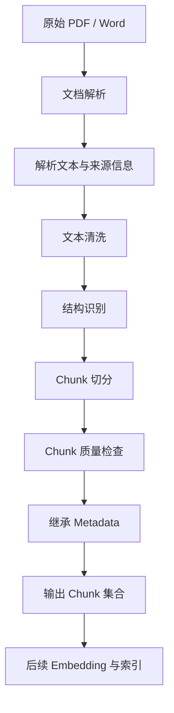

# M3 知识笔记：RAG 文本清洗与切分策略

## 一、文本清洗在 RAG 中的位置

### 1.1 RAG 文档处理流程

RAG 并不是把 PDF 或 Word 解析出的文本直接交给 Embedding 模型，而是需要经过预处理和切分。



本次学习范围截至 Chunk 集合生成，不展开 Embedding、Vector Store 和 Reranking 的具体实现。

### 1.2 为什么解析结果不能直接切分

文档解析的主要任务是提取内容，而不是保证内容已经适合检索。

解析结果可能包含：

- 多余的空格、换行和制表符。
- PDF 页眉、页脚和重复页码。
- 重复的目录内容。
- 页面断开造成的句子截断。
- 表格内容被错误地展开为普通文本。
- 设备型号、告警代码、技术参数被拆散。
- 扫描件 OCR 产生的错误字符。
- 同一段内容因为跨页而重复出现。

例如，原文可能是：

```text
CPU 1214C DC/DC/DC

数字量输入：14 x 24 V DC
数字量输出：10 x 24 V DC
模拟量输入：2 x 0-10 V DC
```

不合理的清洗可能变成：

```text
CPU 1214C
数字量输入：14
数字量输出：10
模拟量输入：2
```

这种处理破坏了型号、数量、单位和参数之间的关系。

因此，清洗的核心目标不是让文本变短，而是：

1. 去除无价值噪声。
2. 保留有意义的结构。
3. 修复可以确定的格式问题。
4. 不改变技术事实。
5. 为后续切分提供稳定输入。

### 1.3 常见清洗操作

| 清洗对象      | 处理方式           | 注意事项                 |
| ------------- | ------------------ | ------------------------ |
| CRLF、CR 换行 | 统一为 LF          | 不要删除段落边界         |
| 行首行尾空格  | 去除               | 保留必要缩进             |
| 连续空行      | 适度合并           | 不要把段落全部合并       |
| 页眉、页脚    | 根据规则识别后删除 | 不要误删正文             |
| 重复页码      | 结合页面位置识别   | 不要直接删除正文数字     |
| OCR 乱码      | 结合原文校验       | 不要猜测技术参数         |
| 表格          | 保留行列关系       | 不要随意展开成无关联文本 |
| 设备型号      | 原样保留           | 不要拆分或改写           |
| 单位          | 与数值一起保留     | 例如 24 V DC             |
| 告警代码      | 保留完整代码       | 不要拆成普通单词         |

### 1.4 清洗前后对比

清洗前：

```text
      SIMATIC S7-1200 System Manual

CPU 1214C DC/DC/DC


Digital inputs: 14 x 24 V DC

                                      125
```

清洗后：

```text
CPU 1214C DC/DC/DC

Digital inputs: 14 x 24 V DC
```

以上是格式示意，不是本次设备手册的实际解析结果。

### 1.5 清洗操作的幂等性

**概念：**

幂等性是指对同一份数据重复执行同一操作，不会产生额外变化。

例如：

```text
第一次清洗：原文 -> 清洗结果
第二次清洗：清洗结果 -> 相同清洗结果
```

可以使用下面的测试验证：

```java
String once = cleaner.clean(rawText);
String twice = cleaner.clean(once);

assert once.equals(twice);
```

工程实践中需要注意：

- 不要每次运行都在文本末尾追加标记。
- 不要反复替换已经标准化的换行符。
- 不要每次运行都删除一部分空白，导致内容逐渐变化。
- 不要依赖当前时间生成清洗结果。
- 对清洗规则进行版本管理。

**局限：**

幂等不代表清洗正确。一个错误的清洗规则同样可能稳定地产生错误结果。

---

## 二、Chunk 基础概念与设计目的

### 2.1 什么是 Chunk

Chunk 是把较长文档切分后得到的文本片段。

例如：

```text
Document
├── Chunk 001：设备概述
├── Chunk 002：CPU 技术规格
├── Chunk 003：数字量输入
├── Chunk 004：数字量输出
└── Chunk 005：安装要求
```

Chunk 是后续检索和上下文组织的基本文本单元。

### 2.2 为什么不直接把整个文档作为一个 Chunk

假设设备手册有 500 页。

如果将整个文档作为一个 Chunk，会出现：

1. 文本长度可能超过 Embedding 模型输入限制。
2. 文档中不同主题混合，检索粒度过粗。
3. 一个 Chunk 包含大量与当前问题无关的信息。
4. 后续很难精确定位相关章节。
5. 整体更新成本较高。

因此，通常需要将文档拆分为多个具有相对独立语义的 Chunk。

### 2.3 Document 和 Chunk 的关系

| 对象        | 含义                           | 示例                |
| ----------- | ------------------------------ | ------------------- |
| Document    | 一份原始文档或一次文档解析结果 | S7-1200 系统手册    |
| Chunk       | Document 切分后得到的文本片段  | CPU 1214C 技术规格  |
| Document ID | 原始文档的稳定标识             | doc-s7-1200         |
| Chunk ID    | 某个切分结果的唯一标识         | doc-s7-1200-v2-0001 |

关系：

```text
Document
   |
   | 经过清洗和切分
   |
   +---- Chunk 001
   |
   +---- Chunk 002
   |
   +---- Chunk 003
```

一个 Document 可以包含多个 Chunk。

每个 Chunk 应保留它来自哪个 Document，以及能够定位原文的来源信息。

### 2.4 Chunk 粒度的影响

| Chunk 粒度 | 优势                   | 缺点                       |
| ---------- | ---------------------- | -------------------------- |
| 过大       | 上下文相对完整         | 无关内容多，检索粒度粗     |
| 适中       | 语义和检索粒度相对平衡 | 需要根据文档类型调参       |
| 过小       | 内容主题可能更集中     | 容易丢失条件、定义和上下文 |

Chunk 不是越小越好。

例如：

```text
原文：
CPU 1214C 的数字量输入数量为 14 点，
输入电压为 24 V DC。
```

不合理切分：

```text
Chunk 1：CPU 1214C 的数字量输入数量为 14 点
Chunk 2：输入电压为 24 V DC
```

第二个 Chunk 可能失去它描述的是哪一种设备、哪一种接口的上下文。

---

## 三、固定长度切分原理

### 3.1 基本原理

固定长度切分按照预先设定的长度，将文本划分成多个片段。

例如：

```text
原文：
ABCDEFGHIJKLMN

Chunk Size = 5
Overlap = 0

Chunk 1：ABCDE
Chunk 2：FGHIJ
Chunk 3：KLMN
```

如果：

```text
Chunk Size = 5
Overlap = 2
```

则：

```text
Chunk 1：ABCDE
Chunk 2：DEFGH
Chunk 3：GHIJK
Chunk 4：JKLMN
```

这里的长度仅用于说明字符切分，不代表 Token 数量。

### 3.2 Chunk Size

Chunk Size 是切分器使用的目标长度参数。

必须先明确长度单位：

- 字符数：例如 Unicode 码点数量。
- UTF-16 代码单元数量：Java String.length() 使用的单位。
- Token 数：由具体 Tokenizer 决定。

三者不能直接等同。

Java 中：

```java
String text = "Java技术";

System.out.println(text.length());
```

`String.length()` 返回 UTF-16 代码单元数量，不等于 Unicode 码点数量，也不等于 Token 数量。

### 3.3 Overlap

Overlap 是相邻 Chunk 之间重复保留的文本长度。

例如：

```text
Chunk Size = 100
Overlap = 20
```

通常意味着相邻 Chunk 之间保留约 20 个单位的重叠内容。

Overlap 的作用：

1. 减少切分边界造成的信息丢失。
2. 让跨边界的上下文有机会同时出现在相邻 Chunk 中。
3. 提高边界附近内容被检索到的可能性。

代价：

1. 增加 Chunk 数量。
2. 增加 Embedding 输入总量。
3. 增加索引存储。
4. 可能造成重复召回。
5. 可能导致最终上下文中出现重复内容。

Overlap 不是越大越好。

### 3.4 固定长度切分的优势与局限

优势：

- 算法简单。
- 长度容易控制。
- 实现成本低。
- 适合结构不明显的长文本。
- 容易进行参数实验。

局限：

- 可能截断句子。
- 可能截断段落。
- 可能拆散表格。
- 可能将标题与正文分开。
- 不理解技术参数之间的关系。

适用场景：

- 连续性较强的普通文本。
- 没有明显章节结构的文档。
- 作为结构化切分的二次切分手段。

---

## 四、标题/段落结构化切分

### 4.1 基本原理

结构化切分不只关注文本长度，还关注文档自身的结构。

主要结构包括：

- 标题层级。
- 段落。
- 列表。
- 表格。
- 代码块。
- 操作步骤。

例如：

```text
1. CPU 概述

CPU 是控制器的核心组件。

1.1 CPU 技术规格

CPU 1214C 具有以下技术参数：

- 数字量输入：14 点
- 数字量输出：10 点

1.2 安装要求

安装设备时应满足规定的环境条件。
```

可以按照标题和段落生成：

```text
Chunk 1：
标题路径：1. CPU 概述
内容：CPU 是控制器的核心组件。

Chunk 2：
标题路径：1. CPU 概述 > 1.1 CPU 技术规格
内容：CPU 1214C 具有以下技术参数：
- 数字量输入：14 点
- 数字量输出：10 点

Chunk 3：
标题路径：1. CPU 概述 > 1.2 安装要求
内容：安装设备时应满足规定的环境条件。
```

### 4.2 为什么标题要与正文关联

假设正文只有：

```text
输入电压：24 V DC
```

没有标题时，无法判断它属于：

- 数字量输入。
- 数字量输出。
- 电源输入。
- 其他设备接口。

如果将标题路径一起保留：

```text
CPU 技术规格 > 数字量输入

输入电压：24 V DC
```

上下文就更加完整。

工程中可以将标题路径：

1. 拼接到 Chunk 正文。
2. 存入 Metadata。
3. 同时保留在正文和 Metadata 中。

对于技术文档，通常建议保留标题路径，并在必要时将其作为上下文前缀。

### 4.3 表格、列表和代码块保护

不要把所有换行都视为普通段落边界。

例如：

```text
| 参数 | 数值 |
|---|---|
| 输入电压 | 24 V DC |
| 输入数量 | 14 |
| 输出数量 | 10 |
```

如果将表格拆成：

```text
Chunk 1：
| 参数 | 数值 |
|---|---|

Chunk 2：
| 输入电压 | 24 V DC |
```

第二个 Chunk 可能缺少表头。

因此，应尽量将完整表格作为一个结构块。

代码块同理：

````text
```java
public class Device {
    private String model;
}
```
````

不能随意从中间切断。

### 4.4 超长章节和超长段落

结构化切分并不意味着永远不切断段落。

如果某个段落特别长，仍然需要二次切分。

推荐流程：

```text
标题识别
  |
章节内容提取
  |
段落和结构块识别
  |
判断长度
  |
  +-- 未超限：直接保留
  |
  +-- 超限：按句子、自然边界二次切分
                  |
                  +-- 仍然超限：固定长度兜底
```

二次切分时需要：

- 继承原章节标题。
- 保留原始来源信息。
- 尽可能在句子边界切分。
- 不破坏设备参数与单位的关系。
- 不随意拆散表格和操作步骤。

### 4.5 短文本合并

结构化切分可能产生非常短的 Chunk。

例如：

```text
Chunk 1：设备概述
Chunk 2：本设备支持以下功能。
Chunk 3：支持数字量输入。
Chunk 4：支持数字量输出。
```

可以在满足条件时合并相邻短文本。

合并原则：

1. 必须属于相同章节或相近主题。
2. 合并后不能超过目标长度。
3. 不能跨越明显的章节边界。
4. 不能将无关表格或操作步骤合并。
5. 必须保留原始来源范围。

---

## 五、Chunk Size、Overlap 与 Token 限制

### 5.1 字符数不等于 Token 数

Token 是模型处理文本时使用的基本编码单位。

不同模型可能采用不同 Tokenizer。

例如：

```text
Java
Spring Boot
24 V DC
CPU 1214C
```

这些文本的字符数量与 Token 数量不存在固定比例。

影响 Token 数量的因素包括：

- 中文、英文和其他语言。
- 数字与标点符号。
- 代码结构。
- 设备型号。
- 特殊字符。
- Tokenizer 的具体实现。

因此：

```text
1000 个字符 != 1000 个 Token
```

不能使用 `String.length()` 代替真实 Token 统计。

### 5.2 Chunk Size 与 Token 限制

需要区分三个概念：

| 概念               | 含义                             |
| ------------------ | -------------------------------- |
| Chunk Size         | 切分器的目标长度参数             |
| Embedding 输入限制 | Embedding 模型允许的单次输入长度 |
| LLM 上下文窗口     | 生成模型能够处理的上下文总量     |

例如，一个 Chunk 即使没有超过字符长度限制，也可能超过 Embedding 模型的 Token 限制。

因此，正式构建索引前，需要使用与目标模型兼容的 Tokenizer 进行验证。

### 5.3 Embedding 输入长度

不同 Embedding 模型的输入限制不同，不能把某个模型的限制当成所有模型的通用标准。

例如，OpenAI 当前 Embeddings API 文档标注其 Embedding 模型输入上限为 8192 Tokens，同时单次请求还有批量总 Token 数限制。

实际项目必须以所使用模型及服务商当前文档为准。

### 5.4 Top-K 与 LLM 上下文窗口

Top-K 表示检索阶段返回多少个候选 Chunk。

例如：

```text
Top-K = 5
```

表示检索阶段返回 5 个候选结果。

它不代表最终 LLM 一定会收到完整的 5 个 Chunk。

最终上下文还需要考虑：

- 系统提示词。
- 用户问题。
- 历史对话。
- 检索到的 Chunk。
- 其他工具或业务上下文。
- 模型输出预留空间。

因此，Top-K 和 LLM 上下文窗口不是同一个概念。

### 5.5 Chunk Size 与 Overlap 的调节原则

| 文档类型     | 初步策略           | 主要关注点     |
| ------------ | ------------------ | -------------- |
| 普通说明文本 | 固定长度或递归切分 | 句子完整性     |
| 技术手册     | 标题/段落切分      | 参数和章节关系 |
| 设备参数表   | 表格整体保留       | 行列完整性     |
| 操作步骤     | 按步骤结构切分     | 步骤顺序       |
| 代码文档     | 按代码块或方法切分 | 代码完整性     |
| FAQ          | 按问答对切分       | 问题和答案关联 |

这些是初始选型方向，不是固定参数标准。

---

## 六、语义边界及递归切分

### 6.1 什么是语义边界

语义边界是文本中一个相对完整的意思单元的结束位置。

例如：

```text
设备必须在规定的温度范围内运行。
```

这是一个相对完整的句子。

但完整句子不一定构成完整语义单元。

例如：

```text
如果设备处于高温环境，
则必须采取额外的散热措施。
```

第一句和第二句存在条件与结论关系。

如果只保留第一句，可能无法完整表达业务含义。

### 6.2 递归字符切分

Recursive Splitting 的基本思想：

按照多个分隔符的优先级递归拆分文本。

例如：

```text
优先级 1：章节标题
优先级 2：段落换行
优先级 3：句号
优先级 4：逗号
优先级 5：字符边界
```

示意：

```text
长文本
  |
  +-- 按段落拆分
         |
         +-- 段落未超限：保留
         |
         +-- 段落超限：按句子拆分
                             |
                             +-- 仍然超限：按更细边界拆分
                                                   |
                                                   +-- 最后兜底
```

递归切分的关键是优先使用更自然的边界，而不是每次都按固定长度截断。

### 6.3 三种策略的区别

| 策略     | 切分依据             | 主要优势         | 主要缺点                     |
| -------- | -------------------- | ---------------- | ---------------------------- |
| 固定长度 | 字符数或 Token 数    | 简单、可控       | 容易破坏结构                 |
| 递归切分 | 多级分隔符           | 尽量保留自然边界 | 依赖分隔符规则               |
| 语义切分 | 语义相似性或主题变化 | 更关注语义单元   | 计算成本较高，结果受模型影响 |

语义切分通常需要额外的语义判断能力，不能简单地把按句号切分称为语义切分。

### 6.4 不同文档的策略选择

对于设备手册：

- 优先识别章节。
- 保留标题与正文关系。
- 参数表尽量整体保留。
- 操作步骤尽量保持完整。
- 超长段落再进行递归或固定长度二次切分。

对于没有明确结构的文本：

- 可以优先使用递归切分。
- 再使用固定长度作为兜底。
- 如果业务对语义边界要求较高，可以评估语义切分。

---

## 七、Metadata 继承与来源追溯

### 7.1 Chunk 为什么需要 Metadata

Chunk 不能只保存一段文本。

还应该保留：

- Document ID。
- 原始文件名称。
- 原始文件版本。
- 章节标题。
- 页码。
- Chunk 序号。
- 切分策略。
- 切分参数。
- 切分版本。

否则后续检索到 Chunk 后，很难定位原始来源。

### 7.2 Metadata 示例

```json
{
  "chunkId": "doc-s7-1200-v2-0001",
  "documentId": "doc-s7-1200",
  "fileName": "S7-1200-System-Manual.pdf",
  "documentVersion": "2022-11",
  "pageStart": 120,
  "pageEnd": 121,
  "sectionPath": [
    "Technical specifications",
    "General technical specifications"
  ],
  "chunkIndex": 1,
  "splitStrategy": "STRUCTURED",
  "splitVersion": "v2",
  "chunkSize": 800,
  "overlap": 100,
  "content": "示例文本"
}
```

以上 JSON 是结构示例，不是实际实验生成的 Chunk。

### 7.3 Document ID 与 Chunk ID

Document ID 标识原始文档。

Chunk ID 标识某个版本、某种切分策略下生成的 Chunk。

推荐将以下信息纳入 Chunk ID 的生成依据：

```text
Document ID
+ 文档版本
+ 切分配置版本
+ Chunk 序号
```

例如：

```text
doc-s7-1200-v2-0001
```

实际系统中也可以使用 UUID 或稳定哈希。

注意：

- 不能只使用 Chunk 序号作为全局 ID。
- 文档更新后不能假设原 Chunk ID 仍然对应原内容。
- 切分配置变化后应能区分新旧结果。
- 对于同一输入和同一配置，应保证输出可预测。

### 7.4 Parent-Child Chunk

Parent-Child Chunk 是一种将检索粒度和上下文粒度分离的设计。

例如：

```text
Parent Chunk
├── Child Chunk 1
├── Child Chunk 2
├── Child Chunk 3
└── Child Chunk 4
```

基本思想：

- Child Chunk：较小的文本片段，用于更精细地匹配问题。
- Parent Chunk：较大的上下文单元，用于提供更完整的信息。

例如：

```text
Parent：
CPU 1214C 的技术规格章节。

Child 1：
数字量输入参数。

Child 2：
数字量输出参数。

Child 3：
模拟量输入参数。
```

检索时可以先定位 Child，再根据 Child 与 Parent 的关系取得更完整上下文。

本次仅学习基本设计，不实现完整 Parent-Child 检索流程。

### 7.5 文档重新切分

文档内容或切分策略变化后，旧 Chunk 可能不再有效。

建议：

1. 为文档记录版本。
2. 为切分策略记录版本。
3. 生成新一批 Chunk。
4. 校验新 Chunk 的数量、内容和来源。
5. 确认新结果可用后，再清理旧 Chunk。
6. 避免新旧 Chunk 同时参与正式检索。

不要只通过 Chunk 序号判断新旧数据是否一致。

---

## 八、两种策略的 Java 实践

### 8.1 实现边界

本次实践使用纯 Java 实现两种切分策略：

| 实现               | 说明                              |
| ------------------ | --------------------------------- |
| FixedLengthChunker | 按 Unicode 码点切分，支持 Overlap |
| StructuredChunker  | 按标题、段落和结构块切分          |
| Chunk              | 保存文本和 Metadata               |
| ChunkMetrics       | 统计切分结果                      |
| TextCleaner        | 基础清洗                          |

两种切分器接收同一份清洗后文本。

本次字符切分器使用 Unicode 码点作为长度单位，不使用 `String.length()` 作为字符数量。它不等同于 Token 切分。

### 8.2 推荐目录结构

```text
src/main/java/com/example/rag/chunk/
├── Chunk.java
├── TextCleaner.java
├── FixedLengthChunker.java
├── StructuredChunker.java
├── ChunkMetrics.java
└── ChunkExperiment.java
```

### 8.3 Chunk 数据结构

```java
package com.example.rag.chunk;

import java.util.Map;

public record Chunk(
        String chunkId,
        String documentId,
        String content,
        Map<String, Object> metadata
) {
}
```

这里使用 Java Record 保存不可变的数据结构。

Metadata 使用 Map，是为了在不同文档类型下保留灵活的来源信息。

### 8.4 文本清洗器

```java
package com.example.rag.chunk;

public class TextCleaner {

    public String clean(String rawText) {
        if (rawText == null || rawText.isBlank()) {
            return "";
        }

        String text = rawText
                .replace("\r\n", "\n")
                .replace('\r', '\n')
                .replace('\u00A0', ' ');

        // 去除每一行首尾空格，但不破坏段落结构。
        String[] lines = text.split("\n", -1);

        StringBuilder result = new StringBuilder();

        for (String line : lines) {
            result.append(line.strip()).append('\n');
        }

        // 将连续三个及以上换行压缩为两个换行。
        return result.toString()
                .replaceAll("\n{3,}", "\n\n")
                .strip();
    }
}
```

注意：

该示例只处理基础格式，不负责识别和删除页眉、页脚、目录及重复页码。

这些操作必须根据实际设备手册的解析结果制定规则，不能简单地删除所有数字或短行。

### 8.5 固定长度切分器

```java
package com.example.rag.chunk;

import java.util.ArrayList;
import java.util.List;

public class FixedLengthChunker {

    public List<String> split(
            String text,
            int chunkSize,
            int overlap
    ) {
        if (text == null || text.isBlank()) {
            return List.of();
        }

        if (chunkSize <= 0) {
            throw new IllegalArgumentException(
                    "chunkSize must be greater than 0"
            );
        }

        if (overlap < 0 || overlap >= chunkSize) {
            throw new IllegalArgumentException(
                    "overlap must be >= 0 and < chunkSize"
            );
        }

        int[] codePoints = text.codePoints().toArray();

        List<String> chunks = new ArrayList<>();

        int start = 0;

        while (start < codePoints.length) {
            int end = Math.min(
                    start + chunkSize,
                    codePoints.length
            );

            String chunk = new String(
                    codePoints,
                    start,
                    end - start
            );

            if (!chunk.isBlank()) {
                chunks.add(chunk);
            }

            if (end == codePoints.length) {
                break;
            }

            start = end - overlap;
        }

        return chunks;
    }
}
```

特点：

- 按 Unicode 码点计算长度。
- 支持 Overlap。
- 不依赖第三方库。
- 适合观察固定长度边界行为。

局限：

- 不识别句子。
- 不识别标题。
- 不保护表格。
- 不保护操作步骤。
- 不统计 Token。

### 8.6 标题/段落结构化切分器

下面给出一个用于 Markdown 类文本的基础实现。

约定：

- `#` 到 `######` 表示标题。
- 空行用于分隔普通段落。
- Markdown 表格尽量作为一个结构块。
- 围栏代码块尽量整体保留。
- 超长结构块再使用固定长度切分作为兜底。

```java
package com.example.rag.chunk;

import java.util.ArrayList;
import java.util.List;

public class StructuredChunker {

    private final FixedLengthChunker fallback =
            new FixedLengthChunker();

    public List<String> split(
            String text,
            int maxCodePoints
    ) {
        if (text == null || text.isBlank()) {
            return List.of();
        }

        if (maxCodePoints <= 0) {
            throw new IllegalArgumentException(
                    "maxCodePoints must be greater than 0"
            );
        }

        String[] lines = text.split("\n");

        List<String> chunks = new ArrayList<>();

        List<String> headingStack = new ArrayList<>();

        StringBuilder currentBlock = new StringBuilder();

        StringBuilder currentChunk = new StringBuilder();

        boolean inCodeBlock = false;

        for (String line : lines) {

            String trimmed = line.strip();

            if (trimmed.startsWith("```")
                    || trimmed.startsWith("~~~")) {
                inCodeBlock = !inCodeBlock;
            }

            if (!inCodeBlock && isHeading(trimmed)) {

                flushBlock(
                        currentBlock,
                        currentChunk,
                        chunks,
                        maxCodePoints,
                        headingStack
                );

                flushChunk(currentChunk, chunks);

                int level = headingLevel(trimmed);

                String heading = trimmed
                        .replaceFirst("^#{1,6}\\s+", "");

                while (headingStack.size() >= level) {
                    headingStack.remove(
                            headingStack.size() - 1
                    );
                }

                headingStack.add(heading);

                currentBlock.append(
                        headingPath(headingStack)
                ).append('\n');

                continue;
            }

            if (!inCodeBlock && trimmed.isEmpty()) {
                flushBlock(
                        currentBlock,
                        currentChunk,
                        chunks,
                        maxCodePoints,
                        headingStack
                );
                continue;
            }

            if (currentBlock.length() > 0) {
                currentBlock.append('\n');
            }

            currentBlock.append(line);
        }

        flushBlock(
                currentBlock,
                currentChunk,
                chunks,
                maxCodePoints,
                headingStack
        );

        flushChunk(currentChunk, chunks);

        return List.copyOf(chunks);
    }

    private void flushBlock(
            StringBuilder block,
            StringBuilder currentChunk,
            List<String> chunks,
            int maxCodePoints,
            List<String> headingStack
    ) {
        if (block.isEmpty()) {
            return;
        }

        String content = block.toString().strip();

        block.setLength(0);

        if (content.isBlank()) {
            return;
        }

        int length = content.codePointCount(
                0,
                content.length()
        );

        if (length > maxCodePoints) {

            flushChunk(currentChunk, chunks);

            List<String> parts = fallback.split(
                    content,
                    maxCodePoints,
                    0
            );

            for (String part : parts) {
                chunks.add(part);
            }

            return;
        }

        int currentLength = currentChunk.codePointCount(
                0,
                currentChunk.length()
        );

        if (currentLength + length > maxCodePoints) {
            flushChunk(currentChunk, chunks);
        }

        if (!currentChunk.isEmpty()) {
            currentChunk.append("\n\n");
        }

        currentChunk.append(content);
    }

    private void flushChunk(
            StringBuilder currentChunk,
            List<String> chunks
    ) {
        if (!currentChunk.isEmpty()) {
            chunks.add(currentChunk.toString().strip());
            currentChunk.setLength(0);
        }
    }

    private boolean isHeading(String line) {
        return line.matches("^#{1,6}\\s+.+$");
    }

    private int headingLevel(String line) {
        int count = 0;

        while (count < line.length()
                && line.charAt(count) == '#') {
            count++;
        }

        return count;
    }

    private String headingPath(List<String> headings) {
        return String.join(" > ", headings);
    }
}
```

**重要限制：**

这是一份教学用的结构化切分起点，不是完整的 Markdown 解析器，也不是生产级文档切分器。

需要特别注意：

1. 示例将标题路径写入后续内容，但没有独立输出完整章节 Metadata。
2. 表格和代码块只有在原始文本结构正确时才能较好地保留。
3. 超长块的兜底逻辑仍可能切断句子、表格或代码。
4. 代码块围栏识别没有处理所有 Markdown 边界情况。
5. 没有实现短文本合并、页码范围继承和 Parent-Child 映射。

正式用于设备手册时，应根据解析器实际输出，进一步实现专用的表格块、操作步骤块和来源页码范围处理。

### 8.7 两种切分策略的统一输入

实验必须确保两种策略使用完全相同的清洗结果。

```java
package com.example.rag.chunk;

import java.util.List;

public class ChunkExperiment {

    public static void main(String[] args) {

        String rawText = """
                # CPU 概述

                CPU 1214C 是一种控制器。

                ## 技术规格

                数字量输入：14 x 24 V DC

                数字量输出：10 x 24 V DC
                """;

        TextCleaner cleaner = new TextCleaner();

        String cleanedText = cleaner.clean(rawText);

        FixedLengthChunker fixed = new FixedLengthChunker();

        StructuredChunker structured = new StructuredChunker();

        List<String> fixedChunks = fixed.split(
                cleanedText,
                100,
                20
        );

        List<String> structuredChunks = structured.split(
                cleanedText,
                100
        );

        System.out.println("清洗后文本：");
        System.out.println(cleanedText);

        System.out.println("\n固定长度切分：");

        for (int i = 0; i < fixedChunks.size(); i++) {
            System.out.println("Chunk " + (i + 1));
            System.out.println(fixedChunks.get(i));
        }

        System.out.println("\n标题/段落切分：");

        for (int i = 0; i < structuredChunks.size(); i++) {
            System.out.println("Chunk " + (i + 1));
            System.out.println(structuredChunks.get(i));
        }
    }
}
```

这段代码中的文本是人工构造的最小测试样例，只用于验证程序运行和观察切分逻辑，不能作为设备手册实验数据。

### 8.8 Spring AI 1.1.8 中的 TokenTextSplitter

Spring AI 1.1.8 提供：

```java
import org.springframework.ai.transformer.splitter.TokenTextSplitter;
```

API 中可以使用 Builder：

```java
TokenTextSplitter splitter =
        TokenTextSplitter.builder().build();
```

也可以使用官方 API 提供的构造器。

`TokenTextSplitter` 是基于 Token 数量进行切分的能力，不等于本次实现的固定字符切分器。

它也不能直接替代按章节、表格和操作步骤进行结构化切分的自定义逻辑。

实际项目中应当：

1. 先识别文档结构。
2. 保留必要的标题和来源信息。
3. 对超长结构块使用合适的二次切分。
4. 根据模型要求验证 Token 长度。
5. 不要假设字符长度可以代替 Token 长度。

本次两种核心实验仍使用前面给出的纯 Java 自定义实现，避免把框架默认行为和自定义策略混在一起。

---

## 九、实验结果与质量对比

### 9.1 实验对象

推荐继续使用之前的 Siemens S7-1200 系统手册。

官方资料入口：

https://support.industry.siemens.com/cs/cn/zh/view/109814829

本次实验必须固定：

- 同一份 PDF 文件。
- 同一份解析后原文。
- 同一份清洗后原文。
- 同一份来源 Metadata。
- 同一组实验参数。

不能让固定长度策略和结构化策略分别使用不同的原文，否则实验结果不具备可比性。

### 9.2 实验步骤

```text
读取之前的设备手册解析结果
          |
          v
获取同一份原始文本
          |
          v
执行文本清洗
          |
          v
保存清洗结果及其版本
          |
          +-----------------------+
          |                       |
          v                       v
     固定长度切分             结构化切分
          |                       |
          v                       v
     统计 Chunk              统计 Chunk
          |                       |
          +-----------+-----------+
                      |
                      v
                 质量检查
                      |
                      v
                 结果对比
```

### 9.3 实验参数记录

| 参数     | 固定长度切分     | 结构化切分         |
| -------- | ---------------- | ------------------ |
| 输入文档 | 同一份设备手册   | 同一份设备手册     |
| 输入文本 | 同一份清洗后原文 | 同一份清洗后原文   |
| 长度单位 | Unicode 码点     | Unicode 码点       |
| 目标长度 | 实验配置         | 实验配置           |
| Overlap  | 实验配置         | 本示例未实现       |
| 超长处理 | 固定长度截取     | 固定长度兜底       |
| 标题保留 | 不主动识别       | 识别 Markdown 标题 |
| 表格保护 | 不支持           | 有限支持           |
| 页码继承 | 待实现           | 待实现             |

### 9.4 实验统计维度

建议至少记录：

| 指标            | 说明                            |
| --------------- | ------------------------------- |
| Chunk 数量      | 总共生成多少个 Chunk            |
| 平均长度        | 每个 Chunk 的平均码点数         |
| 最大长度        | 最长 Chunk 的码点数             |
| 最小长度        | 最短 Chunk 的码点数             |
| 标题保留率      | 有多少 Chunk 保留了对应标题信息 |
| 表格完整率      | 表格是否被完整保留              |
| 重复内容        | 相邻 Chunk 的重复情况           |
| 来源完整率      | 是否保留 Document ID 和页码     |
| 空 Chunk 数量   | 是否产生空内容                  |
| 异常 Chunk 数量 | 是否出现格式或结构异常          |

不能只比较 Chunk 数量。

Chunk 数量少，不代表质量更好；Chunk 数量多，也不代表检索效果更好。

### 9.5 Chunk 长度统计代码

```java
package com.example.rag.chunk;

import java.util.List;

public class ChunkMetrics {

    public static void print(
            String strategy,
            List<String> chunks
    ) {
        if (chunks == null || chunks.isEmpty()) {
            System.out.println(strategy + ": no chunks");
            return;
        }

        int total = 0;
        int max = 0;
        int min = Integer.MAX_VALUE;

        for (String chunk : chunks) {

            int length = chunk.codePointCount(
                    0,
                    chunk.length()
            );

            total += length;
            max = Math.max(max, length);
            min = Math.min(min, length);
        }

        double average = (double) total / chunks.size();

        System.out.println("策略：" + strategy);
        System.out.println("Chunk 数量：" + chunks.size());
        System.out.println("平均长度：" + average);
        System.out.println("最大长度：" + max);
        System.out.println("最小长度：" + min);
    }
}
```

这里统计的是 Unicode 码点数量，不是 Token 数量。

### 9.6 实验对比记录

以下表格必须在实际运行后填写。

| 对比维度      | 固定长度切分 | 标题/段落切分 |
| ------------- | ------------ | ------------- |
| Chunk 数量    | 待实测       | 待实测        |
| 平均长度      | 待实测       | 待实测        |
| 最大长度      | 待实测       | 待实测        |
| 最小长度      | 待实测       | 待实测        |
| 语义完整性    | 待检查       | 待检查        |
| 标题保留      | 待检查       | 待检查        |
| 表格完整性    | 待检查       | 待检查        |
| 内容重复      | 待检查       | 待检查        |
| 来源 Metadata | 待检查       | 待检查        |
| 适用场景      | 待分析       | 待分析        |

### 9.7 至少三组原文与 Chunk 对照样例

正式实验必须提供至少三组来自设备手册的原文和切分结果。

建议覆盖：

**样例一：普通说明段落**

检查句子是否被截断、标题是否丢失。

**样例二：设备技术参数**

检查型号、参数、数值和单位是否仍然保持关联。

**样例三：表格或操作步骤**

检查表头、参数行和步骤顺序是否完整。

记录模板：

| 样例 | 原文位置 | 原文内容   | 固定长度结果     | 结构化切分结果   | 分析   |
| ---- | -------- | ---------- | ---------------- | ---------------- | ------ |
| 1    | 实际页码 | 待填入原文 | 待填入实际 Chunk | 待填入实际 Chunk | 待分析 |
| 2    | 实际页码 | 待填入原文 | 待填入实际 Chunk | 待填入实际 Chunk | 待分析 |
| 3    | 实际页码 | 待填入原文 | 待填入实际 Chunk | 待填入实际 Chunk | 待分析 |

**禁止使用人工构造的示例代替真实设备手册实验结果。**

### 9.8 实验结论应回答的问题

实验完成后，需要回答：

1. 哪种策略产生的 Chunk 更多？
2. 哪种策略更容易保留完整章节？
3. 固定长度切分在哪些位置造成了边界截断？
4. 结构化切分在哪些情况下仍然需要二次切分？
5. 表格是否能够完整保留？
6. 哪种策略更容易继承页码和章节信息？
7. 是否出现重复内容？
8. 两种策略分别适合什么类型的文档？

不要在没有检索实验的情况下直接宣称某种切分策略的召回率更高。

---

## 十、工程选型原则与核心总结

### 10.1 工程选型原则

面对设备手册、技术规范和产品说明书，推荐采用：

```text
文本清洗
    |
    v
标题识别
    |
    v
段落和结构块识别
    |
    v
按章节和自然边界切分
    |
    v
超长内容二次切分
    |
    v
Token 长度验证
    |
    v
Metadata 继承
    |
    v
Chunk 质量检查
```

不建议将所有文档统一使用一个固定字符长度切分器。

### 10.2 需要掌握的关键结论

1. 文本清洗是 Chunk 切分的前置步骤。
2. 清洗不能破坏设备型号、技术参数和单位。
3. Chunk 是后续检索使用的基本文本单元。
4. Document 与 Chunk 必须建立来源关系。
5. 固定长度切分简单，但不理解文本结构。
6. 标题/段落切分更容易保留技术文档的章节关系。
7. 递归切分通过多级自然边界处理超长文本。
8. 语义切分与按标点切分不是同一个概念。
9. 字符数不等于 Token 数。
10. Chunk Size 和 Overlap 需要结合文档结构和模型限制确定。
11. 表格、代码和操作步骤需要特殊保护。
12. Metadata 必须随 Chunk 一起保留。
13. 相同输入和相同配置应产生可预测的结果。
14. 切分策略和参数需要版本管理。
15. Chunk 数量不能单独作为切分质量指标。

### 10.3 容易混淆的概念

| 容易混淆               | 正确理解                           |
| ---------------------- | ---------------------------------- |
| 字符数 = Token 数      | 不相等                             |
| Chunk 越小越好         | 需要平衡粒度与上下文               |
| Overlap 越大越好       | 过大增加重复和成本                 |
| 固定长度 = 递归切分    | 两者切分依据不同                   |
| 句子切分 = 语义切分    | 完整句子不一定构成完整语义单元     |
| Chunk ID = Document ID | 两者标识对象不同                   |
| Top-K = 上下文窗口     | 一个是检索数量，一个是模型输入容量 |
| 清洗成功 = 内容正确    | 清洗还需要质量验证                 |
| Chunk 数量少 = 质量好  | 数量不能代替语义完整性评估         |

### 10.4 最终验收清单

- [ ] 能解释文本清洗为什么是切分的前置步骤。
- [ ] 能识别页眉、页脚、目录等噪声。
- [ ] 能解释 Chunk、Document 和 Document ID 的关系。
- [ ] 能独立实现固定长度切分。
- [ ] 能独立实现标题/段落结构化切分。
- [ ] 能解释 Chunk Size 和 Overlap。
- [ ] 能解释字符数与 Token 数的区别。
- [ ] 能解释固定长度、递归和语义切分的区别。
- [ ] 能保护设备型号、参数、单位和告警代码。
- [ ] 能保留标题、页码和来源 Metadata。
- [ ] 能解释 Parent-Child Chunk。
- [ ] 能处理空文档、极短文本和超长段落。
- [ ] 能验证切分结果的确定性。
- [ ] 能记录切分策略及参数版本。
- [ ] 能使用同一份清洗后原文进行两种策略的对比实验。
- [ ] 能提供至少三组真实原文与 Chunk 对照。
- [ ] 能根据实际结果解释两种策略的适用场景。

---

## 十一、参考资料

### Spring AI

1. **TokenTextSplitter (Spring AI Parent 1.1.8 API) | TokenTextSplitter（Spring AI Parent 1.1.8 API 文档）**：[https://docs.spring.io/spring-ai/docs/1.1.x/api/org/springframework/ai/transformer/splitter/TokenTextSplitter.html](https://docs.spring.io/spring-ai/docs/1.1.x/api/org/springframework/ai/transformer/splitter/TokenTextSplitter.html)

2. **Spring AI Reference Documentation | Spring AI 参考文档**：[https://docs.spring.io/spring-ai/reference/](https://docs.spring.io/spring-ai/reference/)

### 设备手册

3. **S7-1200 System Manual | S7-1200 系统手册（西门子官方资料入口）**：[https://support.industry.siemens.com/cs/cn/zh/view/109814829](https://support.industry.siemens.com/cs/cn/zh/view/109814829)

4. **S7-1200 Programmable Controller System Manual | S7-1200 可编程控制器系统手册（英文 PDF）**：[https://cache.industry.siemens.com/dl/files/302/109977302/att_1307432/v1/s71200_system_manual_en-US.pdf](https://cache.industry.siemens.com/dl/files/302/109977302/att_1307432/v1/s71200_system_manual_en-US.pdf)

### Token 与 Embedding

5. **Create embeddings | 创建 Embedding 向量**：[https://developers.openai.com/api/reference/resources/embeddings/methods/create](https://developers.openai.com/api/reference/resources/embeddings/methods/create)

6. **Vector embeddings | 向量 Embedding 指南**：[https://developers.openai.com/api/docs/guides/embeddings](https://developers.openai.com/api/docs/guides/embeddings)

### RAG 研究资料

7. **Retrieval-Augmented Generation for Knowledge-Intensive NLP Tasks | 面向知识密集型 NLP 任务的检索增强生成**：[https://arxiv.org/abs/2005.11401](https://arxiv.org/abs/2005.11401)

---

## 十二、本次学习交付记录

| 交付物              | 要求                 | 当前状态       |
| ------------------- | -------------------- | -------------- |
| Markdown 知识笔记   | 原理、实践和总结     | 已整理         |
| 固定长度切分器      | Java 实现            | 已提供示例实现 |
| 标题/段落切分器     | Java 实现            | 已提供教学实现 |
| 清洗器              | Java 实现            | 已提供基础实现 |
| Chunk 数据结构      | 包含 Metadata        | 已提供         |
| 实际设备手册切分    | 使用同一份清洗后文本 | 待实际运行     |
| 三组真实 Chunk 样例 | 原文与切分结果对照   | 待实际运行     |
| 实验统计            | 数量、长度、完整性等 | 待实际运行     |
| 工程结论            | 基于真实结果分析     | 待实验后填写   |

**最终目标：** 不只是能够调用切分 API，而是能够根据设备手册的结构、技术参数的关联关系、模型 Token 限制和来源追溯要求，设计出合理、可验证、可重复的 Chunk 切分方案。