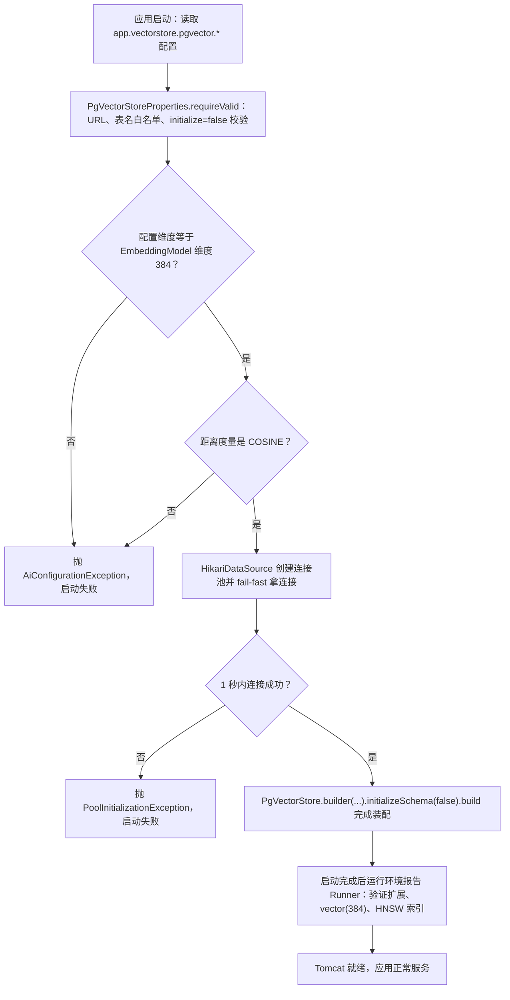
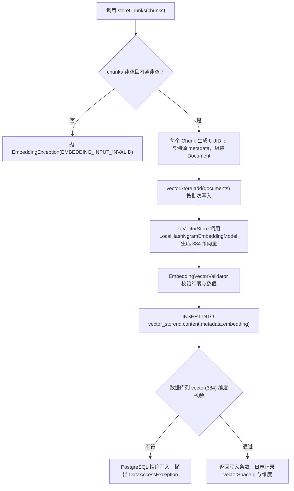
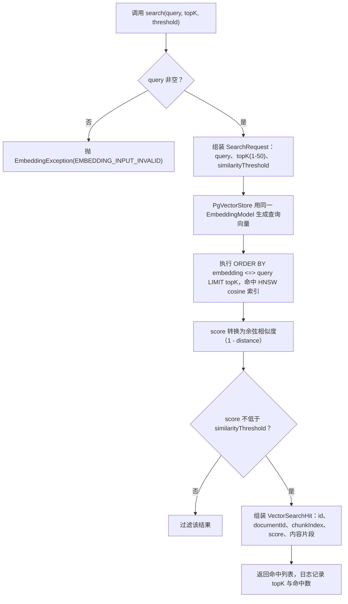

# D30-PostgreSQL-pgvector技术原理与实践指南

> 项目：M3-Java-ds（Spring AI 1.1.8 / Spring Boot 3.5.16 / JDK 21 / Maven 3.9.16）
> 主题：PostgreSQL/pgvector 向量数据库接入——原理、实现、验证与操作指南
> 配套文档：《D30-PostgreSQL-pgvector项目迭代实施记录.md》（全量代码与文件清单）
> 生成时间：2026-11-13

---

## 第一章 功能概述

### 1.1 本次实现的功能

- **是什么**：在 D30 骨架中接入 Spring AI 1.1.8 的 `PgVectorStore`，把 PostgreSQL 18 +
  pgvector 0.8.7（虚拟机 192.168.200.153 容器部署）作为项目**唯一向量库**，复用 D29 的
  384 维本地 `LocalHashNgramEmbeddingModel`，实现知识 Chunk 的向量持久化与 COSINE 相似度检索。
- **解决什么问题**：D25/D29 的检索能力停留在 classpath 语料 + 关键词评分/内存向量，向量没有
  持久化、无法随文档规模扩展。D30 补齐真实的向量存储与检索链路。
- **边界**：仅 COSINE 距离 + HNSW 索引 + 384 维；不引入第二个向量库；不涉及 1536/1024/768
  等未来维度；不提供 Controller 端点（服务层交付，接口接入留待后续迭代）。

### 1.2 完成与未完成

| 完成 | 未完成（明确边界） |
|---|---|
| PgVectorStore 手动装配 + 双数据源隔离 | 对外 HTTP 接口（后续迭代接入服务层） |
| 环境只读检查器（扩展/表/维度/索引） | 未来维度的自动迁移 |
| Chunk 写入 + COSINE 检索服务层 | 混合检索（向量 + 关键词） |
| 4 个单元测试类 + 1 个真实集成测试类（L1-L5 全过） | 压测与性能基线 |

---

## 第二章 架构与设计依据

### 2.1 现状（以本地实际代码为准）

- 主数据源：MySQL 8.0.33（chat/prompt/history 业务，MyBatis-Plus）；
- Embedding：`EmbeddingModelConfiguration` 装配唯一 `EmbeddingModel` Bean
  （`LocalHashNgramEmbeddingModel`，384 维，COSINE 约定，`app.embedding.*` 配置）；
- D30 新增：PG 连接（Hikari）+ `PgVectorStore` + 环境检查器 + 写入/检索服务。

### 2.2 为什么「手动构造」而不是用官方自动配置

Spring AI 1.1.8 的 `PgVectorStoreAutoConfiguration` 使用容器中**唯一**的 `JdbcTemplate`——
本项目该 Bean 连接 MySQL。若放任自动配置，PgVectorStore 会尝试在 MySQL 上建向量表，直接破坏
业务库。因此手动构造 `PgVectorStore` Bean（官方自动配置因 `@ConditionalOnMissingBean` 退让），
并把 PG 专用 `JdbcTemplate` 显式传入 Builder。

### 2.3 为什么 PG 连接「不作为 Spring Bean」

若把 PG `DataSource` 注册为 Bean，容器将有两个 `DataSource` 候选，
`JdbcTemplateAutoConfiguration` 与 MyBatis 自动配置都带
`@ConditionalOnSingleCandidate(DataSource.class)`，会**整体退让**——MySQL 业务全部失效。
因此 PG 连接由 `PgVectorStoreConfiguration` 内部持有（`DisposableBean` 关闭），仅以
`PgVectorStore` 一个 Bean 对外暴露。

### 2.4 组件关系

```
EmbeddingModelConfiguration ── EmbeddingModel（LocalHashNgramEmbeddingModel 384 维）
        │                                        │（复用同一实例）
        ▼                                        ▼
PgVectorStoreConfiguration ── PgVectorStore.builder(pgJdbcTemplate, embeddingModel)
        │                                        ▲
        └── PgVectorEnvironmentVerifier（只读检查）  │
KnowledgeVectorStoreService ── VectorStore（add / similaritySearch）
```

---

## 第三章 核心原理

### 3.1 pgvector 的 vector 类型与维度强约束

`vector(n)` 是 pgvector 扩展提供的定长向量类型，n 在列定义时固化（本环境
`format_type(atttypid, atttypmod)` 实测返回 `vector(384)`）。任何维度不符的写入都会被
**数据库层直接拒绝**（实测报错 `expected 384 dimensions`），不存在隐式截断或补零。
这正是「维度一致性」的最可靠防线：应用层守卫（配置 vs EmbeddingModel）是前置校验，
数据库列约束是最终防线。

### 3.2 COSINE 距离与 `<=>` 运算符

- 余弦距离定义：`cosine_distance = 1 - cosine_similarity`；
- pgvector 提供运算符 `<=>` 计算余弦距离（值域 [0,2]，越小越相似）；
- Spring AI 1.1.8 的 `PgDistanceType.COSINE_DISTANCE` 生成的检索 SQL 使用 `embedding <=> ?`，
  返回的 score = 1 - distance（即余弦相似度）。本次集成测试实测：**同文本自查询 score=1.0**，
  验证了该语义成立。

### 3.3 HNSW 索引与 vector_cosine_ops

HNSW（Hierarchical Navigable Small World，分层可导航小世界图）是 pgvector 支持的近似最近邻
（ANN）索引：多层跳表式图结构，查询从高层粗粒度进入、逐层下钻，复杂度约为 O(log N)。
`vector_cosine_ops` 指定索引的 operator class 与余弦距离匹配——**索引与查询运算符必须配套**，
若建了 `vector_l2_ops` 却用 `<=>` 检索，索引不会生效（退化为全表扫描）。本环境索引实测：
`spring_ai_vector_index USING hnsw (embedding vector_cosine_ops)`。

### 3.4 PgVectorStore 写入与检索的内部机制（1.1.8 实测）

- 写入 `add(List<Document>)`：按 `maxDocumentBatchSize` 分批；对每个 Document 调用注入的
  `EmbeddingModel.embed(doc)` 生成向量（本模型确定性，与 D29 输出逐位一致）；
  Document 无 id 时生成 UUID；metadata 经 Jackson 序列化为 json 列；
  SQL：`INSERT INTO vector_store (id, content, metadata, embedding) VALUES (?, ?, ?::json, ?)`。
- 检索 `similaritySearch(SearchRequest)`：先用 `EmbeddingModel.embed(query)` 得到查询向量，
  再执行 `ORDER BY embedding <=> ? LIMIT topK`，返回带 score 的 Document 列表。

### 3.5 向量空间一致性的三道防线

1. **装配守卫**：配置维度 ≠ `EmbeddingModel.dimensions()` → 抛 `AiConfigurationException`，
   在触碰数据库之前拒绝；
2. **服务层校验**：`EmbeddingVectorValidator`（空/维度/NaN/零向量）在模型内部执行；
3. **数据库约束**：`vector(384)` 列类型拒绝一切维度不符写入（集成测试实测通过）。

---

## 第四章 核心代码解析

### 4.1 `PgVectorStoreConfiguration` —— 装配中枢

```java
@Bean
public PgVectorStore pgVectorStore(PgVectorStoreProperties properties,
                                   EmbeddingModel embeddingModel) {
    properties.requireValid();
    if (properties.getDimensions() != embeddingModel.dimensions()) {
        throw new AiConfigurationException(...); // 维度守卫
    }
    if (properties.getDistanceMetric() != DistanceMetric.COSINE) {
        throw new AiConfigurationException(...); // 距离度量守卫
    }
    this.pgDataSource = createDataSource(properties);   // Hikari fail-fast
    this.pgJdbcTemplate = new JdbcTemplate(this.pgDataSource);
    return PgVectorStore.builder(this.pgJdbcTemplate, embeddingModel)
            .schemaName(...).vectorTableName(...)
            .idType(PgVectorStore.PgIdType.UUID)
            .dimensions(384)
            .distanceType(PgVectorStore.PgDistanceType.COSINE_DISTANCE)
            .indexType(PgVectorStore.PgIndexType.HNSW)
            .removeExistingVectorStoreTable(false)
            .initializeSchema(false)
            .build();
}
```

要点：Hikari `setInitializationFailTimeout(1_000)` 实现 fail-fast——PG 不可达时**应用启动失败**
而不是静默带病运行；`initializeSchema=false` 保证启动零 DDL。

### 4.2 `PgVectorEnvironmentVerifier` —— 只读环境报告

五步检查：`SELECT 1` 连通性 → `pg_extension` 扩展版本 → `information_schema.tables` 表存在 →
`format_type(att.atttypid, att.atttypmod)` 解析 `vector(384)` → `pg_indexes` 校验 HNSW +
vector_cosine_ops。所有结果进入 `PgVectorEnvironmentReport`（含 problems 列表），
连接失败返回 `reachable=false` 而非抛异常。表名经白名单正则校验，杜绝 regclass 注入。

### 4.3 `KnowledgeVectorStoreService` —— 写入与检索

写入：`DocumentChunk` → `new Document(UUID, content, metadata)`，metadata 携带
documentId/title/version/chunkIndex/strategy/pageNumbers/vectorSpaceId，保证检索结果可溯源
回 D29 语料；随后 `vectorStore.add(documents)`。

检索：`SearchRequest.builder().query().topK(1..50).similarityThreshold()`
→ `vectorStore.similaritySearch(request)` → `VectorSearchHit.from(doc)` 剥离框架对象，
仅暴露 id/documentId/chunkIndex/title/score/内容片段。

---

## 第五章 完整执行流程

### 5.1 装配与启动流程



### 5.2 Chunk 写入流程



### 5.3 COSINE 相似度检索流程



---

## 第六章 配置与运行说明

### 6.1 配置项（application.yml，全部支持环境变量覆盖）

| 配置 | 默认值 | 说明 |
|---|---|---|
| `app.vectorstore.pgvector.url` | jdbc:postgresql://192.168.200.153:5432/spring_ai | PG_VECTOR_URL |
| `app.vectorstore.pgvector.username` | postgres | PG_VECTOR_USERNAME |
| `app.vectorstore.pgvector.password` | 空 | **必须**环境变量 PG_VECTOR_PASSWORD 注入，禁止入库 |
| `schema-name` / `table-name` | public / vector_store | 标识符白名单校验 |
| `dimensions` | 384 | 必须与 app.embedding.dimensions 一致 |
| `distance-metric` | COSINE | 仅支持 COSINE |
| `index-type` | HNSW | NONE/IVFFLAT/HNSW |
| `initialize-schema` | false | 强制 false，表结构由外部幂等 DDL 管理 |
| `remove-existing-vector-store-table` | false | 强制 false，禁止启动删表 |
| `enabled` | true | test profile 置 false（保护历史测试） |

### 6.2 本地运行

```powershell
$env:PG_VECTOR_PASSWORD = "你的密码"   # 仅环境变量，勿写入文件
mvn -f D30\pom.xml -pl D30_postgresqlAndpgvector spring-boot:run
```

启动成功标志（真实日志）：`PgVectorStore 装配完成`、`pgvector 环境检查通过`、`Tomcat started on port 8080`。

### 6.3 真实集成测试运行

```powershell
$env:D30_PG_INTEGRATION = "true"
$env:D30_PG_URL = "jdbc:postgresql://192.168.200.153:5432/spring_ai"
$env:D30_PG_USERNAME = "postgres"
$env:D30_PG_PASSWORD = "你的密码"
mvn -f D30\pom.xml test "-Dtest=PgVectorStoreRealIntegrationTest"
```

### 6.4 幂等 DDL（手动执行，应用不自动执行）

`docs/temp_docs/D30/pgvector-schema-idempotent.sql`，含扩展、主表、主索引、smoke 表，
全部 `IF NOT EXISTS`，可重复执行、不碰数据。

---

## 第七章 测试与验证（真实结果）

| 层级 | 验证内容 | 命令/手段 | 结果 |
|---|---|---|---|
| L1 | 编译 + 全量单测 | `mvn compile` / `mvn test` | 退出码 0；全仓 0 失败 |
| L2 | 数据库连接 | 主应用启动 + 集成测试 Hikari 真连 | 连接池 Start completed |
| L3 | pgvector 环境 | verifier 只读报告 | 0.8.7 / vector(384) / HNSW cosine 全部通过 |
| L4 | 真实写入 | 集成测试写入 5 条 | COUNT=5 复核通过 |
| L5 | 真实检索 | COSINE 检索 | top1 命中 doc-001；自查询 score=1.0；排序正确 |
| 附加 | 维度防护 | 3 维写入 vector(384) | PostgreSQL 服务端拒绝 |
| 附加 | 数据安全复核 | SSH 只读查询 | 主表 0 行，未污染 |

回归说明：修复前历史 5 个 @SpringBootTest 类（10 用例）因 PG fail-fast 报错，通过
test profile 关闭装配恢复；全量测试日志见 `docs/temp_docs/D30/mvn-test-run1.log`。

---

## 第八章 关键注意事项与常见问题

1. **不要在 MySQL 上建向量表**：自动配置误用唯一 JdbcTemplate 的风险已通过手动 Bean 规避；
   若未来引入第二 DataSource Bean，必须同步检查 JdbcTemplate/MyBatis 自动配置退让问题。
2. **索引与运算符必须配套**：HNSW `vector_cosine_ops` 只服务于 `<=>`；换用 L2/IP 距离必须
   重建索引并同步修改 distance-type。
3. **initialize-schema=false 后表必须先行存在**：否则首次 add/search 会报表不存在；
   幂等脚本只增不改、绝不 DROP。
4. **维度不一致的表现**：PG 报 `expected 384 dimensions, not N`；应用侧报
   `AiConfigurationException`（配置 vs 模型）——两道防线可定位到具体层。
5. **密码管理**：任何日志/证据/文档不得出现真实密码；验证脚本凭据只经环境变量传递。
6. **本模型是哈希 n-gram 而非神经网络**：其相似度基于字符/词 n-gram 重叠，适合确定性
   复现与本地零成本实验，不代表语义向量质量；上线语义检索需更换 EmbeddingModel
   （vectorSpaceId 机制已为模型切换预留契约）。
7. **smoke 表数据保留策略**：测试只清理 `d30TestMarker=true` 的行，表与索引保留作为
   环境证据；不要手工 DROP。

---

## 第九章 总结

本次迭代完成了 PostgreSQL/pgvector 向量库的完整接入：双数据源隔离的手动装配、
fail-fast 启动、只读环境检查、Chunk 持久化与 COSINE 检索服务，以及 L1-L5 全链路真实
验收（含同文本自查询 score=1.0 的余弦语义实证与数据库维度拒绝实证）。

技术收获：Spring AI 自动配置的退让机制（@ConditionalOnMissingBean）、
@ConditionalOnSingleCandidate 对双数据源的影响、pgvector 运算符/operator class 配套规则、
Hikari fail-fast 的价值。

限制与后续：服务层尚未挂载 Controller（后续迭代接入）；未做大规模压测与 HNSW 参数调优；
未来换语义模型时需按 vectorSpaceId 迁移或双写。

---

## 第十章 参考资料

- 《pgvector | GitHub README》：https://github.com/pgvector/pgvector
- 《Spring AI Reference | Spring AI 参考文档》：https://docs.spring.io/spring-ai/reference/
- 《Spring Boot Reference | Spring Boot 参考文档》：https://docs.spring.io/spring-boot/reference/
- 本指南中 PgVectorStore 1.1.8 的构造器/Builder/自动配置注解结论，均经本机 Maven 仓库 jar
  `javap` 反查实证（证据 01），属于本项目实现分析。
