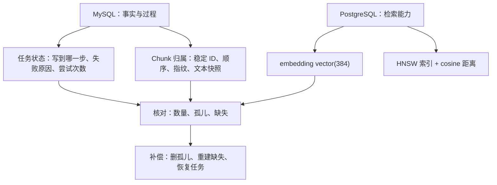
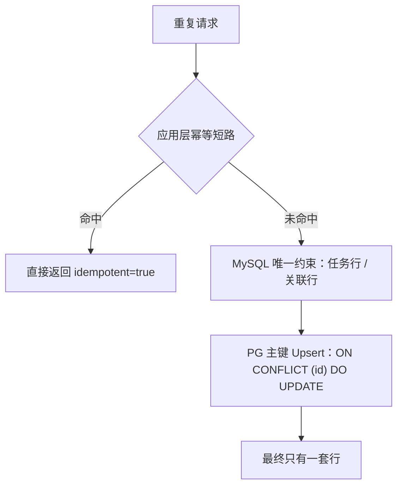
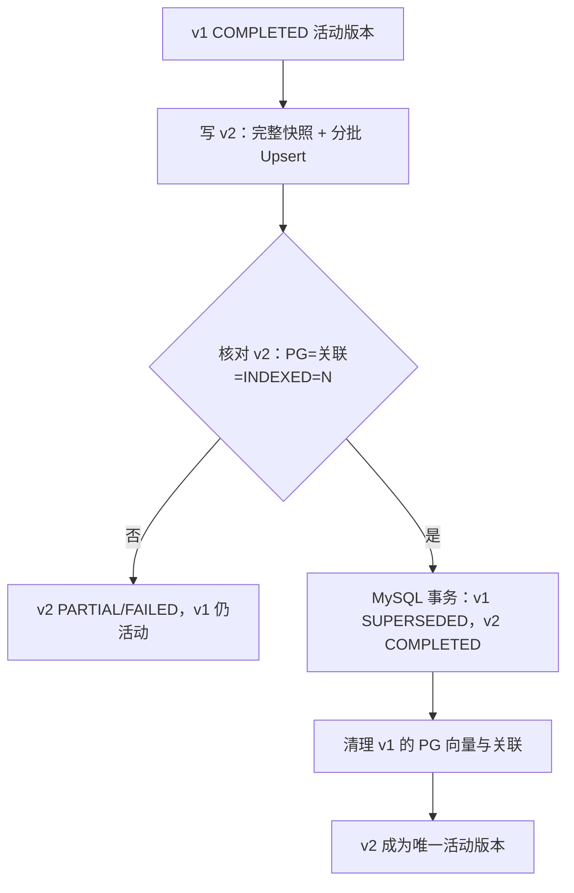
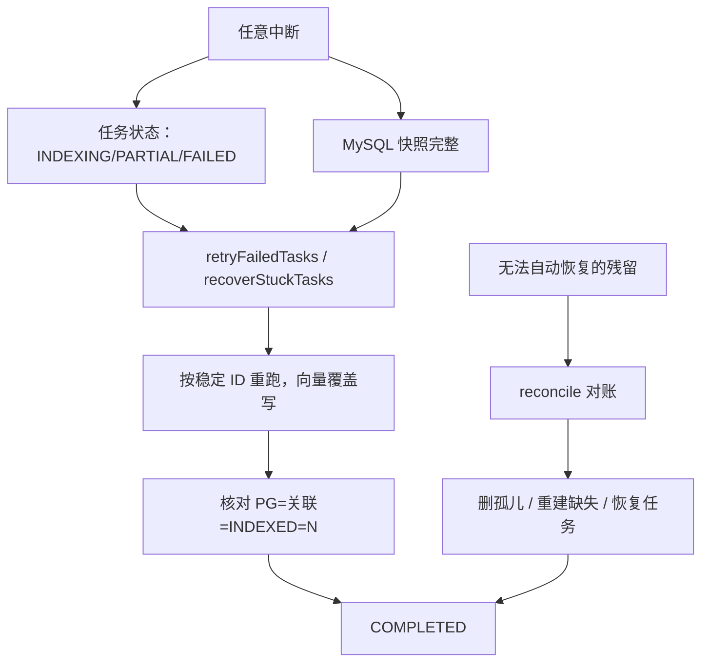

# D31-向量入库更新与幂等技术原理与实践指南

> 面向读者：具备 Java/Spring Boot 基础、需要理解"向量库为什么能幂等、为什么能恢复、为什么能对账"的开发者
> 对应实现：`D31_VSUAI` 模块 `com.zl.d31.knowledge.vectorindex` 包
> 组织方式：是什么 → 为什么 → 底层原理 → 执行流程 → 核心代码 → 常见问题 → 工程实践

---

## 1. 文档与 Chunk 的关系：为什么必须有一张关联表

### 1.1 是什么

RAG 的向量库只回答一个问题："给我最相似的 N 条文本"。它**不负责**回答：

- 这条向量属于哪篇文档、哪个版本？
- 这篇文档一共有多少块？是否都在库里？
- 文档删除时，应该删哪些向量？
- 文档更新后，哪些向量是旧的？

`vector_chunk_index` 就是补上这层"归属关系"的表：一行 = 一个 Chunk 的稳定身份 + 归属 + 文本快照 + 索引状态。

### 1.2 为什么不能只靠向量表里的 metadata

| 只靠 metadata | 有独立关联表 |
| --- | --- |
| 可以按 `metadata->>'documentId'` 过滤，但**无法做唯一约束** | `(document_id, version, chunk_index)` 唯一约束由数据库强制 |
| 无法表达"应该有多少块" | `chunk_count` 可表达期望数量，用于核对 |
| 无法保存完整文本快照（metadata 是查询用的小字段） | `content MEDIUMTEXT` 保存完整快照，供重建 |
| 无法表达"这块正在写 / 已写成功" | `status PENDING/INDEXED/FAILED` 表达过程状态 |
| 删除需要扫描全表 JSON 字段，代价高 | 按 `document_id` 索引精确删除 |

### 1.3 底层原理：两个存储系统的职责切分



一句话：**MySQL 记"应该有什么、进行到哪"，PostgreSQL 存"能用来检索的向量"，两边靠稳定 ID 对齐。**

---

## 2. 稳定 ID 与幂等机制

### 2.1 为什么 `UUID.randomUUID()` 不能用于向量入库

`randomUUID()` 是 UUID v4：128 位随机数。特性是"每次调用都不同"。放在向量入库场景里意味着：

- 同一份文档导入两次 → 两套不同 ID → 向量表行数翻倍；
- 失败重试 → 又一套新 ID → 越重试越多；
- 删除时只能靠 metadata 扫描，且无法判断哪些是"重复的同一块"。

**幂等的前提是"同一逻辑实体在任何时刻都映射到同一个物理 ID"。** 随机 ID 从定义上破坏了这一点。

### 2.2 UUID v5 的构造原理

UUID v5 是"名称型 UUID"：`UUID = SHA-1(namespace || name)` 取前 16 字节，再写入版本位与变体位。

```java
// StableChunkIdGenerator#nameUuidV5（真实实现）
MessageDigest digest = MessageDigest.getInstance("SHA-1");
digest.update(toBytes(namespace));
digest.update(name.getBytes(StandardCharsets.UTF_8));
byte[] hash = digest.digest();
byte[] result = new byte[16];
System.arraycopy(hash, 0, result, 0, 16);
result[6] &= 0x0F; result[6] |= 0x50;   // version = 5
result[8] &= 0x3F; result[8] |= 0x80;   // variant = RFC 4122
```

特点：

- **确定性**：输入相同 → 输出相同（不依赖时间、机器、随机源）；
- **抗碰撞**：SHA-1 前 128 位，工程上足够；
- **标准格式**：36 字符，可直接作为 `uuid` 主键；
- **可审计**：给定名称要素，任何环境都能复算出同一个 ID。

### 2.3 名称要素的选择逻辑

```
documentId|version|strategy|chunkIndex|chunkContentHash|splitVersion|vectorSpaceId
```

| 要素 | 不加会怎样 |
| --- | --- |
| `documentId` | 两篇文档有相同句子 → 同 ID → 删除一篇会误删另一篇 |
| `version` | 新版本覆盖旧版本 ID → 无法做版本切换与旧版本清理 |
| `strategy` | 固定长度与结构感知切分互相覆盖 |
| `chunkIndex` | 同文档内重复句子会合并成一条，丢失"出现两次"的事实 |
| `chunkContentHash` | 内容改了但 ID 不变 → Upsert 覆盖内容，看似正确，但差集清理失去依据 |
| `splitVersion` | 切分算法升级后新旧 ID 混用，无法灰度 |
| `vectorSpaceId` | 换模型/维度后旧向量被当成"同一实体"，维度或语义空间污染 |

**注意**：`chunkContentHash` 参与 ID，意味着"内容变化 = 新 ID"，旧 ID 必须通过差集删除；这正是 3.3 节清理逻辑存在的原因。

### 2.4 幂等的三层防线



**应用层短路条件（真实代码 `isIdempotentHit`）**：

1. 任务状态为 `COMPLETED`；
2. 载荷指纹相同；
3. Chunk 数相同；
4. `splitVersion` 相同；
5. `vectorSpaceId` 相同；
6. MySQL 关联行数 = N；
7. MySQL `INDEXED` 行数 = N；
8. PG 行数 = N。

六与七必须分开检查：只有关联行存在但状态还是 `PENDING`，说明上次写到一半，不能短路。

**数据库层**：`uk_vector_task_doc_version`、`uk_vector_chunk_chunk_id`、`uk_vector_chunk_doc_version_index`。并发首建时两个事务都执行 `INSERT ... ON DUPLICATE KEY UPDATE`，不会抛唯一键异常，也不会产生第二行。

**向量层**：PgVectorStore 1.1.8 的 `add()` 本身就是 `INSERT ... ON CONFLICT (id) DO UPDATE`（对 jar 常量池实证），所以"同一 ID 重复写"是覆盖。

---

## 3. 向量持久化与版本管理

### 3.1 PgVectorStore 的写入语义

`vectorStore.add(List<Document>)` 的链路：

1. 对每个 `Document` 调用 Embedding 模型得到 384 维向量；
2. 按 `maxDocumentBatchSize` 分批；
3. 每批执行 `INSERT ... ON CONFLICT (id) DO UPDATE`。

因此：

- **不会**因为重复 `add` 产生重复行（前提是 ID 稳定）；
- **不会**自动删除"这次没有出现"的旧行——旧行清理必须由业务显式 `delete`；
- 事务边界在内部批次，跨批不是原子操作——这正是需要"状态机 + 快照"的原因。

### 3.2 版本模型



**为什么禁止"先删旧再写新"**：删除后若新版本写入失败，系统进入"没有任何可用向量"的状态，检索直接空窗；而"先写后切"最坏情况只是新版本不可用，旧版本继续服务。

### 3.3 同版本内容变化的处理

同一 `(documentId, version)` 内容变了（例如修正错别字后重新导入）：

1. 载荷指纹变化 → 不是幂等短路；
2. 每个 Chunk 因内容变化得到新 ID；
3. 新 ID 全部 Upsert；
4. `previousChunkIds - newIds` 得到"这次不再存在的旧块"，批量 `delete`；
5. `deleteChunksFromIndex(doc, ver, n)` 删除 `chunk_index >= n` 的尾部关联；
6. 再核对数量。

**顺序要点**：清理必须在核对之前（首轮实现把清理放在核对之后，被集成测试抓出 `pg=5 expected=2`，见实施记录 7.1）。

---

## 4. 重试、恢复与并发控制

### 4.1 状态机与阶段

| 状态 | 含义 | 是否可被检索依赖 |
| --- | --- | --- |
| `PENDING` | 已登记，未开始 | 否 |
| `INDEXING` | 写入中 | 部分可用 |
| `COMPLETED` | 完整写入且核对通过 | 是（活动版本） |
| `PARTIAL` | 写了部分后中断 | 否（等待恢复） |
| `FAILED` | 未写入任何向量 | 否 |
| `SUPERSEDED` | 被新版本取代 | 否（等待/已清理） |

阶段 `REGISTER → EMBED_WRITE → VERIFY → SWITCH → CLEANUP` 用于定位"卡在哪一步"，比单一状态更好排查。

### 4.2 为什么恢复必须依赖 Outbox 快照

中断时系统只知道"要写 3 块"，但如果只保存了"已写 2 块"，第 3 块的内容已经丢失（原始切分结果在内存里）。没有内容就无法重建，只能重新切分（代价高且可能产生不同的 Chunk）。

因此写入顺序是：

```
① MySQL 事务写入全部 3 块快照（status=PENDING）
② 逐批写 PG，成功后把该批标记 INDEXED
③ 核对
```

任何一步崩溃，`vector_chunk_index` 都有完整 3 块内容，恢复时按同一稳定 ID 重跑即可。

### 4.3 恢复策略矩阵

| 快照完整性 | 处理 | 理由 |
| --- | --- | --- |
| 条数 = chunkCount | 从快照重建，走 `indexChunks` | 稳定 ID 保证幂等，重复写只是覆盖 |
| 条数 < chunkCount | 标记 `FAILED + NO_COMPLETE_SNAPSHOT` | 不虚构缺失内容，交人工重新切分 |
| 达到最大尝试次数 | 标记人工处理 | 防止无限重试放大故障 |

### 4.4 并发控制

本方案**不用分布式锁**，靠数据库约束与 Upsert 收敛：

- 两个线程同时首建任务 → `ON DUPLICATE KEY UPDATE`，最终一行；
- 两个线程同时写同一批 Chunk → 稳定 ID 相同 → 最终一行/块；
- 两个线程同时切版本 → MySQL 事务串行化，最终只有最后提交的版本为 `COMPLETED`。

代价：并发时可能互相覆盖状态字段（如 `attempt_count` 不精确），但**数据一致性不受影响**。这是"最终一致优先于过程精确"的取舍。

### 4.5 迟到任务

场景：`v1` 任务在队列里延迟很久，`v2` 已完成并取代 `v1`，此时 `v1` 任务到达。

若不处理，`v1` 重写会把 `v1` 变回 `COMPLETED` 并把 `v2` 置 `SUPERSEDED`——版本回滚。实现中用 `STALE_VERSION_REJECTED` 拒绝：目标版本已 `SUPERSEDED` 且存在其他 `COMPLETED` 版本时直接抛错。

---

## 5. 数据库事务边界与最终一致性

### 5.1 为什么不做跨库分布式事务

| 方案 | 代价 | 结论 |
| --- | --- | --- |
| XA / 两阶段提交 | PG 与 MySQL 驱动、事务管理器、恢复日志都要支持 XA；运维复杂度高；Spring 声明式事务不覆盖 | 不采用 |
| 单一库（向量也放 MySQL） | 失去 pgvector 的 HNSW 检索能力 | 不采用 |
| 本地事务 + 状态机 + 补偿 | 需要接受"短时间不一致"，但可自愈 | **采用** |

### 5.2 各操作的原子性边界

| 操作 | 原子范围 | 失败后的可见状态 |
| --- | --- | --- |
| 快照批量写入 | MySQL 一个事务 | 要么 0 行，要么 N 行 `PENDING` |
| 每批状态推进 | MySQL 单条 UPDATE | 部分 `INDEXED`，可继续 |
| 版本切换 | MySQL 一个事务 | 要么旧版本仍活动，要么新版本活动 |
| 删除关联/任务 | MySQL 一个事务 | PG 已删、MySQL 未删 → 对账可见 |
| PG 写入 | 框架内部批次 | 部分向量存在，状态为 `INDEXING/PARTIAL` |

### 5.3 最终一致的收敛路径



**收敛保证**：只要快照存在，重跑就是幂等的；只要对账在跑，孤儿与缺失就会被发现并修复。

---

## 6. Outbox、补偿与对账实践

### 6.1 这里的 Outbox 是什么

经典 Outbox 模式：业务事务内把"待发布事件"写入本地表，再由后台任务投递，避免"业务提交了但消息没发出去"。

本项目的"轻量 Outbox"做了同构的简化：

- **不是**消息队列事件，而是**索引载荷快照**；
- 与任务状态同表族（`vector_index_task` + `vector_chunk_index`），与原文库同库；
- 作用不是"投递消息"，而是"让跨库写入具备可重放性"。

### 6.2 对账的四类问题与判定

| 类型 | 判定 | 补偿 |
| --- | --- | --- |
| 孤儿向量 | PG 有行，但 MySQL 无对应 `chunk_id`，或所属任务不存在/非活动 | 批量 `delete` |
| 缺失向量 | MySQL 有 `INDEXED` 关联，PG 无对应行 | 快照完整则重建，否则标记 |
| 数量不一致 | 版本关联数 ≠ PG 数 | 由前两类修复后自然归零 |
| 卡住任务 | `PENDING/INDEXING` 且 `updated_at` 超过阈值 | `recoverStuckTasks` |

### 6.3 对账的安全边界

- `dryRun=true` 是默认：只读、只出报告；
- 补偿只操作"自己可识别的行"（按 `chunk_id` 与文档前缀）；
- 不删表、不删扩展、不删主表 `vector_store` 的历史数据；
- 定时任务默认关闭，避免本地/测试环境产生额外负载。

### 6.4 生产实践建议

1. **对账频率**：低峰期（如 02:00），单次全表扫描在百万级向量下仍然昂贵，建议按文档分区或增量游标；
2. **阈值**：`stuckMinutes` 应大于单次索引最长耗时的 2–3 倍；
3. **重试上限**：`maxAttempts` 与告警联动，达到上限必须人工介入，不能无限重试；
4. **监控指标**：`PARTIAL + FAILED` 任务数、对账 issue 数、单文档索引耗时、PG 行数与关联数差值。

---

## 7. 故障案例与排查方法

### 7.1 案例：重复导入后向量数量翻倍

- **现象**：同一文档导入两次，`SELECT COUNT(*) FROM vector_store WHERE metadata->>'documentId'='x'` 翻倍。
- **根因**：ID 使用 `randomUUID()`，两次导入是两套 ID。
- **排查**：对比两次导入的 `chunk_id` 是否相同；查 `vector_chunk_index` 是否有重复 `(document_id, version, chunk_index)`。
- **修复**：改为 UUID v5 稳定 ID；已有重复数据按 `chunk_id` 去重或按文档重建。

### 7.2 案例：更新后检索为空

- **现象**：文档更新后查不到任何结果。
- **根因**：采用"先删旧、再写新"，新版本写入失败，旧版本已被删。
- **排查**：查 `vector_index_task` 中该文档各版本状态；若旧版本 `status` 不是 `SUPERSEDED` 而是被删除，说明走了删除路径。
- **修复**：改为"先写新、核对、再切、最后清旧"。

### 7.3 案例：`PARTIAL` 任务重试后仍然不完整

- **现象**：重试多次，PG 行数始终小于 `chunk_count`。
- **根因**：快照不完整（写入前进程崩溃），恢复逻辑无法凭空补内容。
- **排查**：`SELECT COUNT(*) FROM vector_chunk_index WHERE document_id=? AND version=?` 与 `chunk_count` 对比。
- **修复**：标记 `NO_COMPLETE_SNAPSHOT`，重新切分后重新索引；不要伪造内容。

### 7.4 案例：孤儿向量持续增长

- **现象**：对账每次都能发现新的孤儿。
- **根因**：删除流程中 PG 删除成功但 MySQL 事务失败（或反之），且没有重试；或旧版本清理持续失败。
- **排查**：查 `logs` 中"旧版本清理失败"与"按文档删除"记录；比对 `vector_index_task` 与 `vector_chunk_index` 的版本集合。
- **修复**：开启定时对账；确认 PG 删除幂等（不存在 ID 不报错）后，把删除改为可重试。

### 7.5 案例：启动即失败，提示密码为空

- **现象**：应用启动报 `pgvector 密码为空`。
- **根因**：`application.yml` 使用 `${PG_VECTOR_PASSWORD:}`，环境变量未注入。
- **排查**：确认进程环境变量；注意 IDE 运行配置与容器环境变量是两套。
- **修复**：注入环境变量或启动参数（`--PG_VECTOR_PASSWORD=...`），**不要**把口令写回配置文件。

### 7.6 通用排查入口

| 入口 | 用途 |
| --- | --- |
| `GET .../vector-index` | 查看各版本状态、阶段、错误码、尝试次数 |
| `GET .../vector-index/chunks` | 查看关联行与快照状态 |
| `POST .../vector-index/recover` | 触发卡住任务恢复 |
| `POST .../vector-index/retry` | 触发失败任务重试 |
| `POST /vector-index/reconcile?dryRun=true` | 只读核对，先看问题再决定是否补偿 |

---

## 8. 工程实践清单

1. **ID 先行**：先确定稳定 ID 的要素组合，再写任何入库代码；ID 不稳定，后面所有幂等与清理都是空谈。
2. **约束落到数据库**：应用层判断可能被并发绕过，唯一键是最后防线。
3. **先快照后写入**：任何跨系统写入，都先在本库留下"可重放的完整载荷"。
4. **先写新后删旧**：任何"替换"语义，都要保证任意时刻存在一个可用版本。
5. **状态要能解释失败**：`status + stage + error_code + attempt_count` 四件套缺一不可。
6. **恢复要有边界**：快照不完整就拒绝自动恢复，宁可人工介入，不可伪造数据。
7. **删除要幂等**：按稳定 ID 删，允许重复执行；不要依赖"删之前先确认存在"。
8. **对账要默认只读**：`dryRun` 默认 true，补偿必须显式触发。
9. **密码只走环境变量**：配置文件里只允许空默认值，缺失即 fail-fast。
10. **测试连真库**：Mock 数据库无法验证唯一约束、Upsert、事务与并发，六场景必须在真实 MySQL + PG 上跑。

---

## 9. 参考资料

- 《Spring AI Reference: PgVector Store | Spring AI 参考文档：PgVector 向量存储》：https://docs.spring.io/spring-ai/reference/api/vectordbs/pgvector.html
- 《Spring AI Reference: Vector Databases | Spring AI 参考文档：向量数据库》：https://docs.spring.io/spring-ai/reference/api/vectordbs.html
- 《PostgreSQL 18 Documentation | PostgreSQL 18 官方文档》：https://www.postgresql.org/docs/18/
- 《pgvector: Open-source vector similarity search for Postgres | pgvector：PostgreSQL 开源向量相似度检索》：https://github.com/pgvector/pgvector
- 《RFC 4122: A Universally Unique IDentifier (UUID) URN Namespace | RFC 4122：UUID URN 命名空间》：https://www.rfc-editor.org/rfc/rfc4122
- 《MySQL Reference Manual: INSERT ... ON DUPLICATE KEY UPDATE | MySQL 参考手册：插入或冲突更新》：https://dev.mysql.com/doc/refman/8.4/en/insert-on-duplicate.html
- 《Spring Framework Reference: Transaction Management | Spring 框架参考文档：事务管理》：https://docs.spring.io/spring-framework/reference/data-access/transaction.html
- 《Spring Framework Reference: Task Execution and Scheduling | Spring 框架参考文档：任务执行与调度》：https://docs.spring.io/spring-framework/reference/integration/scheduling.html

> 本文所引框架行为均已对照本地依赖版本（Spring AI 1.1.8、Spring Boot 3.5.16）与真实运行结果；涉及本项目的判断均可在 `D31_VSUAI` 源码中找到对应实现。
