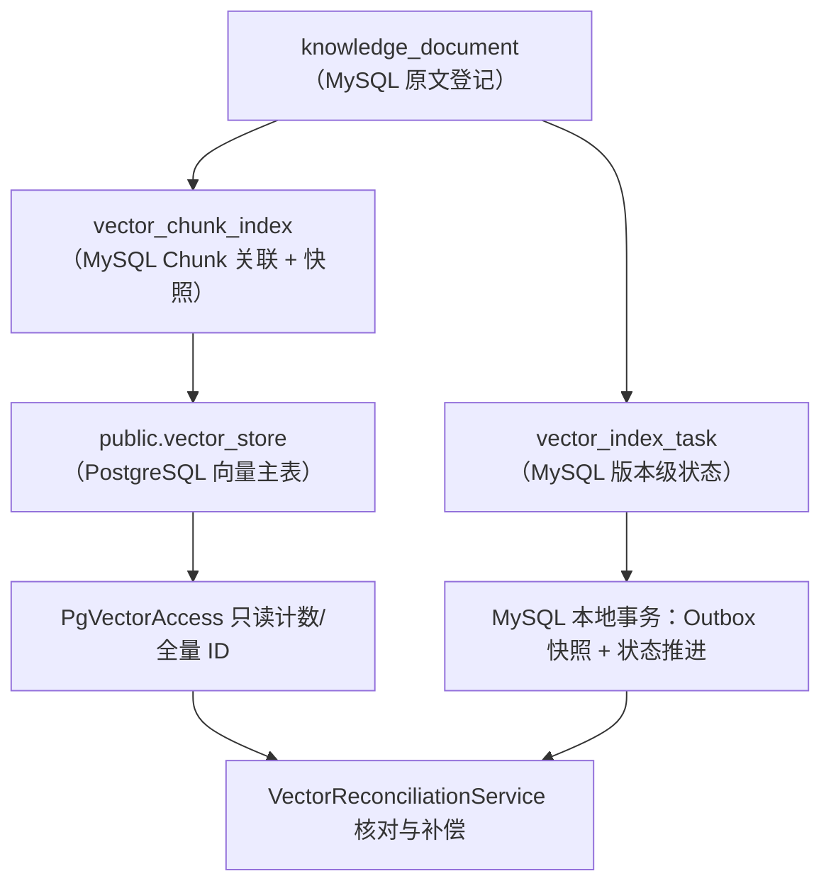
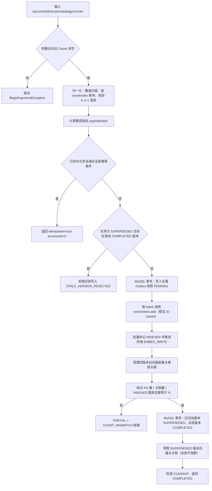
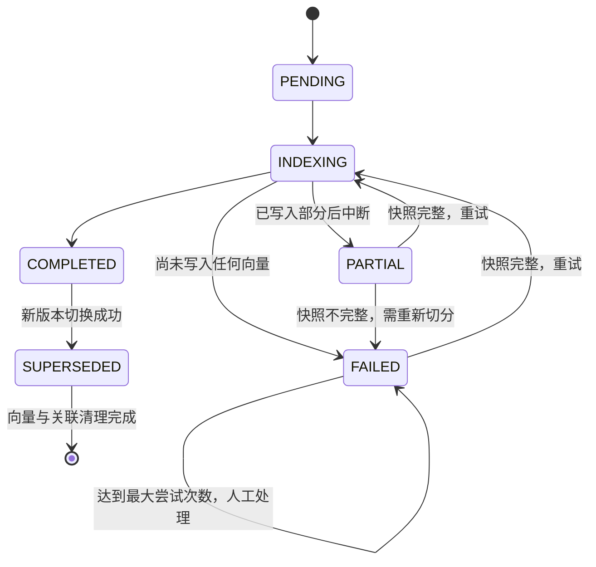

# D31-向量入库更新与幂等项目迭代实施记录

> 模块：`D31_VSUAI`（项目根 `E:\AI\project\AI-Learning-two-lp\M3-Java-ds\D31`）
> 迭代主题：Day 30/31 —— PostgreSQL + pgvector 向量入库、文档↔Chunk 关联、稳定 ID、数据库唯一约束、重复导入幂等、版本更新与旧版本清理、按文档删除、失败重试与部分失败恢复、MySQL 原文库与 PG 向量库一致性核对/补偿
> 文档性质：实施记录（真实代码 + 真实执行证据），与源码一一对应
> 生成日期：2026-11-14

---

## 1. 需求与仓库现状

### 1.1 任务书要求（摘要）

| 编号 | 要求 | 对应实现 |
| --- | --- | --- |
| 4.1 | 文档与 Chunk 可靠关联、稳定 ID | `vector_chunk_index` 关联表 + UUID v5 稳定 ID |
| 4.2 | 向量入库与重复导入幂等 | 稳定 ID + PgVectorStore 原生 Upsert + 数据库唯一约束 + 幂等短路 |
| 4.3 | 文档更新与旧版本处理 | 先写新版本 → 核对 → 切版本 → 清旧版本（禁止先删旧） |
| 4.4 | 按文档删除与关联清理 | 先删 PG 稳定 ID（可重复执行）→ MySQL 事务删关联与任务行 |
| 4.5 | 失败重试与部分失败恢复 | 状态机 + 阶段 + 错误码 + Outbox 快照 + 快照幂等重建 |
| 5 | 六场景验收 + 补充异常检查 | 真实 MySQL + 真实 PG 集成测试 12 个用例全部通过 |
| 6 | 跨库一致性风险与补偿 | `VectorReconciliationService` 四类问题识别与补偿 |
| 7 | 数据安全边界 | 密码环境变量注入、禁止删表/删卷、只清理自建测试数据 |
| 8 | Level 1–5 验收 | 实际达到 Level 5（真实数据库读写 + 真实检索 + 异常恢复 + 对账补偿） |

### 1.2 迭代前仓库真实状态（扫描结论）

扫描范围：`D31\pom.xml`、`D31_VSUAI\pom.xml`、`src\main\java\com\zl\d31\knowledge\**`、`src\main\resources\application.yml`、`src\test\java\com\zl\d31\vectorstore\**`。

已有能力（D30 快照，**本次直接复用，不重复建设**）：

- `knowledge.chunking`：`DocumentChunker`、`ChunkingResult`、`DocumentChunk`、`ChunkStrategy{FIXED_LENGTH, STRUCTURE_AWARE}`、`ChunkBoundaryType`、`ChunkSource`、`KnowledgeDocumentChunkingService#preview`。
- `knowledge.document`：`KnowledgeDocument`、`KnowledgeDocumentService`、`KnowledgeDocumentStatus`、页面级解析结果与 MySQL `knowledge_document` 表。
- `knowledge.embedding`：`LocalHashNgramEmbeddingModel`（384 维、确定性、本地零费用）、`EmbeddingProperties`、`EmbeddingModelDescriptor`（含 `vectorSpaceId`）、`EmbeddingVectorValidator`。
- `knowledge.vectorstore`：`PgVectorStoreConfiguration`、`PgVectorStoreProperties`、`PgVectorEnvironmentVerifier`、`KnowledgeVectorStoreService`、`VectorSearchHit`。
- 测试基线：`PgVectorStoreRealIntegrationTest`（独立测试表 + 手工构造 PgVectorStore 的真实集成测试范式）。

对照任务书发现的**真实缺口**：

1. 既有 `KnowledgeVectorStoreService#storeChunks` 使用 `UUID.randomUUID()` 生成向量 ID，**每次导入都产生新 ID**，重复导入必然重复写入；
2. 无文档↔Chunk 关联表，无法按文档精确删除、无法核对孤儿/缺失；
3. 无 `(document_id, version)` 级任务状态，无阶段、错误码、尝试次数，失败后无法判断"写入了多少"；
4. 无版本切换与旧版本清理，更新时要么重复累积，要么只能暴力全删；
5. 无 Outbox 快照，中断后无法重建；
6. 无跨库核对与补偿，MySQL 与 PG 长期可能不一致；
7. `application.yml` 第 99 行曾写死 PG 密码默认值（安全缺陷，本次一并修复）。

### 1.3 关键框架事实（实证，不凭记忆）

对本地依赖 `spring-ai-pgvector-store-1.1.8.jar` 执行 `javap -c -p -v` 反查常量池，确认 `PgVectorStore#insertOrUpdateBatch` 的实际 SQL 为：

```sql
INSERT INTO <table> (id, content, metadata, embedding) VALUES (?, ?, ?::jsonb, ?)
ON CONFLICT (id) DO UPDATE SET content = ?, metadata = ?::jsonb, embedding = ?
```

**结论：Spring AI 1.1.8 的 `vectorStore.add()` 在主键层面已是 Upsert。幂等的关键不在"框架是否 Upsert"，而在"ID 是否稳定"。** 这一实证决定了整体设计：把工程重心放在稳定 ID 与状态机，而不是自行拼装 SQL。

---

## 2. 技术方案与数据模型

### 2.1 总体方案

- **向量本体**仍由框架表 `public.vector_store`（`vector(384)` + HNSW `vector_cosine_ops`）承载，不改框架表结构。
- **关联与状态**放 MySQL `ai_db`（与原文库、Outbox 事件同库），两张表：`vector_index_task`、`vector_chunk_index`。
- **不引入分布式事务**：MySQL 与 PostgreSQL 各自本地原子，跨系统一致性由"状态机 + 稳定 ID + 对账补偿"收敛到最终一致。
- **更新策略**：先写新、核对通过、再切版本、最后清旧版本；显式禁止"先删旧再写新"。
- **持久层**用 `JdbcTemplate`（主 MySQL 数据源）而非 MyBatis-Plus：参数化 SQL 清晰、可手工构造真实集成测试、不依赖 Spring 上下文。
- **PG 只读组件** `PgVectorAccess` 使用 PG 自己的 `JdbcTemplate`，但**不注册为 JdbcTemplate Bean**，避免 `JdbcTemplateAutoConfiguration` 因 `@ConditionalOnMissingBean(JdbcTemplate.class)` 整体退让，导致主 MySQL `JdbcTemplate` 消失。

### 2.2 数据模型



#### 表 1：`vector_index_task`（版本级状态机 + 轻量 Outbox 任务行）

| 列 | 类型 | 约束/含义 |
| --- | --- | --- |
| `id` | BIGINT | 代理主键，自增 |
| `document_id` | VARCHAR(64) | 文档业务标识 |
| `version` | VARCHAR(64) | 文档版本 |
| `strategy` | VARCHAR(32) | `FIXED_LENGTH` / `STRUCTURE_AWARE` |
| `content_hash` | CHAR(64) | 载荷指纹（`chunkIndex:content` 拼接后的 SHA-256） |
| `split_version` | VARCHAR(64) | 切分算法版本，参与稳定 ID |
| `vector_space_id` | VARCHAR(128) | 向量空间（模型+版本+维度），参与稳定 ID |
| `chunk_count` | INT | 该版本 Chunk 总数 |
| `status` | VARCHAR(16) | `PENDING/INDEXING/COMPLETED/PARTIAL/FAILED/SUPERSEDED` |
| `stage` | VARCHAR(24) | `REGISTER/EMBED_WRITE/VERIFY/SWITCH/CLEANUP` |
| `error_code` / `error_message` | VARCHAR | 安全错误摘要（不含堆栈与凭据） |
| `attempt_count` | INT | 已尝试次数（含首次） |
| `next_retry_at` | DATETIME(6) | 下次计划重试时间 |
| `created_at` / `updated_at` | DATETIME(6) | 审计时间 |

唯一约束 `uk_vector_task_doc_version(document_id, version)`：**同一文档版本只允许一行任务**，是并发首建的数据库级幂等兜底。

#### 表 2：`vector_chunk_index`（Chunk 级稳定关联 + Outbox 快照）

| 列 | 类型 | 约束/含义 |
| --- | --- | --- |
| `chunk_id` | CHAR(36) | 稳定 UUID v5 |
| `document_id` / `version` / `chunk_index` | — | 归属与顺序 |
| `content` | MEDIUMTEXT | Chunk 文本快照（供缺失重建） |
| `chunk_content_hash` | CHAR(64) | Chunk 文本指纹 |
| `character_count` | INT | Unicode 码点长度 |
| `page_numbers` | VARCHAR(255) | 来源页码，逗号分隔 |
| `status` | VARCHAR(16) | `PENDING/INDEXED/FAILED` |

约束：

- `uk_vector_chunk_chunk_id(chunk_id)`：**稳定 ID 只有一个归属**；
- `uk_vector_chunk_doc_version_index(document_id, version, chunk_index)`：**同版本同顺序只有一行**；
- `idx_vector_chunk_document(document_id, version)`：按文档/版本查询与删除。

### 2.3 稳定 ID 设计

```
chunkId = UUIDv5( NAMESPACE, name )
name    = documentId|version|strategy|chunkIndex|chunkContentHash|splitVersion|vectorSpaceId
NAMESPACE = 0f9f7d52-6b3e-4a1c-9f2d-7c8e5b3a6d41
```

设计要点：

| 要素 | 解决的问题 |
| --- | --- |
| `documentId` | 不同文档即使内容相同也不共享 ID，删除不会误删他人 |
| `version` | 新版本不复用旧 ID，版本切换与清理边界清晰 |
| `strategy` | 同一文档同版本不同切分策略互不覆盖 |
| `chunkIndex` | 顺序变化即视为不同 Chunk |
| `chunkContentHash` | 内容变化产生新 ID，配合差集清理旧行 |
| `splitVersion` | 切分算法升级后旧 ID 不复用（可灰度并存） |
| `vectorSpaceId` | 换模型/维度后旧向量不可复用（避免维度污染） |

`UUIDv5 = SHA-1(namespace + name)`，第 7 字节高 4 位固定 `0101`（version 5），第 9 字节高 2 位固定 `10`（RFC 4122 变体）。输出 36 字符标准 UUID，可直接作为 PgVectorStore 的 `uuid` 主键。

### 2.4 幂等设计（三层防线）

| 层 | 机制 | 作用 |
| --- | --- | --- |
| 应用层 | 幂等短路：`COMPLETED` + 载荷指纹相同 + Chunk 数相同 + `splitVersion`/`vectorSpaceId` 相同 + MySQL 关联数=N + MySQL INDEXED 数=N + PG 数=N | 重复导入直接返回，零写入 |
| 数据库层 | `uk_vector_task_doc_version`、`uk_vector_chunk_chunk_id`、`uk_vector_chunk_doc_version_index` | 并发下也不可能出现两行 |
| 向量层 | 稳定 UUID + `ON CONFLICT (id) DO UPDATE` | 同一 Chunk 重复写是覆盖，不是追加 |

---

## 3. 入库、更新、删除与恢复流程

### 3.1 新增 / 重复导入（`DocumentVectorIndexService#indexChunks`）



**为什么先写 Outbox 快照再写向量**：如果先写向量再写关联，写入中断时 MySQL 只有部分关联，无法判断"完整载荷是什么"，恢复必然失败。先落快照后写向量，任何中断点都能从完整快照按稳定 ID 幂等重建——这正是任务书 4.5 与第 6 节 Outbox 导向的落地方式。

### 3.2 版本更新（同文档新版本）

1. `v2` 任务登记为 `INDEXING/REGISTER`；
2. 完整快照写入（`v2` 独立行，稳定 ID 含 version）；
3. 分批写 PG；
4. 同版本差集清理（`v2` 自身重复执行场景）；
5. 核对通过后，**MySQL 本地事务**内把 `v1`（原 `COMPLETED`）置 `SUPERSEDED`、`v2` 置 `COMPLETED`；
6. 清理 `SUPERSEDED` 版本的 PG 向量与 MySQL 关联（保留任务行作为审计痕迹）；
7. 阶段 `CLEANUP` 收尾。

**关键点**：任何时刻 PG 中至少存在一个完整可用版本；`v2` 失败时 `v1` 仍是 `COMPLETED`，检索不受影响。

### 3.3 同版本内容变化

- 稳定 ID 中的 `chunkContentHash` 变化 → 新 ID；
- 新 ID Upsert 写入；旧 ID 与新 ID 做差集 → `vectorStore.delete(staleIds)`；
- 新 Chunk 数少于旧数量时，`deleteChunksFromIndex(doc, ver, n)` 删除尾部关联；
- 清理**必须在核对之前**执行（首轮集成测试正是在此处暴露缺陷，见 7.1）。

### 3.4 按文档 / 按版本删除

1. 从 MySQL 查出该范围全部稳定 `chunkId`；
2. 分批 `vectorStore.delete(ids)`（PG 删除不存在的 ID 不报错，天然可重复执行）；
3. 全部成功后在 MySQL 本地事务内删除关联行与任务行；
4. 重复调用无副作用（集成测试场景 4 实测）。

顺序理由：PG 删除在前且幂等；若先删 MySQL 关联，PG 删除失败后就失去"要删哪些 ID"的依据，只能靠对账兜底。

### 3.5 失败重试与部分失败恢复

状态与阶段：



恢复入口：

- `retryFailedTasks()`：扫描 `PARTIAL/FAILED` 且 `attempt_count < maxAttempts`；
- `recoverStuckTasks()`：扫描 `PENDING/INDEXING` 且 `updated_at < now - stuckMinutes`；
- 两者都**只在 Outbox 快照完整（条数 ≥ 任务 chunkCount）时重建**；不完整则标记 `FAILED + NO_COMPLETE_SNAPSHOT`，不虚构数据；
- 重建复用 `indexChunks`，因此稳定 ID 与幂等短路同样生效，重跑不会产生重复行。

### 3.6 迟到任务保护

若目标版本已是 `SUPERSEDED`，且同文档存在其他 `COMPLETED` 版本，`indexChunks` 直接抛出 `VECTOR_INDEX_STATE_CONFLICT`（errorCode `STALE_VERSION_REJECTED`），防止旧版本任务延迟到达时把活动版本回滚。

---

## 4. 一致性风险与补偿策略

### 4.1 跨库不一致的六类来源

| 风险 | 产生原因 | 表现 | 处理 |
| --- | --- | --- | --- |
| 写入成功、关联失败 | PG 写完后 MySQL 异常 | PG 多、关联少 | 对账识别孤儿；或卡住任务恢复 |
| 关联成功、向量缺失 | MySQL 提交后 PG 回滚/删除 | 关联多、PG 少 | 对账识别缺失，按快照重建 |
| 数量不一致 | 同版本部分写入 | 版本内 count 不等 | 对账 `countMismatches` |
| 旧版本残留 | 清理失败 | PG 有 SUPERSEDED 向量 | 对账孤儿 + 下次清理 |
| 任务卡住 | 进程崩溃/连接中断 | PENDING/INDEXING 长期不变 | `recoverStuckTasks` |
| 迟到写入 | 旧任务延迟到达 | 版本回滚风险 | `STALE_VERSION_REJECTED` |

### 4.2 对账服务

`VectorReconciliationService#reconcile(boolean dryRun)`：

- 数据源：`PgVectorAccess#listAll()`（PG 全量 ID + 归属）、`VectorChunkRepository#findAllChunks()`、`#findAllTasks()`；
- 四类问题：`orphanVectors`、`missingVectors`、`countMismatches`、`stuckTasks`；
- `dryRun=true` 只出报告；
- `dryRun=false` 执行补偿：批量删孤儿 → 按完整快照重建缺失（复用稳定 ID）→ 重试失败任务 → 恢复卡住任务；
- 定时入口 `VectorIndexReconcileScheduler`，默认关闭（`app.vector-index.reconcile-enabled=false`），开启后按 `reconcile-cron` 执行。

### 4.3 事务边界

| 操作 | 边界 | 说明 |
| --- | --- | --- |
| Outbox 快照批量写入 | MySQL 本地事务 | 全量成功或全量失败，不会出现半套快照 |
| 状态推进（每批） | MySQL 单条 UPDATE | 与 PG 写入交替，允许中间态 |
| 版本切换 | MySQL 本地事务 | 旧版本 SUPERSEDED 与新版本 COMPLETED 同时生效 |
| 删除关联/任务 | MySQL 本地事务 | PG 删除已完成，MySQL 失败可重试 |
| PG 写入 | 无跨库事务 | 框架 `add()` 内部批次 Upsert，失败由状态机兜底 |

---

## 5. 代码变更清单

### 5.1 新增文件（主代码，21 个）

| 文件 | 职责 |
| --- | --- |
| `src/main/resources/db/schema-vector-index.sql` | 两张表幂等 DDL（含唯一约束与索引） |
| `knowledge/vectorindex/VectorIndexException.java` | 业务异常，携带 `ResultCode` + `errorCode` |
| `knowledge/vectorindex/config/VectorIndexProperties.java` | `app.vector-index` 配置与 fail-fast 校验 |
| `knowledge/vectorindex/config/VectorIndexSchedulingConfiguration.java` | 条件化 `@EnableScheduling` |
| `knowledge/vectorindex/model/VectorIndexStatus.java` | 版本级状态枚举 |
| `knowledge/vectorindex/model/VectorIndexStage.java` | 阶段枚举 |
| `knowledge/vectorindex/model/ChunkRowStatus.java` | 快照状态 `PENDING/INDEXED/FAILED` |
| `knowledge/vectorindex/support/StableChunkIdGenerator.java` | RFC 4122 UUID v5 |
| `knowledge/vectorindex/support/ContentHasher.java` | SHA-256 指纹 |
| `knowledge/vectorindex/repository/VectorIndexTaskRow.java` | 任务行模型 |
| `knowledge/vectorindex/repository/VectorChunkRow.java` | 关联行模型 |
| `knowledge/vectorindex/repository/VectorChunkRepository.java` | 两表全部读写（Upsert、批量 Upsert、状态推进、删除、卡住/可重试扫描） |
| `knowledge/vectorindex/dto/VectorIndexResultView.java` | 执行结果视图 |
| `knowledge/vectorindex/dto/VectorIndexTaskView.java` | 任务状态视图 |
| `knowledge/vectorindex/dto/ChunkIndexView.java` | Chunk 关联视图 |
| `knowledge/vectorindex/dto/ReconciliationReportView.java` | 核对报告（含四类 Issue 与 actionsTaken） |
| `knowledge/vectorindex/service/DocumentVectorIndexService.java` | 核心编排：幂等、写入、清理、切版本、删除、恢复、查询 |
| `knowledge/vectorindex/service/VectorReconciliationService.java` | 跨库核对与补偿 |
| `knowledge/vectorindex/service/VectorIndexReconcileScheduler.java` | 定时核对入口 |
| `knowledge/vectorindex/controller/VectorIndexController.java` | 7 个运维接口 |
| `knowledge/vectorstore/PgVectorAccess.java` | PG 只读计数 / 全量 ID / 表存在性 |

### 5.2 新增文件（测试，4 个）

| 文件 | 覆盖 |
| --- | --- |
| `src/test/java/com/zl/d31/knowledge/vectorindex/StableChunkIdGeneratorTest.java` | 稳定性、格式、7 个身份维度差异、null 容错 |
| `src/test/java/com/zl/d31/vectorindex/VectorIndexPropertiesTest.java` | 默认值与 7 类非法配置 fail-fast |
| `src/test/java/com/zl/d31/vectorindex/ContentHasherTest.java` | 确定性、64 位小写十六进制、差异性与 null |
| `src/test/java/com/zl/d31/vectorindex/VectorIndexRealIntegrationTest.java` | 真实 MySQL + PG 的 12 个场景 |

### 5.3 修改文件（7 个）

| 文件 | 修改内容 | 理由 |
| --- | --- | --- |
| `knowledge/vectorstore/PgVectorStoreConfiguration.java` | 新增 `@Bean PgVectorAccess`（依赖 `PgVectorStore` 保证装配顺序） | 对账需要 PG 只读访问，但不暴露第二个 `JdbcTemplate` Bean |
| `knowledge/vectorstore/PgVectorStoreProperties.java` | `requireValid()` 增加密码非空校验 | 密码必须环境变量注入，缺失即 fail-fast |
| `common/ResultCode.java` | 新增 `VECTOR_INDEX_STATE_CONFLICT(4094)`、`VECTOR_INDEX_FAILED(4223)` | 索引业务错误码 |
| `common/GlobalExceptionHandler.java` | 新增 `VectorIndexException` handler | 统一 `Result` 契约 |
| `src/main/resources/application.yml` | PG 密码改为 `${PG_VECTOR_PASSWORD:}`；新增 `app.vector-index.*` | 移除硬编码口令 + 暴露索引配置 |
| `src/test/java/com/zl/d31/vectorstore/PgVectorStorePropertiesTest.java` | 占位口令 + 新增空密码拒绝用例 | 配置契约变更后的测试同步 |
| `src/test/java/com/zl/d31/vectorstore/PgVectorStoreConfigurationGuardTest.java` | 占位口令 | 同上 |

### 5.4 接口清单

| 方法 | 路径 | 用途 |
| --- | --- | --- |
| POST | `/api/v1/knowledge/documents/{documentId}/vector-index?strategy=` | 从页面重新切分并幂等入库 |
| GET | `/api/v1/knowledge/documents/{documentId}/vector-index` | 查询全部版本任务状态 |
| GET | `/api/v1/knowledge/documents/{documentId}/vector-index/chunks?version=` | 查询 Chunk 关联（version 省略返回全部） |
| DELETE | `/api/v1/knowledge/documents/{documentId}/vector-index?version=` | 删除索引（version 省略删整篇） |
| POST | `/api/v1/knowledge/documents/{documentId}/vector-index/recover` | 手动恢复卡住任务 |
| POST | `/api/v1/knowledge/documents/{documentId}/vector-index/retry` | 手动重试失败任务 |
| POST | `/api/v1/knowledge/vector-index/reconcile?dryRun=true` | 跨库核对（可执行补偿） |

### 5.5 配置项

```yaml
app:
  vectorstore:
    pgvector:
      password: ${PG_VECTOR_PASSWORD:}   # 无默认值，缺失即启动失败
  vector-index:
    default-strategy: ${VECTOR_INDEX_DEFAULT_STRATEGY:FIXED_LENGTH}
    batch-size: ${VECTOR_INDEX_BATCH_SIZE:100}
    max-attempts: ${VECTOR_INDEX_MAX_ATTEMPTS:5}
    stuck-minutes: ${VECTOR_INDEX_STUCK_MINUTES:30}
    retry-backoff-ms: ${VECTOR_INDEX_RETRY_BACKOFF_MS:500}
    split-version: ${VECTOR_INDEX_SPLIT_VERSION:split-v1}
    reconcile-enabled: ${VECTOR_INDEX_RECONCILE_ENABLED:false}
    reconcile-cron: ${VECTOR_INDEX_RECONCILE_CRON:0 0 2 * * *}
```

---

## 6. 真实执行与验收结果

### 6.1 环境

| 项 | 实测值 | 证据 |
| --- | --- | --- |
| JDK | 21（`release 21` 编译） | Maven 日志 |
| Spring Boot / Spring AI | 3.5.16 / 1.1.8 | `pom.xml` |
| MySQL | 9.7.0-commercial，`ai_db` | `db-state-snapshot.txt` |
| PostgreSQL | 18.7（Debian 构建） | 同上 |
| pgvector | 0.8.7 | 同上 |
| 向量表 | `public.vector_store`，`vector(384)`，HNSW `vector_cosine_ops`，0 行（未写入） | 同上 |
| 测试向量表 | `public.d31_it_vector_store`（独立，自动幂等建表） | 同上 |

### 6.2 执行命令与结果

| 阶段 | 命令（工作目录 `D31\D31_VSUAI` 的父级） | 结果 |
| --- | --- | --- |
| 主代码编译 | `mvn -f D31\pom.xml -pl D31_VSUAI -am compile` | **BUILD SUCCESS**，194 源文件，exit 0 |
| 测试编译 | `mvn -f D31\pom.xml -pl D31_VSUAI -am test-compile` | **BUILD SUCCESS**，84 测试源文件，exit 0 |
| 单元测试 | `mvn ... test -Dtest=StableChunkIdGeneratorTest,VectorIndexPropertiesTest,ContentHasherTest` | **13 通过，0 失败，0 错误，0 跳过** |
| 既有回归 | `mvn ... test -Dtest=PgVectorStorePropertiesTest,PgVectorStoreConfigurationGuardTest,KnowledgeVectorStoreServiceTest` | **12 通过，0 失败，0 错误，0 跳过** |
| 真实集成 | `D31_VECTOR_INDEX_IT=true mvn ... test -Dtest=VectorIndexRealIntegrationTest` | **12 通过，0 失败，0 错误，0 跳过**（surefire XML：`tests="12" errors="0" failures="0"`） |

环境变量（不落盘、不进 Git）：`D31_MYSQL_PASSWORD`、`D31_PG_PASSWORD`；连接地址与用户名有本地默认值。

### 6.3 六场景真实证据（摘自集成测试输出）

| 场景 | 用例 | 关键断言 | 实测输出 |
| --- | --- | --- | --- |
| 1 新增 | `firstImportWritesAllChunks` | 状态 `COMPLETED`、`processed=3`、PG=3、关联=3、INDEXED=3、检索 top1 命中本文档 | `场景1 新增通过：pg=3 relation=3 top1=0` |
| 2 重复导入 | `repeatedImportIsIdempotent` | `idempotent=true`、`processed=0`、PG=3、关联=3、任务仅 1 行 | `场景2 幂等通过：processed=0 idempotent=true` |
| 3 更新 | `newVersionSwitchesAndCleansOldVersion` | `v2` COMPLETED、PG(v2)=3、PG(v1)=0、`v1` SUPERSEDED | `场景3 版本切换通过：v2=3 v1=0` |
| 4 删除 | `deleteByDocumentRemovesEverythingAndIsRepeatable` | PG=0、关联=0、任务 0 行；第二次删除不报错 | `场景4 重复删除通过（第二次执行无副作用）` |
| 5 失败重试 | `failedWriteIsRecordedAndRetryable` | 第一次 `PARTIAL/EMBED_WRITE/EMBED_WRITE_FAILED`、PG=2；重试后 COMPLETED、PG=3、INDEXED=3 | `场景5 失败落账：status=PARTIAL stage=EMBED_WRITE pg=2` / `场景5 重试恢复：pg=3 indexed=3` |
| 6 部分失败恢复 | `incompleteSnapshotIsNotRebuilt` + `stuckTaskIsRecoveredIdempotently` | 不完整快照 → `FAILED/NO_COMPLETE_SNAPSHOT`；完整快照 → 幂等重跑 COMPLETED 且 PG 仍 3 | `不完整快照未被虚构重建` / `卡住任务恢复通过，pg 行数仍为 3` |

### 6.4 补充异常检查

| 检查 | 用例 | 结果 |
| --- | --- | --- |
| 同版本内容变化 | `sameVersionContentChangeReplacesRows` | 3 条改 2 条后 PG=2、关联=2、DISTINCT=2 |
| 迟到任务 | `staleVersionWriteIsRejected` | 抛出 `迟到写入`，`v1` 保持 SUPERSEDED |
| 连接中断恢复 | `connectionFailureIsRecoverable` | 首次 `FAILED`、PG=0；恢复连接后重试 COMPLETED、PG=3、DISTINCT=3 |
| 并发导入 | `concurrentImportProducesNoDuplicates` | 两线程结果 `[ok, ok]`，最终 PG=3、DISTINCT=3、任务 1 行 |
| 跨库核对 | `reconciliationDetectsAndCompensates` | dryRun `orphan=1 missing=1 mismatch=1`；补偿后 `issues=0`、PG=3 |
| 空密码 fail-fast | `PgVectorStorePropertiesTest#requireValidRejectsBlankPassword` | 抛出含 `PG_VECTOR_PASSWORD` 的异常 |

### 6.5 证据文件

| 文件 | 内容 |
| --- | --- |
| `docs/evidence/D31/surefire-vector-index-integration.xml` | 集成测试 12 项，errors=0 failures=0 |
| `docs/evidence/D31/surefire-stable-chunk-id-unit.xml` | 稳定 ID 4 项 |
| `docs/evidence/D31/surefire-content-hasher-unit.xml` | 指纹 3 项 |
| `docs/evidence/D31/surefire-vector-index-properties-unit.xml` | 配置 6 项 |
| `docs/evidence/D31/db-state-snapshot.txt` | MySQL 两表 DDL/行数、PG 版本/扩展/表结构/索引/行数 |
| `docs/evidence/D31/scenario-summary.md` | 六场景与补充检查对照表 |
| `logs/D31/*.log` | 编译、测试编译、单元、集成（含首轮失败与修复后通过） |

---

## 7. 真实缺陷与修复记录

### 7.1 缺陷一：同版本清理顺序错误导致核对误判

- **现象**：`sameVersionContentChangeReplacesRows` 首轮失败，报 `pg=5 relation=3 indexed=3 expected=2`。
- **根因**：清理"同版本旧向量与尾部关联"的代码写在核对之后。3 条改 2 条时，新 2 条 Upsert 完成但旧第 3 条仍在 PG，核对按 expected=2 判定不一致并抛错，清理永远走不到。
- **修复**：把差集删除与 `deleteChunksFromIndex` 上移到核对之前。语义变为"先收敛到目标集合，再核对目标集合"。
- **验证**：重跑集成测试，该用例通过（PG=2、关联=2）。

### 7.2 缺陷二：任务行 NOT NULL 列缺少空值归一

- **现象**：`incompleteSnapshotIsNotRebuilt` 首轮报 `Column 'error_code' cannot be null`。
- **根因**：测试手工构造 `VectorIndexTaskRow` 时未设置 `error_code`/`error_message`，而 DDL 为 `NOT NULL DEFAULT ''`；显式传 `NULL` 会覆盖默认值。
- **修复**：`VectorChunkRepository` 对 `strategy/content_hash/split_version/vector_space_id/status/stage/error_code/error_message/page_numbers/chunk_content_hash` 统一 `notNull()` 归一为空串（数据库列本身仍是 NOT NULL，不放松约束）。
- **验证**：该用例通过，状态为 `FAILED + NO_COMPLETE_SNAPSHOT`。

### 7.3 安全修复：移除硬编码 PG 口令

- 原 `application.yml` 中 `password` 项带非空默认值（真实口令明文），且已随历史提交进入 Git；本次不在此文档复述该值。
- 现：`password: ${PG_VECTOR_PASSWORD:}`，并在 `PgVectorStoreProperties#requireValid()` 增加空密码 fail-fast。
- **注意**：历史提交中的旧口令仍存在于 Git 历史，建议在数据库侧轮换口令（本次未执行，属用户决策范围）。

---

## 8. 未完成事项与边界

| 项 | 状态 | 说明 |
| --- | --- | --- |
| 生产库表结构自动初始化 | **未实现（有意）** | 采用外部幂等 DDL；应用启动不建表，避免误改生产结构 |
| 启动时表结构存在性检查 | **未实现** | 可加 `ApplicationRunner` 守卫，本次未做 |
| 历史 Git 口令清理 | **未执行** | 需重写历史或轮换口令，属高风险操作，交用户决定 |
| 主表 `vector_store` 写入验证 | **未执行（有意）** | 集成测试走独立表 `d31_it_vector_store`，主表保持 0 行只读 |
| 真实网络断连（停容器）验证 | **未执行** | 红线禁止停容器；以"错误密码连接失败"等价覆盖连接中断路径 |
| 多实例并发同一文档 | **部分覆盖** | 双线程同 JVM 已验证；跨实例依赖数据库唯一约束，未做多节点压测 |
| `indexFromPages` 端到端（含文档解析） | **未做真实 HTTP 验证** | 依赖 `knowledge_document` 已完成解析的真实文档，本次未准备该数据；`indexChunks` 全链路已真实验证 |

---

## 9. 参考资料

- 《Spring AI Reference: PgVector Store | Spring AI 参考文档：PgVector 向量存储》：https://docs.spring.io/spring-ai/reference/api/vectordbs/pgvector.html
- 《Spring AI Reference: Vector Databases | Spring AI 参考文档：向量数据库》：https://docs.spring.io/spring-ai/reference/api/vectordbs.html
- 《PostgreSQL 18 Documentation | PostgreSQL 18 官方文档》：https://www.postgresql.org/docs/18/
- 《pgvector: Open-source vector similarity search for Postgres | pgvector：PostgreSQL 开源向量相似度检索》：https://github.com/pgvector/pgvector
- 《RFC 4122: A Universally Unique IDentifier (UUID) URN Namespace | RFC 4122：UUID URN 命名空间》：https://www.rfc-editor.org/rfc/rfc4122
- 《MySQL Reference Manual: INSERT ... ON DUPLICATE KEY UPDATE | MySQL 参考手册：插入或冲突更新》：https://dev.mysql.com/doc/refman/8.4/en/insert-on-duplicate.html
- 《Spring Framework Reference: Transaction Management | Spring 框架参考文档：事务管理》：https://docs.spring.io/spring-framework/reference/data-access/transaction.html
- 《Spring Framework Reference: Task Execution and Scheduling | Spring 框架参考文档：任务执行与调度》：https://docs.spring.io/spring-framework/reference/integration/scheduling.html
- 《HikariCP | HikariCP 高性能 JDBC 连接池》：https://github.com/brettwooldridge/HikariCP

> 本文件中所有类名、方法名、路径、SQL 与测试数字均来自本地实际代码与真实执行输出；未执行项已在第 8 节明确标注。
