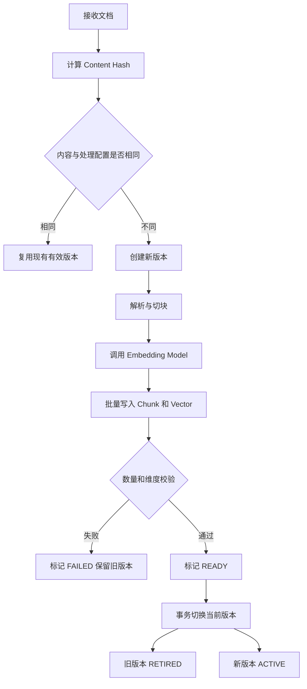

# M3 知识笔记：Day 31｜向量入库、更新与幂等

> 技术基线：JDK 21、Spring Boot 3.5.16、Spring AI 1.1.8、PostgreSQL 18.7、pgvector 0.8.7  
> 数据库：`spring_ai`  
> 向量维度：当前环境目标为 384，必须通过真实 Embedding 输出验证  
> 相似度：Cosine Distance，pgvector 运算符 `<=>`  
> 核心目标：重复导入、更新、失败重试和删除后，数据身份明确、版本有效、向量可追溯。

---

## 1. 核心概念：Insert、Upsert 与幂等

### 1.1 INSERT、UPDATE、UPSERT

| 操作   | 作用             | 典型场景               |
| ------ | ---------------- | ---------------------- |
| INSERT | 插入新记录       | 首次创建文档、Chunk    |
| UPDATE | 修改已存在记录   | 修改文档名称、任务状态 |
| UPSERT | 冲突时插入或更新 | 重复请求、幂等写入     |

PostgreSQL 使用 `INSERT ... ON CONFLICT` 实现 UPSERT。

```sql
INSERT INTO device_document (
    tenant_id,
    source_key,
    document_name
)
VALUES (
    'tenant-001',
    'manual/device-A.pdf',
    '设备 A 操作手册'
)
ON CONFLICT (tenant_id, source_key)
DO UPDATE SET
    document_name = EXCLUDED.document_name,
    updated_at = CURRENT_TIMESTAMP;
```

其中：

- `ON CONFLICT`：指定发生唯一性冲突时的处理方式。
- `EXCLUDED`：代表本次准备插入但发生冲突的记录。
- `DO NOTHING`：冲突时不执行写入。
- `DO UPDATE`：冲突时更新已有记录。

**重要：** `ON CONFLICT` 不是自动识别业务重复数据。必须先建立对应的主键、唯一约束或唯一索引。

PostgreSQL 18 的 `ON CONFLICT DO UPDATE` 可以保证单条 UPSERT 在并发情况下得到原子性的插入或更新结果，但它不能自动保证多张表组成的业务流水线整体幂等。

### 1.2 什么是幂等性

幂等性是指：

> 同一个业务请求执行一次或多次，最终产生的有效业务状态一致。

例如：

| 操作             | 第一次执行        | 重复执行             | 是否满足幂等 |
| ---------------- | ----------------- | -------------------- | ------------ |
| 导入同一文档     | 创建 1 个有效版本 | 不再创建重复有效版本 | 是           |
| 创建相同 Chunk   | 插入 1 条记录     | 唯一约束阻止重复     | 是           |
| 写入相同模型向量 | 创建 1 条向量记录 | 更新或忽略已有记录   | 是           |
| 删除同一文档     | 文档变为删除状态  | 再次删除仍为删除状态 | 是           |

幂等不意味着每次请求都不执行 SQL，而是最终有效数据状态一致。

### 1.3 为什么不能只用 Java 判断是否存在

错误做法：

```java
if (!repository.existsBySourceKey(sourceKey)) {
    repository.save(document);
}
```

并发场景：

```text
线程 A：查询，不存在
线程 B：查询，不存在
线程 A：插入
线程 B：插入
```

如果数据库没有唯一约束，就可能产生两条重复数据。

正确做法：

1. Java 可以进行前置检查，减少无效工作。
2. 数据库唯一约束负责最终兜底。
3. 使用 `INSERT ... ON CONFLICT` 处理重复写入。
4. 多表写入放在合适的事务边界内。
5. 使用任务 ID 和幂等键识别重复任务。

**数据库约束是并发幂等的最终防线，不能用业务代码中的 `if` 代替。**

---

## 2. RAG 数据身份与映射关系

### 2.1 五种重要身份

| 名称             | 含义               | 示例                        |
| ---------------- | ------------------ | --------------------------- |
| Document ID      | 原始文档的业务身份 | 设备 A 手册                 |
| Document Version | 文档某一次内容版本 | v1、v2                      |
| Chunk ID         | 某个切块的身份     | v1 的第 3 个 Chunk          |
| Vector ID        | 某条向量记录的身份 | 某 Chunk 在指定模型下的向量 |
| Embedding Model  | 生成向量的模型身份 | 模型名称、版本、维度        |

这些 ID 不应简单混为一谈。

例如：

```text
Document
  document_id = D001
  |
  +-- Document Version v1
  |      |
  |      +-- Chunk C001
  |      |      |
  |      |      +-- Vector V001
  |      |
  |      +-- Chunk C002
  |             |
  |             +-- Vector V002
  |
  +-- Document Version v2
         |
         +-- Chunk C003
         |      |
         |      +-- Vector V003
         |
         +-- Chunk C004
                |
                +-- Vector V004
```

同一份文档更新后，Document ID 通常不变，但 Document Version、Chunk ID 和 Vector ID 可以发生变化。

### 2.2 Chunk 与 Vector 是否必须一一对应

逻辑上，一条 Chunk 内容通常对应指定 Embedding 模型生成的一条向量。

但数据库设计上不一定必须使用同一个 ID：

- 同表：Chunk 文本、Metadata 和 Embedding 放在同一张表。
- 分表：Chunk 表保存文本，Embedding 表保存模型向量。
- 多模型：同一个 Chunk 可以有不同 Embedding Profile 对应的多条向量记录。

分表设计更容易管理模型升级、维度变化和多模型迁移。

本次建议采用：

```text
rag_document
    |
    +-- rag_document_version
              |
              +-- rag_chunk
                       |
                       +-- rag_embedding
```

### 2.3 稳定 Chunk ID

不能简单使用数据库自增 ID 作为重复导入的业务身份。

建议使用以下信息构造稳定标识：

```text
Document ID
+ Document Content Hash
+ Chunking Version
+ Chunk Ordinal
+ Chunk Content Hash
```

例如：

```text
chunk_identity =
SHA256(
    document_id
    + document_content_hash
    + chunking_version
    + chunk_ordinal
    + chunk_content_hash
)
```

其中：

- Document ID：确定属于哪份文档。
- Content Hash：确定原始文档内容版本。
- Chunking Version：确定切分规则版本。
- Chunk Ordinal：确定在当前文档中的顺序。
- Chunk Content Hash：辅助识别切块内容变化。

实际工程可以使用 UUIDv5 或 SHA-256 生成稳定 ID。

需要注意：稳定 ID 的作用是识别同一逻辑对象，不代表不同文档中的相同文本必须共享一个 Chunk ID。

---

## 3. 重复导入为什么会污染知识库

### 3.1 常见失败模式

| 失败模式        | 产生原因                   | 后果                   |
| --------------- | -------------------------- | ---------------------- |
| 重复 Chunk      | 每次导入都生成新 ID        | 相同内容反复检索       |
| 重复 Vector     | 重试时再次插入向量         | 存储浪费、结果重复     |
| 新旧版本混合    | 更新后未切换有效版本       | 过期知识参与检索       |
| 孤儿 Vector     | 删除 Chunk 后未删除向量    | 无法追溯来源           |
| Metadata 不一致 | 文本更新但 Metadata 未同步 | 设备型号、故障编码错误 |
| 部分写入        | 多步骤中途失败             | 文档只有部分 Chunk     |
| 并发覆盖        | 多个任务同时修改状态       | 旧任务覆盖新版本       |

### 3.2 Content Hash 的作用

建议对原始文档的规范化内容计算 SHA-256：

```text
content_hash = SHA256(normalized_document_content)
```

例如：

```text
文档 A
内容：设备 A 电机过热处理说明
Hash：H001

重复导入相同内容
Hash：H001

修改内容后重新导入
Hash：H002
```

可以据此判断：

- Hash 相同：内容没有变化，可以复用已有版本。
- Hash 不同：产生了新内容版本，需要重新处理。
- Chunking Version 不同：即使原文不变，也可能需要重新切块。
- Embedding Profile 不同：可能需要重新向量化。

### 3.3 Hash、版本号与更新时间的区别

| 字段                    | 表达的含义         | 是否能互相替代       |
| ----------------------- | ------------------ | -------------------- |
| Content Hash            | 内容是否相同       | 不能替代版本号       |
| Version No              | 业务版本顺序       | 不能证明内容是否相同 |
| Updated At              | 最近更新时间       | 不能证明内容发生变化 |
| Chunking Version        | 切分算法及参数版本 | 不能替代文档版本     |
| Embedding Model Version | 向量模型版本       | 不能替代文档版本     |

不要只使用 `updated_at` 判断是否需要重新向量化。

---

## 4. 文档版本管理与有效版本切换

### 4.1 三种更新策略

| 策略             | 实现方式                       | 优点                     | 风险                       |
| ---------------- | ------------------------------ | ------------------------ | -------------------------- |
| 原地更新         | 覆盖旧 Chunk 和向量            | 实现简单                 | 失败时可能破坏旧数据       |
| 先删除后新增     | 删除旧数据，再写新数据         | 逻辑简单                 | 新数据失败时知识库暂时为空 |
| 新版本写入后切换 | 新版本完整写入，再切换有效版本 | 可以保留旧版本，便于恢复 | 需要额外状态管理和存储     |

推荐第三种：**先写入新版本，验证成功后原子切换有效版本。**

### 4.2 推荐版本状态

```text
PENDING
   |
   v
PROCESSING
   |
   +------> FAILED
   |
   v
READY
   |
   v
ACTIVE
   |
   v
RETIRED
```

说明：

- PENDING：等待处理。
- PROCESSING：正在解析、切块或向量化。
- FAILED：处理失败，可重试。
- READY：所有 Chunk 和向量已经准备完成。
- ACTIVE：当前有效版本。
- RETIRED：历史版本，不参与正常检索。

### 4.3 版本切换流程



新版本的 Chunk 和向量在切换前可以已经写入数据库，但必须通过查询条件保证它们不参与正常检索。

### 4.4 如何避免新旧版本同时参与检索

文档表保存当前有效版本 ID：

```text
rag_document.current_version_id
```

查询时必须关联当前版本：

```sql
SELECT
    c.chunk_id,
    c.content,
    e.embedding <=> CAST(:query_vector AS vector) AS distance
FROM rag_embedding e
JOIN rag_chunk c
    ON c.chunk_id = e.chunk_id
JOIN rag_document_version v
    ON v.id = c.version_id
JOIN rag_document d
    ON d.id = v.document_id
WHERE d.tenant_id = :tenant_id
  AND d.deleted_at IS NULL
  AND d.current_version_id = v.id
  AND v.status = 'ACTIVE'
  AND e.embedding_profile = :embedding_profile
ORDER BY e.embedding <=> CAST(:query_vector AS vector)
LIMIT :top_k;
```

这样，即使旧版本的数据尚未物理删除，也不会被正常检索返回。

生产环境还应确保：

- 每次查询都带上租户条件。
- 每次查询都带上文档权限条件。
- 查询使用正确的 Embedding Profile。
- 新版本切换和旧版本退役在同一个数据库事务内完成。

---

## 5. PostgreSQL 数据模型示例

以下 SQL 是 Day 31 的教学设计，不代表已经在当前数据库执行。执行前应先核对项目是否已有同类表，避免重复创建或覆盖现有结构。

### 5.1 文档主表

```sql
CREATE EXTENSION IF NOT EXISTS vector;

CREATE TABLE rag_document (
    id UUID PRIMARY KEY DEFAULT gen_random_uuid(),

    tenant_id VARCHAR(100) NOT NULL,
    source_key VARCHAR(500) NOT NULL,
    document_name VARCHAR(500),

    current_version_id UUID,

    deleted_at TIMESTAMPTZ,
    created_at TIMESTAMPTZ NOT NULL DEFAULT CURRENT_TIMESTAMP,
    updated_at TIMESTAMPTZ NOT NULL DEFAULT CURRENT_TIMESTAMP,

    CONSTRAINT uk_rag_document_tenant_source
        UNIQUE (tenant_id, source_key)
);
```

关键点：

- `id`：Document ID。
- `tenant_id`：租户隔离。
- `source_key`：原始文档在业务系统中的唯一标识。
- `current_version_id`：当前有效版本。
- `deleted_at`：软删除标记。

唯一约束：

```sql
UNIQUE (tenant_id, source_key)
```

可以阻止同一租户重复创建相同业务文档。

### 5.2 文档版本表

```sql
CREATE TABLE rag_document_version (
    id UUID PRIMARY KEY DEFAULT gen_random_uuid(),

    document_id UUID NOT NULL
        REFERENCES rag_document(id)
        ON DELETE CASCADE,

    version_no BIGINT NOT NULL,

    content_hash CHAR(64) NOT NULL,
    chunking_version VARCHAR(100) NOT NULL,
    embedding_profile VARCHAR(200) NOT NULL,

    status VARCHAR(20) NOT NULL,

    created_at TIMESTAMPTZ NOT NULL DEFAULT CURRENT_TIMESTAMP,

    CONSTRAINT uk_document_version_config
        UNIQUE (
            document_id,
            content_hash,
            chunking_version,
            embedding_profile
        ),

    CONSTRAINT uk_document_version_no
        UNIQUE (document_id, version_no),

    CONSTRAINT ck_document_version_status
        CHECK (
            status IN (
                'PENDING',
                'PROCESSING',
                'FAILED',
                'READY',
                'ACTIVE',
                'RETIRED'
            )
        ),

    CONSTRAINT uk_version_document_pair
        UNIQUE (document_id, id)
);
```

其中：

- `content_hash`：原文内容 Hash。
- `chunking_version`：切分规则版本。
- `embedding_profile`：模型及向量配置的组合标识。
- `version_no`：业务版本号。
- `status`：处理和生效状态。

唯一约束确保相同文档、相同内容、相同切分配置和相同 Embedding Profile 不会重复创建版本。

### 5.3 限制一个文档只有一个 ACTIVE 版本

```sql
CREATE UNIQUE INDEX uk_document_one_active_version
ON rag_document_version(document_id)
WHERE status = 'ACTIVE';
```

这是部分唯一索引。

它保证同一份文档最多只有一条 `ACTIVE` 版本记录。

但它不能替代 `rag_document.current_version_id` 的一致性校验，两者应在同一个事务中维护。

### 5.4 Chunk 表

```sql
CREATE TABLE rag_chunk (
    id UUID PRIMARY KEY DEFAULT gen_random_uuid(),

    version_id UUID NOT NULL
        REFERENCES rag_document_version(id)
        ON DELETE CASCADE,

    chunk_ordinal INTEGER NOT NULL,
    content_hash CHAR(64) NOT NULL,
    content TEXT NOT NULL,
    metadata JSONB NOT NULL DEFAULT '{}'::jsonb,

    created_at TIMESTAMPTZ NOT NULL DEFAULT CURRENT_TIMESTAMP,

    CONSTRAINT uk_version_chunk_ordinal
        UNIQUE (version_id, chunk_ordinal)
);
```

说明：

- `id`：Chunk ID。
- `version_id`：所属文档版本。
- `chunk_ordinal`：当前版本中的 Chunk 顺序。
- `content_hash`：Chunk 内容 Hash。
- `metadata`：设备型号、故障编码、来源页码等。

使用 `UNIQUE(version_id, chunk_ordinal)` 防止同一个文档版本重复插入相同序号的 Chunk。

如果业务允许同一版本中存在内容完全相同但位置不同的 Chunk，不应简单对 `(version_id, content_hash)` 建立唯一约束。

### 5.5 Embedding 表

当前环境目标维度为 384，示例采用 `vector(384)`：

```sql
CREATE TABLE rag_embedding (
    id UUID PRIMARY KEY DEFAULT gen_random_uuid(),

    chunk_id UUID NOT NULL
        REFERENCES rag_chunk(id)
        ON DELETE CASCADE,

    embedding_profile VARCHAR(200) NOT NULL,
    model_id VARCHAR(200) NOT NULL,
    model_version VARCHAR(100) NOT NULL,

    dimensions INTEGER NOT NULL
        CHECK (dimensions = 384),

    embedding VECTOR(384) NOT NULL,

    created_at TIMESTAMPTZ NOT NULL DEFAULT CURRENT_TIMESTAMP,

    CONSTRAINT uk_chunk_embedding_profile
        UNIQUE (chunk_id, embedding_profile)
);
```

注意：

1. `VECTOR(384)` 限制数据库向量维度。
2. `dimensions = 384` 是额外的业务约束。
3. `embedding_profile` 标识一组明确的模型配置。
4. 同一个 Chunk 可以对应多个 Embedding Profile。
5. 如果未来切换到 768、1024 或 1536 维，不应把这些不同维度的向量强行写入当前列。

### 5.6 HNSW 索引

```sql
CREATE INDEX idx_rag_embedding_hnsw_cosine
ON rag_embedding
USING HNSW (embedding vector_cosine_ops);
```

该索引服务于 Cosine Distance 检索。

注意：HNSW 索引并不负责保证文档版本正确，也不负责数据幂等。它只负责加速相似度搜索。

---

## 6. UPSERT SQL 与重复导入处理

### 6.1 文档主表 UPSERT

```sql
INSERT INTO rag_document (
    tenant_id,
    source_key,
    document_name
)
VALUES (
    :tenant_id,
    :source_key,
    :document_name
)
ON CONFLICT (tenant_id, source_key)
DO UPDATE SET
    document_name = EXCLUDED.document_name,
    updated_at = CURRENT_TIMESTAMP
RETURNING id;
```

这里更新文档名称，但不应该在这个 UPSERT 中随意覆盖 `current_version_id`。

否则重复请求可能把当前有效版本指针重置为错误值。

### 6.2 Chunk 幂等插入

```sql
INSERT INTO rag_chunk (
    version_id,
    chunk_ordinal,
    content_hash,
    content,
    metadata
)
VALUES (
    :version_id,
    :chunk_ordinal,
    :content_hash,
    :content,
    CAST(:metadata AS jsonb)
)
ON CONFLICT (version_id, chunk_ordinal)
DO NOTHING;
```

适合重试时避免重复插入。

但要注意：如果相同版本、相同序号对应的 Chunk 内容发生变化，`DO NOTHING` 会保留旧内容。因此在正式写入前，应确保版本身份和 Chunking Version 正确，不能用它掩盖数据冲突。

### 6.3 Embedding 幂等写入

```sql
INSERT INTO rag_embedding (
    chunk_id,
    embedding_profile,
    model_id,
    model_version,
    dimensions,
    embedding
)
VALUES (
    :chunk_id,
    :embedding_profile,
    :model_id,
    :model_version,
    :dimensions,
    CAST(:embedding AS vector)
)
ON CONFLICT (chunk_id, embedding_profile)
DO UPDATE SET
    model_id = EXCLUDED.model_id,
    model_version = EXCLUDED.model_version,
    dimensions = EXCLUDED.dimensions,
    embedding = EXCLUDED.embedding;
```

该 SQL 可以保证同一个 Chunk 和 Embedding Profile 最终只有一条向量记录。

但如果模型版本发生变化，不应不加判断地覆盖旧向量。应该使用新的 Embedding Profile 或明确执行模型迁移。

### 6.4 为什么要区分版本和 Profile

例如：

```text
Profile A:
model = embedding-model-A
model_version = v1
dimensions = 384

Profile B:
model = embedding-model-B
model_version = v2
dimensions = 384
```

虽然维度相同，但两种模型的语义空间不一定兼容。

因此：

```text
dimensions 相同 ≠ Embedding 兼容
```

必须按模型及版本区分。

---

## 7. 全量替换与增量更新

### 7.1 全量替换

流程：

1. 计算新文档 Hash。
2. 创建新文档版本。
3. 对新版本重新切块。
4. 对所有 Chunk 重新向量化。
5. 写入新版本数据。
6. 校验 Chunk 数量、向量数量、维度。
7. 事务切换当前版本。
8. 后续清理历史版本。

优点：

- 逻辑简单。
- 版本边界清晰。
- 失败时可以保留旧版本。
- 更容易验证数据完整性。

缺点：

- 重新计算全部 Embedding。
- 数据量和 API 成本可能增加。

适用场景：文档规模较小、切分规则发生变化、Embedding 模型升级。

### 7.2 增量更新

只重新处理发生变化的部分 Chunk。

例如：

```text
旧版本：
Chunk 1
Chunk 2
Chunk 3

新版本：
Chunk 1
Chunk 2'
Chunk 3
```

可以复用未变化 Chunk 的处理结果，但必须证明其身份和配置兼容。

判断依据至少包括：

- Chunk 内容 Hash。
- Chunking Version。
- Embedding Profile。
- Metadata 版本。
- 所属文档版本。

风险：

- 旧 Chunk 和新 Chunk 的映射错误。
- 部分复用时遗漏需要更新的 Metadata。
- 旧向量仍然参与检索。
- 更新失败导致版本状态不一致。

**Day 31 阶段建议先实现全量新版本写入和原子切换。增量更新可以在全量流程稳定后再引入。**

---

## 8. 事务、并发与失败恢复

### 8.1 事务边界

不要把远程 Embedding API 调用长时间放在数据库事务中。

推荐拆分：

```text
事务 A：
创建或领取导入任务
创建 PROCESSING 文档版本
提交事务

事务外：
解析文档
切分 Chunk
调用 Embedding API
准备批量数据

事务 B：
批量写入 Chunk
批量写入 Embedding
更新任务进度
提交事务

事务 C：
检查全部数据
新版本 READY
旧版本 RETIRED
新版本 ACTIVE
更新 current_version_id
提交事务
```

这样可以避免：

- 远程模型响应慢导致数据库事务长时间占用。
- 数据库连接被远程调用占用。
- 模型服务异常时持有数据库锁。

### 8.2 并发导入

同一份文档可能被两个任务同时处理。

推荐组合：

1. 唯一约束：保证文档身份唯一。
2. 数据库行锁：串行化同一文档的版本分配和切换。
3. 任务幂等键：识别重复请求。
4. 版本状态检查：防止旧任务覆盖新任务。
5. 条件更新：只有预期状态才能切换。

例如：

```sql
BEGIN;

SELECT id, current_version_id
FROM rag_document
WHERE tenant_id = :tenant_id
  AND source_key = :source_key
FOR UPDATE;

-- 在锁内检查版本并分配新版本号

COMMIT;
```

`FOR UPDATE` 会锁定目标行，直到事务结束。

不要在持有该锁时调用远程 Embedding API。

### 8.3 失败恢复

| 失败位置                       | 可能状态               | 恢复策略                |
| ------------------------------ | ---------------------- | ----------------------- |
| 文档解析失败                   | 只有任务记录           | 标记 FAILED，修复后重试 |
| Chunk 切分失败                 | 可能存在临时数据       | 清理未完成版本或重建    |
| Embedding API 失败             | 部分 Chunk 已准备      | 保留进度，按批次重试    |
| Chunk 写入成功、向量写入失败   | 部分数据不完整         | 不激活版本，补齐向量    |
| 向量写入成功、任务状态更新失败 | 数据存在但任务状态滞后 | 对账后恢复任务状态      |
| 版本切换事务失败               | 旧版本仍有效           | 回滚后重试切换          |
| 删除过程中失败                 | 文档可能已软删除       | 根据删除任务继续清理    |

核心原则：

> 只有数据完整并通过校验的版本才能进入 ACTIVE 状态。

### 8.4 批量入库

推荐批量处理：

```text
文档
  |
  v
Chunk 列表
  |
  v
分批调用 Embedding Model
  |
  v
校验每批向量
  |
  v
批量 INSERT
  |
  v
记录批次进度
```

不要将所有文档无限制地一次性提交给模型和数据库。

应考虑：

- 模型接口批次大小限制。
- 请求超时。
- 数据库连接池大小。
- 单批事务耗时。
- 部分批次失败。
- 重试时的幂等键。
- 批次与原始 Chunk 的映射关系。

建议每个批次记录：

```text
task_id
document_id
version_id
batch_no
expected_count
success_count
failed_count
started_at
finished_at
status
```

---

## 9. 任务状态与可观测性

### 9.1 任务状态表

建议使用独立任务表记录处理过程：

```sql
CREATE TABLE rag_ingest_task (
    id UUID PRIMARY KEY DEFAULT gen_random_uuid(),

    idempotency_key VARCHAR(200) NOT NULL UNIQUE,

    document_id UUID NOT NULL
        REFERENCES rag_document(id),

    version_id UUID
        REFERENCES rag_document_version(id),

    status VARCHAR(20) NOT NULL,

    expected_chunk_count INTEGER NOT NULL DEFAULT 0,
    success_chunk_count INTEGER NOT NULL DEFAULT 0,
    failed_chunk_count INTEGER NOT NULL DEFAULT 0,

    retry_count INTEGER NOT NULL DEFAULT 0,

    error_message TEXT,

    started_at TIMESTAMPTZ,
    finished_at TIMESTAMPTZ,

    created_at TIMESTAMPTZ NOT NULL DEFAULT CURRENT_TIMESTAMP,

    CONSTRAINT ck_ingest_task_status
        CHECK (
            status IN (
                'PENDING',
                'PROCESSING',
                'SUCCESS',
                'FAILED',
                'CANCELLED'
            )
        )
);
```

### 9.2 幂等任务键

例如：

```text
idempotency_key =
tenant_id
+ document_id
+ content_hash
+ chunking_version
+ embedding_profile
```

同一个业务输入重复提交时，应该能识别为同一个处理意图。

不要把随机 UUID 当成幂等键，否则每次重试都会生成新的任务身份。

### 9.3 可观测性字段

至少记录：

- Trace ID。
- Ingest Task ID。
- Document ID。
- Document Version。
- Content Hash。
- Embedding Profile。
- Chunk 总数。
- 成功数量。
- 失败数量。
- 重试次数。
- 批次耗时。
- 模型调用耗时。
- 数据库写入耗时。
- 失败原因。

不要在日志中打印数据库密码、Embedding API Key 或完整敏感文档内容。

---

## 10. 删除与数据一致性

### 10.1 删除方式

| 删除方式 | 说明                    | 使用场景               |
| -------- | ----------------------- | ---------------------- |
| 软删除   | 设置 `deleted_at`       | 需要恢复、保留审计记录 |
| 物理删除 | 真正删除记录            | 数据生命周期结束       |
| 级联删除 | 外键触发关联数据删除    | 同一数据库内的数据依赖 |
| 事务删除 | 多条 SQL 在同一事务执行 | 保证本地数据原子性     |

### 10.2 单数据库中的级联删除

示例关系：

```text
rag_document
  |
  +-- rag_document_version
          |
          +-- rag_chunk
                  |
                  +-- rag_embedding
```

如果外键使用 `ON DELETE CASCADE`，删除文档时可以沿关联关系删除其版本、Chunk 和向量。

但生产环境不一定应该立即物理删除所有历史记录。可以先软删除，再通过清理任务物理删除。

### 10.3 软删除

```sql
UPDATE rag_document
SET
    deleted_at = CURRENT_TIMESTAMP,
    current_version_id = NULL,
    updated_at = CURRENT_TIMESTAMP
WHERE id = :document_id
  AND tenant_id = :tenant_id
  AND deleted_at IS NULL;
```

正常检索必须过滤：

```sql
WHERE d.deleted_at IS NULL
```

这样软删除后，即使历史向量仍存在，也不会被正常检索使用。

### 10.4 物理删除

```sql
BEGIN;

DELETE FROM rag_document
WHERE id = :document_id
  AND tenant_id = :tenant_id;

COMMIT;
```

在外键级联正确配置的前提下，关联版本、Chunk 和 Embedding 会被删除。

执行前必须确认外键关系和删除策略，不能对真实业务数据直接试验。

### 10.5 原文库与向量库分离

如果原始文档存储在对象存储，向量存储在 PostgreSQL：

```text
对象存储
   |
   | 文档内容
   v
应用服务
   |
   | Chunk / Embedding
   v
PostgreSQL + pgvector
```

这时不能简单依赖一个 PostgreSQL 事务同时保证对象存储和数据库操作成功。

需要理解：

- 最终一致性：多个系统最终达到一致状态。
- Outbox：业务事务提交时，同时写入待处理事件。
- 补偿任务：某个步骤失败后执行修复操作。
- 定期对账：扫描文档、Chunk、Vector，发现缺失或多余数据。

例如：

```text
删除请求
   |
   v
数据库事务：
文档软删除 + 写入 Outbox 事件
   |
   v
提交事务
   |
   v
异步消费者：
删除对象存储文件
   |
   v
清理 Chunk 和 Vector
   |
   v
标记删除任务成功
```

如果消费者失败，事件仍可重试，而不是丢失删除请求。

---

## 11. Embedding 维度与模型兼容

### 11.1 维度约束

当前数据库目标：

```sql
embedding VECTOR(384)
```

如果模型实际输出 384 维，可以写入。

如果实际输出 768 维，写入 `VECTOR(384)` 会失败。

不能通过修改配置文件中的数字来伪造实际模型输出维度。

Java 侧必须验证：

```java
float[] vector = embeddingModel.embed(text);

if (vector.length != expectedDimensions) {
    throw new IllegalStateException(
        "Embedding dimensions mismatch: expected="
            + expectedDimensions
            + ", actual="
            + vector.length
    );
}
```

### 11.2 不同模型不能默认混合

即使两个模型都是 384 维，也不代表它们生成的向量位于同一语义空间。

例如：

```text
模型 A：384 维
模型 B：384 维
```

维度相同，只能说明向量长度一致。

不能据此认为：

```text
模型 A 的文档向量
+
模型 B 的查询向量
```

可以直接进行可靠的相似度检索。

### 11.3 模型升级方案

推荐：

```text
旧模型 Profile A
    |
    v
旧向量表数据继续服务

新模型 Profile B
    |
    v
重新向量化
    |
    v
验证向量数量和维度
    |
    v
切换查询使用的 Profile
    |
    v
确认稳定后清理旧数据
```

如果维度发生变化，例如：

```text
384 → 768
```

需要使用新的向量列、表或独立存储方案。

pgvector 的 `vector(N)` 是固定维度约束，不能把不同维度的向量直接写入同一固定维度列。

### 11.4 模型元数据建议

至少保存：

```text
embedding_profile
model_id
model_version
dimensions
normalization_strategy
preprocessing_version
created_at
```

还应记录 Chunking Version，因为切分策略改变后，即使模型没有改变，也可能需要重新生成向量。

---

## 12. Spring AI 1.1.8 Java 实践

### 12.1 EmbeddingModel 调用

Spring AI 提供 `EmbeddingModel` 抽象，可以通过它调用具体 Embedding 服务。

```java
@Service
@RequiredArgsConstructor
public class DocumentEmbeddingService {

    private final EmbeddingModel embeddingModel;

    public List<float[]> embed(List<String> chunks) {

        List<float[]> vectors = embeddingModel.embed(chunks);

        if (vectors.size() != chunks.size()) {
            throw new IllegalStateException(
                "Embedding result count mismatch"
            );
        }

        for (float[] vector : vectors) {
            if (vector == null || vector.length != 384) {
                throw new IllegalStateException(
                    "Expected 384-dimensional embedding"
                );
            }

            for (float value : vector) {
                if (!Float.isFinite(value)) {
                    throw new IllegalStateException(
                        "Embedding contains non-finite value"
                    );
                }
            }
        }

        return vectors;
    }
}
```

说明：

- `EmbeddingModel.embed(List<String>)` 返回多个向量。
- 返回向量数量应与输入文本数量对应。
- 当前示例按 384 维进行校验。
- 真实模型输出维度必须先验证。
- 不能用伪造的随机向量代替模型调用。

如果未来需要支持多个模型维度，应将期望维度从硬编码常量改为经过核验的 Embedding Profile 配置。

### 12.2 使用 JDBC 写入 pgvector

可以使用参数化 SQL，将向量序列化为 pgvector 接受的文本形式，并通过 PostgreSQL 类型转换写入。

```java
private String toVectorLiteral(float[] vector) {

    StringJoiner joiner = new StringJoiner(",", "[", "]");

    for (float value : vector) {
        if (!Float.isFinite(value)) {
            throw new IllegalArgumentException(
                "Vector contains non-finite value"
            );
        }

        joiner.add(Float.toString(value));
    }

    return joiner.toString();
}
```

批量写入示例：

```java
String sql = """
    INSERT INTO rag_embedding (
        chunk_id,
        embedding_profile,
        model_id,
        model_version,
        dimensions,
        embedding
    )
    VALUES (
        ?,
        ?,
        ?,
        ?,
        ?,
        CAST(? AS vector)
    )
    ON CONFLICT (chunk_id, embedding_profile)
    DO UPDATE SET
        model_id = EXCLUDED.model_id,
        model_version = EXCLUDED.model_version,
        dimensions = EXCLUDED.dimensions,
        embedding = EXCLUDED.embedding
    """;

jdbcTemplate.batchUpdate(
    sql,
    vectors,
    vectors.size(),
    (ps, vector) -> {
        ps.setObject(1, vector.chunkId());
        ps.setString(2, vector.embeddingProfile());
        ps.setString(3, vector.modelId());
        ps.setString(4, vector.modelVersion());
        ps.setInt(5, vector.values().length);
        ps.setString(6, toVectorLiteral(vector.values()));
    }
);
```

这里的 `vector` 是示例业务对象，`chunkId()`、`embeddingProfile()` 等字段需要由项目自己的 DTO 或实体提供。

实际工程中应使用参数化 SQL，不要拼接用户输入构造 SQL。

### 12.3 Spring AI VectorStore 的边界

Spring AI 的 `VectorStore` 提供文档写入、删除和相似度检索等抽象能力。

典型使用：

```java
vectorStore.add(documents);

vectorStore.delete(documentIds);
```

但是必须理解：

- `add()` 是向量存储写入操作，不等于整个文档生命周期的幂等工作流。
- 不能仅凭调用 `add()` 就认定重复导入不会产生重复数据。
- 不能仅凭 `delete()` 就认定文档版本、任务状态和外部原文已经一致删除。
- 是否能实现业务级 UPSERT，取决于具体 VectorStore 实现和数据库约束。
- 文档 ID、Metadata、版本管理仍需要业务层设计。

对于当前设备故障知识库，建议把文档生命周期、版本切换和任务状态放在业务服务层管理，VectorStore 负责其适合的向量写入和检索职责。

---

## 13. 数据对账与验证 SQL

以下 SQL 是待执行验证模板，不是实际运行结果。

### 13.1 检查重复 Chunk

```sql
SELECT
    version_id,
    chunk_ordinal,
    COUNT(*) AS duplicate_count
FROM rag_chunk
GROUP BY version_id, chunk_ordinal
HAVING COUNT(*) > 1;
```

预期：无结果。

### 13.2 检查重复向量

```sql
SELECT
    chunk_id,
    embedding_profile,
    COUNT(*) AS duplicate_count
FROM rag_embedding
GROUP BY chunk_id, embedding_profile
HAVING COUNT(*) > 1;
```

预期：无结果。

### 13.3 检查孤儿向量

```sql
SELECT e.id, e.chunk_id
FROM rag_embedding e
LEFT JOIN rag_chunk c
    ON c.id = e.chunk_id
WHERE c.id IS NULL;
```

预期：无结果。

如果外键已正确建立，正常情况下不会出现孤儿向量。

### 13.4 检查没有向量的 Chunk

```sql
SELECT
    c.id,
    c.version_id
FROM rag_chunk c
LEFT JOIN rag_embedding e
    ON e.chunk_id = c.id
WHERE e.id IS NULL;
```

注意：该 SQL 需要结合版本状态和 Embedding Profile 判断。未完成的 PENDING 或 PROCESSING 版本可能暂时没有向量，不能一律视为异常。

### 13.5 检查当前有效版本

```sql
SELECT
    d.id AS document_id,
    d.current_version_id,
    v.status,
    v.version_no
FROM rag_document d
LEFT JOIN rag_document_version v
    ON v.id = d.current_version_id
WHERE d.deleted_at IS NULL
  AND (
      v.id IS NULL
      OR v.status <> 'ACTIVE'
  );
```

预期：无结果。

### 13.6 检查 ACTIVE 版本数量

```sql
SELECT
    document_id,
    COUNT(*) AS active_count
FROM rag_document_version
WHERE status = 'ACTIVE'
GROUP BY document_id
HAVING COUNT(*) > 1;
```

预期：无结果。

### 13.7 检查有效版本中 Chunk 与 Vector 数量

```sql
SELECT
    d.id AS document_id,
    v.id AS version_id,
    COUNT(DISTINCT c.id) AS chunk_count,
    COUNT(DISTINCT e.id) AS embedding_count
FROM rag_document d
JOIN rag_document_version v
    ON v.id = d.current_version_id
JOIN rag_chunk c
    ON c.version_id = v.id
LEFT JOIN rag_embedding e
    ON e.chunk_id = c.id
   AND e.embedding_profile = v.embedding_profile
WHERE d.deleted_at IS NULL
  AND v.status = 'ACTIVE'
GROUP BY d.id, v.id;
```

正常情况下，完整入库的有效版本应满足：

```text
chunk_count = embedding_count
```

如果一个 Chunk 允许对应多个模型向量，则必须按当前 Profile 进行统计，不能直接把所有模型的向量混在一起计算。

---

## 14. 常见故障与排查

| 问题                       | 可能原因                      | 排查方向                             |
| -------------------------- | ----------------------------- | ------------------------------------ |
| 重复导入产生多条记录       | 缺少唯一约束                  | 检查业务唯一键                       |
| `ON CONFLICT` 报错         | 冲突目标没有对应唯一约束      | 检查索引与约束定义                   |
| Chunk 有记录但没有 Vector  | 模型调用或批量写入失败        | 检查任务批次和失败日志               |
| Vector 维度不匹配          | 模型输出与 `vector(N)` 不一致 | 检查真实 `float[].length`            |
| 新旧版本同时被检索         | 查询没有过滤当前版本          | 检查 JOIN 和 WHERE                   |
| 删除后仍能检索             | 软删除条件遗漏                | 检查租户和删除过滤                   |
| 并发导入版本号冲突         | 版本分配缺少并发控制          | 检查唯一约束和行锁                   |
| 重试覆盖新版本             | 旧任务没有检查版本状态        | 使用条件更新和版本校验               |
| 向量模型升级后召回异常     | 新旧模型向量混用              | 检查 Embedding Profile               |
| 数据库记录与任务状态不一致 | 跨步骤失败                    | 任务对账与补偿                       |
| 检索过滤后结果数量不足     | ANN 候选集和过滤条件相互影响  | 检查过滤条件、执行计划和迭代扫描配置 |

---

## 15. Day 31 实践设计与验收

### 15.1 完整生命周期

以设备 A 的故障维修手册为例：

| 阶段     | 操作                          | 必须满足的条件                  |
| -------- | ----------------------------- | ------------------------------- |
| 首次导入 | 创建文档、版本、Chunk、Vector | 数据完整，版本 ACTIVE           |
| 重复导入 | 再次提交相同文档              | 不新增重复有效版本              |
| 内容更新 | 修改原文并重新导入            | 生成新版本                      |
| 部分失败 | 模拟向量化失败                | 新版本不能激活                  |
| 失败重试 | 继续处理失败批次              | 不产生重复 Chunk 和 Vector      |
| 版本切换 | 新版本完成校验                | 新版本 ACTIVE，旧版本不参与检索 |
| 删除     | 软删除或物理删除              | 不再参与检索，关联数据可追溯    |

### 15.2 建议测试用例

| 编号 | 测试场景               | 验收标准                         |
| ---- | ---------------------- | -------------------------------- |
| T01  | 首次导入               | Document、Chunk、Vector 关联正确 |
| T02  | 重复导入               | 不产生重复有效版本               |
| T03  | 同一任务重复提交       | 幂等键能够识别重复任务           |
| T04  | 修改文档内容           | 生成新版本                       |
| T05  | 模型调用失败           | 旧版本仍然有效                   |
| T06  | 数据库批次写入失败     | 未完成版本不激活                 |
| T07  | 同一文档并发导入       | 不出现重复有效版本               |
| T08  | 重试失败批次           | 不产生重复 Chunk 和 Vector       |
| T09  | 删除文档               | 正常检索不再返回                 |
| T10  | 更换 Embedding Profile | 不混用新旧模型向量               |

### 15.3 真实验证记录模板

以下内容必须在实际执行后填写：

| 验证项          | 执行命令或 SQL                                               | 实际结果 | 状态   |
| --------------- | ------------------------------------------------------------ | -------- | ------ |
| PostgreSQL 版本 | `SELECT version();`                                          | 待实测   | 待验证 |
| pgvector 版本   | `SELECT extversion FROM pg_extension WHERE extname='vector';` | 待实测   | 待验证 |
| 首次导入        | 实际项目接口或测试                                           | 待实测   | 待验证 |
| 重复导入        | 相同文档再次提交                                             | 待实测   | 待验证 |
| 更新版本        | 修改原文重新提交                                             | 待实测   | 待验证 |
| 模型失败        | 模拟模型调用异常                                             | 待实测   | 待验证 |
| 并发导入        | 多线程或并发请求                                             | 待实测   | 待验证 |
| 删除            | 实际删除接口                                                 | 待实测   | 待验证 |
| 孤儿检查        | 执行对账 SQL                                                 | 待实测   | 待验证 |

**当前没有执行真实模型调用、数据库 DDL 或并发测试，因此不提供虚构的测试输出、执行耗时或成功率。**

---

## 16. 本日核心总结

### 16.1 必须掌握的八个结论

1. 幂等不能只靠 Java 判断是否存在，数据库唯一约束是最终防线。
2. Document ID、Document Version、Chunk ID、Vector ID 是不同层次的身份。
3. Content Hash 用于识别内容变化，版本号用于表达业务版本顺序。
4. Chunking Version 和 Embedding Profile 必须独立管理。
5. 文档更新优先采用新版本完整写入、验证成功后原子切换。
6. 模型调用失败或批次写入失败时，未完成版本不能进入 ACTIVE。
7. 删除必须同时考虑原文、Chunk、Vector、任务和检索有效性。
8. 相同向量维度不代表不同模型的语义空间兼容。

### 16.2 最重要的工程设计

```text
文档身份唯一
    +
内容 Hash
    +
版本管理
    +
稳定 Chunk ID
    +
Embedding Profile
    +
数据库唯一约束
    +
事务切换
    +
失败重试
    +
数据对账
    =
可靠的向量入库生命周期
```

最终需要保证：

```text
首次导入
    ↓
重复导入
    ↓
内容更新
    ↓
部分失败
    ↓
失败重试
    ↓
版本切换
    ↓
删除
```

每一步都有明确身份、可验证状态、可重试操作和可追溯数据。

---

## 17. 参考资料

### PostgreSQL

1. PostgreSQL 18 Documentation: INSERT | PostgreSQL 18 插入与 UPSERT 文档：[https://www.postgresql.org/docs/18/sql-insert.html](https://www.postgresql.org/docs/18/sql-insert.html)
2. PostgreSQL 18 Documentation: Transaction Isolation | PostgreSQL 18 事务隔离文档：[https://www.postgresql.org/docs/18/transaction-iso.html](https://www.postgresql.org/docs/18/transaction-iso.html)
3. PostgreSQL 18 Documentation: Constraints | PostgreSQL 18 约束文档：[https://www.postgresql.org/docs/18/ddl-constraints.html](https://www.postgresql.org/docs/18/ddl-constraints.html)
4. PostgreSQL 18 Documentation: Explicit Locking | PostgreSQL 18 显式锁定文档：[https://www.postgresql.org/docs/18/explicit-locking.html](https://www.postgresql.org/docs/18/explicit-locking.html)

### pgvector

5. pgvector README | pgvector 项目说明与使用文档：[https://github.com/pgvector/pgvector](https://github.com/pgvector/pgvector)
6. pgvector 0.8.7 Documentation | pgvector 0.8.7 类型、运算符与索引文档：[https://pgvector.app/docs/](https://pgvector.app/docs/)

### Spring AI

7. Vector Databases :: Spring AI Reference | Spring AI 向量数据库参考文档：[https://docs.spring.io/spring-ai/reference/api/vectordbs.html](https://docs.spring.io/spring-ai/reference/api/vectordbs.html)
8. PGvector :: Spring AI Reference | Spring AI PostgreSQL/pgvector 集成文档：[https://docs.spring.io/spring-ai/reference/api/vectordbs/pgvector.html](https://docs.spring.io/spring-ai/reference/api/vectordbs/pgvector.html)
9. VectorStore (Spring AI 1.1.x API) | Spring AI 1.1.x 向量存储接口：[https://docs.spring.io/spring-ai/docs/1.1.x/api/org/springframework/ai/vectorstore/VectorStore.html](https://docs.spring.io/spring-ai/docs/1.1.x/api/org/springframework/ai/vectorstore/VectorStore.html)

> 版本说明：Spring AI 的通用参考文档可能随版本更新。实际开发必须以 Spring AI 1.1.8 对应的 API、依赖和配置元数据为准，不要直接复制其他版本的配置。