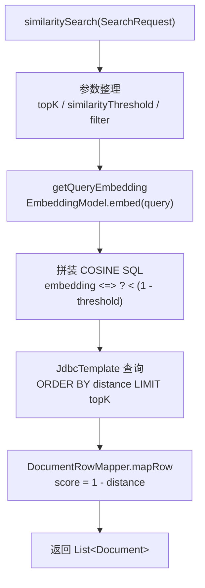
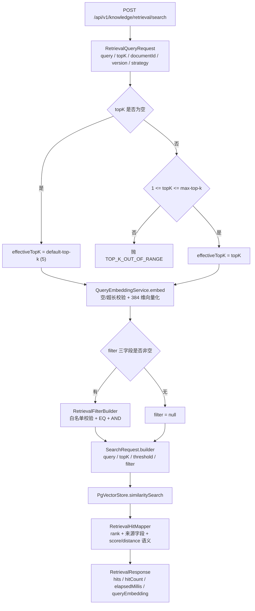

# D32 相似度检索与 Top-K 技术原理与实践指南

> 模块前缀：D32 ｜ 功能技术标题：相似度检索与 Top-K
> 适用代码：`D32_SSATK`（Spring Boot 3.5.16 / Spring AI 1.1.8 / JDK 21）
> 阅读前提：已了解 D31 的「向量入库、更新与幂等」，知道每个 chunk 已写入 `public.vector_store`（`vector(384)`）。

---

## 一、是什么：Top-K 相似度检索在 RAG 中的位置

RAG（Retrieval-Augmented Generation，检索增强生成）的最小闭环是：

```
文档 → 切分 → 向量化 → 入库
用户问题 → 向量化 → 相似度检索 Top-K → 交给大模型生成答案
```

D32 只做中间那段 **"用户问题 → 向量化 → Top-K 相似度检索"**，明确不接生成环节。因此本迭代的产物是"检索命中 + 真实来源 + 分数语义"，而不是"答案"。

一次检索要回答四个问题：

| 问题 | D32 的答案载体 |
| --- | --- |
| 用哪个模型把问题变成向量？维度多少？ | `RetrievalResponse.queryEmbedding`（维度/向量空间/模型/耗时） |
| 在哪个向量库里比？用什么距离？ | PostgreSQL + pgvector，`COSINE_DISTANCE` |
| 取前几条？ | `effectiveTopK`（默认 5，上限 50） |
| 命中来自哪份文档的哪一段？ | `RetrievalHitView`（documentId / version / chunkIndex / title / pageNumbers / strategy / 全文） |

---

## 二、为什么：向量检索 vs 关键词检索

D31 快照里已有 `KnowledgeRetrievalService`，它是**纯内存 bigram 关键词打分**。两者差别不在"谁快"，而在"能不能跨表述匹配"：

| 维度 | 关键词检索（bigram） | 向量检索（pgvector COSINE） |
| --- | --- | --- |
| 匹配依据 | 字面 n-gram 重合 | 向量空间中的方向夹角 |
| 同义改写 | 匹配不到（"液位不足" vs "液位低于下刻线"） | 取决于 embedding 模型语义能力 |
| 跨语种 | 不成立 | 取决于模型 |
| 召回解释性 | 强（能看到命中了哪些词） | 弱（只有分数） |
| 存储 | 内存/倒排 | 向量表 + ANN 索引 |
| 规模上限 | 万级文本容易变慢 | HNSW 可到百万级 |

结论：向量检索不是"更准的关键词检索"，而是"换一种相似性定义"。它把"文本是否含相同词"换成"语义方向是否一致"，代价是可解释性下降、依赖 embedding 模型质量。

> 本次实测也给出了这个代价的真实样本：本地 `LocalHashNgramEmbeddingModel` 本质仍是字符 n-gram 哈希向量，**没有真正的语义能力**，所以分数普遍偏低（Top1 仅 0.11–0.56），并出现排序倒挂（详见 `docs\evidence\D32\noise-and-miss-analysis.md`）。这证明"向量检索"只是通道，通道里装什么模型才决定效果。

---

## 三、底层原理

### 3.1 Embedding 与余弦相似度

Embedding 把一段文本映射成固定维度的实数向量（本工程 384 维）。两个向量的**余弦相似度**只关心方向、不关心长度：

```
cos(A, B) = (A · B) / (‖A‖ · ‖B‖)
```

- `1`：方向完全一致（语义最接近）
- `0`：正交（无语义关联）
- `-1`：方向完全相反
- 取值范围 `[-1, 1]`

工程里更常用它的互补量**余弦距离**：

```
cosine_distance(A, B) = 1 - cos(A, B)
```

- `0`：完全一致
- `1`：正交
- `2`：完全相反

pgvector 的 `<=>` 算子返回的就是余弦距离（范围 `[0, 2]`），因此 `ORDER BY embedding <=> q ASC` 就是"越相似越靠前"。

**为什么用余弦而不是欧氏距离？** 欧氏距离对向量长度敏感：同一段文本加一句"备注："就可能让模长变化，从而改变排序。余弦先把长度归一化，只比方向。本工程入库侧向量已归一化（实测 `norm=1.000000`），此时余弦与"归一化后的欧氏距离"单调等价，但余弦的语义解释更直接。

### 3.2 pgvector：算子、索引与 SQL 形状

pgvector 给 PostgreSQL 增加了 `vector` 类型和距离算子：

| 算子 | 距离类型 | 说明 |
| --- | --- | --- |
| `<->` | L2（欧氏） | 向量长度敏感 |
| `<#>` | 内积 | 常配合归一化向量 |
| `<=>` | 余弦 | 本工程使用 |

Spring AI 1.1.8 的 `PgVectorStore` 在 COSINE 模式下生成的 SQL 形状（字节码常量池实证）是：

```sql
SELECT *, embedding <=> ? AS distance
FROM <table>
WHERE embedding <=> ? < ?
<filter 片段>
ORDER BY distance
LIMIT ?
```

三个占位参数的含义：查询向量（用于输出 distance）、查询向量（用于 WHERE 比较）、**距离上界**（`1 - similarityThreshold`）。

索引层面，`vector_cosine_ops` 表示该索引为余弦距离服务：

```sql
CREATE INDEX spring_ai_vector_index
ON public.vector_store
USING hnsw (embedding vector_cosine_ops);
```

**HNSW（Hierarchical Navigable Small World，分层可导航小世界图）** 是一种近似最近邻（ANN）索引：把向量组织成多层图，查询从稀疏的顶层逐层下降，用少量距离计算逼近真实最近邻。它能显著降低延迟，但**是近似算法**——返回的 Top-K 可能不是精确 Top-K。常用可调参数（以 pgvector 官方 README 为准）：

- 建索引：`m`（每层邻居数，默认 16）、`ef_construction`（建图候选队列，默认 64）；
- 查询：`hnsw.ef_search`（候选队列大小，默认 40，越大越准越慢）。

实践含义：**语料很小时（本工程 8 个 chunk）HNSW 与暴力扫描的差异可以忽略**；语料上量后，召回率与延迟的取舍才成为问题，届时先调 `ef_search` 再考虑换索引类型。

### 3.3 Spring AI PgVectorStore 的执行流程（源码机制）

把一次 `vectorStore.similaritySearch(request)` 拆开，真实动作顺序是：



逐点说明：

1. **topK 默认值**：`SearchRequest.DEFAULT_TOP_K = 4`。若不显式设置，框架给 4，而不是 5。D32 在 `RetrievalProperties` 里把业务默认值锁定为 5 并显式传入。
2. **查询向量来源**：`getQueryEmbedding` 内部调用 `EmbeddingModel.embed(String)`。`SearchRequest` **没有** `queryVector` 入口（`javap` 方法列表实证），所以无法把外部算好的向量交给它。
3. **阈值换算**：`doSimilaritySearch` 字节码中计算 `1.0 - getSimilarityThreshold()` 作为 SQL 的距离上界。因此 `similarityThreshold=0.0` 翻译成 `distance < 1`，等价"只保留余弦相似度 > 0 的向量"。
4. **过滤下推**：`Filter.Expression` 被渲染成 SQL 片段插入 `%s` 位置，是**数据库端过滤**，不是查回来再筛。因此过滤会真实减少返回条数。
5. **分数语义**：`DocumentRowMapper#mapRow` 里 `metadata.put("distance", distance)` 保存原始距离，`Document.builder().score(1 - distance)` 得到相似度。即 `Document#getScore()` 是**相似度**，不是距离。

### 3.4 双次向量化：一个必须知道的框架限制

因为 `SearchRequest` 只接受文本，一次业务检索会触发两次 `embed`：

1. 显式路径：`QueryEmbeddingService.embed(query)` —— 用于输出维度/空间/耗时，做可观测性；
2. 隐式路径：`PgVectorStore` 内部再 embed 一次 —— 真正用于 SQL 比较。

| 模型类型 | 影响 |
| --- | --- |
| 本地确定性模型（本工程默认） | 零成本、结果确定，仅一次多余 CPU 计算（实测整链路 3–6 ms） |
| 远程 Embedding API | 每次检索计费两次、延迟叠加一次网络往返 |

工程建议：若换远程模型，要么接受双次调用，要么绕过 `VectorStore` 直接用 `PgVectorAccess` 执行自定义 SQL（本工程已有该类，但 D32 边界内不改），要么向框架提 issue 支持 `queryVector`。这是**能力限制**，不是实现缺陷。

### 3.5 为什么结果可能不足 K 条

`distance < 1` 这个条件会丢弃"相似度 ≤ 0"的向量。余弦相似度可以为 0（正交）甚至为负（方向相反），于是出现：

- `topK=50` 实测只返回 **4** 条（8 个 chunk 中只有 4 个与查询正相关）；
- 某些问题 Top-5 的最低分低至 `0.013438`，说明"正但极弱"的结果仍被接受。

若业务要求"必定返回 K 条"，需要把阈值降到允许负相似度的区间（或不做阈值只靠 `LIMIT`），这属于阈值策略标定，不能靠"把阈值拍成 0.0 就以为返回全部"。

---

## 四、执行流程（D32 全链路）



---

## 五、核心代码拆解

### 5.1 查询向量化与校验（`QueryEmbeddingService`）

```java
public QueryVector embed(String query) {
    String normalized = requireQuery(query);          // QUERY_BLANK / QUERY_TOO_LONG / QUERY_EXCEEDS_MODEL_LIMIT
    long start = System.nanoTime();
    float[] values = embeddingModel.embed(normalized); // 384 维
    QueryVectorValidator.validate(values, descriptor.dimensions()); // 维度 / 有限 / 非全零
    long elapsedMillis = (System.nanoTime() - start) / 1_000_000L;
    return new QueryVector(normalized, values, descriptor.dimensions(),
            descriptor.vectorSpaceId(), descriptor.modelName(), elapsedMillis);
}
```

要点：
- 校验发生在**调用数据库之前**，避免把 NaN/全零向量送进 SQL；
- `QueryVector` 对 `values` 做防御性拷贝，避免外部修改内部状态；
- 产出 `vectorSpaceId` 用于证明"查询向量与入库向量在同一空间"。

### 5.2 Top-K 解析（`resolveTopK`）

```java
int value = topK == null ? properties.getDefaultTopK() : topK;
if (value < 1 || value > properties.getMaxTopK()) {
    throw new RetrievalException(ResultCode.PARAM_INVALID,
            "topK 必须在 1.." + properties.getMaxTopK() + " 之间，实际传入 " + value,
            "TOP_K_OUT_OF_RANGE");
}
```

要点：`topK=0` **不等于**"使用默认值"，而是直接拒绝。这是刻意设计——静默回退会掩盖调用方 bug。

### 5.3 过滤表达式（`RetrievalFilterBuilder`）

```java
private Filter.Expression buildCondition(String field, String value) {
    requireSafe(field, value);                       // FILTER_VALUE_INVALID
    return new FilterExpressionBuilder().eq(field, value).build();
}

// 三条件 AND；全空返回 null
```

要点：`Filter.Expression` 最终会进入 SQL 文本，所以**必须**在构建前对值做白名单校验（`[A-Za-z0-9._:-]{1,128}`）。这是"表达式注入"与 SQL 注入的区别：这里没有字符串拼接 SQL，但表达式渲染层同样会拼文本。

### 5.4 结果映射（`RetrievalHitMapper`）

```java
double score = document.getScore();                  // 余弦相似度
Double distance = asDouble(metadata.get("distance")); // 余弦距离
return new RetrievalHitView(rank, document.getId(), ...,
        score, distance, "COSINE_SIMILARITY", "COSINE_DISTANCE");
```

要点：
- metadata 数值可能是 `Integer/Float/Double/String`，统一容错转换；
- 字段缺失返回 `null` / 空列表，**不补造默认值**；
- 同时输出 `score` 与 `distance` 并各自标注语义，从契约层杜绝"把分数当距离"。

### 5.5 组装检索请求（`SimilarityRetrievalService#search`）

```java
SearchRequest.Builder builder = SearchRequest.builder()
        .query(queryVector.query())
        .topK(effectiveTopK)
        .similarityThreshold(properties.getSimilarityThreshold());
if (filter != null) {
    builder.filterExpression(filter);
}
List<Document> documents = vectorStore.similaritySearch(builder.build());
```

要点：`query` 传的是**文本**（不是向量），原因见 3.3；`topK` 与阈值都显式设置，不依赖框架默认值。

---

## 六、配置与调参

### 6.1 配置项

```yaml
app:
  retrieval:
    default-top-k: ${RETRIEVAL_DEFAULT_TOP_K:5}
    max-top-k: ${RETRIEVAL_MAX_TOP_K:50}
    max-query-length: ${RETRIEVAL_MAX_QUERY_LENGTH:2000}
    similarity-threshold: ${RETRIEVAL_SIMILARITY_THRESHOLD:0.0}
```

`RetrievalProperties#validate()` 在 Bean 构造期执行（`SimilarityRetrievalService` 构造器里调用），非法配置**启动即失败**，不会带病运行。

### 6.2 调参顺序建议

| 顺序 | 参数 | 判断依据 |
| --- | --- | --- |
| 1 | `topK` | 下游上下文预算：每条 chunk 约 100–500 字，Top-5 一般 1–3K 字 |
| 2 | `similarity-threshold` | 用人工标注结果统计"噪声率 vs 召回率"曲线，而不是凭经验拍 |
| 3 | HNSW `ef_search` | 语料上量后测召回率（与暴力扫描对比） |
| 4 | chunk 大小/切分策略 | 观察是否同一 chunk 被多题互相干扰（本工程 COOLING-C01 被 8/10 题命中） |

---

## 七、验证方法：如何证明"检索是真的在工作"

只看到 HTTP 200 不足以证明向量检索生效。D32 用了四类互相独立的证据：

| 证据 | 做法 | 本次实测值 |
| --- | --- | --- |
| **分数语义自洽** | 用 chunk 原文做查询，Top1 必须命中自身，且 `score≈1`、`distance≈0` | `score=1.000000`、`distance=0.000000` |
| **互补关系** | 同一命中满足 `score + distance ≈ 1` | `0.352904 + 0.647096 = 1.000000` |
| **过滤真实下推** | 无过滤 vs 加 `documentId` 过滤，结果集必须收缩且全部指向目标文档 | `7 条 / 3 文档 → 2 条` |
| **数据库层独立核验** | 用 psql 直接查扩展版本、列类型、索引定义 | `vector 0.8.7`、`vector(384)`、HNSW `vector_cosine_ops` |

反例（这些"通过"是假的，不能算验收）：

- 只断言"接口返回 200"——可能是空数组；
- 只断言"hits 非空"——可能是关键词检索兜底返回；
- 用 Mock `VectorStore` 断言调用次数——没有证明 SQL 与 pgvector 真的工作；
- 数据库不可用时跳过测试并宣称通过。

---

## 八、常见问题与陷阱

| # | 现象 | 根因 | 正确做法 |
| --- | --- | --- | --- |
| 1 | 期望 Top-K 一定返回 K 条，实际更少 | 阈值 0.0 → SQL `distance < 1`，丢弃相似度 ≤ 0 的向量 | 明确"阈值语义 = 距离上界"，按业务标定；需要满 K 时不要设正阈值 |
| 2 | 不传 topK 得到 4 条 | `SearchRequest.DEFAULT_TOP_K=4` | 业务层显式兜底 5（D32 已做） |
| 3 | 把 `score` 当距离用，排序反了 | 框架 `score = 1 - distance` | 结果契约同时给 `score`/`distance` 并标注语义 |
| 4 | 加过滤后 0 条 | metadata 里没有该字段或值大小写/格式不一致 | 先确认入库时真实写入的字段与值（D32 只开放三个真实字段） |
| 5 | 过滤值带引号导致异常 | 表达式渲染会拼 SQL 文本 | 值白名单校验，违规直接拒绝（`FILTER_VALUE_INVALID`） |
| 6 | 启动后检索报维度不匹配 | 查询向量维度与表 `vector(384)` 不一致 | 校验 `descriptor.dimensions()` 与 PgVectorStore `dimensions(384)` 一致 |
| 7 | 向量含 NaN/Infinity | 模型异常或数值溢出 | 入库前/查询前都校验有限性 |
| 8 | 检索延迟是"两次 embed" | 框架限制（`SearchRequest` 无 `queryVector`） | 本地模型可接受；远程模型需评估成本或改自定义 SQL |
| 9 | 语料很小但召回率仍不理想 | embedding 模型无真语义（hash-ngram） | 换语义模型（bge-m3 / text-embedding-3-small），注意向量空间变更需重建 |
| 10 | 应用重启后检索 0 条 | `initialize-schema=false`，表由外部 DDL 管理；未执行语料入库 | 先调 `/corpus/index` 幂等入库，再检索 |
| 11 | 服务端过滤 + HNSW 结果不足 K 条 | ANN 候选集被过滤条件削减 | 提高 `hnsw.ef_search`，或对强过滤场景改用精确扫描/分区表 |
| 12 | 中文长查询被截断或拒绝 | `max-query-length=2000` 与模型 `max-input-length=12000` | 两个上限都要校验，错误码区分（`QUERY_TOO_LONG` vs `QUERY_EXCEEDS_MODEL_LIMIT`） |

---

## 九、工程实践

### 9.1 上线前检查清单

1. 向量表存在且维度为 384，索引为 `vector_cosine_ops`；
2. 语料已幂等入库（`corpus/index` 返回每篇文档的 `status` 与 `idempotent`）；
3. 自查询验证 `score≈1 / distance≈0`（证明链路与分数语义都正确）；
4. 过滤字段与入库 metadata 字段一一对应，无"幽灵字段"；
5. 阈值经人工标注标定，不靠默认值上线；
6. 检索耗时 P95 已测（本次本地模型 3–6 ms，仅代表本地场景）。

### 9.2 监控指标

| 指标 | 采集方式 | 用途 |
| --- | --- | --- |
| 检索耗时 | `RetrievalResponse.elapsedMillis` | 发现 pgvector 连接或索引退化 |
| 命中数分布 | `hitCount` | 判断阈值是否过严（长期低于 K 说明阈值需下调或语料不足） |
| Top1 分数分布 | `hits[0].score` | 判断 embedding 模型是否匹配业务语料 |
| 过滤使用率 | `filterDescription` 非空比例 | 评估多文档场景的真实诉求 |

### 9.3 与后续 RAG 链路的衔接

D32 的产物是"命中列表"，下一步接生成时需要做：

1. **上下文拼装**：按 `rank` 顺序拼接 `content`，控制总长度；
2. **引用溯源**：把 `documentId + title + pageNumbers` 变成可点击引用；
3. **不可信数据处理**：语料中 `SERVO-C03` 明确是提示注入样本，拼进 prompt 时必须作为"数据"而非"指令"（本次实测它被 6 个问题召回，是真实风险点）；
4. **答案与检索分离**：命中为空或 Top1 分数过低时，应明确回复"未找到依据"，不能凭模型臆造。

### 9.4 一个反直觉的结论

本次十题评估里，Top1 分数最高的 Q6 只有 `0.558432`，最低的 Q9 只有 `0.112298`——但两者的 Top1 都落在了原文措辞对应的 chunk 上。这说明：

**分数绝对值不直接等价于"相关性好不好"，它只反映"当前模型下的相对排序"。** 判断检索质量必须用人工标注的 hit@1 / hit@5 / 噪声率，而不是"分数看着高不高"。

---

## 十、官方文档与引用

- 《Spring AI Reference | Spring AI 参考文档》：https://docs.spring.io/spring-ai/reference/
- 《Spring AI Vector Store API | Spring AI 向量存储 API》：https://docs.spring.io/spring-ai/reference/api/vectordbs.html
- 《PgVector Vector Store | PgVector 向量存储》：https://docs.spring.io/spring-ai/reference/api/vectordbs/pgvector.html
- 《pgvector README（含 HNSW 与距离算子说明）》：https://github.com/pgvector/pgvector
- 《PostgreSQL 18 Documentation | PostgreSQL 18 官方文档》：https://www.postgresql.org/docs/18/index.html

> 本文中关于 `SearchRequest` 无 `queryVector`、`DEFAULT_TOP_K=4`、COSINE SQL 模板、`1 - threshold` 换算、`score = 1 - distance` 的结论，均来自本机 Spring AI 1.1.8 构件的 `javap` 字节码实证（原件见 `docs\temp_docs\D32\javap-*.txt`），不是二手资料转述。
