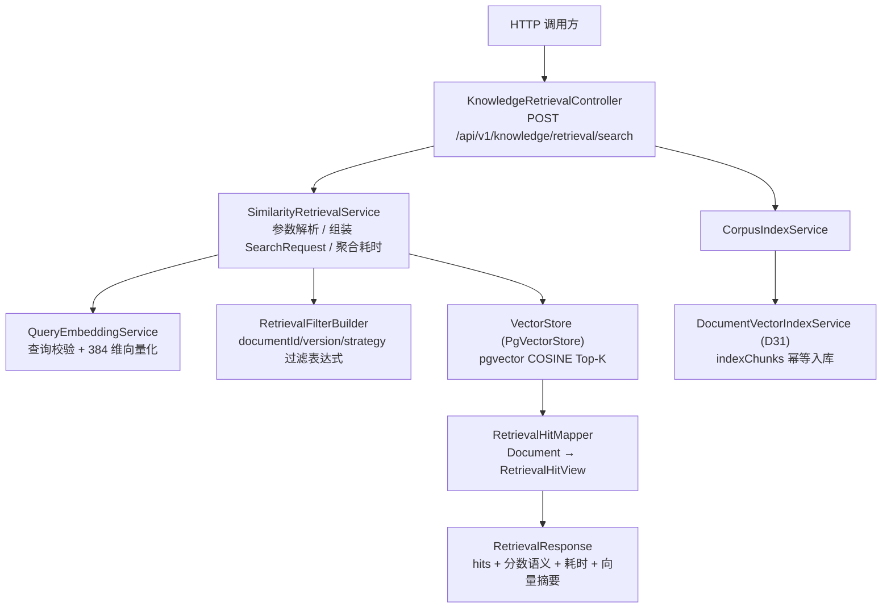

# D32 相似度检索与 Top-K 项目迭代实施记录

> 模块前缀：D32 ｜ 功能技术标题：相似度检索与 Top-K
> 迭代日期：2026-11-15 ｜ 项目根：`E:\AI\project\AI-Learning-two-lp\M3-Java-ds\D32` ｜ 模块：`D32_SSATK`
> 任务书：`docs\proj_docs\D32 项目迭代任务书 Prompt：相似度检索与 Top-K.md`
> 结论口径：所有"通过"均有真实命令退出码或 surefire XML 支撑；未执行/未确认项一律标注。

---

## 一、迭代概述

### 1.1 迭代目标

在 D31 已完成的「向量入库、更新与幂等」能力之上，补齐 RAG 的检索侧四件事：

1. **Query Embedding**：把用户问题转换成与入库同模型、同向量空间的 384 维向量，并可观测维度、向量空间、模型、耗时；
2. **Top-K 相似度检索**：基于 PostgreSQL + pgvector 的 COSINE 距离算子做 Top-K（默认 5）检索；
3. **真实来源与 metadata 过滤**：返回真实 documentId / version / chunkIndex / title / pageNumbers / strategy / 全文，并支持按真实字段过滤；
4. **接口与结果结构**：提供检索 REST 接口与稳定结果契约。

同时交付 10 个真实业务问题的 Top-5 检索记录、两份技术文档、证据与日志。

### 1.2 技术基线（不得升级）

| 项 | 版本/值 | 来源 |
| --- | --- | --- |
| JDK | 21 | `pom.xml` `<java.version>` |
| Spring Boot | 3.5.16 | `pom.xml` `<parent>` |
| Spring AI | 1.1.8（BOM 统一治理） | `pom.xml` `<spring-ai.version>` |
| MyBatis-Plus | 3.5.17 | `pom.xml` `<mybatis-plus.version>` |
| Maven | 3.9.16，本地仓库 `D:\SoftwareInstall\Apache\repository` | 本机环境 |
| PostgreSQL | 18.7 + pgvector 0.8.7，库 `spring_ai`，`192.168.200.153:5432` | `db-verification.txt` 实测 `vector 0.8.7` |
| MySQL | 8.x，`127.0.0.1:3306/ai_db`，`vector_index_task` / `vector_chunk_index` | D31 已建表 |
| 向量维度 | `vector(384)`，HNSW `vector_cosine_ops` | `db-verification.txt` 实测 |

### 1.3 边界（明确不做）

- 不重复实现入库/更新/删除/幂等（全部复用 D31 `DocumentVectorIndexService`）；
- 不引入第二个向量库（pgvector 为唯一向量库）；
- 不接完整 RAG 问答链（不调用大模型生成答案，只返回检索命中）；
- 不修改 D31 快照，不动 `D31` 目录任何文件；
- 不硬编码数据库口令，凭据只走环境变量；
- 不做 Docker prune / 删卷 / 清空向量表；
- 不自动删除 `docs\temp_docs`。

---

## 二、阶段一：工程扫描结论

完整证据见 `docs\evidence\D32\engineering-scan.md`，此处只列决定设计的结论。

### 2.1 扫描结果

| 项 | 事实 |
| --- | --- |
| 主代码规模 | 207 个 `.java` |
| 扫描前测试代码 | **0 个**（`src/test/java` 为空，D32 未复制 D31 集成测试） |
| 已有检索能力 1 | `KnowledgeRetrievalService`：纯内存 bigram 关键词检索，非向量 |
| 已有检索能力 2 | `KnowledgeVectorStoreService#search(query, topK, threshold)`：`DEFAULT_TOP_K=4`、`MAX_TOP_K=50`，无过滤、无耗时、6 个字段 |
| 真实语料 | 3 篇文档 / 8 个 chunk（冷却手册、伺服指南、工单规范） |
| 可用过滤字段 | `documentId` / `version` / `strategy`（字符串等值），其余 metadata 类型不适合 EQ 过滤 |

### 2.2 缺口判定

对照任务书 4.1–4.4：Query Embedding 组件缺失、Top-K 契约缺失、metadata 过滤缺失、检索接口缺失。→ 本迭代新增 `knowledge/retrieval` 包补齐这四项，不改动既有入库与对话链路。

---

## 三、阶段二：框架行为实证（决定设计）

证据原件：`docs\temp_docs\D32\javap-PgVectorStore.txt`（47KB）、`javap-PgDistanceType-verbose.txt`、`javap-DocumentRowMapper.txt`；摘要见 `docs\evidence\D32\framework-behavior-evidence.md`。

| 实证结论 | 证据 | 对设计的影响 |
| --- | --- | --- |
| `SearchRequest` **没有** `queryVector` | `javap` 方法列表 | 无法把预计算向量传给 `VectorStore`；检索时框架内部会再次 embed（本地模型零成本，远程模型需评估双次调用成本） |
| `SearchRequest.DEFAULT_TOP_K = 4` | `javap -constants` | 必须显式传 topK，业务默认 5 由 `RetrievalProperties` 兜底 |
| COSINE SQL 模板 | `PgDistanceType` 常量池：`SELECT *, embedding <=> ? AS distance FROM %s WHERE embedding <=> ? < ? %s ORDER BY distance LIMIT ?` | 排序按距离升序；过滤条件进 `%s` 位，是服务端下推 |
| 阈值换算 | `doSimilaritySearch` 字节码 `1.0 - getSimilarityThreshold` | `similarity-threshold=0.0` → SQL 条件 `distance < 1`，即只保留相似度 > 0 的向量（**不是返回全部行**） |
| 分数语义 | `DocumentRowMapper#mapRow`：`metadata.put("distance", …)`、`score(1 - distance)` | `score` 是余弦相似度，`distance` 是余弦距离，二者互补 |
| 过滤器 API | `FilterExpressionBuilder` + `Filter.Expression` | metadata 过滤可用框架表达式，无需自写 SQL |

---

## 四、阶段三：设计与架构

### 4.1 分层职责（新增 `com.zl.d32.knowledge.retrieval`）



| 层 | 类 | 单一职责 |
| --- | --- | --- |
| Controller | `KnowledgeRetrievalController` | 暴露两个端点：检索、语料入库准备；不含业务逻辑 |
| Service | `SimilarityRetrievalService` | 解析 topK、构建 `SearchRequest`、调用 `VectorStore`、聚合耗时 |
| Service | `QueryEmbeddingService` | 查询校验（空/超长/超模型上限）+ 调用 `EmbeddingModel` + 产出 `QueryVector` |
| Service | `CorpusIndexService` | 把 `KnowledgeCorpus` 的 chunk 转成 `DocumentChunk`，委托 D31 入库 |
| Support | `RetrievalFilterBuilder` | 三个真实字段 EQ + AND，值白名单防注入 |
| Support | `RetrievalHitMapper` | metadata → 强类型视图，缺失字段如实置空 |
| Support | `QueryVectorValidator` | 维度、有限性、非全零校验 |
| Config | `RetrievalProperties` | `app.retrieval` 四项配置 + fail-fast 校验 |

### 4.2 异常与统一响应（零改动复用）

`RetrievalException extends EmbeddingException`，额外携带 `errorCode`：

```java
public RetrievalException(ResultCode resultCode, String message, String errorCode, Throwable cause)
```

因此现有 `GlobalExceptionHandler#handleEmbedding(EmbeddingException)` 与 `Result` 契约可直接生效，**不新增 ResultCode、不改异常处理器**。业务错误码通过 `errorCode` 精确区分：

| errorCode | 触发条件 |
| --- | --- |
| `REQUEST_NULL` | 检索请求为 null |
| `QUERY_BLANK` | 查询为空/纯空白 |
| `QUERY_TOO_LONG` | 查询超过 `max-query-length`（默认 2000 码点） |
| `QUERY_EXCEEDS_MODEL_LIMIT` | 查询超过 embedding 模型输入上限 |
| `QUERY_EMBEDDING_FAILED` | 向量化异常 |
| `TOP_K_OUT_OF_RANGE` | topK 不在 1..maxTopK |
| `FILTER_VALUE_INVALID` | 过滤值含白名单外字符或超长 |
| `SIMILARITY_SEARCH_FAILED` | pgvector 检索执行异常 |
| `QUERY_VECTOR_EMPTY` / `QUERY_VECTOR_DIMENSION_MISMATCH` / `QUERY_VECTOR_NOT_FINITE` / `QUERY_VECTOR_ALL_ZERO` | 向量校验失败 |

### 4.3 过滤字段收敛与注入防护

只开放 D31 实际写入的三个字符串字段，且三条件 AND：

```java
Filter.Expression expression = filterBuilder.build(
        request.documentId(), request.version(), request.strategy());
```

过滤值白名单 `[A-Za-z0-9._:-]{1,128}`，违规抛 `FILTER_VALUE_INVALID`。理由：`Filter.Expression` 最终会拼进 SQL 字符串，必须把用户输入挡在表达式构建之前（实测 `DOC-…' OR 1=1` 被拒绝）。

### 4.4 结果契约

`RetrievalResponse` 字段：`query`、`requestedTopK`、`effectiveTopK`、`filterDescription`、`hits`、`hitCount`、`elapsedMillis`、`scoreSemantic`、`distanceSemantic`、`queryEmbedding`（`dimensions`/`vectorSpaceId`/`modelName`/`elapsedMillis`，**不回传 384 维向量本体**）。

`RetrievalHitView` 字段：`rank`、`chunkId`、`documentId`、`version`、`chunkIndex`、`title`、`pageNumbers`、`strategy`、`content`（全文）、`score`、`distance`、`scoreSemantic`、`distanceSemantic`。

### 4.5 语料入库复用策略

`CorpusIndexService` 不重写入库：把 `KnowledgeChunk` 映射成 `DocumentChunk` 后调用 D31 `DocumentVectorIndexService#indexChunks`，从而继承稳定 UUID v5 主键、幂等判定、任务表状态机。

新增三参重载用于环境隔离：

```java
public List<VectorIndexResultView> indexCorpus(String version, String strategy)
public List<VectorIndexResultView> indexCorpus(String version, String strategy, String documentIdPrefix)
```

生产 Controller 只用两参版本；集成测试用 `d32-it-` 前缀，避免污染 `ai_db` 中真实 `DOC-*` 行。

---

## 五、阶段四：代码实施清单

### 5.1 新增文件（13 个，均在 `src/main/java/com/zl/d32/knowledge/retrieval/`）

| # | 文件 | 关键内容 |
| --- | --- | --- |
| 1 | `config/RetrievalProperties.java` | `default-top-k=5`、`max-top-k=50`、`max-query-length=2000`、`similarity-threshold=0.0`；`validate()` 校验越界与 NaN |
| 2 | `RetrievalException.java` | `extends EmbeddingException`，带 `errorCode` |
| 3 | `model/QueryVector.java` | record：`query/values/dimensions/vectorSpaceId/modelName/elapsedMillis`，`values` 防御性拷贝 |
| 4 | `support/QueryVectorValidator.java` | 空/维度不一致/NaN-Infinity/全零四类校验 |
| 5 | `support/RetrievalFilterBuilder.java` | 三字段 EQ + `and()`；值白名单 `[A-Za-z0-9._:-]{1,128}` |
| 6 | `support/RetrievalHitMapper.java` | `SCORE_SEMANTIC=COSINE_SIMILARITY`、`DISTANCE_SEMANTIC=COSINE_DISTANCE`；类型容错（`String/Integer/Double/List`） |
| 7 | `dto/RetrievalQueryRequest.java` | record：`query/topK/documentId/version/strategy` |
| 8 | `dto/RetrievalHitView.java` | 单条命中视图（13 字段） |
| 9 | `dto/RetrievalResponse.java` | 检索响应 + 内部 record `QueryEmbeddingSummary` |
| 10 | `service/QueryEmbeddingService.java` | `embed(String)`、`requireQuery(String)`、`descriptor()` |
| 11 | `service/SimilarityRetrievalService.java` | `search()`、`resolveTopK()`、耗时聚合 |
| 12 | `service/CorpusIndexService.java` | `DEFAULT_CORPUS_VERSION="corpus-v1"`；两参 + 三参重载；策略仅 `FIXED_LENGTH`/`STRUCTURE_AWARE` |
| 13 | `controller/KnowledgeRetrievalController.java` | 两个 POST 端点 |

### 5.2 修改文件（1 个）

`src/main/resources/application.yml`（第 126–130 行）：

```yaml
  retrieval:
    default-top-k: ${RETRIEVAL_DEFAULT_TOP_K:5}
    max-top-k: ${RETRIEVAL_MAX_TOP_K:50}
    max-query-length: ${RETRIEVAL_MAX_QUERY_LENGTH:2000}
    similarity-threshold: ${RETRIEVAL_SIMILARITY_THRESHOLD:0.0}
```

`@ConfigurationPropertiesScan` 已存在于 `D32SpringAiApplication`，新配置类自动注册，启动类零改动。

### 5.3 检索主流程关键代码

```java
long start = System.nanoTime();
int effectiveTopK = resolveTopK(request.topK());
QueryVector queryVector = queryEmbeddingService.embed(request.query());
Filter.Expression filter = filterBuilder.build(
        request.documentId(), request.version(), request.strategy());

SearchRequest.Builder builder = SearchRequest.builder()
        .query(queryVector.query())
        .topK(effectiveTopK)
        .similarityThreshold(properties.getSimilarityThreshold());
if (filter != null) {
    builder.filterExpression(filter);
}
List<Document> documents = vectorStore.similaritySearch(builder.build());
```

注意：向量化结果只用于**可观测与校验**；真正送入 `VectorStore` 的是查询文本（框架限制，见 3.1）。

### 5.4 测试文件（5 个）

| 文件 | 用例数 | 依赖 |
| --- | --- | --- |
| `src/test/java/.../RetrievalPropertiesTest.java` | 6 | 纯单元 |
| `src/test/java/.../QueryVectorValidatorTest.java` | 7 | 纯单元 |
| `src/test/java/.../RetrievalFilterBuilderTest.java` | 6 | 纯单元 |
| `src/test/java/.../RetrievalHitMapperTest.java` | 4 | 纯单元（构造 `Document`） |
| `src/test/java/com/zl/d32/retrieval/SimilarityRetrievalRealIntegrationTest.java` | 12 | 真实 MySQL + PostgreSQL/pgvector |

集成测试隔离策略：PG 独立表 `d32_it_vector_store`（手工 DDL + HNSW 索引，`initializeSchema(false)`、`removeExistingVectorStoreTable(false)`）；MySQL 复用既有两表但 documentId 统一 `d32-it-` 前缀，`@AfterAll` 按文档删除。门控：`@EnabledIfEnvironmentVariable(named="D32_RETRIEVAL_IT", matches="true")`。

---

## 六、阶段五：配置与启动

### 6.1 配置项

| 配置 | 默认 | 环境变量 | 说明 |
| --- | --- | --- | --- |
| `app.retrieval.default-top-k` | 5 | `RETRIEVAL_DEFAULT_TOP_K` | 未传 topK 时生效 |
| `app.retrieval.max-top-k` | 50 | `RETRIEVAL_MAX_TOP_K` | 上界，超出拒绝 |
| `app.retrieval.max-query-length` | 2000 | `RETRIEVAL_MAX_QUERY_LENGTH` | 查询码点上限 |
| `app.retrieval.similarity-threshold` | 0.0 | `RETRIEVAL_SIMILARITY_THRESHOLD` | 0.0..1.0，按需标定 |

### 6.2 端点

| 方法 | 路径 | 入参 | 说明 |
| --- | --- | --- | --- |
| POST | `/api/v1/knowledge/retrieval/search` | JSON `{query, topK, documentId, version, strategy}` | 只返回检索命中，不生成答案 |
| POST | `/api/v1/knowledge/retrieval/corpus/index` | query string `version`、`strategy` | 幂等写入真实语料（准备检索数据） |

### 6.3 启动前置

1. MySQL 与 PostgreSQL 可达（本次实测 `MYSQL_3306=True`、`PG_5432=True`）；
2. `PG_VECTOR_PASSWORD` 等凭据以环境变量注入；
3. 首次检索前调用 `/corpus/index` 完成语料入库（否则向量表为空，返回 0 条）。

---

## 七、阶段六：构建与测试（真实执行）

详细日志与失败原因见 `docs\evidence\D32\build-and-test-results.txt`。

### 7.1 编译（3 次）

| 日志 | 结果 | 原因与处理 |
| --- | --- | --- |
| `logs\D32\compile-phase2.log` | 失败 exit=1 | PowerShell 把 `-Dmaven.repo.local="D:\…"` 拆成 `-D` + `.repo.local=…` → `No plugin found for prefix`；去掉该参数解决 |
| `logs\D32\compile-phase2b.log` | 失败 exit=1 | `RetrievalFilterBuilder()` 构造器 private → 改为 public |
| `logs\D32\compile-phase2c.log` | **成功 exit=0** | `D32 SUCCESS` / `D32_SSATK SUCCESS`，16.949 s |

### 7.2 测试编译（2 次）

| 日志 | 结果 | 原因与处理 |
| --- | --- | --- |
| `logs\D32\test-compile-d32.log` | 失败 exit=1 | 集成测试误导入 `retrieval.QueryEmbeddingService`（实际在 `retrieval.service`）→ 修正 import |
| `logs\D32\test-compile-d32b.log` | **成功 exit=0** | 5 个测试源文件编译通过 |

### 7.3 单元测试（23 用例）

| 日志 | 结果 | 备注 |
| --- | --- | --- |
| `logs\D32\unit-test-d32.log` | 失败 exit=1 | `RetrievalHitMapperTest` 断言 `distance=0.18` 精确相等，实际 `0.18000000715255737`（Float→double）；改为 `isCloseTo(1e-6)`，不动业务代码 |
| `logs\D32\unit-test-d32b.log` | **成功 exit=0** | `Tests run: 23, Failures: 0, Errors: 0, Skipped: 0` |

### 7.4 真实集成测试（12 用例）

| 日志 | 结果 | 数据库 |
| --- | --- | --- |
| `logs\D32\integration-test-d32.log` | **成功 exit=0** | MySQL `127.0.0.1:3306/ai_db` + PG `192.168.200.153:5432/spring_ai` |

`Tests run: 12, Failures: 0, Errors: 0, Skipped: 0`，1.975 s（含 3 篇文档入库 + 10 题检索）。关键实测输出（完整 23 行见 `retrieval-test-console.txt`）：

```
[D32-IT] 语料入库完成: documents=3, chunks=8, version=corpus-v1
[D32-IT] QueryEmbedding dims=384 vectorSpace=vs_3b71fef23531baa9fc398678092333d4 norm=1.000000 elapsedMs=0
[D32-IT] 默认 TopK 通过: effectiveTopK=5 hits=5
[D32-IT] TopK 边界通过: top1=1 top50=4
[D32-IT] 真实 Top5 通过: hits=5 top1=4a934d8c-… score=0.352904 distance=0.647096 elapsedMs=4
[D32-IT] 自查询语义通过: chunkId=4a934d8c-… score=1.000000 distance=0.000000
[D32-IT] 过滤通过: 无过滤 hits=7 文档数=3 -> 过滤后 hits=2
[D32-IT] 评估快照已导出: …\docs\evidence\D32\retrieval-raw-top5.json (38847 bytes)
```

---

## 八、阶段七：Level 1–5 验收

| 级别 | 验收点 | 真实结果 | 判定 |
| --- | --- | --- | --- |
| Level 1 | 工程可构建、依赖未升级 | `compile-phase2c.log` BUILD SUCCESS exit=0；pom 无新增依赖 | **通过** |
| Level 2 | Query Embedding 384 维、同模型同空间、可观测 | `dims=384`、`norm=1.000000`、`vectorSpace=vs_3b71fef2…`、`elapsedMs=0`；空查询/超长查询按错误码拒绝 | **通过** |
| Level 3 | 真实 pgvector Top-5、COSINE 分数语义正确 | `hits=5`、`score=0.352904`、`distance=0.647096`（和≈1）；自查询 `score=1.000000 / distance=0.000000` | **通过** |
| Level 4 | 真实来源字段 + metadata 过滤 + 注入防护 | 来源字段齐全（`documentId/version/chunkIndex/title/pageNumbers/strategy`）；过滤后 7→2 条且全部命中目标文档；注入值被 `FILTER_VALUE_INVALID` 拒绝 | **通过** |
| Level 5 | 10 题 Top-5 逐条相关性标注 | 10 题 Top-5 已真实检索并导出（50 条），标注表已生成但**标注列全部为"待确认"** | **未完成（待人工标注）** |

> 按任务书硬约束：AI 初判不等于人工标注。Level 5 必须在用户本人（或明确参与评估的同事）完成 50 条标注后，才能报告通过。本次不宣称 Level 5 通过。

---

## 九、阶段八：十个真实业务问题的 Top-5 检索

问题全部由 `equipment-fault-corpus.json` 的真实内容编写，未引入语料外知识。

| 题号 | 业务问题 | 命中 | Top1 分数 | Top1 文档/chunk |
| --- | --- | --- | --- | --- |
| Q1 | 数控机床主轴过热报警时应该先检查什么？ | 5 | 0.364774 | COOLING-001 / 0 |
| Q2 | 冷却液充足但反复出现过热报警，如何判断温度传感器故障？ | 5 | 0.418780 | COOLING-001 / 1 |
| Q3 | 冷却泵异响并且流量下降，应该怎么处理？ | 5 | 0.157734 | COOLING-001 / 0（应为 2，见噪声分析） |
| Q4 | 伺服驱动器反复报过载，排查顺序是什么？ | 5 | 0.375498 | SERVO-002 / 0 |
| Q5 | 位置偏差计数器溢出报警应该检查哪些部位？ | 5 | 0.353140 | SERVO-002 / 1 |
| Q6 | 导致整条产线停机的设备故障属于几级工单，响应时限是多少？ | 5 | 0.558432 | WORKORDER-003 / 0 |
| Q7 | 工单关闭时必须填写哪些内容？ | 5 | 0.348055 | WORKORDER-003 / 1 |
| Q8 | 设备故障工单如何分级，二级工单的响应时限是多久？ | 5 | 0.440969 | WORKORDER-003 / 0 |
| Q9 | 冷却系统日常巡检需要检查哪些项目？ | 5 | 0.112298 | COOLING-001 / 0 |
| Q10 | 伺服电机过载时可以直接提高电流限幅吗？ | 5 | 0.368173 | SERVO-002 / 0 |

- 原始数据：`docs\evidence\D32\retrieval-raw-top5.json`（含每条全文与分数）
- 可读摘要：`docs\evidence\D32\retrieval-top5-summary.md`
- 标注表：`docs\evidence\D32\retrieval-annotation-table.md`（50 条候选，标注列待填）
- 噪声分析：`docs\evidence\D32\noise-and-miss-analysis.md`

**客观事实（非相关性标注）**：10 题中 9 题的 Top1 chunk 原文包含与问题一致的业务措辞；Q3 出现排序倒挂——原文含"冷却泵异响伴随流量下降"的 C03 以 `0.154262` 排在 `0.157734` 的 C01 之后。逐条相关性仍需人工确认。

---

## 十、阶段九：证据目录清单

`docs\evidence\D32\`：

| 文件 | 对应任务书要求 |
| --- | --- |
| `engineering-scan.md` | 工程扫描（版本、模块、现有能力、缺口） |
| `framework-behavior-evidence.md` | 框架行为实证（能否传向量、默认 topK、SQL、分数语义） |
| `build-and-test-results.txt` | Maven 构建与测试结果（3+2+23+12 与失败修复） |
| `db-verification.txt` | 数据库核验（pgvector 0.8.7、`vector(384)`、HNSW 索引、行数） |
| `retrieval-test-console.txt` | Query Embedding 结果 + 数据库检索结果 + 过滤结果（23 行真实控制台） |
| `retrieval-raw-top5.json` | Top-K 原始结果（10 题 × 5 条，38847 bytes） |
| `retrieval-top5-summary.md` | 十题评估记录（可读表格） |
| `retrieval-annotation-table.md` | 人工标注记录（50 条候选，状态待确认） |
| `noise-and-miss-analysis.md` | 噪声与漏召回分析 |

保留未删：`docs\temp_docs\D32\javap-*.txt`、`db-verify.sql`（由用户决定是否清理）。

---

## 十一、阶段十：日志清单

`logs\D32\`：

| 文件 | 内容 | 结果 |
| --- | --- | --- |
| `compile-phase2.log` | 第 1 次编译 | 失败（参数拆分） |
| `compile-phase2b.log` | 第 2 次编译 | 失败（构造器可见性） |
| `compile-phase2c.log` | 第 3 次编译 | **成功** |
| `test-compile-d32.log` | 第 1 次测试编译 | 失败（import 包名） |
| `test-compile-d32b.log` | 第 2 次测试编译 | **成功** |
| `unit-test-d32.log` | 第 1 次单元测试 | 失败（断言精度） |
| `unit-test-d32b.log` | 第 2 次单元测试 | **成功 23/23** |
| `integration-test-d32.log` | 真实集成测试 | **成功 12/12** |

---

## 十二、阶段十一：Git 变更范围

只应提交 D32 相关路径（提交前以 `git status` 复核）：

- `D32/**`（源码、配置、测试）
- `docs/proj_docs/D32-相似度检索与TopK项目迭代实施记录.md`
- `docs/proj_docs/D32-相似度检索与TopK技术原理与实践指南.md`
- `docs/evidence/D32/**`
- `logs/D32/**`
- `docs/temp_docs/D32/**`（按任务书要求保留，是否纳入提交需用户确认）

不得提交：任何口令、`D31` 目录内容、与本迭代无关的改动。

---

## 十三、问题与缺陷记录

| # | 问题 | 根因 | 处理 | 是否影响功能 |
| --- | --- | --- | --- | --- |
| 1 | PowerShell 传 `-Dmaven.repo.local="D:\…"` 被拆参 | PowerShell 对含 `=` 的参数解析 | 去掉该参数，依赖本地 settings.xml | 否 |
| 2 | `RetrievalFilterBuilder` 构造器 private 导致编译失败 | 类内使用了 new，但构造器私有 | 改 public | 否 |
| 3 | 集成测试 import 包名错误 | 实际包为 `retrieval.service` | 修正 import | 否 |
| 4 | `Map.of("pageNumbers", 7)` 泛型不匹配 | 泛型推断为 `Map<String,Integer>` | 显式 `Map.<String,Object>of` | 否 |
| 5 | 单元测试断言 `distance=0.18` 精确相等失败 | metadata 中 Float→double 精度 | 断言改为 `isCloseTo(1e-6)` | 否 |
| 6 | topK=50 实际只返回 4 条 | 阈值 0.0 对应 `distance < 1`，负/零相似度被过滤 | 如实记录，不擅改阈值语义 | 是（需在阈值标定阶段解决） |

---

## 十四、遗留事项

1. **Level 5 人工标注**：50 条候选需人工填写相关性、标注人、时间，之后才能统计 hit@1 / hit@5 / 噪声率。
2. **生产语料入库**：主表 `public.vector_store` 当前 **0 行**（`db-verification.txt` 实测）。真实检索验收在独立表完成；若要让检索接口在生产表上工作，需执行一次 `POST /api/v1/knowledge/retrieval/corpus/index`——这属于写共享数据库，需你确认后执行。
3. **双次向量化**：框架限制导致每轮检索 embed 两次；本地模型零成本，若换远程模型需评估成本。
4. **阈值标定**：0.0 为宽松策略，业务阈值应基于人工标注结果确定。
5. **语料规模**：8 个 chunk 下 Top-5 覆盖 62.5% 语料，评估结论的泛化性有限。

---

## 十五、复现步骤

```powershell
# 1. 编译
& "D:\SoftwareInstall\Apache\Maven\apache-maven-3.9.16\bin\mvn.cmd" `
  -f "E:\AI\project\AI-Learning-two-lp\M3-Java-ds\D32\pom.xml" -pl D32_SSATK -am compile

# 2. 单元测试（4 类 23 用例）
& "D:\SoftwareInstall\Apache\Maven\apache-maven-3.9.16\bin\mvn.cmd" `
  -f "E:\AI\project\AI-Learning-two-lp\M3-Java-ds\D32\pom.xml" -pl D32_SSATK test `
  "-Dtest=RetrievalPropertiesTest,QueryVectorValidatorTest,RetrievalFilterBuilderTest,RetrievalHitMapperTest"

# 3. 真实集成测试（需要数据库与环境变量）
$env:D32_RETRIEVAL_IT = "true"
$env:D32_MYSQL_PASSWORD = "<你的 MySQL 口令>"
$env:D32_PG_PASSWORD = "<你的 PG 口令>"
& "D:\SoftwareInstall\Apache\Maven\apache-maven-3.9.16\bin\mvn.cmd" `
  -f "E:\AI\project\AI-Learning-two-lp\M3-Java-ds\D32\pom.xml" -pl D32_SSATK test `
  "-Dtest=SimilarityRetrievalRealIntegrationTest"
```

验收判定：以 `exit=0` 与 `target\surefire-reports\TEST-*.xml` 的 `tests/failures/errors` 为准；PowerShell 重定向的日志中文为乱码，不能用作判定依据。
