# D35 引用溯源与返回契约 — 技术文档说明与实践指南

> 模块前缀：D35_RTARC · 功能：引用溯源与返回契约
> 技术基线：JDK21 / Spring Boot 3.5.16 / Spring AI 1.1.8 / pgvector 384 维 COSINE HNSW

---

## 一、概述

### 1.1 是什么

「引用溯源」指 RAG 回答中每个 `[S编号]` 引用都能回溯到一条真实检索命中的知识片段，且该片段携带**稳定来源标识（sourceId）、页码列表（pageNumbers）、段落索引（paragraphIndex）、有限摘录（excerpt）** 等可核验字段。「返回契约」指这些字段在同步 API 与 SSE 流式两条链路上保持一致、可配置、可拦截非法输入。

### 1.2 为什么

- **可审计**：回答的每处引用能定位到原始文档/页/段，而非模型凭空生成；
- **防伪造**：模型只能使用后端分配的 S 编号，来源字段全部由后端组装；
- **防泄漏**：URL/本机路径/危险协议被黑名单拦截，前端移除 innerHTML 消除 XSS 面；
- **一致性**：删除竞态下悬空引用被拦截，SSE 与同步 API 不再各自组装一套来源。

---

## 二、架构与数据流

```mermaid
graph TD
    subgraph "D35_RTARC 引用溯源链路"
        A["RagController<br/>@Valid RagRequest"] --> B["RagOrchestrator<br/>编排"]
        B --> C["RagRetrievalService<br/>真实 pgvector 检索"]
        C --> D["RetrievalHitMapper<br/>metadata -> RetrievalHitView"]
        D --> E["ContextAssemblyService<br/>预算截断 + 引用片段分离"]
        E --> F["CitationRegistry<br/>S 编号分配 + 溯源字段组装"]
        F --> G["GenerationService<br/>生成 + 引用清洗"]
        G --> H["PostGenerationValidator<br/>事实支持 + URL 拦截"]
        H --> I["CitationExistenceValidator<br/>删除竞态批量核验"]
        I --> J["RagResponse<br/>sources/citedSources"]
        J --> K["SSE citations / 同步 API<br/>同语义"]
    end
    subgraph "入库侧"
        L["DocumentChunker<br/>sources(paragraphIndex)"] --> M["VectorMetadataBuilder<br/>统一溯源键"]
        M --> N["两个写入点<br/>DocumentVectorIndexService / KnowledgeVectorStoreService"]
        N --> O["pgvector metadata<br/>含 paragraphIndex"]
    end
```



### 2.1 稳定 sourceId 与请求级 citationId 区分

- **sourceId**：稳定来源标识，跨请求不变，当前映射真实 `documentId`（系统无独立来源 ID，如实映射，不擅自新增 ID 体系）；
- **citationId（id）**：请求级 S 编号（S1/S2），由 `CitationRegistry` 按进入顺序分配，仅在本次请求内有效。

两者在 `CitationDto` 中分列两字段，语义不混用。

### 2.2 证据文本与引用片段分离

`ContextAssemblyService` 组装时拆成两条文本：

- **给模型的证据文本（contextText）**：按 `max-context-chars` 预算截断，可超过 200 字符，保证模型看到完整证据；
- **返回用户的引用片段（CitationDto.excerpt）**：`CitationText.excerpt` 有限截取 ≤200 UTF-16，来自原文不改写。

避免「给模型看的内容」与「给用户看的引用」混用同一长度口径。

---

## 三、底层原理

### 3.1 页码列表与段落索引的来源

切分阶段 `DocumentChunker.sourcesFor()` 为每个 chunk 记录 `ChunkSource(pageNumber, paragraphIndex)`。paragraphIndex 在切分阶段真实存在，但历史两个 metadata 写入点只透传了 pageNumbers，漏了 paragraphIndex。本轮通过 `ChunkSources.firstParagraphIndex` 取首个非空段落索引，经 `VectorMetadataBuilder.buildTrace` 统一写入，端到端透传到 `CitationDto.paragraphIndex`。

### 3.2 excerpt 有限截取（Unicode 边界）

- 口径：UTF-16 字符数，默认上限 200（可配 `app.rag.citation.excerpt-max-chars`）；
- 边界：截断点若落在低位代理（low surrogate），回退一个 UTF-16 单元，不切断 emoji 等增补平面字符；
- 超限追加省略号「…」，不足上限原样返回；null 返回 null（不补造）。

### 3.3 URL 协议黑名单

`UrlSafetyPolicy` 服务端强制，仅放行 `http://`、`https://` 合法外链；拒绝：

- `javascript:`、`data:`、`file:`、`ftp:`；
- `localhost` / `127.0.0.1` / `0.0.0.0` / `::1`；
- 私网/链路本地段（10.x、172.16-31.x、192.168.x、169.254.x）；
- 非 http(s) 前缀（含 Windows 盘符绝对路径 `C:\`）。

`PostGenerationValidator` 增加第 3 步：答案中出现 URL/本机路径 → `FABRICATED_URL` 受控失败（证据不提供 URL，答案中出现即视为拼接）。

### 3.4 删除竞态与批量核验

检索命中后、响应返回前，文档/Chunk 可能被删除。`CitationExistenceValidator` 在生成后校验通过、返回前，把本轮实际引用 chunkId 集合**一次 SQL** 批量查询 MySQL 关联表 `vector_chunk_index`（`findExistingChunkIds`），识别失效来源，避免逐条 N+1；失效 → `CITATION_TARGET_DELETED` 受控失败，悬空引用不展示。

---

## 四、核心代码

### 4.1 有限截取

```java
public static String excerpt(String content, int maxChars) {
    if (content == null) return null;
    String compact = content.strip();
    if (maxChars <= 0) return "";
    if (compact.length() <= maxChars) return compact;
    int cut = maxChars;
    if (Character.isLowSurrogate(compact.charAt(cut))) cut--;
    return compact.substring(0, cut) + "…";
}
```

### 4.2 检索命中到知识片段映射（字段端到端）

```java
public KnowledgeChunk toKnowledgeChunk(int excerptMaxChars) {
    Integer page = (pageNumbers == null || pageNumbers.isEmpty()) ? null : pageNumbers.get(0);
    List<Integer> pages = (pageNumbers == null || pageNumbers.isEmpty()) ? null : pageNumbers;
    return new KnowledgeChunk(documentId, chunkId, title, null, null, page, pages,
            paragraphIndex, CitationText.excerpt(content, excerptMaxChars), score, null);
}
```

### 4.3 引用 DTO 组装（sourceId 映射 + URL 安全过滤）

```java
private CitationDto toDto(String id, KnowledgeChunk chunk) {
    String safeUrl = UrlSafetyPolicy.isSafe(chunk.url()) ? chunk.url() : null;
    return new CitationDto(id, chunk.documentId(), chunk.documentId(), chunk.chunkId(),
            chunk.title(), chunk.sourceType(), chunk.section(), chunk.page(),
            chunk.pageNumbers(), chunk.paragraphIndex(), chunk.score(), chunk.excerpt(), safeUrl);
}
```

### 4.4 批量核验

```java
public List<String> findExistingChunkIds(Collection<String> chunkIds) {
    if (chunkIds == null || chunkIds.isEmpty()) return List.of();
    String sql = "SELECT chunk_id FROM vector_chunk_index WHERE chunk_id IN ("
            + placeholders(chunkIds.size()) + ")";
    return jdbcTemplate.queryForList(sql, String.class, chunkIds.toArray());
}
```

---

## 五、执行流程（编排器视角）

1. 入参 `@Valid` 校验 → 失败走全局异常（HTTP 200 + 业务码 4001）；
2. 真实检索 → 空检索拒答（模型零调用）；
3. 证据评估门禁（生命周期/相关性/澄清/冲突/充分性）；
4. 组装：预算截断给模型 + 有限截取给引用；
5. 生成 + 引用清洗（`validateAndStrip` 删未知编号）；
6. 生成后校验：事实支持 + URL/本机路径拦截；
7. **引用存在性核验**（新增，批量）→ 失效走 `CITATION_TARGET_DELETED`；
8. 返回 `sources`（全部）+ `citedSources`（实际引用），SSE 与同步同语义。

---

## 六、配置

```yaml
app:
  rag:
    top-k: ${RAG_TOP_K:}
    max-context-chars: ${RAG_MAX_CONTEXT_CHARS:4000}
    min-score: ${RAG_MIN_SCORE:0.0}
    # 新增：引用片段上限（UTF-16 字符）
    citation:
      excerpt-max-chars: ${RAG_CITATION_EXCERPT_MAX_CHARS:200}
    evidence:
      relevant-score: ${RAG_EVIDENCE_RELEVANT_SCORE:0.15}
```

`RagProperties.validate()` 自检：excerpt-max-chars 必须 1..10000，非法组合启动即失败。

---

## 七、验证结果（真实执行）

- 命令：`& "D:\SoftwareInstall\Apache\Maven\apache-maven-3.9.16\bin\mvn.cmd" -f "...\D35\pom.xml" clean test`
- 结果：**BUILD SUCCESS，EXIT=0**；`Tests run: 47, Failures: 0, Errors: 0, Skipped: 0`
- 前端扫描：static 目录 `innerHTML` 0 命中。

### 7 指标（evaluation-metrics.json）

| 指标 | 值 | 分母 |
|---|---|---|
| 引用合法率 | 100% | 1 |
| 伪造引用拦截率 | 100% | 1 |
| 悬空引用率 | 0% | 3 |
| 页码可溯源率 | 100% | 1 |
| 片段合规率 | 100% | 6 |
| 危险协议/虚构URL泄漏数 | 0（目标 0） | N/A |
| 整体通过率 | 100% | 47 |

---

## 八、注意事项与已知边界

1. **sourceId 当前恒等于 documentId**：系统无独立来源 ID，未擅自造 ID；未来若引入独立来源标识，只需改 `CitationRegistry.toDto` 一处映射。
2. **score 仅内部溯源，前端不展示**（与既有前端约定一致）。
3. **paragraphIndex 取首个非空**：跨多段 chunk 只保留起始段落索引，后续段落索引不单独展示（任务书要求单值段落定位）。
4. **存量向量回填未执行**：存量向量 metadata 缺 paragraphIndex 保持 null 兼容，不作为失败；回填=重新切分入库（会重写真实向量），属破坏性操作，本轮只提供方案，待用户授权。
5. **Level 5 真实端到端未执行**：虽已具备 PG 口令与 AI Key，但真实重新入库/真实删除会变更真实数据，需隔离可控数据后授权执行。
6. **HTTP 层恒返回 200**：入参校验失败以业务码 4001 表达，非 HTTP 400（与项目统一返回体约定一致）。
7. **@MockBean 已弃用提示**：Spring Boot 3.5 中 `@MockBean` 标记 deprecated，属既有依赖版本警告，本轮为保持与 D33/D34 测试风格一致沿用；后续可迁移 `@MockitoBean`，不属本轮必改项。

---

## 九、参考文档

- 《Spring Framework Validation | Spring 校验框架》：官方文档。
- 《Spring AI Reference | Spring AI 参考文档》：`spring-ai-starter-vector-store-pgvector` 官方文档。
- 《Bean Validation 3.0 | Jakarta Bean Validation 规范》：`jakarta.validation.constraints` 注解规范。
