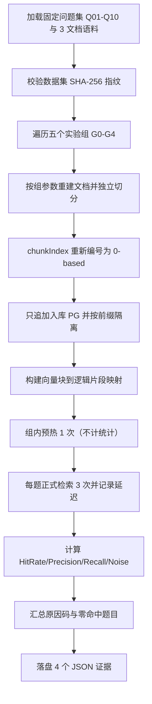

# D36-01 检索参数对照实验：全量信息与操作手册

> 模块：`D36/D36_SPCE`（artifactId `D36_SPCE`，包 `com.zl.d36`）
> 实验代码包：`com.zl.d36.experiment`
> 执行依据：《D36-项目迭代任务书Prompt-GPT修复版-检索参数对照实验》
> 技术基线：JDK 21 / Spring Boot 3.5.16 / Spring AI 1.1.8 / MyBatis-Plus 3.5.17 / PostgreSQL 18.7 + pgvector 0.8.7
> 本文所有指标均来自真实运行落盘的 JSON，未做任何估算或修饰。

---

## 1. 实验概述

### 1.1 目标

在**完全固定的问题集、语料、Embedding 模型与距离度量**下，通过**单变量对照**量化四个检索参数对检索质量（HitRate、Precision、Recall、Noise）与延迟的影响：

- chunk size（切分块大小）
- overlap（块间重叠）
- Top-K（返回候选数）
- similarity threshold（相似度阈值）

### 1.2 固定变量（五组全程不变）

| 固定项 | 取值 |
|---|---|
| 问题集 | D25 `questions.jsonl` 的 Q01–Q10（共 10 题，含 Q10 复述题） |
| 语料 | `equipment-fault-corpus.json`，3 文档 / 8 逻辑片段 |
| Embedding 模型 | `local-hash-ngram-v1`（本地确定性哈希模型，无外部调用） |
| 向量维度 | 384 |
| 距离度量 | COSINE（余弦距离） |
| 索引 | HNSW |
| 切分策略 | FIXED_LENGTH（定长切分） |
| 预热 / 重复 | 每组预热 1 次（不计统计），每题正式重复 3 次 |

### 1.3 单变量原则

每个实验组相对基线 G0 **只改变一个参数**，其余参数与基线完全一致，从而把指标差异归因到单一变量。

---

## 2. 实验矩阵

| 组 | chunk size | overlap | Top-K | 阈值 | 改变的变量 |
|---|---|---|---|---|---|
| G0 | 480 | 60 | 5 | 0.00 | 基线（骨架真实配置） |
| G1 | **200** | 60 | 5 | 0.00 | 只改 chunk size（480→200） |
| G2 | 480 | **20** | 5 | 0.00 | 只改 overlap（60→20） |
| G3 | 480 | 60 | **10** | 0.00 | 只改 Top-K（5→10） |
| G4 | 480 | 60 | 5 | **0.25** | 只改阈值（0.00→0.25） |

**参数合法性（均通过 `requireValid` 校验）**：

- chunk size 200 / 480 均在 `[80, 720]` 区间；
- overlap 20 / 60 均小于最小块尺寸 80（`ChunkingProperties` 额外要求 overlap < minChunkSize）；
- Top-K 10 ≤ 最大上限 50；
- 阈值 0.25 在 `[0, 1]` 区间。

**命名空间隔离**：每组入库文档 ID 加前缀 `d36exp-gX-`，版本标记 `exp-gX-v1`，例如：

```
documentId = d36exp-g0-DOC-CNC-COOLING-001
version    = exp-g0-v1
```

---

## 3. 数据集与指纹

### 3.1 问题集

- 路径：`docs/evidence/D25/rag-design/questions.jsonl`（原文件 15 题，本实验取 Q01–Q10）。
- Q01–Q10 全部满足 `retrieve_enabled=true`、`citation_required=true`、单标签。
- Q10 是 Q01 的复述（paraphrase），用于观察同一标注在不同表述下的稳定性。

### 3.2 语料

- 路径：`D36/D36_SPCE/src/main/resources/knowledge/equipment-fault-corpus.json`。
- 嵌套结构：document → chunks，共 3 个文档、8 个逻辑片段。
- 8 个逻辑片段中，7 个被 Q01–Q10 标注覆盖；第 8 个片段 `DOC-SERVO-TROUBLE-002-C03`（提示注入教学片段）不在 Q01–Q10 标注内。

### 3.3 标注到逻辑片段的映射

| 问题 | 期望逻辑片段 |
|---|---|
| Q01、Q10 | DOC-CNC-COOLING-001-C01 |
| Q02 | DOC-CNC-COOLING-001-C02 |
| Q03、Q08 | DOC-CNC-COOLING-001-C03 |
| Q04、Q09 | DOC-SERVO-TROUBLE-002-C01 |
| Q05 | DOC-SERVO-TROUBLE-002-C02 |
| Q06 | DOC-WORKORDER-SPEC-003-C01 |
| Q07 | DOC-WORKORDER-SPEC-003-C02 |

### 3.4 数据集指纹（SHA-256）

```
questionsSha256 = 44426b1771c379343a2239147af0adf4c4d9a2d80e547e0bcf3259c65634750a
corpusSha256    = aad6ac4df5585aadd5078d1c94df4e5093af15a9730e230149cfde0940335ab0b
```

指纹随矩阵文件一并落盘，用于保证实验可复现、数据集版本可追溯。

---

## 4. 环境与前置条件

### 4.1 工具链（本机锁定）

| 工具 | 路径 |
|---|---|
| JDK 21 | `D:\SoftwareInstall\JDK\JDK21` |
| Maven 3.9.16 | `D:\SoftwareInstall\Apache\Maven\apache-maven-3.9.16\bin\mvn.cmd` |
| 本地仓库 | `D:\SoftwareInstall\Apache\repository` |

### 4.2 外部服务

| 服务 | 地址 | 连通性 |
|---|---|---|
| PostgreSQL + pgvector | 192.168.200.153:5432 | 真实执行前已验证 TcpTestSucceeded=True |
| MySQL | 127.0.0.1:3306 | 真实执行前已验证 TcpTestSucceeded=True |

### 4.3 密钥注入（仅环境变量，禁止硬编码）

- PostgreSQL 密码：环境变量 **`PG_VECTOR_PASSWORD`**（无默认值，缺失时 fail-fast）。
- MySQL 密码：环境变量 **`MYSQL_PASSWORD`**（本机默认 `123456`）。
- 真实 PG 口令不写入任何文件、不进入 PATH，仅在会话内通过环境变量注入。

> 说明：本仓库历史上曾使用 `PGVECTOR_DB_PASSWORD`，已统一替换为 `PG_VECTOR_PASSWORD`。

---

## 5. 执行步骤

> 以下命令均在模块目录 `D36/D36_SPCE` 下执行。PowerShell 调用原生 exe 时，所有 `-D` 参数必须用双引号包裹，否则含点号的参数会被拆分。

### 5.1 离线编译（不依赖数据库）

```powershell
& "D:\SoftwareInstall\Apache\Maven\apache-maven-3.9.16\bin\mvn.cmd" -B -o clean compile
```

### 5.2 离线组件测试（默认 profile，IT 自动跳过）

```powershell
& "D:\SoftwareInstall\Apache\Maven\apache-maven-3.9.16\bin\mvn.cmd" -B -o clean test
```

默认 `test` profile 关闭 pgvector，集成测试 `RetrievalExperimentRunnerIT` 由类级条件守卫整体禁用（显示 Skipped），其余 5 个组件测试类全部离线运行。

### 5.3 真实五组实验（连接真实 PG/MySQL）

真实执行通过可覆盖的 Maven 属性切换到 `experiment` profile，并显式打开集成测试守卫：

```powershell
$env:D36_EXP_RUN = "true"
& "D:\SoftwareInstall\Apache\Maven\apache-maven-3.9.16\bin\mvn.cmd" -B `
  "-Dsurefire.spring.profile=experiment" `
  "-Dtest=RetrievalExperimentRunnerIT" `
  "-DfailIfNoTests=false" test
```

- `experiment` profile 启用 pgvector 装配（`application-experiment.yml` 仅置 `app.vectorstore.pgvector.enabled=true`，其余继承主配置）。
- 实验对真实数据库为**只追加**写入：5 组 × 3 文档 = 15 个带前缀 documentId，未删除任何数据、未执行 prune。
- 执行结束后，4 个 JSON 证据自动落盘到 `docs/evidence/D36`。

---

## 6. 证据清单与落盘结构

证据目录：`docs/evidence/D36`

| 文件 | 大小（实测） | 内容 |
|---|---|---|
| `retrieval-experiment-matrix.json` | 1629 B | 矩阵定义 + 数据集指纹（不含任何回填指标） |
| `chunk-id-mapping.json` | 5028 B | 每个向量块 → 页码 → 逻辑片段 ID 的映射 |
| `experiment-results.json` | 185295 B | 逐题、逐次重复的完整命中记录 |
| `experiment-summary.json` | 3558 B | 五组汇总指标 |

**矩阵定义与执行结果分离**：matrix 文件只含定义与指纹，所有指标只出现在 results / summary 中，避免定义与结果互相污染。

---

## 7. 真实实验结果

### 7.1 五组核心指标（数据来自 `experiment-summary.json`）

| 组 | 入库块数 | HitRate | micro Precision | avg Recall | avg Noise | avg ms | P50 ms | P95 ms | max ms |
|---|---|---|---|---|---|---|---|---|---|
| G0 | 3 | 1.0 | 0.1389 | 1.0 | 6.2 | 4.761 | 4.698 | 6.213 | 7.037 |
| G1 | 5 | 1.0 | 0.1389 | 1.0 | 6.2 | 4.393 | 4.495 | 5.680 | 6.156 |
| G2 | 3 | 1.0 | 0.1389 | 1.0 | 6.2 | 3.544 | 3.449 | 4.356 | 4.731 |
| G3 | 3 | 1.0 | 0.1389 | 1.0 | 6.2 | 3.341 | 3.280 | 4.149 | 4.342 |
| G4 | 3 | 0.5 | 0.3846 | 0.5 | 0.8 | 2.512 | 2.375 | 3.492 | 3.853 |

> 每组延迟样本数 = 30（10 题 × 3 次正式重复，预热不计）。

### 7.2 原因码（真实记录）

| 组 | 原因码 |
|---|---|
| G0 | K_EXCEEDS_INDEXED_CHUNKS |
| G1 | 无 |
| G2 | K_EXCEEDS_INDEXED_CHUNKS |
| G3 | K_EXCEEDS_INDEXED_CHUNKS |
| G4 | ZERO_HITS_AFTER_THRESHOLD、K_EXCEEDS_INDEXED_CHUNKS |

- `K_EXCEEDS_INDEXED_CHUNKS`：请求的 Top-K（5 或 10）大于该组实际向量块数（3），effectiveTopK 被实际块数限制，属真实情况而非错误。
- `ZERO_HITS_AFTER_THRESHOLD`：G4 阈值过滤后出现零命中。

### 7.3 G4 零命中题目

G4（阈值 0.25）下，以下 5 题零命中：

```
Q03、Q04、Q05、Q08、Q10
```

其余 5 题（Q01、Q02、Q06、Q07、Q09）仍有命中。五组均无重复结果分歧（divergedQuestionIds 均为空），本地确定性模型在 3 次重复间结果稳定。

---

## 8. 结论与参数影响（基于真实差值）

### 8.1 对召回（HitRate）的影响

- G0–G3 的 HitRate 全部为 1.0，**无可测差异**。在当前已经全命中的基线和极小数据集下，chunk size、overlap、Top-K 对召回的影响**数据不足以区分**。
- G4 阈值 0.25 使 HitRate 从 1.0 降到 0.5（绝对差 −0.5），是唯一对召回产生显著影响的变量。

### 8.2 对精度与噪声的影响

- G0–G3 的 micro Precision 均为 0.1389、avg Noise 均为 6.2，无差异。
- G4 的 micro Precision 升到 0.3846（+0.2457），avg Noise 降到 0.8（−5.4）。
- 阈值通过过滤低相似块显著降低噪声、提升精度，但**以召回减半为代价**，呈现典型的精度—召回权衡。

### 8.3 对延迟的影响

- G3（Top-K 10）avg 3.341 ms 并不比 G0（Top-K 5）4.761 ms 慢；G4 avg 2.512 ms 最低。
- 在 3–5 个向量块、单块毫秒级的极小数据量下，延迟差异主要来自系统测量噪声，**不具备统计显著性，不应过度解读**。

### 8.4 参数影响排序（限定本实验范围）

1. **相似度阈值**：影响最大，是唯一同时改变召回与精度的变量；
2. **chunk size / overlap / Top-K**：在本数据集、本地确定性模型、全命中基线下未观测到可测差异。

> 该排序仅在“10 题、3–5 块、本地哈希模型”范围内成立，不能外推到大规模语料或真实语义 Embedding。

---

## 9. 注意事项与已知偏差

1. **逻辑片段口径 vs 向量块口径**：当 chunk size（480）大于单个文档长度时，整文档被切成 1 个向量块，该块覆盖文档全部页码，映射出该文档全部逻辑片段。因此 G0 单题虽只返回 3 个向量块，逻辑片段口径下却覆盖 8 个逻辑 ID。Precision/Noise 按**逻辑片段口径**计算，会放大粗粒度块的噪声；阅读时应与实际向量块数（hitCount）并列理解。
2. **chunkIndex 1-based → 0-based 适配**：`DocumentChunker` 输出首个块 chunkIndex=1（1-based），而 `DocumentVectorIndexService.indexChunks` 的 normalize 要求 0-based 连续。运行器在实验侧通过 `reindexZeroBased` 重新编号后入库，**未修改任何生产类**。
3. **二次 Embedding 诚实记录**：入库时 `VectorStore.add` 内部会对每个块再调用一次 EmbeddingModel；实验复用同一本地确定性模型，结果一致且无外部 API 调用。
4. **本地模型局限**：`local-hash-ngram-v1` 是教学用确定性哈希模型，不具备真实语义表征能力，实验结论不代表生产语义 Embedding 的表现。
5. **统计显著性局限**：10 题、3–5 块、30 个延迟样本，结论是工程演示与方法学验证，而非统计显著的性能结论。
6. **数据安全**：实验只追加、按前缀隔离，不删除数据、不执行 Docker prune / 删卷 / 重建；密钥仅经环境变量注入。

---

## 10. 附：实验执行流程（Mermaid，Typora 兼容）


