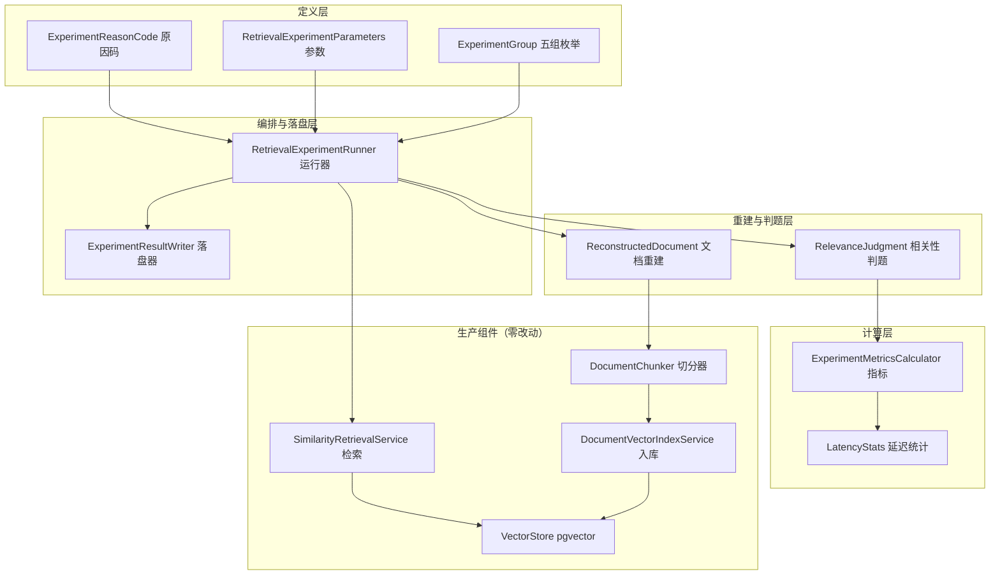
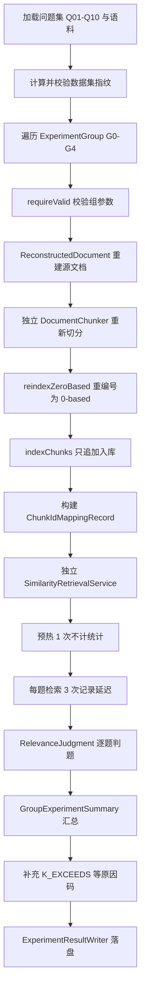

# D36-02 检索参数对照实验：技术文档与实践指南

> 模块：`D36/D36_SPCE`
> 实验代码包：`com.zl.d36.experiment`（新增 18 个 Java 文件，生产组件零改动）
> 技术基线：JDK 21 / Spring Boot 3.5.16 / Spring AI 1.1.8 / MyBatis-Plus 3.5.17 / PostgreSQL 18.7 + pgvector 0.8.7
> 配套文档：《D36-01_检索参数对照实验全量信息与操作.md》

---

## 1. 概述

本文从架构、原理、代码与工程实践角度，说明检索参数对照实验的实现方式。实验在固定问题集、语料、Embedding 与距离度量的前提下，通过 1 个真实基线 G0 与 4 个单变量组 G1–G4，量化 chunk size、overlap、Top-K、阈值四个参数对检索质量与延迟的影响。

设计遵循三条硬约束：

1. **生产组件零改动**：不修改任何已有生产类，实验能力以独立子包增量提供；
2. **真实链路**：复用生产的切分、Embedding、入库、检索组件，对真实 PG/MySQL 执行，不用 Mock 替代端到端；
3. **可复现可追溯**：固定数据集版本与 SHA-256 指纹，矩阵定义与执行结果分离落盘。

---

## 2. 架构设计

### 2.1 分层结构

实验子包在尊重既有 Controller / Service / 组件分层的前提下，内部再分四层：

| 层 | 职责 | 主要类 |
|---|---|---|
| 定义层 | 实验矩阵、组参数、原因码 | `ExperimentGroup`、`RetrievalExperimentParameters`、`RetrievalExperimentMatrix`、`ExperimentReasonCode` |
| 重建与判题层 | 语料重建、页码映射、相关性判题 | `ReconstructedDocument`、`RelevanceJudgment`、`ExperimentQuestion` |
| 计算层 | 指标与延迟统计（纯函数） | `ExperimentMetricsCalculator`、`LatencyStats` |
| 编排与落盘层 | 实验执行、记录、JSON 落盘 | `RetrievalExperimentRunner`、`ExperimentResultWriter`、各 record 类 |

### 2.2 与生产组件的关系（Mermaid，Typora 兼容）



---

## 3. 核心原理

### 3.1 单变量对照

每个实验组相对基线只改变一个参数。`ExperimentGroup` 枚举把五组参数固化为常量，避免在执行过程中被修改；`RetrievalExperimentParameters.requireValid()` 在每组执行前先校验参数合法性，非法参数 fail-fast 并给出 `CONFIG_INVALID` 原因码。

### 3.2 向量块到逻辑片段的稳定映射

这是本实验判题的关键。语料是扁平的逻辑片段，每个片段具备：

- 唯一且非空的物理页码（CNC 12/15/18、SERVO 6/9/10、WORKORDER 3/7）；
- 单段 excerpt 文本。

因此 `page → 逻辑 chunkId` 是一一映射。`ReconstructedDocument` 重建文档时保留该映射表；重新切分产出的新块携带其覆盖的 `pageNumbers`，通过 `mapPagesToLogicalChunkIds` 反查得到一个或多个逻辑片段 ID。若出现重复页码、缺失页码或未登记页码，立即抛出 `ID_MAPPING_AMBIGUOUS`，不做静默猜测。

### 3.3 两个判题口径必须并列理解

| 口径 | 含义 | 用途 |
|---|---|---|
| 向量块口径 | 实际返回的向量块数（hitCount，2–5） | 反映真实检索返回的物理块数量 |
| 逻辑片段映射口径 | 返回块经页码反查覆盖的逻辑片段数 | 与 Gold 标注对照，计算 Precision/Recall/Noise |

当 chunk size 大于单个文档长度时，整文档被切成 1 个向量块，该块覆盖文档全部页码，映射出该文档全部逻辑片段。因此 G0 单题只返回 3 个向量块，逻辑片段口径下却覆盖 8 个逻辑 ID。这是**保守且诚实**的判题：粗粒度块把同文档无关片段一起带回，其代价在逻辑片段口径下被如实计入噪声。

### 3.4 相关性判题

`RelevanceJudgment.judge` 把返回的每个逻辑 ID 与 Gold 标注比对：

- 出现在标注集合内 → 相关（relevant）；
- 否则 → 噪声（noise）；
- 至少一个相关 → hit；
- 返回为空 → 记录 `ZERO_HITS_AFTER_THRESHOLD`。

单标签题的标注集合只有一个 ID，因此单题 Recall 非 0 即 1。

---

## 4. 代码结构（18 个类）

### 4.1 定义与异常（4 个）

| 类 | 类型 | 职责 |
|---|---|---|
| `ExperimentGroup` | enum | 固化 G0–G4 参数，提供 documentId 前缀与版本号 |
| `RetrievalExperimentParameters` | class | 单组参数，含 `toChunkingProperties` / `toRetrievalProperties` / `requireValid` |
| `RetrievalExperimentMatrix` | record | 矩阵元数据（策略、预热、重复次数、组列表） |
| `ExperimentReasonCode` | class | 12 个稳定原因码常量 |
| `ExperimentException` | class | 携带原因码的运行时异常 |

### 4.2 重建与判题（3 个）

| 类 | 类型 | 职责 |
|---|---|---|
| `ReconstructedDocument` | record | 扁平语料重建为可切分源文档，保留页码映射，提供 `mapPagesToLogicalChunkIds` |
| `RelevanceJudgment` | record | 单题判题，提供单题 Precision / Recall |
| `ExperimentQuestion` | record | 实验问题（ID、问题文本、期望逻辑 ID） |

### 4.3 指标（2 个）

| 类 | 类型 | 职责 |
|---|---|---|
| `ExperimentMetricsCalculator` | final 工具类 | HitRate、micro Precision、平均 Recall、平均 Noise、延迟统计（纯函数） |
| `LatencyStats` | record | 样本数、avg、P50、P95、max |

### 4.4 记录与编排（8 个）

| 类 | 类型 | 职责 |
|---|---|---|
| `ReturnedHitRecord` | record | 单个命中块（rank、逻辑 ID、score、distance） |
| `QuestionRunRecord` | record | 单次重复的命中与延迟 |
| `QuestionExperimentRecord` | record | 单题多次重复聚合，含一致性判断 |
| `GroupExperimentSummary` | record | 单组汇总指标与原因码 |
| `ChunkIdMappingRecord` | record | 向量块 → 页码 → 逻辑 ID 映射 |
| `ExperimentRunResult` | record | 完整实验结果（含内部 GroupRunResult） |
| `RetrievalExperimentRunner` | @Service | 实验编排，`@ConditionalOnProperty` 守卫 |
| `ExperimentResultWriter` | class | 4 个 JSON 落盘 |

---

## 5. 执行流程（Mermaid，Typora 兼容）



---

## 6. 关键技术决策

### 6.1 独立实例化，不改全局 Bean

`DocumentChunker` 的切分参数来自注入的 `ChunkingProperties`，`SimilarityRetrievalService` 的阈值来自注入的 `RetrievalProperties`，二者都不支持按次传参。运行器利用其 public 无状态构造器，用**独立的实验属性对象**实例化：

```java
DocumentChunker chunker = new DocumentChunker(textCleaner, params.toChunkingProperties());
SimilarityRetrievalService retrieval = new SimilarityRetrievalService(
        vectorStore, queryEmbeddingService, params.toRetrievalProperties());
```

这样每组使用各自参数，又不污染全局 Bean，符合最小改动原则。

### 6.2 chunkIndex 1-based → 0-based 适配

`DocumentChunker` 输出首个块 `chunkIndex = chunks.size()+1`（1-based），而 `DocumentVectorIndexService.indexChunks` 的 normalize 要求 chunkIndex 严格等于循环下标（0 起、连续），直接喂入会抛“Chunk 顺序必须为 0..n-1 连续”。运行器新增 `reindexZeroBased`，构造新 `DocumentChunk` 重新编号、保留其余字段后再入库，**不修改生产类**。

### 6.3 入库复用 indexChunks 并按前缀隔离

重新切分后的入库复用 `DocumentVectorIndexService.indexChunks`，传入带 `d36exp-gX-` 前缀的 documentId 与 `exp-gX-v1` 版本，而非走不重新切分的 CorpusIndexService。检索时以版本过滤，运行器在 `toReturnedHit` 中再校验命中 documentId 必须以本组前缀开头，否则抛 `GROUP_ISOLATION_CONFLICT`，双重保证无跨组污染。

### 6.4 集成测试条件守卫与 profile 覆盖

test profile 关闭 pgvector 后，条件 Bean 不装配，但生产 `RagRetrievalService` 是无条件 `@Service` 且强依赖检索服务，导致完整 `@SpringBootTest` 上下文无法加载。两个处置：

1. 集成测试改用 JUnit 5 原生类级 `@EnabledIfEnvironmentVariable(named="D36_EXP_RUN", matches="true")` 守卫，默认环境整个测试类禁用、不加载上下文；
2. 把 surefire 写死的 profile 改为可覆盖 Maven 属性 `spring.profiles.active=${surefire.spring.profile}`（默认仍 test），真实执行时用 `-Dsurefire.spring.profile=experiment` 启用 pgvector，并新增 `application-experiment.yml`（仅置 `pgvector.enabled=true`）。

---

## 7. 指标公式

以下公式与 `ExperimentMetricsCalculator`、`RelevanceJudgment` 源码一致。

| 指标 | 公式 | 说明 |
|---|---|---|
| HitRate | 命中题数 / 可判题数 | 至少命中一个标注片段即算命中 |
| micro Precision | 相关返回总数 / 实际返回总数 | 先汇总再求比，非单题精度平均 |
| 平均 Recall | 单题 Recall 的算术平均 | 单标签题单题 Recall 为 0/1 |
| 平均 Noise | 噪声片段总数 / 题数 | 每题无关逻辑片段数的平均 |
| 单题 Precision | 相关数 / 返回数 | 零返回时为 0 |
| 单题 Recall | 命中标注数 / 标注总数 | 单标签题即 0/1 |

延迟分位数采用**线性插值法**：`rank = (p/100) × (n−1)`，对相邻排序样本按距离插值，与 numpy 默认 `linear` 同口径。P50、P95 均据此计算。

---

## 8. 配置说明

### 8.1 主配置（`application.yml`）

| 配置项 | 默认值 |
|---|---|
| chunk-size / overlap / min / max | 480 / 60 / 80 / 720 |
| default-top-k / max-top-k / max-query-length | 5 / 50 / 2000 |
| similarity-threshold | 0.0 |
| Embedding / model-version / index-version | LOCAL / local-hash-ngram-v1 / 2026.11 / d36-local-384-v1 |
| 维度 / 距离 | 384 / COSINE |

### 8.2 数据源密钥（环境变量注入）

```yaml
# PostgreSQL
password: ${PG_VECTOR_PASSWORD:}   # 无默认，缺失 fail-fast
# MySQL
password: ${MYSQL_PASSWORD:123456}
```

### 8.3 profile 配置

| 文件 | 作用 |
|---|---|
| `application-test.yml` | `pgvector.enabled=false`，离线组件测试 |
| `application-experiment.yml` | `pgvector.enabled=true`，真实实验，其余继承主配置 |

---

## 9. 工程实践指南

### 9.1 如何新增一个单变量组

1. 在 `ExperimentGroup` 增加枚举常量，只改目标参数、其余与 G0 对齐；
2. 在 `RetrievalExperimentParameters.requireValid` 确认新参数合法；
3. 无需改动运行器、落盘器与指标计算（它们按枚举遍历，自动适配）；
4. 重新执行真实实验，新组自动获得独立前缀与映射。

### 9.2 如何替换为真实语义 Embedding

将 Embedding 配置从 LOCAL 切换为真实模型后，实验框架无需改动（仍走同一 `EmbeddingModel` 接口）；但需重新核验向量维度与环境基线一致，并重新计算数据集指纹。真实外部 API 调用应控制次数与成本，仅做必要最小调试。

### 9.3 扩展判题口径

若未来语料出现同页多段、跨页片段，`page → 逻辑 ID` 不再一一映射，应在 `ReconstructedDocument` 升级为 `(pageNumber, paragraphIndex)` 复合键（当前 `CleanedParagraph.paragraphIndex` 为 per-page 从 1 起），并保持映射缺失即 fail-fast 的契约。

### 9.4 安全与数据治理

- 密钥仅经环境变量注入，禁止硬编码、禁止进入 PATH；
- `surefire-reports` 含环境变量等敏感信息，已加入 `.gitignore`，不提交 Git；
- 实验只追加、按前缀隔离，不删除真实数据，不执行 Docker prune / 删卷 / 重建；
- 不擅自执行 Git commit / push。

---

## 10. 常见问题与局限

1. **为什么 G0–G3 指标完全相同？** 数据集极小且基线已全命中，chunk size、overlap、Top-K 的变化未触达召回边界，数据不足以区分差异，这是真实结果而非计算错误。
2. **延迟为什么 Top-K 增大反而更快？** 3–5 个块、毫秒级检索下，系统测量噪声大于参数本身影响，延迟差异不具统计显著性。
3. **本地哈希模型能代表生产表现吗？** 不能。`local-hash-ngram-v1` 是确定性教学模型，无语义表征，结论不外推到生产语义 Embedding。
4. **结论的适用边界？** 仅在 10 题、3–5 块、本地确定性模型范围内成立；大规模语料需扩大问题集与重复次数后再评估。

---

## 11. 官方文档溯源

| 文档（英文原标题 / 中文翻译） | 链接 |
|---|---|
| Spring AI Reference / Spring AI 参考文档 | https://docs.spring.io/spring-ai/reference/ |
| Spring Boot Reference Documentation / Spring Boot 参考文档 | https://docs.spring.io/spring-boot/docs/current/reference/html/ |
| JUnit 5 User Guide / JUnit 5 用户指南 | https://junit.org/junit5/docs/current/user-guide/ |
| pgvector: Open-source vector similarity search for Postgres / pgvector：Postgres 开源向量相似检索 | https://github.com/pgvector/pgvector |
| PostgreSQL Documentation / PostgreSQL 官方文档 | https://www.postgresql.org/docs/ |
