# D38-02 百炼 Embedding 双模型与 two_ 隔离链路 — 技术文档与实践指南

> 模块：M3-Java-ds / D38（D38_QWE_MROQRE）｜迭代：D38-R01｜日期：2026-11-21
> 技术基线：JDK 21 · Spring Boot 3.5.16 · Spring AI 1.1.8 · PostgreSQL 18.7 + pgvector 0.8.7
> 阅读顺序：是什么 → 为什么 → 底层原理 → 执行流程 → 核心代码 → 常见问题 → 工程实践

## 一、是什么

D38 在同一个 Spring Boot 应用内运行**两套完全隔离的 RAG 向量链路**：

- **LOCAL 链路**：本地确定性哈希 n-gram Embedding（384 维，零费用，结果可复现），承载既有全部端点与表；
- **two_ 链路**：阿里百炼 `qwen3.7-text-embedding` 远程 Embedding（1024 维，按 token 计费），承载 `/api/v1/two/…` 新端点与 `two_` 前缀新表。

两条链路共享同一份语料（KnowledgeCorpus）、同一套切分与幂等编排逻辑、同一个 MySQL 主数据源与 PG 实例，但**向量空间、表、配置、连接池、端点完全分离**，可做公平的双模型检索质量对照。

关键术语：
- **Embedding**：把文本映射为稠密向量的模型；检索语义相似度的基础。
- **向量空间标识（vectorSpaceId，vs_id）**：`vs_ + SHA256("PROVIDER|model|version|dims") 前 16 字节 hex`。模型/版本/维度任一变化 → vs_id 变化 → 稳定 chunkId 变化 → 天然禁止跨空间混写。
- **compatible-mode**：百炼提供的 OpenAI 兼容协议（`POST {baseUrl}/embeddings`，请求体 `{model, input[], encoding_format}`，响应 `data[].{index, embedding[]}` + `usage`）。
- **HNSW**（Hierarchical Navigable Small World）：pgvector 的近似最近邻图索引；`vector` 类型上限 2000 维（1024 维可建，3072 维不可建——这是维度必须探针实测而非假设的硬原因之一）。

## 二、为什么这样设计

### 2.1 为什么不直接替换本地模型？

本地哈希模型是 D29–D37 全部基线、实验与评测的锚点：替换它会让历史基线全部失效，且远程模型有费用与非确定性。保留 LOCAL + 新增 two_ 平行链路，才能做"同语料、同切分、同编排、不同向量模型"的受控对照。

### 2.2 为什么新表必须加 two_ 前缀，而不是复用旧表加过滤字段？

1. **维度物理隔离**：`vector(384)` 与 `vector(1024)` 是不同列类型，同表无法共存（pgvector 列维度固定）。
2. **幂等键隔离**：MySQL 唯一键 `(document_id, version)` 在旧表已被 LOCAL 任务占用；同表双空间会让任务状态机互相覆盖。虽然 vs_id 参与稳定 chunkId 可防撞键，但任务行唯一键不含 vs_id——新表是最小且最彻底的解法。
3. **审计与回滚**：two_ 资产可整体 DROP 而不伤本地；git diff 可证明旧表零触碰。

### 2.3 为什么 two_ 组件不做 Spring Bean（方案 B 极致版）？

Spring 按类型注入在出现第二个同类型 Bean 时抛 NoUniqueBeanDefinitionException。本应用有六类按类型注入点：

| 类型 | 既有注入点 |
|---|---|
| EmbeddingModel | PgVectorStoreConfiguration.pgVectorStore / QueryEmbeddingService / ChunkEmbeddingService |
| VectorStore（接口） | KnowledgeVectorStoreService / DocumentVectorIndexService |
| PgVectorStore | pgVectorEnvironmentVerifier / pgVectorAccess |
| EmbeddingModelDescriptor | RetrievalExperimentRunner / QueryEmbeddingService / KnowledgeVectorStoreService / ChunkEmbeddingService / DocumentVectorIndexService |
| PgVectorStoreProperties / EmbeddingProperties | 各自 Configuration |
| VectorChunkRepository | DocumentVectorIndexService |

任务书预设方案是"two_ Bean + @Qualifier + 既有 Bean 加 @Primary"。实际采用更彻底的方案：**two_ 全部组件在 TwoPgVectorConfiguration 内手动构造，只暴露一个全新类型 TwoSpaceComponents（record）作为 Bean**。结果：

- 六类注入点全部保持单候选，**@Primary 一个都不需要**；
- PgVectorStoreConfiguration / EmbeddingModelConfiguration **零改动**（LOCAL 门禁原样）；
- 与既有 PG 装配同构（既有方案本就不暴露 DataSource/JdbcTemplate Bean，避免 JdbcTemplateAutoConfiguration 因 @ConditionalOnSingleCandidate 退让）——two_ 沿用同一纪律，独立 Hikari 池 `two-pgvector-pool`（max 2）。

代价：two_ 服务不是 Bean，无法被其他 Bean 按类型注入——但 two_ 的唯一消费者就是 TwoKnowledgeRetrievalController，经持有器拿实例即可，代价为零。

### 2.4 为什么复用编排类而不是复制？

DocumentVectorIndexService（773 行：幂等命中、Outbox 快照、版本先写后切、三方计数核对、迟到保护）是久经验证的资产。它的构造器接受全部依赖（VectorStore/PgVectorAccess/VectorChunkRepository/描述符/事务管理器…），**天然支持"换依赖不换逻辑"**：two_ 实例 = 同一个类 + two_ 依赖。唯一必须复制的是 VectorChunkRepository（SQL 内联表名、映射器 private，且任务书禁止参数化改造旧类）→ TwoVectorChunkRepository 继承并覆写全部公开方法。

## 三、底层原理

### 3.1 Embedding 发生在哪里？

`PgVectorStore.add(List<Document>)` 内部调用构造时传入的 EmbeddingModel 对 Document.text 向量化，再 `INSERT … ON CONFLICT (id) DO UPDATE`；`similaritySearch(SearchRequest)` 内部再次调用 EmbeddingModel 把查询文本向量化，再执行 `embedding <=> queryVector` 余弦距离排序。因此：

- two_PgVectorStore 必须用 BailianEmbeddingModel 构造——这是双模型分流的物理开关；
- **每次检索 = 2 次远程调用**：SimilarityRetrievalService 先经 QueryEmbeddingService.embed 预向量化（做维度/有限值校验与响应摘要），PgVectorStore 内部再向量化一次。Spring AI 1.1.8 的 SearchRequest 只接受文本不接受预计算向量（既有类 javadoc 已实证预警）。台账成对相同 token 数（27/27、32/32…）是铁证。

### 3.2 幂等为什么能保证复跑 0 调用？

indexChunks 的短路链：任务行 COMPLETED + payloadHash 一致 + chunkCount 一致 + splitVersion 一致 + **vectorSpaceId 一致** + MySQL 关联计数/INDEXED 计数一致 + PG countByDocumentVersion 一致 → `isIdempotentHit=true`，在 `vectorStore.add` 之前直接返回（processed=0）。Embedding 调用只发生在 add 内部，短路即 0 调用。two_ 的 vs_id 与 LOCAL 不同，稳定 chunkId 含 vs_id，两空间永不撞键。

### 3.3 百炼适配器的可靠性语义

- **切批**：call() 把 instructions 按 apiBatchSize（1..10，探针冻结）切子批，逐批 HTTP，按 `data[].index` 对齐合并，全局 index 连续。服务端乱序返回也正确（桩测试 t1 实证）。
- **重试分类**：429/5xx/IO 超时 → 重试 1 次（指数退避 + 抖动）；401/403/400/404 → 立即失败（客户端错误重试无意义，且 401 重试浪费配额）。
- **熔断**：连续 2 次调用失败 → 打开，后续调用直接抛 AI_UNAVAILABLE，0 HTTP，等待人工确认（重启复位）。防"故障期间持续烧钱"。
- **校验**：条数 == 输入数；index 合法且不重复；维度 == 冻结维度；数值有限；非零向量。范数偏离 1 超过 1e-3 → 客户端 L2 归一化 + WARN 一次（探针实测服务端已归一化，此为防御性兜底，决策已登记不静默）。
- **密钥卫生**：apiKey 只进请求头；错误正文先正则剥离 `Bearer …`/`sk-…` 再截断 300 字符；台账/日志/异常永不携带密钥。

### 3.4 维度三方强校验与 HNSW 上限

装配时：`two-pgvector.dimensions == app.embedding.two.dimensions`（配置==模型），运行期：响应维度 == 描述符维度（模型==探针冻结值）。任一不一致 fail-fast。HNSW 对 `vector` 类型上限 2000 维：1024 可建；若未来换 3072 维模型，配置守卫拒绝 HNSW 装配并提示改 NONE/IVFFLAT 或降维——**维度禁假设，探针先行**是本轮最重要的工程纪律。

## 四、执行流程（Typora 兼容 Mermaid）

```mermaid
graph TD
    subgraph SG1 ["two_ 入库链路"]
        A["POST /api/v1/two/knowledge/retrieval/corpus/index"] --> B["TwoCorpusIndexService 语料转换"]
        B --> C["DocumentVectorIndexService.indexChunks（复用既有类）"]
        C --> D{"isIdempotentHit?"}
        D -- "是" --> E["返回 idempotent=true, processed=0（0 次 API）"]
        D -- "否" --> F["MySQL two_ 表 Outbox 快照 PENDING"]
        F --> G["two_PgVectorStore.add"]
        G --> H["BailianEmbeddingModel.call（≤10 切批）"]
        H --> I["百炼 /embeddings HTTP（重试/熔断/校验）"]
        I --> J["two_vector_store Upsert vector(1024)"]
        J --> K["三方计数核对 → 版本切换 → COMPLETED"]
    end
    subgraph SG2 ["two_ 检索链路"]
        L["POST /api/v1/two/knowledge/retrieval/search"] --> M["QueryEmbeddingService.embed（第 1 次 API）"]
        M --> N["two_PgVectorStore.similaritySearch（第 2 次 API）"]
        N --> O["HNSW 余弦排序 two_vector_store"]
        O --> P["RetrievalResponse（score=COSINE_SIMILARITY）"]
    end
    subgraph SG3 ["LOCAL 链路（零改动）"]
        Q["/api/v1/knowledge/retrieval/…"] --> R["LocalHashNgramEmbeddingModel 384 维"]
        R --> S["vector_store + vector_index_task / vector_chunk_index"]
    end
```



## 五、核心代码解读

### 5.1 装配（TwoPgVectorConfiguration，节选）

```java
EmbeddingProperties embeddingProperties = Binder.get(environment)
        .bind("app.embedding.two", Bindable.of(EmbeddingProperties.class))
        .orElseGet(EmbeddingProperties::new);          // 普通对象，不是 Bean
// …fail-fast 校验：BAILIAN / key 非空 / 维度一致 / COSINE / HNSW≤2000 / two_ 前缀
BailianEmbeddingModel embeddingModel = new BailianEmbeddingModel(
        descriptor, embeddingProperties.getApiKey(), apiBatchSize, ledgerPath);
PgVectorStore twoStore = PgVectorStore.builder(twoJdbcTemplate, embeddingModel)
        .vectorTableName(pgProperties.getTableName())   // two_vector_store
        .dimensions(pgProperties.getDimensions())       // 1024
        .distanceType(PgVectorStore.PgDistanceType.COSINE_DISTANCE)
        .initializeSchema(false).removeExistingVectorStoreTable(false)
        .build();
DocumentVectorIndexService twoIndexService = new DocumentVectorIndexService(
        twoStore, twoAccess, twoRepository, idGenerator, hasher,
        vectorIndexProperties, descriptor, chunkingService, transactionManager);
```

要点：Binder 手动绑定避开第二个 @ConfigurationProperties Bean；编排服务构造器注入 two_ 依赖即完成空间切换；MySQL 事务管理器共享（two_ 表同库）。

### 5.2 切批与对齐（BailianEmbeddingModel.call，节选）

```java
for (int from = 0; from < instructions.size(); from += apiBatchSize) {
    List<String> batch = instructions.subList(from, Math.min(from + apiBatchSize, instructions.size()));
    float[][] vectors = postWithRetry(batch);           // 按 data[].index 对齐
    for (int i = 0; i < vectors.length; i++) {
        embeddings.add(new Embedding(vectors[i], from + i));  // 全局 index 连续
    }
}
```

### 5.3 熔断（同根因连败计数）

```java
if (consecutiveFailures.get() >= CIRCUIT_FAILURE_THRESHOLD) {   // 2
    throw new EmbeddingException(ResultCode.AI_UNAVAILABLE, "百炼 Embedding 熔断已打开…");
}
// 成功：consecutiveFailures.set(0)；失败：incrementAndGet()
```

### 5.4 隔离持久层（TwoVectorChunkRepository）

继承 VectorChunkRepository 仅为满足构造器类型契约；覆写全部 24 个公开方法，SQL 表名常量化为 `two_vector_index_task` / `two_vector_chunk_index`；不加 @Repository（避免第二个 Bean）。Upsert 语义与父类逐字同构（ON DUPLICATE KEY UPDATE），幂等由数据库唯一键兜底。

## 六、常见问题（FAQ）

**Q1：为什么冒烟 6 问花了 12 次调用而不是 6 次？**
每次检索双重 Embedding（§3.1）。预算规划按 2× 计；优化方向：查询向量缓存、自定义 VectorStore 包装透传预计算向量（需评估 1.1.8 兼容性），本轮按最小改动不做。

**Q2：two_ 分数 0.87，本地 0.32，能说明百炼"更好"吗？**
不能直接比。分数分布依赖模型与向量空间，跨模型绝对值无可比性；正确做法是同一问题集下比较命中质量（documentHit/chunkHit/Top-K 顺序）与下游决策质量。本轮 two_ QA-001 topScore 0.8668 命中预期 Chunk，本地 0.3228 也命中——两者都 PASS，质量差异需更大样本评测。

**Q3：QU（不可答）类问题为什么检索仍返回 5 条命中？**
two_ 阈值默认 0.0（接受全部），原始检索只负责召回候选；"该不该答"是 RAG 决策层职责（澄清/拒答）。禁止用本地 0.15 经验阈值直接套百炼分布。

**Q4：服务端模型升级了怎么办？**
modelVersion="current" 是登记假设（无版本回显）。vs_id 与 indexVersion 是人工冻结锚点：复跑前复跑探针（2 次调用）对照 manifest；若维度/归一化语义变化，必须新建 indexVersion 与新表，禁止旧表混写。

**Q5：为什么入库是 3 次 HTTP 而不是 1 批 8 条？**
编排按文档逐篇 indexChunks（每文档独立任务行与版本切换），8 片段分属 3 文档（3/3/2），每文档一次 add → 一次 HTTP。这是既有编排语义，不是缺陷。

**Q6：本地 vector_store 里的 d36exp-* 文档会影响 two_ 吗？**
不会。two_ 检索只读 two_vector_store（全新 8 行）；本地检索的 d36exp 噪声是 D36 实验残留（D37 基线同样含），属已知环境事实，清理需授权。

## 七、工程实践与面试表达

### 7.1 可迁移的实践清单

1. **探针先行**：远程模型接入前用最小真实调用冻结维度/归一化/批量/协议语义（2 次调用换全部假设落地），维度禁假设（HNSW 2000 上限是硬约束）。
2. **双轴隔离**：新模型/新空间 = 新表 + 新配置前缀 + 新端点 + 新连接池；旧链路 git diff 为零是验收硬指标。
3. **Bean 歧义的最小解**：能手动装配就不注册第二个同类型 Bean；@Primary 是兜底不是首选。
4. **复用编排、替换依赖**：久经验证的幂等/版本/Outbox 逻辑用构造器换依赖复用，复制件只留给无法参数化的持久层。
5. **成本可审计**：JSONL 调用台账（seq/purpose/status/tokens/ms/batch）+ 预算上限 + 熔断；幂等复跑 0 调用必须可证。
6. **密钥纪律**：环境变量会话注入；@ToString.Exclude；错误正文剥离凭据；证据落盘前 grep 扫描。
7. **基线口径**：远程向量非确定性 → 质量字段（命中/顺序）作对比键，向量字节与耗时只报分布；跨模型分数不混算。

### 7.2 面试一句话版本

> "我在同一应用里做了双 Embedding 链路：本地确定性模型保基线，远程百炼模型走 two_ 前缀全套新表新端点。装配上用手动构造避免第二个同类型 Bean，既有代码零 @Primary 改动；入库复用既有幂等编排，复跑 0 远程调用有台账证明；每次检索双重 Embedding 的成本事实被台账成对 token 数实证并登记为优化项。维度 1024 是探针实测冻结的，因为 pgvector HNSW 有 2000 维硬上限——远程模型接入，探针先行、预算封顶、密钥不落盘。"

## 八、官方参考资料

- 《Spring AI Reference — PGvector | Spring AI 参考文档（PGvector 向量库）》：https://docs.spring.io/spring-ai/reference/api/vectordbs/pgvector.html
- 《Spring AI Reference — Embeddings API | Spring AI 参考文档（Embedding 接口）》：https://docs.spring.io/spring-ai/reference/api/embeddings.html
- 《Spring Boot Reference — Externalized Configuration | Spring Boot 参考文档（外部化配置）》：https://docs.spring.io/spring-boot/reference/features/external-config.html
- 《pgvector — Open-source vector similarity search for Postgres | pgvector 开源向量相似检索》：https://github.com/pgvector/pgvector
- 《阿里云百炼 — OpenAI 兼容接口 | DashScope compatible-mode》：https://help.aliyun.com/zh/model-studio/developer-reference/compatibility-of-openai-with-dashscope
- 《阿里云百炼 — 文本 Embedding API | Text Embedding API》：https://help.aliyun.com/zh/model-studio/developer-reference/text-embedding-api

> 注：以上为对应技术的官方入口链接；本轮结论以本地实测证据（probe/ledger/baseline）为准，未以网络文档替代实测。