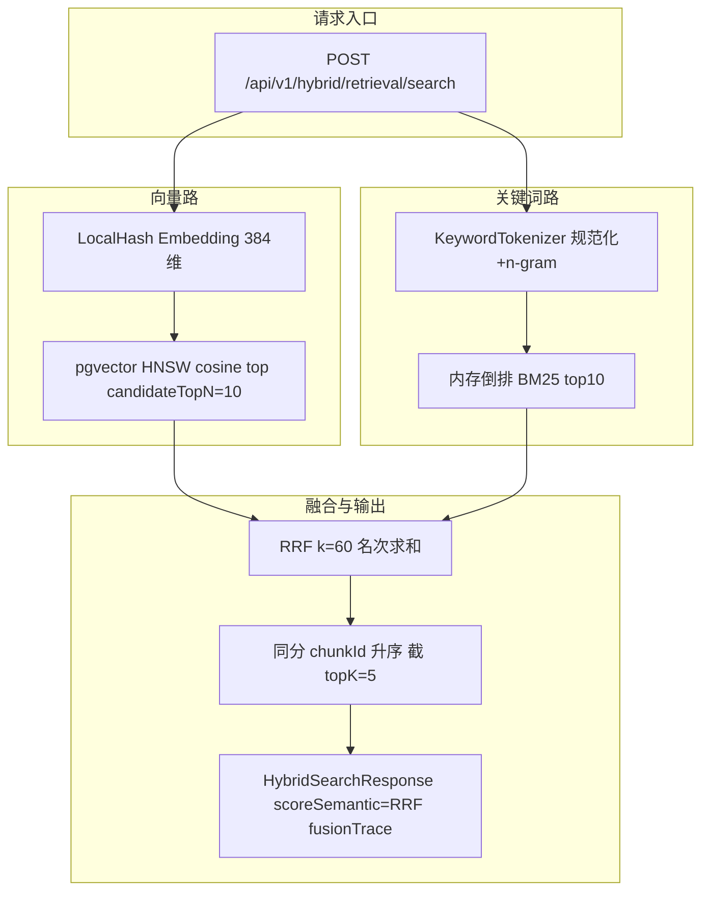

# D38-04 混合检索实验（关键词+向量+RRF）技术文档与实践指南

> 定位：讲透 BM25 与 RRF 的底层原理、第三检索分支的装配机制、确定性设计与诚实评测方法，
> 全部结论锚定 D38-R02 实测。首次缩写：BM25（Best Matching 25，经典概率排序模型）、
> RRF（Reciprocal Rank Fusion，倒数排名融合）、TF/IDF（词频/逆文档频率）。

## 1. 是什么

在不触碰主链路的前提下，给系统增加一条可选的检索路径：**同一查询同时走向量语义检索与
关键词 BM25 检索，用 RRF 融合出 Top-K**，并在冻结评测集上量化它与纯向量基线的差异。
形态是"实验分支 + 配置开关"，不是"新功能上线"。

## 2. 为什么

- 向量检索（本仓 LOCAL local-hash 384 维）对**词面精确信号**（术语、数字、故障码文本）
  区分度弱：QA-005 期望片段被压到向量 rank7，出不了 top5——真实漏召。
- BM25 恰好互补：词面命中即得分，与语义无关。二者排序信号独立，融合有理论增益空间。
- 为什么不选查询改写：改写需额外 LLM 调用（违背本轮"结构性零远程"与成本可控）；RRF 零模型、
  零训练、参数可冻结、开关可回退。
- 为什么用 RRF 而不是分数加权：向量余弦与 BM25 分数量纲不可比（0..1 vs 0..数十），
  加权需归一化+调权（引入第二、第三变量）；RRF **只用名次不用分数**，天然量纲无关。

## 3. 底层原理

### 3.1 BM25

```
score(q,d) = Σ_t∈q  IDF(t) · (tf · (k1+1)) / (tf + k1 · (1 - b + b · |d|/avglen))
IDF(t)     = ln(1 + (N - df + 0.5) / (df + 0.5))
```

- tf 饱和项：词频收益递减（tf→∞ 时分子分母同阶，封顶 k1+1），防"堆词"刷分。
- k1（冻结 1.2）控制饱和速度；b（冻结 0.75）控制文档长度归一化强度，b=0 完全不除长度。
- IDF 用 Lucene 风格 `ln(1+…)` 变体，恒为正（经典 Robertson IDF 在 df>N/2 时为负会引入
  排序反转，工程上普遍弃用）。
- 本仓特殊约束：分词必须与 LocalHash Embedding **同一套特征规则**（NFKC→小写→
  isLetterOrDigit 连续段 + b:/t: n-gram，冻结子集 w+b+t），否则两路对"同一个词"的理解
  不一致，融合增益被规则差污染。既有 `extractFeatures` 为 private 且禁改（H1），
  故 KeywordTokenizer 为**受控复制**，以 KP3 夹具 + 9 用例锁定两处行为一致。

### 3.2 RRF

```
rrfScore(d) = Σ_{route ∈ {vector, keyword}} 1 / (k + rank_route(d))     rank 从 1 起
```

- 只消费名次：两路各出 candidateTopN=10 排名，缺席路不贡献（0），等权求和。
- k=60 的意义：平滑头部权重——rank1 与 rank2 的单项贡献差 1/61-1/62≈0.00026，占比小，
  避免第一名独裁；k→0 退化为"只看是否第一名"，k→∞ 退化为近似等权平均名次。60 是
  原始论文对 Top-50~100 场景的经验值，本轮**冻结不改**（看结果调 k=调参美化，H3 禁止）。
- 实测例（QA-005）：期望行向量 rank7 + 关键词 rank3 → 1/67+1/63=0.0307984，进融合 rank4；
  手算与响应逐位一致（c08 交叉表）。
- 排序闭合：rrfScore 降序 → **同分 chunkId 升序** → 截 topK。同分真实存在（两路 rank 组合
  不同可同分），无 tie-break 则 HashMap 迭代序决定名次——两次运行投影不可能逐字节一致。

### 3.3 分数语义红线

RRF 分量级约 1/61≈0.016 起，与余弦 0..1 **不可混用**：
- 检索响应 `scoreSemantic="RRF"` 显式标注，禁止伪装余弦；向量原始余弦保留在 fusionTrace
  的 vectorSimilarity 供追溯。
- 决策链 0.15 相关性门禁是余弦语义 → HybridRagRetrievalService 把命中分数**回填向量原始
  余弦**再进 RagOrchestrator；KEYWORD_ONLY 命中无真实余弦 → 按 KP4 裁决 score=null 诚实
  进入（normalizedScore null→0.0 天然被门禁过滤），绝不伪造。实测："CNC-3000" 查询的
  KEYWORD_ONLY 命中 vectorSimilarity=null 留档（c09-keyword-only-sample.json）。
- 推论：hybrid 的 RAG 决策 ANSWER 与否，本质由"B 组 top-K 里有没有过门禁的向量行"决定，
  关键词路的作用是**改变哪些向量行进入视野**，不是替向量说话。

### 3.4 第三分支装配（方案 B 的延续）

约束：容器内 RagOrchestrator/RagRetrievalService/EmbeddingModel/VectorStore 按类型注入
必须单候选（H1/H2 主链路零变更）。解法：

- 第二 RagOrchestrator + HybridRagRetrievalService 在 HybridRagController **构造器内
  手动 new、局部持有**，不注册 Bean；其协作者（决策/生成/校验七个服务）注入共享单例。
- 控制器自身：类级 `@Controller + @ConditionalOnProperty("app.hybrid.enabled"=true)`
  条件化扫描注册。注意 R02 实测教训：曾尝试"裸 @RequestMapping + @Bean 工厂"，MVC 的
  isHandler 判定不认（只认 @Controller/@RestController 元注解），端点静默 404→5000。
- 隔离实证：enabled=false 实例上 hybrid 三端点全 code=5000（NoResourceFoundException 经
  全局 Result 包装，HTTP 恒 200 契约），启动日志零 hybrid 装配行；同 jar enabled=true
  则装配行完整。**唯一差异是条件注解求值，主链路 Bean 图未变**——这是 C04/C05 的机制根。

## 4. 执行流程



启动期（enabled=true）：`HybridIndexLoader` 用 DriverManager 短连接只读 `SELECT id,
content, metadata FROM vector_store` 全表（30 行含 D4 残留副本）→ `InvertedIndex`
按 term 字典序、posting 按 chunkId 升序构建 → SHA-256 指纹写日志。PG 不可达则启动
fail-fast——倒排必须与向量路同视图，内存 fallback 等于制造第二个语料变量。

RAG 链：`HybridRagController` → 手动 new 的第二 `RagOrchestrator` →
`HybridRagRetrievalService`（RRF 排序 + 原始余弦回填）→ 与主链路完全相同的
评估/组装/生成/校验组件 → 七态/十原因码契约不变。

## 5. 核心代码（关键机制点）

RRF 融合（后端与评测器镜像实现同式，SelfTest 交叉核对）：

```java
double vc = vr < 0 ? 0.0 : 1.0 / (k + vr);   // 缺席路不贡献
double kc = kr < 0 ? 0.0 : 1.0 / (k + kr);
out.sort(Comparator.comparingDouble(Trace::rrfScore).reversed()
        .thenComparing(Trace::chunkId));      // 确定性闭合
```

装配入口构造（必须显式 @Autowired，多构造候选时 Spring 不自动择 public）：

```java
@Autowired
public KeywordSearchService(KeywordTokenizer tokenizer,
                            HybridProperties hybridProperties,
                            PgVectorStoreProperties pgProperties) { ... }
```

质量投影（评测方法论核心：浮点/计时排除，**排序保留**）：

```java
sb.append(String.join(";", hitChunkIds))   // 名次序入投影，跨 run 逐字节 diff
  ... // hitScores/elapsedMillis 不进投影
```

## 6. 常见问题

- **Q：enabled=true 会不会拖慢主链路？** 不会。hybrid 只新增独立端点与一份进程内只读
  倒排（30 行量级），主链路代码路径零改动；C05 回归在含 hybrid 的 jar 上与基线逐字节
  一致即为机制证明。
- **Q：为什么 fusionTrace 里 vectorSimilarity 会是 null？** 该 chunk 仅关键词路命中，
  无真实余弦可给。填 0 或估算值即伪造分数语义（§3.2 红线），null 是设计行为。
- **Q：d36exp 副本和原始 DOC 文本相同，BM25 分必同，融合结果会不会随机？** 不会：
  同分由 chunkId 升序裁决，倒排构建 term/posting 全序，指纹跨构建一致；两 run 投影
  逐字节 diff 是终判证据。但**结论解释力受限**：命中归属到副本还是原件不可区分，
  已在 measurability-boundary.md 标注，不得据此宣称"检索到了正确文档对象"。
- **Q：QT 4/5 误拒（CLARIFY），混合没修，是不是白做？** 分工不同：误拒发生在证据评估层
  （决策阈值/澄清逻辑），检索层只负责把对的片段送进视野。B 组原样复现基线缺陷恰证明
  控制变量成功——修复属 D39 决策层课题。
- **Q：要不要把开关打开接前端？** 本决策=保留代码、默认 false。20 问小样本增益方向明确
  但幅度证据不足（单题驱动），接前端前需扩题库复测，流程已工具化（一条命令）。

## 7. 工程实践要点（可迁移清单）

1. **实验分支三板斧**：条件注解默认关（不设 matchIfMissing）、既有文件只做追加式改动、
   第二套链路手动装配不入容器。回退成本=改一个布尔值。
2. **L2 必须真实启动**：单测手动 new 绕过 Spring，装配期缺陷（多构造缺 @Autowired、
   裸 @RequestMapping 不被 isHandler 识别）只有 enabled=true 真启动才暴露。凡条件化
   功能，验收必须含两种开关态的启动。
3. **评测先过回归门禁**：改动后的 jar 先在关闭态与冻结基线做投影逐字节 diff，通过才允许
   跑实验——否则对比建立在漂移基线上，全部结论无效。
4. **量纲意识**：任何新分数进入消费旧量纲阈值的组件前，必须显式回答"门禁消费的是哪个分数"
   （本例：决策消费原始余弦，排序消费 RRF，两套并存且各有字段名承载）。
5. **确定性来自排序闭合**：凡浮点/哈希可能同分，tie-break 规则写进实现并写进投影口径；
   跨 run 逐字节一致是唯一能自证"没有隐藏随机源"的廉价手段。
6. **诚实记录高于好看结论**：QA-004 未修复写、退化 0 例写、Precision +4.17pp 未达 +5pp
   写（靠 OR 分支的 QA-005 满足过线）、IndexInfo 两个字段没实现标 N/A 不估算。决策
   规则先冻结后执行，事后改线即自毁。
7. **台账与快照构成防串轨证据链**：跑前/跑后台账 SHA、表行数、源码 grep 零写路径，
   三重独立证据优于口头承诺"我们没碰 two_ 轨"。

## 8. 官方参考

- 《Apache Lucene | BM25 Similarity 文档》：https://lucene.apache.org/core/7_1_1/core/org/apache/lucene/search/similarities/BM25Similarity.html
- 《Elasticsearch Reference | Reciprocal Rank Fusion》：https://www.elastic.co/docs/reference/elasticsearch/rest-apis/retrievers/rrf-retriever
- 《Spring Framework Reference | Spring MVC Annotation-based Controllers》：https://docs.spring.io/spring-framework/reference/web/webmvc/mvc-controller/ann.html
- 《pgvector Documentation | Vector Similarity Search》：https://github.com/pgvector/pgvector
- Cormack, Clarke & Buettcher (2009), "Reciprocal Rank Fusion outperforms Condorcet and individual Rank Learning Methods", SIGIR 2009（RRF k=60 原始出处）。
