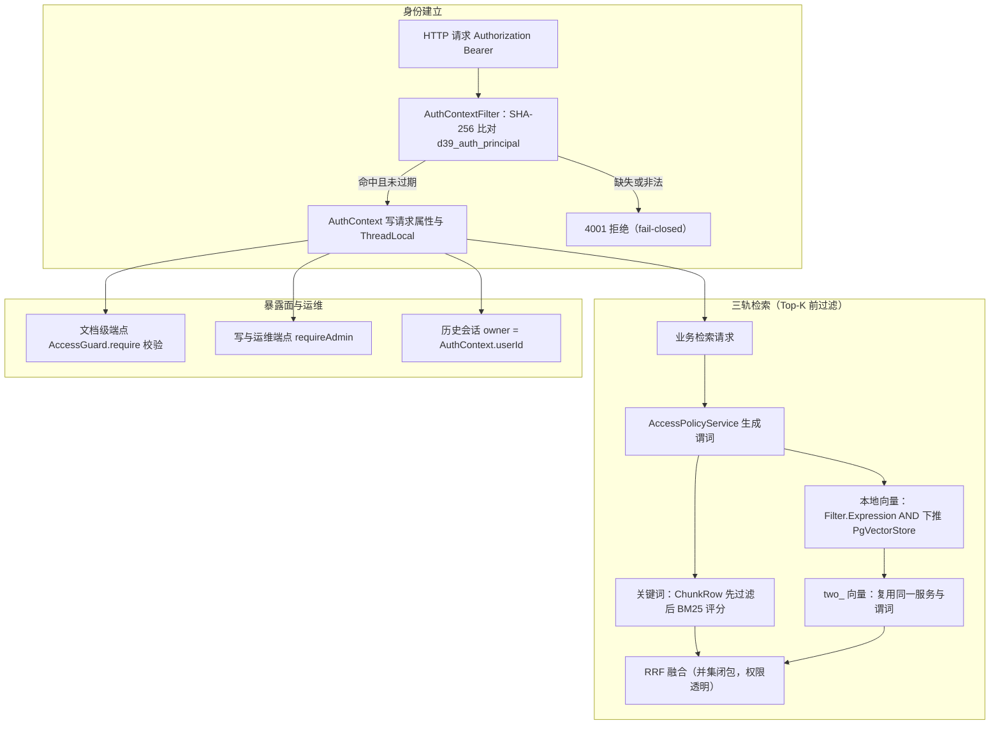

# D39-02 知识权限与元数据过滤——技术文档与实践指南（R01）

配套：《D39-01 全量信息与操作》（事实/命令/踩坑）、状态文件 `docs\evidence\D39\iteration_records\D39_state_R01.md`。本文按「是什么 → 为什么 → 底层原理 → 执行流程 → 核心代码 → 常见问题 → 工程实践」展开。

## 1. 是什么

在 D39_KAAMF（JDK21 / Spring Boot 3.5.16 / Spring AI 1.1.8，三轨检索：本地 pgvector 向量、two_ 百炼向量、MySQL 关键词 + RRF 混合）上叠加一层**服务端可信知识权限体系**：

- **可信身份**：Bearer token → SHA-256 比对 `d39_auth_principal` → `AuthContext`（userId/role/tenantId/deptId/deviceScopes），请求属性 + ThreadLocal 传递；
- **文档三键元数据**：`tenantId/deptId/deviceId` 随注册 DTO 进入文档模型与向量 metadata（json 列）、关键词行、倒排结构；
- **三轨 Top-K 前过滤**：同一 `AccessPolicyService` 生成谓词，向量路下推 SQL、关键词路先过滤后评分、混合路由两轨合流自然继承；
- **fail-closed**：无权限标签数据（遗留 30 行）对任何主体（含 ADMIN）不可见；身份缺失/过期/存储不可达一律拒绝服务而非降级放行；
- **暴露面收口**：37 个 handler 映射全量分级（ADMIN_ONLY / FILTER_REQUIRED / DOCUMENT_SCOPE / OWNER_SCOPED / OUT_OF_SCOPE），写操作与运维端点 admin-only，历史会话归属改可信身份。
- 总开关 `app.access.enabled` 默认 false——关闭态与骨架逐行为零差异（回归门禁证明）。

## 2. 为什么

1. **骨架无任何权限维度**：KnowledgeDocument/vector metadata/ChunkRow 均无租户、部门、设备字段，检索是全库可见；`X-Dev-User` 头可任意伪造会话归属。
2. **权限必须在检索层而非生成层**：若靠提示词或结果后过滤，越权内容已进入 Top-K 窗口与 prompt 上下文，泄漏既成事实。OWASP Access Control Cheat Sheet 的 deny-by-default 与「在资源所有访问路径上强制授权」直接对应本设计的 fail-closed 与三轨同谓词。
3. **后过滤等于没过滤**：Top-K=5 时先取 5 再删越权项，结果集会因越权文档挤占名额而丢失合法文档（漏报）甚至空集（拒绝服务）；只有下推到 SQL/入索引扫描前的过滤才改变"候选集"本身。
4. **零差异与可回退**：学习项目仍要跑 D37 评测基线，权限层必须可整体关闭且关闭即等于骨架——因此全部改动走白名单追加式 + 单一配置门。

## 3. 底层原理

### 3.1 Filter.Expression 下推与 jsonpath Group 括号契约（本轮最大坑）

Spring AI 的过滤抽象是 `Filter.Expression` 树（`and/or/eq/in/group...`，`FilterExpressionTextParser` 解析 DSL，`FilterExpressionBuilder` 编程构造）。`PgVectorStore` 检索时把该树交给 **`PgVectorFilterExpressionConverter`** 递归渲染成 PG 侧谓词：对 `json` 列生成 `metadata ->> '$."key"' == 'value'` 形态的 jsonpath 比较，子树以 `&&`/`||` 连接。

关键契约（javap + 探针实证，spring-ai-vector-store 1.1.8）：转换器**只给 `Group` 节点加括号**。`b.and(b.eq(..), b.or(b.eq(..), b.eq(..)))` 里若 or 子树不是 Group，就被展平为 `A && B || C`——PG jsonpath 表达式里 `&&` 优先级高于 `||`，语义变成 `(A && B) || C`，设备哨兵段整体析取恒真，**跨部门/跨租户全泄漏**。正确形态必须 `b.group(b.or(...))`：

```text
修复前: $."tenantId" == "T1" && ($."deptId" == "D1" || $."deptId" == "ALL") || ($."deviceId" == "DEV-A") || $."deviceId" == "ALL"
修复后: $."tenantId" == "T1" && (($."deptId" == "D1" || $."deptId" == "ALL")) && (($."deviceId" == "DEV-A") || $."deviceId" == "ALL")
```

为什么三层测试都抓不住：内存代数求值（谓词对象层面正确）、`PrintFilterExpressionConverter` 文本面（打印器按树形打印、不带 SQL 优先级语义）、只有**目标库真实 converter 整串渲染**才暴露。结论：下推谓词的正确性只能在它被渲染的那个库里验证。

### 3.2 json 列缺失键的 NULL 语义 = 天然 fail-closed

`vector_store.metadata` 是 `json`（非 jsonb）。PG 中 `metadata ->> '$."tenantId"'` 对不存在的键返回 SQL NULL，`NULL == 'T1'` 结果为 NULL（非真），WHERE 判假 → 行不可见。因此**遗留 30 行（无三键）不需要任何"默认拒绝"代码**：eq/in 谓词天然把它们排除在所有主体的候选集外，ADMIN 也只能看到打了标签的数据。这是 KP3 用 JDBC 实测（IS NULL 计数=30、= 'T1' 计数=0）后写进冻结参数的设计依据，语义口径见 PostgreSQL JSON Functions 官方文档。

### 3.3 三轨同谓词与"先过滤后评分"

- 向量路：谓词进 `SimilaritySearchRequest` 的 filter（业务 filter AND 权限 filter），由 pgvector 在 ANN 扫描条件内生效——过滤先于 Top-K 截断与相似度排序。
- 关键词路：`KeywordSearchService` 从 `HybridIndexLoader` 加载 `ChunkRow`（含三键显式列），**逐行谓词命中后才进 BM25 评分池**，评分只发生在许可子集内。
- 混合路：两轨已各自过滤，RRF 融合无需第三套逻辑。
- 防漂移：三轨谓词都出自 `AccessPolicyService.vectorFilterOp(ctx)` / `keywordPredicate(ctx)` 同一实现，单测对 36 组合断言代数等价（USER 谓词三键全对齐、ADMIN 谓词单 EQ）。

### 3.4 RRF 闭包性质

`RrfFusionService` 分数 `score = Σ 1/(rank + k)`。闭包要求：融合结果集 ⊆ 两路输入并集，任何一轨被权限过滤后，融合层**不可能凭空引入第三文档**。新增 3 用例锁死：并集闭包、topK 截断只从并集取、向量轨空时退化为关键词轨（不绕过其过滤）。RRF 只重排可见集，权限语义对融合透明——这正是"过滤必须在评分前"优于"融合后过滤"的结构性原因。

### 3.5 fail-closed 设计

| 故障 | 行为 |
|---|---|
| 无/非法/过期 token，或存储不可达 | 过滤器直接返回 4001+原因码（AUTH_REQUIRED/AUTH_INVALID/AUTH_EXPIRED/AUTH_FORMAT_INVALID/AUTH_STORE_UNAVAILABLE），不进业务链 |
| access 开启但上下文缺失 | 检索服务抛 RetrievalException，绝不按"无过滤"放行 |
| 文档无权限标签 | NULL 语义排除（3.2），非代码分支 |
| ADMIN | 仍受 `tenantId==ctx.tenant` 硬边界（H7），杜绝"上帝视图"跨租户 |

### 3.6 two_ 手动装配注入点

`TwoPgVectorConfiguration` 用 `new` 手动构造组件（非 Bean，TwoSpaceComponents record 持有），因此 `@Autowired` 失效；`AccessPolicyService` 必须经构造参数从主配置显式传入——这是"非 Bean 组件拿协作者"的唯一正确注入点，也是 two_ 轨过滤与本地轨同源的保证（search 谓词有单测锁定）。

## 4. 执行流程



## 5. 核心代码

```java
// AccessPolicyService：谓词代数唯一来源（含 Group 括号契约，勿删 group 调用）
public Filter.Expression vectorFilterOp(AuthContext ctx) {
    if (ctx.isAdmin()) {
        return b.eq("tenantId", ctx.tenantId());          // ADMIN：租户硬边界
    }
    return b.and(
        b.eq("tenantId", ctx.tenantId()),
        b.group(b.or(b.eq("deptId", ctx.deptId()), b.eq("deptId", SENTINEL))),
        b.group(b.or(b.in("deviceId", ctx.deviceScopes()), b.eq("deviceId", SENTINEL)))
    );
}
```

```java
// SimilarityRetrievalService（本地+two_ 共享）：业务 filter 之后 AND 权限 filter
Filter.Expression effective = accessEnabled
    ? b.and(userFilter, accessPolicyService.vectorFilterOp(AuthContextHolder.require())).expression()
    : userFilter;
```

```java
// KeywordSearchService：先过滤（谓词命中）后评分
if (!accessPolicyService.keywordPredicate(ctx).test(row)) { continue; }
scorePool.add(row, bm25(row, query));
```

```java
// AuthContextFilter：任何身份异常都不进业务链
AuthContext ctx = principalRepository.findByTokenHash(AuthTokenHasher.sha256(rawToken))
        .filter(p -> !p.isExpired())
        .map(AuthPrincipal::toContext)
        .orElseThrow(() -> new RetrievalException(4001, denyCode)); // fail-closed
```

## 6. 常见问题

- **问：哨兵为什么用 `ALL` 不用 `*`？** 元数据值通道白名单字符集 `[A-Za-z0-9._:-]+` 不含 `*`，用 `*` 需开新校验分支（扩大攻击面）；`ALL` 零改动复用既有通道（KP3 裁决）。
- **问：给遗留 30 行 UPDATE 补上 tenantId 让它们可见？** 禁。补标签 = 替历史数据虚构归属，是比泄漏更严重的数据完整性破坏；权限体系对无标签数据的正确语义就是拒绝。
- **问：单测全绿为何线上仍泄漏？** 见 3.1——对象树语义对、SQL 优先级错。下推类断言必须 `PgVectorFilterExpressionConverter` 整串 `assertEquals` 冻结，形态漂移即失败。
- **问：矩阵里怎么区分"被过滤"与"检索坏了"？** 每个越权用例都带正向对照（自身词面 co-occurrence 查询仍命中），越权命中数恒 0 且正向命中 > 0 才 PASS。
- **问：access=false 时 `X-Dev-User` 还生效吗？** 生效——回退骨架行为，这是零差异契约的一部分；文档明确该头仅本地调试语义，生产必须 access=true。
- **问：two_ 环境关着，过滤还测得到吗？** 谓词组合在 `SimilarityRetrievalService` 类级共享，two_ 端点有单测锁同源；端到端矩阵只测启用的本地轨（如实标注，见 measurability-boundary.md）。

## 7. 工程实践

1. **安全迭代用"决定性夹具"验证机制而非语义**：d2p771 与合法文档词面完全一致（无过滤必 Top1），threshold=0/topK=50——命中它 0 次不可能是"分数太低"，只能是被过滤。
2. **回归门禁 = 冻结基线逐行列对照**，不是"看起来没坏"：D37 60 行 × 12 质量列 diff=0 + 骨架 worktree 三轮对照 0 diff 双口径，才允许宣布零回归。
3. **默认关闭 + 白名单追加式**：新体系整体可禁用、逐文件 diff 可审，是学习项目叠加安全层不破坏既有资产的核心手法。
4. **凭据卫生三条硬线**：DB 只存哈希；明文只在 gitignore 的夹具文件（add -f 时逐文件排除）；提交前 `git grep` 扫描 token 片段/`sk-`/`Bearer` 长串。
5. **断言先做格式实扫**：session_id 32 位无连字符 hex 教训——写校验正则前先 SELECT 样本。
6. **端到端链路是 schema/框架 bug 的唯一照妖镜**：三层 schema 漂移与 chunker 1-based 都是单元层全绿、HTTP 链才炸；"Mock 不替代真实闭环"是本项目一贯验收纪律。
7. **熔断纪律有效**：泄漏即停、全矩阵重跑（15 FAIL→修根因→33/33），不允许带病推进或用例改宽迁就缺陷。

## 8. 官方文档溯源

- 《Spring AI Reference — Vector Databases / Metadata Filtering | Spring AI 参考文档：向量数据库与元数据过滤》：https://docs.spring.io/spring-ai/reference/api/vectordbs.html
- 《PostgreSQL Documentation — JSON Functions and Operators | PostgreSQL 官方文档：JSON 函数与操作符》：https://www.postgresql.org/docs/current/functions-json.html
- 《OWASP Access Control Cheat Sheet | OWASP 访问控制速查表》：https://cheatsheetseries.owasp.org/cheatsheets/Access_Control_Cheat_Sheet.html
- 《OWASP Application Security Verification Standard (ASVS) V4 | OWASP 应用安全验证标准 V4 访问控制》：https://owasp.org/www-project-application-security-verification-standard/
- 《pgvector — Open-source vector similarity search for Postgres | pgvector：PostgreSQL 开源向量相似度检索》：https://github.com/pgvector/pgvector
