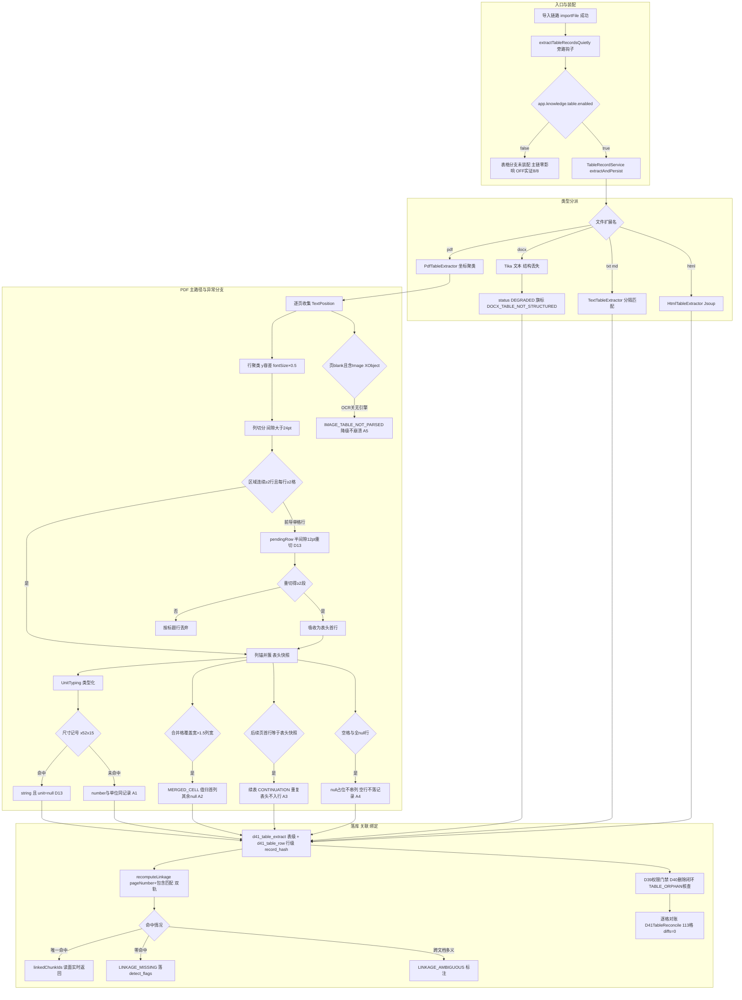

# D41-02 设备手册表格与结构化信息——技术文档与实践指南（R01）

> 模块：`D41\D41_TASIIEM`（com.zl.d41，two 线，端口 9090）；配套全量事实见 D41-01。
> 展开顺序遵循"是什么 → 为什么 → 底层原理 → 执行流程 → 核心代码 → 常见问题 → 工程实践"。

## 1. 是什么

在设备手册（PDF/txt/html/docx）导入链路旁，新增**独立表格抽取分支** `com.zl.d41.knowledge.table`：把手册中的故障码表、参数表等结构化表格抽取为 `d41_table_extract`（表级：页码/表头快照/置信度/异常旗标/退化状态）+ `d41_table_row`（行级：cells_json 类型化单元格 + record_hash），与既有 Chunk **双轨关联**（pageNumber + 规范化包含匹配），提供 4 个分级端点（3 读 1 写），并绑定 D39 权限、D40 删除闭环/版本清理/TABLE_ORPHAN 一致性核查。它是 RAG 证据链的一部分：**表格不进向量轨也不丢**，检索命中的是页文本 Chunk，表格记录经关联字段供精确回查。

**不是什么**：不是通用表格识别引擎（无 OCR、无版式还原框架）；不改变页文本/Chunk/向量任何既有语义（D1）；不生成正式工单（设备域仅候选 DTO 路径，结构上不注入工单端口）。

## 2. 为什么

1. **设备手册的真相密度在表格里**：故障码→处置、型号→参数（含单位）。纯文本抽取会把 `E-101 Overpressure … Check valve` 的列语义压扁成流水句，单位 `1500 rpm` 与数值拆散即失去可执行性。
2. **PDFBox 无原生表格检测**（官方 Text Extraction 文档明示），接线 Tabula/camelot 等新框架会触发熔断条件 H3——必须用既有 pdfbox 3.0.7 的 `TextPosition` 坐标自研轻量聚类。
3. **不破坏主链是硬约束**：页文本 Chunk 是 D37 冻结基线的组成部分，表格若改写提取顺序/清洗规则，回归 diff=0 门禁必炸。故选择**旁路钩子**（ObjectProvider 可选注入，零签名改动）+ 独立表存储 + 读面实时关联。
4. **静默错配比缺失更危险**：列错位、合并单元格、图片表格若不显式标注（LOW_CONFIDENCE/MERGED_CELL/IMAGE_TABLE_NOT_PARSED），下游会把 `x52x15` 当数值、把 D 列值当 C 列值——RAG 场景即幻觉源头。五类异常矩阵（A1–A5）+ 逐格对账（113 格 diffs=0）是对这一工程伦理的机器可验证闭环。

## 3. 底层原理

### 3.1 PDFBox TextPosition 坐标聚类（PdfTableExtractor）

PDFBox `PDFTextStripper` 按内容流顺序回调 `processTextPosition(TextPosition)`，每个 TextPosition 带 `getXDirAdj/getYDirAdj/getWidthDirAdj/getFontSize`。自研子类收集后：

- **行聚类**：yDirAdj 差 < fontSize×0.5 归同行（基线漂移容差随字号缩放，比固定 pt 阈值稳）。
- **列切分**：行内 xDirAdj 升序，邻间隙 > `COL_GAP_PT(24)` 断 cell。
- **区域判定**：连续 ≥2 行且每行 ≥2 cell 才成表；**pendingRow 机制（D13）**：区域前的单 cell 行以半间隙 12pt 重切，≥2 段则吸收为表头首行——修复宽字距表头（`Col_A…Col_D` 字间隙 17–22pt ≤24 切不开→整行 1 cell→被区域条件丢弃→**整表上移一格**）。连续中文标题半间隙仍 1 段，不误吸（回归锁：params/faultcode 中文标题用例）。
- **列锚**：多数行一致的 cell 起点 x 并簇为列。
- **表头快照**：区域首行 normalize 后存 `header_snapshot_json`，fontSize 中位数 ≥ 数据行×1.1 是强表头信号。

### 3.2 默认提取顺序下的双轨包含匹配（D2/D5）

不用 `setSortByPosition(true)` 重排（会与 `knowledge_document_content` 既有默认顺序文本口径分叉）。关联判定 = **pageNumber ∈ vector_chunk_index.page_numbers** AND **normalize(行文本) ⊆ normalize(chunk.content)**；normalize = NFC + U+3000→空格 + `\s+`→单空格 + trim，与页文本**同口径双向包含**。零命中→`LINKAGE_MISSING`（落 detect_flags，因预建表无 linked_chunk_ids_json 列）；跨文档多义→`LINKAGE_AMBIGUOUS`（文档级检索面正常）。读面 `recomputeLinkage` 实时计算 linkedChunkIds——存储降级不降级语义。

### 3.3 类型化单元格与单位同记录（UnitTyping，D10/D13）

`NUMBER_UNIT` 正则捕获数值段+单位段；**仅数值段全匹配才 type=number**；范围表达式（`2..8`）、复合串保持 string。D13 增加否决正则 `DIMENSION_SUFFIX = ^[xX×].*\d`：单位段以 x/× 开头且后续还有数字（`25x52x15`）判 **string/unit=null**，杜绝"number=25, unit=x52x15"的荒谬拆散。回归面：`1500 rpm`→number/rpm、`380V`→number/V、`DN25`→string 不变。空格 `v=null,t="null"` 占位不串列；全 null 行不落记录。

### 3.4 表头快照跨页续表（A3）

后续页首行 normalize 命中前表 header_snapshot → 判续表：重复表头**不入数据行**，续表独立 table_index + `continuation_of_table_id` 指前表（预建表既有列复用），数据行逐页归属 page_number。

### 3.5 能力边界与退化（D3/D4，诚实标注是判据不是失败）

- DOCX：Tika 文本输出丢 `<w:tbl>` 结构 → 表域 `status=DEGRADED + DOCX_TABLE_NOT_STRUCTURED`，**不猜结构**（KP2 实证）。
- 图片表格：页文本 blank 且含 Image XObject，OCR 关（无引擎）→ `IMAGE_TABLE_NOT_PARSED` 主路径不崩溃；全 blank 扫描件维持既有 4221 语义不回退。
- HTML：Jsoup 1.22.2 `<table>` 遍历 `tr×(th|td)`，可选分支（KP1 裁决启用，零新依赖）。

### 3.6 D39 权限 / D40-R03 同步绑定（D6/D7）

读面复用 `requireDocumentVisible` 三键（tenant/dept/document）口径，越权→4001+msg（AUTH_FORBIDDEN 语义在 GlobalExceptionHandler 归一后 reason 码不外泄，**断言按 msg 文本**）。写面 requireAdmin + `d41_admin_audit(action=TABLE_EXTRACT)`；幂等=同 (documentId,version) 重抽覆盖不翻倍（S5：cntA=cntB=1，审计 2 行 ALLOWED）。删除闭环/版本清理钩子级联清 `d41_table_extract/row`（S8 残留 0 + sync SYNCED）；一致性核查新增第 7 类漂移 **TABLE_ORPHAN**（S7 可检出；跨 one/two 线预建表 join 必须两侧显式 `COLLATE utf8mb4_general_ci`，否则 1267）。

## 4. 执行流程（Mermaid，Typora 0.11.18 兼容）



## 5. 核心代码（真实签名，节选自 com.zl.d41.knowledge.table）

```java
// PdfTableExtractor.java L36/L154-168（节选）：坐标聚类与 pendingRow 表头前置吸收（D13）
public final class PdfTableExtractor {
    private List<ExtractedTable> extractPageTables(int pageNumber, List<List<Pos>> rows) {
        List<List<CellRun>> region = new ArrayList<>();
        List<Pos> pendingRow = null;                       // 区域起始前的单 cell 行暂存
        ...
        List<CellRun> cells = row.isEmpty() ? List.of() : splitCells(row, COL_GAP_PT); // 24pt
        if (pendingRow != null) {
            List<CellRun> retry = splitCells(pendingRow, COL_GAP_PT / 2);              // 半间隙 12pt 重切
            // ≥2 段 → 吸收为首行表头；仍 1 段 → 视为标题行（中文标题回归安全）
        }
    }
}

// UnitTyping.java L22-31（节选）：类型化与尺寸记号否决（D13）
private static final Pattern NUMBER_UNIT = Pattern.compile( /* ^(num)(\s*(unit))?$ 冻结口径 */ );
private static final Pattern DIMENSION_SUFFIX = Pattern.compile("^[xX×].*\\d"); // "25x52x15"→string
public static TableCell typeOf(String header, String raw) { /* 数值+单位同记录，缺失单位显式 null */ }

// TableTexts.java L14-23：normalize（NFC + U+3000→空格 + 空白折叠 + trim）与 cleanCell，双轨同口径
public static String normalize(String value) { ... Normalizer.normalize(value, Normalizer.Form.NFC) ... }

// TableRecordService.java：L77 extractAndPersist（幂等落库+旗标+degradeStatus）、
// L158 recomputeLinkage（零命中→LINKAGE_MISSING 增删 flags）、L243 reExtract（读 content 原始字节全型重抽）
public TableExtractSummary extractAndPersist(String documentId, String version, String extension, ...)
public int[] recomputeLinkage(String documentId, String version)
public TableExtractSummary reExtract(String documentId, String version, String fileName)
```

要点解释：
- **为什么钩子用 ObjectProvider 且方法名带 Quietly**：表格分支是旁路能力，enabled=false 或未打包时 importFile 签名与行为零变化——回归门禁（D37 diff=0）的前提是主链**结构性不受影响**，异常在钩子内吞掉并记日志，绝不让导入因表格失败。
- **为什么 reExtract 读原始字节**：`knowledge_document_content.content` 是 byte[] 列，重抽取必须从源文件形态（PDF 结构）而不是已丢失结构的文本反推——坐标真值只在字节层存在。
- **为什么 linkedChunkIds 读面实时算**：one 线预建表无该列且禁 ALTER；持久化只保 LINKAGE_MISSING 旗标，命中集每次按 page_numbers+包含匹配现算（数据量 KB 级，毫秒可承受），换取跨线表结构零侵入。

## 6. 常见问题（FAQ）

**Q1 OFF 态端点为什么返回 code=5000 而不是 404？**
控制器类级 `@ConditionalOnProperty(matchIfMissing=true)` 未装配 → Spring MVC 抛 `NoResourceFoundException`，被 GlobalExceptionHandler 归一为 `UNKNOWN(5000)`。**语义=路由未挂载**，实证看应用日志 `No static resource api/.../tables`；断言按 `code≠200 + 日志` 双条件，不要匹配 404。

**Q2 权限拒绝为什么不返回 AUTH_FORBIDDEN reason 码？**
RetrievalException 经 handler 只透出 `code=4001 + msg`，reason 码不外泄（既有安全口径）。测试断言必须按 msg 文本（"无权访问该文档"/"仅限管理员"），这是 S6 首轮 FAIL 的根因。

**Q3 为什么清理夹具不能按 source 前缀 LIKE？**
`knowledge_document.source` 实测**落库为空串**（register 响应 echo 的 source≠持久化值）。按 `source LIKE 'd41t-%'` 清理是**假成功**（打不中任何行）。唯一权威=注册时留存 `docmap.json` 的 UUID 清单；PG 侧按 `metadata->>'documentId' IN(...)`。兜底清理必须放 finally，且 finally 内失败要显式报错（首轮 OFF 脚本因路径 bug 静默失败 → 残留行占 content_hash → 下轮 import 4092 连锁 4091）。

**Q4 设 TWO_EMBEDDING_ENABLED=false 应用起不来？**
`TwoPgVectorConfiguration` 无条件装配 `twoSpaceComponents → EmbeddingProperties.requireValid:72` 抛"Embedding 配置未启用"。任务书原意是零远程，正确做法（D11）=**不设该 env**：默认 true + 不注入 DASHSCOPE_API_KEY + 全程仅 LOCAL 主轨访问，`two_vector_store=8` 指纹恒等即零远程证据。

**Q5 表格里 `25x52x15` 被抽成 number 怎么办？**
D13 已修：DIMENSION_SUFFIX 否决规则使尺寸记号判 string/unit=null，回归锁用例 `dimensionNotationStaysString`。类似地范围表达式 `2..8` 本来就判 string——**type=number 的充要条件是数值段全匹配且单位段合规**。

**Q6 中文标题会被 pendingRow 误吸收成表头吗？**
不会。中文字符间无 >12pt 间隙，半间隙重切仍为 1 段 → 按标题行丢弃；`Col_A Col_B` 类拉丁宽排表头才会切出 ≥2 段。回归锁用例 `wideHeaderRowRecoveredViaHalfGapRetry` + params/faultcode 中文标题对账。

**Q7 TABLE_ORPHAN 查询报 1267 Illegal mix of collations？**
共享 ai_db 里 one 线预建表是 `utf8mb4_0900_ai_ci`，two 线 `knowledge_document` 是 `utf8mb4_general_ci`。修复：`TableRecordRepository.findOrphanRecords` join 两侧显式 `COLLATE utf8mb4_general_ci`。

**Q8 逐格对账 113 格与真值 104 格口径对不上？**
113 = 104 网格真值格 + 9 项 T7-a5p2 图片降级区表级校验（工具把降级断言也计入 compared）。见 extract\reconciliation-log.json composition 字段。

## 7. 工程实践

1. **旁路钩子 + 双态回归**：新增可选能力必须同时验证"ON 无损"与"OFF 未装配"，且 OFF 验证要做**应用级**（本例 8 项断言），不是只看开关配置。
2. **他线资产纪律**：共享库预建表禁 ALTER/DROP——契约适配（version String↔int 物理列、缺失列降级）+ 幂等 `CREATE TABLE IF NOT EXISTS` 完全匹配现有结构；跨线 collation 差异在 SQL 层显式 COLLATE。
3. **对账先行，禁反推真值**：真值 JSON 在受控构造夹具时同步生成；"抽取结果回写当真值"是绝对禁区。熔断 4.4-5（diffs 静默放行）把"检出→根因（同包反射探针）→最小修复→全链复跑"固化为标准动作（D13 全流程实证）。
4. **探针调试法**：包私有内部类（Pos/CellRun）无法单测直取——写**同包声明的源文件探针**（`ProbeD41Diff.java`）编译进 classpath 直接观察中间态，是定位坐标算法问题最短路径。
5. **脚本工程化**：pwsh 脚本路径绝对化、`JSON_ARRAY()` 规避 native 转义、hashtable 遍历显式收集键、finally 兜底清理且失败必须可见；每轮演练留 console + verdict + 指纹三件套。
6. **诚实退化**：能力边界（docx/OCR/嵌套表）显式标注 + D42 候选清单，比假装支持更有工程价值；文档中所有 PASS 均可回溯到证据 JSON。

## 8. 官方文档溯源

《Apache PDFBox 3.0.7 Javadoc — PDFTextStripper / TextPosition | PDFBox 文本提取与坐标 API》：https://pdfbox.apache.org/docs/3.0.7/javadocs/org/apache/pdfbox/text/PDFTextStripper.html
《Apache PDFBox — Text Extraction | PDFBox 文本提取》（默认顺序 vs sortByPosition、无原生表格检测依据）：https://pdfbox.apache.org/3.0/textextract.html
《Apache Tika — Documentation | Tika 文档解析》（文本输出不保留表格结构依据；执行期 dependency:tree 实证 tika 3.3.1 / pdfbox 3.0.7 / jsoup 1.22.2）：https://tika.apache.org/3.2.3/
《Spring AI Reference — ETL Pipeline | Spring AI 文档读取器》：https://docs.spring.io/spring-ai/reference/api/etl-pipeline.html
《jsoup Java HTML Parser — Selector Syntax | jsoup 选择器语法》：https://jsoup.org/cookbook/extracting-data/selector-syntax
《MySQL 8.0 Reference Manual — JSON Functions | MySQL JSON 函数》：https://dev.mysql.com/doc/refman/8.0/en/json-functions.html
《MySQL 8.0 Reference Manual — Unicode Character Sets / Collations | 排序规则混用（1267）依据》：https://dev.mysql.com/doc/refman/8.0/en/charset-unicode-sets.html
本地权威：D37 冻结基线与评测器（docs\evidence\D37\，IN_MEMORY_LOCAL\20261120-195125，SHA CD875F83611F…）、D40-R03 状态文件、D39 权限冻结（docs\evidence\D39\）、任务书 §8 溯源表。
