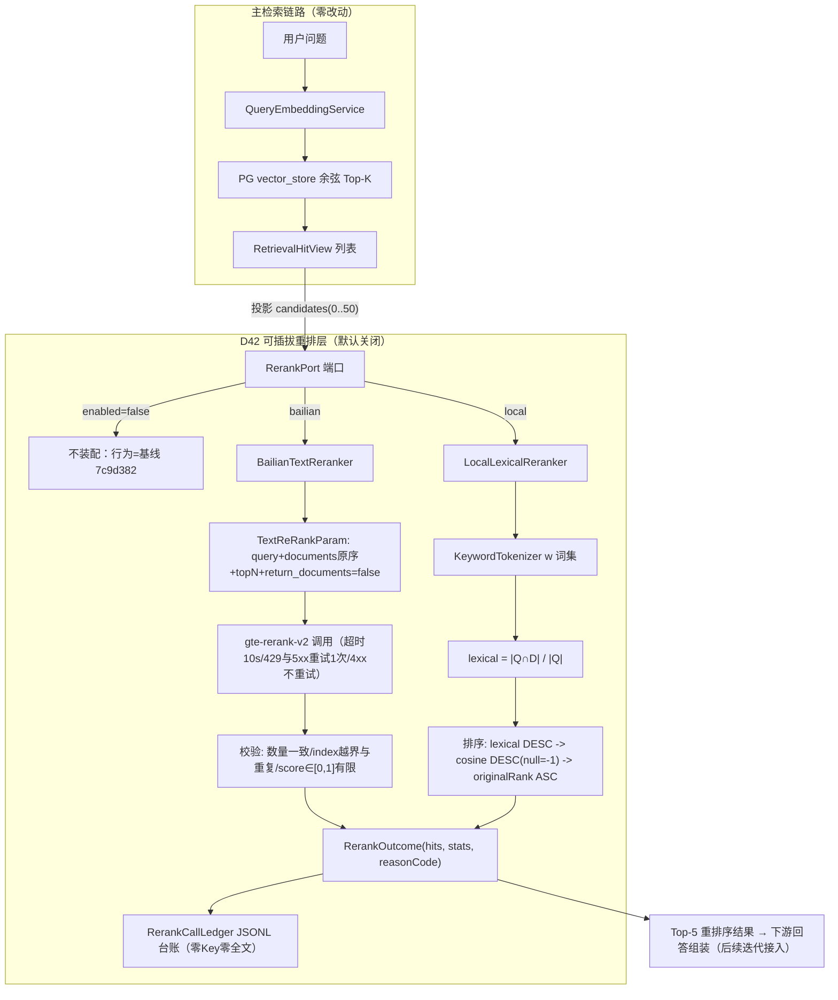
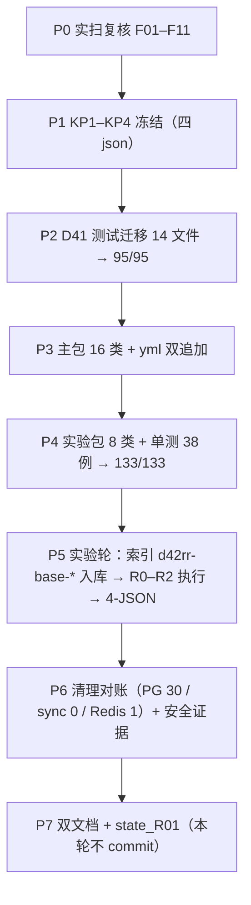

# D42-01 ｜ Rerank 可插拔重排层：设计、原理与操作指南

> 迭代：D42_RERANK（two 线，端口 9090，基线提交 7c9d382，本轮**未 commit**——任务书 §十纪律）
> 人设口径：12 年 Java 架构师 + 6 年 AI 工程落地。所有结论以本地实盘代码与实测证据为准。

---

## 1. 是什么（What）

D42 在 RAG 检索链路上新增一个**可插拔、默认关闭、失败显式化**的重排层（Rerank Layer，重排序层）：

- **新包 `com.zl.d42.rerank`（16 类）**：端口契约（RerankPort/RerankRequest/RerankCandidate/RerankOutcome/RerankedHit/RerankStageStats/RerankReasonCode）+ 本地确定性实现（LocalLexicalReranker）+ 百炼远程适配器（BailianTextReranker）+ JSONL 台账（RerankCallLedger/RerankLedgerEntry）+ 装配（RerankProperties/RerankConfiguration）+ 只读验证端点（RerankController + 双 DTO）。
- **实验子包 `com.zl.d42.rerank.experiment`（8 类）**：R0–R3 冻结矩阵、真实 PG 运行器、MRR@K 指标器、G-A/G-B/G-C/G-E 门禁判定器、4-JSON 落盘器。
- **主链路零改动**：既有 Controller/Service/检索/hybrid 类一行未动；`app.rerank.enabled` 默认 false 时容器零新 Bean（H2）。

## 2. 为什么（Why）

向量 Top-K 相似度排序（单塔 ANN）对"数值/型号/条款"类查询存在语义盲区，业界通行做法是在检索与回答之间插入**重排层（Reranker，Cross-Encoder 类精排）**。但远程重排有延迟、计费、故障面三重成本，**必须先量化价值再决定采用**——所以本轮交付的是"评估框架 + 决策"，而不是"默认启用重排"。

## 3. 底层原理（How it works）



三个关键机制：

1. **端口-适配器（Ports & Adapters）**：实验与调用方只依赖 `RerankPort` 接口；本地/远程是可替换 Bean，`@ConditionalOnProperty` 双层开关（总开关 + remote 开关）保证装配矩阵可证。
2. **确定性排序（Determinism）**：本地实现的三级比较键全为值类型且末位为唯一名次（originalRank），数学上是**全序**——重复执行结果 bit 级一致，这是门禁 G-E（repeat Top5 零分歧）的结构前提，不靠运气。
3. **失败显式化（fail-closed, H8）**：远程所有异常路径（超时/4xx/429 耗尽/数量不符/越界 ID/非法 score/无 Key/台账写失败）收敛为 `RerankOutcome.reasonCode`，绝不返回"空结果伪装成功"；台账每次调用（含失败）必落一行。

## 4. 执行流程（实验轮）



实验触发命令（真实执行过）：

```powershell
$env:D42_EXP_RUN='true'; $env:MYSQL_PASSWORD='****'
mvn -o -B -f D42\D42_RERANK\pom.xml test "-Dsurefire.spring.profile=experiment" "-Dtest=RerankValueExperimentIT" "-Dsurefire.failIfNoSpecifiedTests=false"
```

## 5. 核心代码为什么这样写

| 决策 | 代码事实 | 原理 |
|---|---|---|
| KeywordTokenizer 单例 static final | `LocalLexicalReranker.W` | 该类无状态（normalize 静态、tokenCounts 纯函数），线程安全可共享，避免每题重建分词器的初始化开销 |
| lexical 分母=|Q| 而非 |D| | `overlap / qTokens.size()` | 查询词覆盖率度量"文档回答了问题多少"，与问题侧不可缺词对齐；用 |D| 会奖励长文档 |
| topN>候选数抛异常 | `RerankRequest` compact ctor | 契约显式化（任务书 §6.1）；Runner 侧 `effTopN=min()` 适配真实命中不足——实验首轮正是被该契约挡出（topN=5 vs 候选 3），证明校验有效 |
| 重试成功清 failCode | `BailianTextReranker` 循环内 `failCode = null` | 真实缺陷由单测 rateLimitRetrySuccess 抓出：成功重试后残留上轮失败码会污染台账与决策——失败码生命周期必须与调用终态一致 |
| 超时用独立线程池 future.get | `callOnce()` | dashscope SDK 的同步 call 无调用级超时参数；future 预算是唯一不侵入 SDK 的强制手段，超时后 `cancel(true)` 释放 |
| index DESC→ASC 稳定排序 | `parse()` | 服务端对同分文档不保证次序；本地按候选原序 tie-break 才满足 G-E 可重复性 |
| 台账 synchronized + append | `RerankCallLedger.write` | JSONL 并发追加防行撕裂；写失败返回 false 由适配器升级为 LEDGER_WRITE_FAILED，不静默（H8） |

## 6. 常见问题（Pitfalls）

1. **UTF-8 BOM**：向 javac 输入带 BOM 的 .java 报"需要 class"——所有生成一律 `New-Object System.Text.UTF8Encoding($false)`（D42 迁移轮实测踩坑，已固化为纪律）。
2. **PowerShell 函数作用域**：顶层 `$script:` 变量在 -Command 块内为 null，编码对象必须**在函数体内构造**或作参数传递。
3. **Mockito 嵌套 stubbing**：`when(x.f()).thenReturn(buildMockInLine())` 会在未闭合 stubbing 内二次 stub → UnfinishedStubbingException；先构造 stub 产物再 when。
4. **`TextReRankResult` 构造器 private**：SDK 结果类由 Gson 私有构造，测试必须 `mock()` 而非 new。
5. **实验副作用入审计表**：`indexService.indexChunks` 在完整 Spring 上下文里会对原文档产生 `d42_document_sync` DELETE/SYNCED 行——实验清理必须包含 MySQL 侧对账（本轮 +3 行，已清零留痕）。
6. **门禁判定别用 Skipped**：IT 用 Assumptions 门控，实验轮外 `Tests run: 0` 是"未执行"不是"通过"；回归门禁只看 `-Dtest` 显式指定轮。

## 7. 工程实践与后续

- **本轮实测结论（决策）**：R0/R1/R2 三组 MRR@5=0.7167、HitRate@5=1.0 完全一致，ΔMRR=0 → 本地词面重排 **NOT_ADOPTED**（G-A 不达标；基线 hitRate 已饱和，无头部改进空间）；R3 **BLOCKED**（mock 无授权轮）。详见 `docs/evidence/D42/extract/rerank-decision.json`。
- **保留价值**：端口/台账/门禁框架是后续远程轮（独立授权后 + D4 费用已实测解除）与 hybrid 融合评估的既成基座；`NOT_ADOPTED` 只否定了"默认启用"，不否定"能力在位"。
- **hitRate=1.0 天花板提示**：若未来在 R0 未饱和集（如 D38 大语料/长文档集）复测，重排价值判断需要重跑矩阵，勿外推本轮结论。

## 8. 官方溯源

- 《Alibaba Cloud Model Studio Rerank API Reference | 阿里云百炼文本重排 API》：https://help.aliyun.com/zh/model-studio/text-rerank-api
- 《Alibaba Cloud Model Studio Models Pricing | 模型调用计费》：gte-rerank-v2 **0.8 元/百万 tokens**（KP1 双源核实，费用 BLOCKED 解除）
- 《DashScope Java SDK | com.alibaba.dashscope.rerank.TextReRank》：本地 jar dashscope-sdk-java 2.23.6 javap 实签（§6.4 参数映射依据）
- 《Spring Boot Reference | Conditional Annotations》：https://docs.spring.io/spring-boot/reference/features/spi.html （@ConditionalOnProperty 装配矩阵依据）
- 《SIGIR | Re-ranking with Cross-Encoders（MRR/HitRate 指标通行定义）》：指标实现见 RerankMetricsCalculator 与 fixture-truth.json 手算夹具