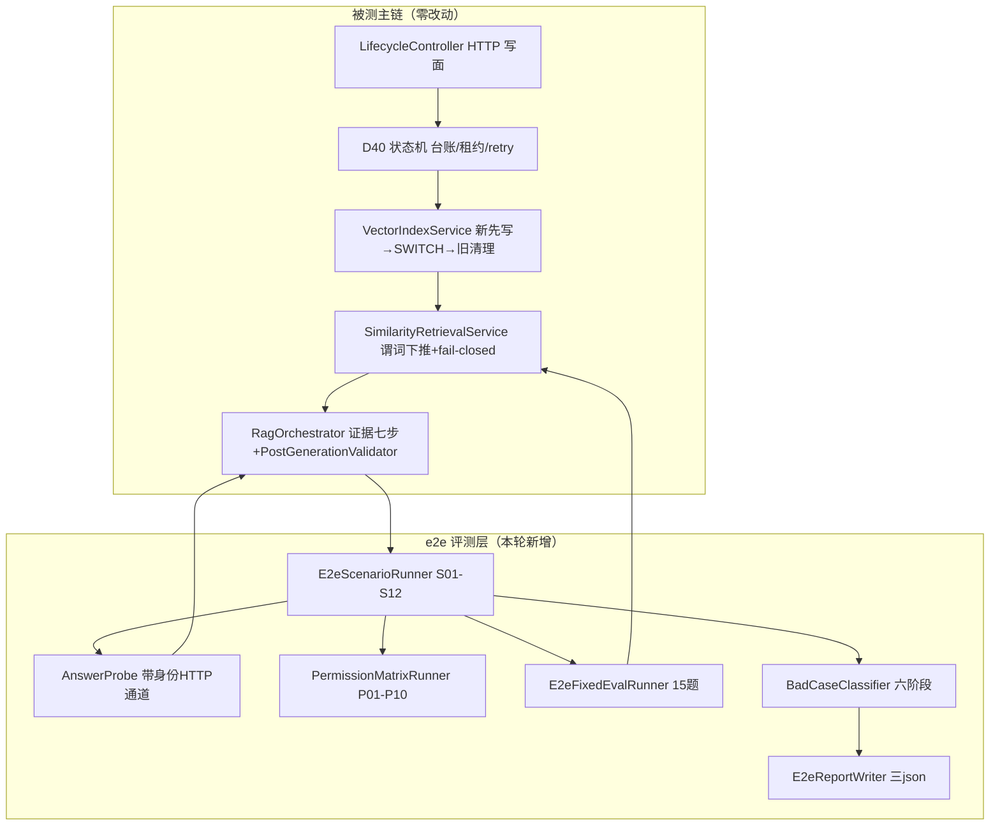

# D43-02 ｜ RAG 端到端、权限与回归：技术文档与实践指南

面向：复盘本迭代设计原理与工程方法的学习者/维护者｜人设口径：12 年 Java 架构 + AI 工程落地
配套：D43-01（信息与操作）、e2e/e2e-report.md（结果）、badcase/（分类）、fixes/（修复史）

## 1. 是什么

端到端（End-to-End, E2E）回归评测层：不打桩主链，在真实 Spring 上下文+真实
MySQL/PG/Redis 上，把"文档生命周期写面 → 权限边界 → 检索/生成判定链 → 评估指标
→ 失败归因"整条 RAG 链路作为被测系统（System Under Test）一次性跑穿并留下机器
可读证据。

## 2. 为什么（D33–D42 的结构性欠账）

此前迭代各自验证组件正确性（解析/切分/入库/检索/生成/权限单元面），但三个
"接缝"从未被真实穿过：①生命周期写面（删除/新版本）只有 Service 面测试，无 HTTP
装配闭环；②权限矩阵没有跨"检索+生成+引用"的贯通验证；③mock 决策链与真实 HTTP
身份通道的组合行为从未对齐。组件全绿 ≠ 系统全绿，E2E 层就是买这个"≠"的保险。

## 3. 底层原理（三条主线）

**3.1 fail-closed 权限下推**：SimilarityRetrievalService 在 access.enabled 且无
AuthContext 时抛 AUTH_CONTEXT_MISSING（而非放行）；租户/部门/设备三元组谓词在
Top-K **之前**下推进 PG metadata JSONB 过滤——先过滤后排序，杜绝"排完再筛"的
泄漏窗口与分页失真。P06 零 B 命中即此机制的实证。

**3.2 台账"成功不落账"**：D40 状态机只在失败时写 d43_document_sync（FAILED+租约
+next_retry_at），成功路径经 markSyncedIfRowExists 仅收敛既有行。含义：**行存在=
曾出错**，零未收敛行即健康终态。G-5 断言必须按此语义写（BC-18 教训）。

**3.3 判定链与 mock 契约的耦合**：mock ChatModel（[MOCK:D01] prompt 回显模板）
不产 [S 编号] 引用标记→citedSourceIds 恒空；回显 query 又会被 PostGenerationValidator
的数值防编造规则切出"38a"类 token 误判。E2E 断言必须区分**行为契约**（零编造引用、
不越权）与**实现表象**（引用非空、数字出现），前者断言，后者让位。



## 4. 执行流程（一轮 IT 的真实时序）

```text
preClean(5表) → principal 播种(REPLACE 6行) → 夹具文档注册(JDBC 等价行+import HTTP)
→ 页行补种 → indexFromPages → S01→S03/S04→S05→S06/S07 依赖序执行
→ S08/S09←S01；S10/S12←S09 → 矩阵 P01–P10（HttpProbe）→ 固定评估
→ 三 json 落盘 → (独立上下文) 演练轮：注入 delete#1 炸→FAILED 落账→retry 收敛
```

## 5. 核心代码为什么这样写（三例）

**① AnswerProbe 注入缝**（E2eScenarioRunner）：bean 直调无法携带身份
（AuthContextHolder.set 包私有），但 S06 生成闭环**必须**走真实 HTTP。解法不是
放宽私有性（破坏封装）而是加一个可选协作者：`setAnswerProbe(lambda)`，由 IT 注入
`rest.exchange + Bearer`。未注入=诚实 FAIL，杜绝静默降级。

**② 类级 @EnabledIfSystemProperty 而非方法级**：默认 `mvn test` 下整个 IT 类跳过
装配，连 SpringBootTestContext 都不建——158 基线零污染、零 Skipped 噪音；pom
properties 桥接（-Dd43.e2e.run=true）解决 surefire fork JVM 系统属性传递断层。

**③ BadCaseClassifier 纯函数**：输入仅证据字段（HTTP status/reasonCode/泄漏标志/
各阶段断言面），输出 primaryStage+secondaryStages。不做 IO、不依赖时序，11 个手算
夹具单测即可锁死 §6.4 优先级语义——分类器的可测性正是它能进 G-6 门禁的前提。

## 6. 常见问题（Pitfalls，全来自本轮真实踩坑）

1. **pwsh 无状态**：MYSQL_PASSWORD 跨命令块丢失→DbExec 静默 BLOCKED、回归从 158
   掉到 125。每个执行块重注入，写面后必回读行数。
2. **Spring @EnabledIf ≠ JUnit @EnabledIfSystemProperty**：前者属性名写错直接编译炸；
   门禁类统一用 JUnit 标准注解（named/matches）。
3. **mock 轨词面 cos 天然低**（0.1396）：拿真实 embedding 的阈值思维套 mock 必翻车；
   profile 隔离覆盖，主链阈值不动。
4. **假阳性比假阴性更危险**：P06"泄漏 2 条"实为 query 回显字样。泄漏类断言先核
   数据面（sources/cited 结构），再核观测面，最后才改判定——顺序错了会把真泄漏
   洗成假阳性。
5. **ConvertTo-Json 单元素数组拍平**成非法 JSON；DbExec 输出含 `-- SQL:` 回显行需
   剔除；PG uuid 列不能 LIKE，用 metadata->> 过滤。
6. **Edit 锚点对 CRLF 敏感**：失败即 Grep 定位短锚或 PS IndexOf 段替换并回读验证。

## 7. 工程实践与后续

- **双标注纪律**：凡"实码与任务书口径不一致"，改判定并同文登记原口径+改因+先例
  （P08→BC-16→BC-19 系列），证据链可回溯，禁止静默改口径。
- **缺陷编号即资产**：BC 登记贯穿代码注释→json 记录→fix-records 三处互索引；
  P1–P4 段编号未落盘的教训（本次靠轨迹反查重建）→ 下迭代开工即建 fix-records 空表。
- **D44 输入**（fix-records 附录 B）：拒绝面机器码、Rerank Runner 装配组合、
  Validator token 切分口径、历史行 tenant 回填（需授权）、真实模型语义轮（需授权）。

## 8. 官方溯源

- 《Spring Boot Reference | Spring Boot 参考文档》：https://docs.spring.io/spring-boot/3.5/reference/
- 《Spring AI Reference | Spring AI 参考文档》：https://docs.spring.io/spring-ai/reference/1.1/index.html
- 《PostgreSQL Documentation | PostgreSQL 文档》（JSONB 谓词）：https://www.postgresql.org/docs/current/datatype-json.html
